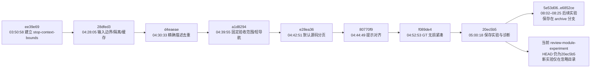
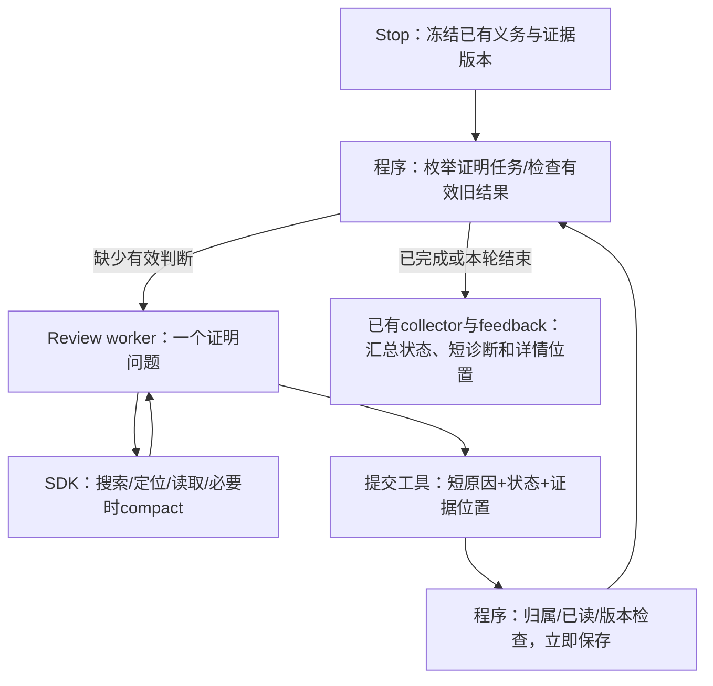

# 从 Stop 大终审到可复用的单项 Review：核查与实验

2026-10-24。生产树固定在 `20ec5b5abb31d38b1ad714ae95596b7baa4a3567`，当前分支 `codex/review-module-experiment`，工作区干净。所有新实验、依赖和报告位于被忽略的本目录。此前回退的后续提交保存在 `codex/archive-stop-context-20261024` → `e6852ce`。未安装或接入活动 Stop，未启动、修改原项目或原 session。

## 判断

先把一个 Review 做成清楚、可重复调用的模块，是正确的切入点。原分支已经较好地解决了部分结果保全、反馈限量和失败隔离；没有证明复杂单项能稳定完成。继续叠加分页、短时限、累计读取额度和提示约束，不足以解决任务语义混杂、取证导航过大和终稿输出瓶颈。

新实验把模型循环、读取工具和压缩交给正式 Pi SDK，只保留小的业务适配层。厨房正反两例和复杂项目的一项完整实现义务均交回了有依据的结果。复杂项没有删掉 79 条公共条件；一次尝试约 64 秒完成。它证明这个模块方向值得保留，尚不能证明整个 Stop、旧四个指标或所有 overflow 情形已经解决。

## 1. 历史：哪些问题真的被解决

所有时间为北京时间，2026-10-24。以下节点在同一提交树中；回退分支已保留，不需要整体 merge。

- 分支之前的 `4d8ead6` 已有逐项收集、进度、分页和短反馈；这些不能全部算成新分支的创造。
- `28dfed3` 的必要价值是：边界失败不能变成 PASS，其他项的合法结果必须保住，完整同输入 PASS 可以保守复用。
- 精确描述去重、哈希不喂模型、GT 去掉格式空白：属于低风险减负，可保留。它们不改变义务，也不需要额外 agent。
- 固定 80 行、128KiB 累计读取和每项 120 秒：属于成本/终止政策，不是高效查证策略。材料一页页变小不等于相关材料变少；压缩也不会返还累计读取额度。
- `20ec5b5` 主要保存实验事实，不是一个新的完成率突破。

原复杂 f1 的四轮代表轨迹均为 0/4 接纳：第一轮超时且读取预算仅回放；第二轮实时报累计读取上限；第三轮累计读取未超但超时；第四轮材料完整、累计读取未超，却在最后输出长度上限处中断。第四轮长篇公开论述之后才开始输出 JSON，未交出完整判定。四轮不是相同条件下的四个独立统计样本。

因此应区分四件事：当前模型窗口、累计传输/读取成本、单次输出长度、墙钟时间。一个统一的“小预算”不能代替这四种机制的设计。原失败诊断保存在 `docs/experiments/stop-bounds-20261024.md` 及历史隔离捕获中，原始记录不覆盖。

## 2. 最小领域模型

一个 Review 处理一个**证明问题**，不是“同一个 f1 下随便四个指标”。定义：

`q = (义务ID与修订, 判定属性, 适用条件与例外, 证据种类, 冻结快照)`。

例如“首页商品卡片是否有图片和加载占位”是实现问题；“需求是否被正确分解”“验收标准是否覆盖需求”是另两个问题，证据和判定函数不同。相同 sourceId 不能证明它们可以共用一个结论。多个指标只有在确实共用同一个证明时才能关联同一份证据，不能复制 verdict 冒充覆盖。

对固定任务集合 T，Stop 只组织执行与保存；不生成“需求 × 文件 × 指标 × 条件”的笛卡尔积。条件属于任务的约束，不自动生成新的组合测试。总体通过至少要求 T 中每项都有当前有效的 PASS；具体反例产生 DEVIATION；证据不足、超时、工具或模型失败产生 UNVERIFIED。任意缺项都不能整体 PASS。程序检查覆盖和结果身份，语义是否成立仍由 reviewer 结合证据判断。

原有按 `sourceId + verificationTarget` 分组、每组最多四个对象，避免了一部分数量膨胀，却不保证组内问题语义一致。下一步应明确每种既有指标的证明类型；不新增一套模型规划器，也不扩大指标集合。

## 3. 只保留四个职责

1. **任务与基线**：程序给出精确问题和不可删除的条件；模型不负责重新发明验收清单。
2. **取证与判断**：worker 自选只读搜索、文件定位、区间读取；有可信基线时用 diff 找变化，再核对现行实现和必要依赖。
3. **提交与账本**：工具提交一个小记录，程序校验后立刻持久化。结果不依赖 agent 正常输出长篇终稿后退出。
4. **调度与反馈**：复用已有 collector、失败隔离、缓存和短反馈；不再另起 agent 读全部结果做总评。

### 每一步输入输出及 prompt 成分

- **固定 system**：一个只读证明问题；源文件是数据；完整读条件与例外；diff 仅导航；不能从源码推断运行验收；用提交工具保存一两句机制与影响，引用给路径和行号。实际全文在每次 `review/prompt.txt`。
- **程序 user 输入**：task ID、问题、必读 basis 路径、目标源码入口、可选 diff/基线信息。复杂例的静态 prompt 文件约 2.1KB，不把 805 条过程转录或完整 manifest 硬塞进 prompt。
- **SDK 自动成分**：实际工具定义和参数 schema、模型请求包装、此前消息/工具结果、必要时的原生 compaction 摘要。这些不是 `prompt.txt` 的全部内容；实际发送的对话保存在 sessions 文件中。
- **强制完成的读取**：所有 basisFiles 的实际披露区间须覆盖全文，包括截断后的续页。程序可以证明已披露，不能证明模型已经正确理解每条条件。
- **agent 自选的读取**：源码、依赖、资源、diff 及检索结果；工具读多少以实际结果记账。输入索引不要求全文遍历，审计哈希由程序管理。
- **输出**：`taskId/verdict/reason/refs`，程序附快照身份、哈希、保存时间、轨迹；宿主收到短诊断和详情位置。过长原因保存原件后给位置。

不需要新建 summary agent。原生 compact 是窗口快满时的退路；冻结基线仍可重读，不把摘要自动当成基线的等价替代。

## 4. 开源与 diff：实际用了什么

已核查用户给出的 [Open Code Review 架构](https://github.com/alibaba/open-code-review/blob/main/pages/src/content/docs/en/architecture.md)，并固定安装官方 OCR 1.13.3 与 Pi 1.4.0。详细版本、许可证、发布二进制哈希与源码链接在 `oss-fit.md`。

- OCR 的 npm 包是 Go CLI 启动器，没有可直接 import 的 JS 审查 SDK。本实验实际调用它的 `delegate preview` 做 workspace/commit/range 导航预检；没有伪称运行了 OCR 的完整模型审查。
- OCR 的 `code_comment` / `task_done` 分开收集与完成、Git 变化选材、只读检索，是适合借用的小机制。默认并发、多轮分组/过滤/定位、另一次总评，不是此 Stop 的最小需求。其文件过滤也不能成为需求义务的过滤器。
- 真正复用的执行层是正式 [Pi SDK](https://github.com/earendil-works/pi/blob/v1.4.0/packages/coding-agent/src/core/sdk.ts)：现成模型循环、provider 重试、session、read/grep/find/ls、截断和原生 compact。适配层约 270 行，不重写上述能力。原生窗口管理不能保证任何长材料都可完成。
- 厨房用真实 Git base→candidate diff，真实 reviewer 都读取了 diff，并核对完整现行实现和要求；正确版本只有注释变化，也没有仅凭“无实质 diff”就跳过验收。
- 复杂捕获没有可信 Git 基线，明确报告 `NO_TRUSTED_GIT_BASE`。使用完整冻结源码和需求查证，不伪造 diff、不把 diff 为空当 PASS。
- 原生产 Stop 没有将 diff 作为统一导航入口；仅分页 read 的查证效率不足。以后可信 diff 应服务于选材与失效分析，不能替代全量需求的初次验收或证明未变依赖仍有效。

审阅能力从只有 read 放开为 read/grep/find/ls，以及程序准备好的 Git 差异。模型可自由组合这些只读能力。未提供会修改项目的 edit/write/exec；原生 grep/find 的内部实现属于已复用的成熟工具。文件访问限制是工具边界，不声称操作系统沙箱。

## 5. 实验结果与反证

所有实验使用同一冻结源码版本 `source-snapshot-01/manifest.json`，原模型服务，额外 tokenBudget/deadline 都为 null；每项最多两次外层尝试、100 个 assistant turns 防死循环，SDK 短暂错误最多重试两次。模型本身窗口及单次输出仍有限。不能把本实验宣称为完全沿用旧预算的同条件 A/B。

- **机制测试 28/28**：包括实际 SDK 和本地脚本 provider；真实原生读取截断识别、只读工具、禁用自动项目资源、取消/失效、提交后异常保全、有限尝试。注入 provider context overflow 后，原生 compact 成功并保存判断。它验证恢复机制接线，不代表真实大模型已经在相同故障下恢复。
- **厨房坏版本**：37.651 秒，一次尝试，DEVIATION；指出做饭没有扣库存，与独立 `persisted-consumption` 失败相符。9 个 assistant turns，读取 11,532B，反馈 368B。前两次绝对引用路径被工具拒绝，模型修正后成功提交，未丢失整个任务。
- **厨房正确版本**：27.100 秒，一次尝试，PASS；独立原有 verifier 的 21 场景通过。4 turns，读取 11,204B，反馈 429B。有一处需求引用错指 R02/R03，实际 R04 在19–22行；实现证据有效、要求完整读过，但不能因此将引用质量写成全部通过。
- **复杂 f1 实现问题**：63.793 秒，一次尝试，DEVIATION。保留原始 f1＋全部79公共条件，与完整原GT逐项一致；原基线精确字节45,655B，必读可读版1700行分两页读完，原需求410行读完。诊断商品卡片缺少图片和图片加载占位，与模型不可见的预置源码 oracle 和人工核对一致。14 turns、23次取证工具调用、实际 read 96,280B、重复读取行0、反馈404B。六处引用均有效。

token 按服务 usage 原样汇总：复杂例累计输入330,412（含251,392缓存读取、79,020非缓存），输出5,362；单次报告的输入峰值36,219。累计输入不是模型同时持有330K上下文，也不是美元成本。模型虽配置 thinking off，服务仍报告 reasoning 用量，不把它描述为真正无思考。真实三例 compact 均为0，因此不宣称本轮实际测到了 live overflow 恢复。

时间是 worker 统计，包含 session 设置与审查，不含它之前的快照复制/预检；工具读取字节不含 grep/find/ls返回。厨房重复读取50–51行仍存在，不能把复杂例0重复泛化成整个模块从不重复。已完整记录取证和提交会话。

复杂输入源67个源码文件，worker完整冻结集79个文件；独立复核全部哈希及75条来源记录相符。仓库601个tracked文件前后状态与摘要相同，宿主配置字节相同；原项目/session未启动或写入。本轮没有模拟器、构建或业务端到端重跑。

### 本轮没有证明的事

- f1 的反例足以否定该实现义务，不等于79条公共条件全部合规，不等于运行时验收或全项目371指标完成。
- 旧0/4接纳记录保持原样。M01/M02/M05各有不同的证明问题，本轮没有替它们给结论。即使涉及M12，也不能缺少其完整标准就映射成完整M12判断。
- 这是已知缺陷的定向查证，不是盲测：实验入口指定了商品卡片和图片加载这一证明对象；独立oracle不在模型可见区。不能由3个样例估计生产稳定率或声称权威库保证质量。
- 程序的“已读＋引用合法＋快照未变”是证据完整性校验，不是语义真实性证明；厨房错引说明此边界真实存在。基线位置可由task→claim映射由程序附上，避免要求模型重复定位；实现证据语义仍需审阅。

## 6. 必要、可以合并、暂不做

**必须保留**：清楚的证明任务；完整条件与例外；只读检索和当前源码证据；版本化结果；立即持久化；取消与旧结果失效；缺项不可PASS；短诊断及独立详情。

**应合并或减少**：每项重新分页全部历史与复制整棵树；让模型读程序审计哈希；同一义务重复正文；只靠行数/累计字节逼模型完成；混合多种证明的终稿；新增模型分组/总评；另造工具循环、compact、结果数据库。

**暂不做**：复杂依赖图、自动影响分析、向量数据库、多agent投票、自动summary服务、全量复审工作流。先保守命中同身份结果；没有依赖完整性时，diff未触及引用文件不足以证明旧PASS可复用。缓存身份至少包括义务及修订、证明类型、条件、证据版本、规则/协议/模型身份；不能直接使用本实验仅task＋全快照的fingerprint作为生产缓存键。

## 7. 最小接入建议（未实施）

当前生产已有 `reviewerFactory → review-collector → rc_progress/feedback/cache`。保留这些模块，只将一个清楚的 worker adapter 接在 reviewerFactory 边界。选定一个执行运行时，不能在一个 OpenClaw agent 中再套一层 Pi agent循环。

实验 `submit_review` 与生产 `rc_progress` 应共用同一个业务提交/校验服务；不保留两套并行账本。单独Review和Stop使用相同版本化任务与结果身份，Stop先复用有效结果，再只补缺项。一个Stop内只冻结一次源材料，各worker按需读共享冻结快照；不用每项重新复制和分页整个项目。反馈继续复用生产单项768B/整包8KiB边界，实验仅reason限量不能代替整包限制。

接入前的最小必要实验是：单独Review完成→Stop零模型复用；修改义务/源码/证明类型后拒绝旧结果；一个worker失败仍保住其他结果。随后分别检查原四种证明目标，不能拿本次单个实现反例填成4/4。用户当前优先级是有限尝试内完成，成本限制应在完成证据充分后基于实际分布设定，不先重新塞回旧的120秒/128KiB。

本轮停在生产集成之前，是为了保持用户要求的20ec5b5干净基线并先验证小模块；没有把实验接口冒充已经上线的Stop实现。

## 8. 证据入口

- 固定实验源：`source-snapshot-01/`；可执行源码与锁文件：`experiments/review-task/`。
- 机制：`verification-adapter.tap`，`sdk-test-runs/run-gkdvOx/review/`。
- 厨房：`kitchen-live-01/report.json` 与两个 `*-review/{decision.json,reads.json,events.jsonl,feedback.txt,sessions/}`。
- 复杂：`complex-live-01/report.json`，`complex-live-01/review/`；独立 oracle：`complex-preflight-01/source-oracle.json`。
- 开源适用性及官方固定源码：`oss-fit.md`。
