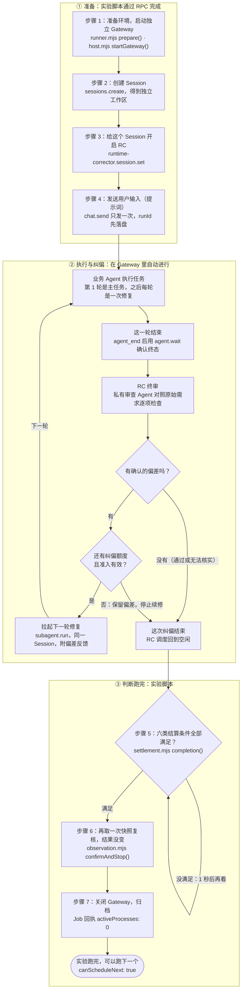
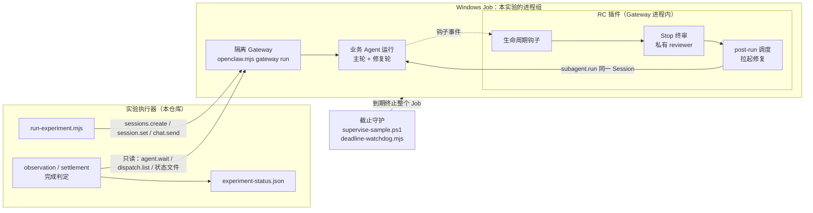
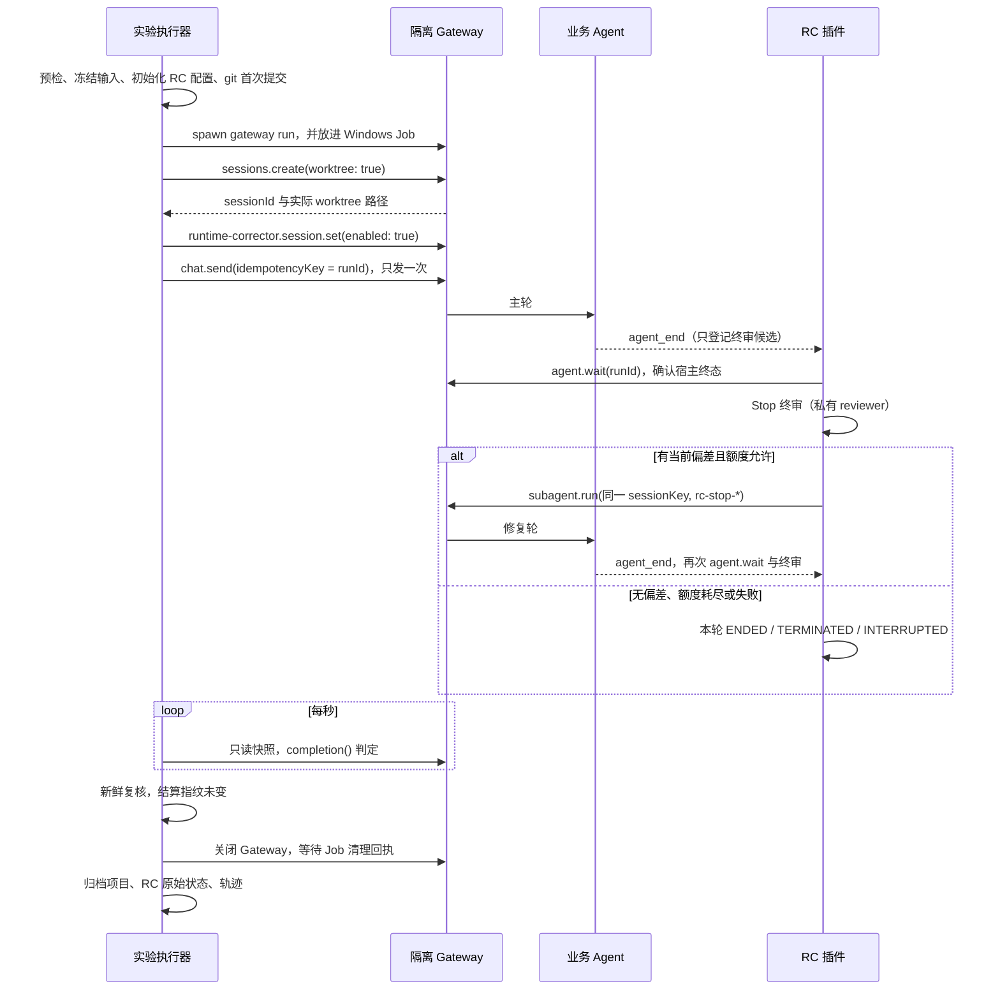

# 交接说明：RC 实验执行器的流程、技术方案与代码位置

面向已有自己的 `openclaw agent --local` 实验脚本、想复用或重写这套流程的同事。读完应能回答三个问题：实验用什么模式跑、终审和自动纠偏在哪里发生、怎样判断一个实验真正跑完。想从零自己写一套，直接看第 6 节的入门教程，里面有一份改 8 行就能运行的完整脚本。

网页版 `HANDOFF.html` 包含流程图、整体架构和第 6 节的入门教程，代码可以一键复制。

版本基线：实验程序 `codex/experiment-mvp-20261117`（`bf0ce17`），MA 内置 OpenClaw `2026.7.1-2`，RC 插件包 `runtime-corrector-ma 1.11.0`，插件源码 `codex/rc-general-efficiency-bench` 的 `e6a4284`。

## 一张图看懂

从准备到跑完的全过程。前四步和最后三步由实验脚本完成；中间的执行、终审和纠偏都在 Gateway 里自动进行，实验脚本此时只读观察。



"无法核实"不算偏差，不会拉起修复。图里没画超时：总时限到期时，截止守护会直接终止整个进程组，见第 4 节。

## 先说结论

1. **不是 `--local` 模式。** 每个实验启动一个独立的 OpenClaw Gateway 进程（`openclaw.mjs gateway run`）。实验脚本是这个 Gateway 的客户端，通过 RPC 创建 Session、启用 RC、提交一次提示词。
2. **终审和拉起纠偏不在实验脚本里，在 RC 插件里**，运行于 Gateway 进程内部。实验脚本只做两件事：用 `runtime-corrector.session.set` 打开 RC，然后只读观察。它从不自己发修复提示词。
3. **"跑完"不是单一信号。** `chat.send` 返回、CLI 退出、主轮 `agent_end`、RC 当前轮 `ended: true` 都不算。需要同时满足第 4 节的六类条件，再做一次新鲜复核，才关闭 Gateway 并归档。外层调度只看 `experiment-status.json` 的 `canScheduleNext`。
4. **继续用 `openclaw agent --local` 测不到自动纠偏。** RC 钩子在 `--local` 下会加载，但 RC 拉起修复轮用的 `api.runtime.subagent.run` 只在 Gateway 进程中可用，非 Gateway 进程调用会直接抛错；确认宿主终态用的 `agent.wait` 也需要 Gateway。详见第 5 节。

## 1. 整体架构



| 角色 | 是什么 | 负责 | 不负责 |
| --- | --- | --- | --- |
| 实验执行器 | 本仓库 `scripts/` 与 `lib/` | 准备隔离环境、提交一次任务、判定结束、归档 | 审查、纠偏、评分 |
| 隔离 Gateway | MA 内置 OpenClaw，每个实验一份 | 执行业务 Agent、加载插件、提供 RPC | 实验何时结束 |
| RC 插件 | `runtime-corrector-ma-1.11.0.tgz` | 钩子、终审、派发修复、复验 | 实验何时结束 |
| 截止守护 | PowerShell + Windows Job + Node 守护进程 | 总时限到期时终止整个进程组并写清理回执 | 正常结束判定 |

容易混淆的一点：`lib/host.mjs` 写入私有配置的 `gateway.mode: 'local'` 是 Gateway 自身的配置项，意思是"本机 Gateway、不连远端"，和 `openclaw agent --local` 的嵌入执行是两回事。

## 2. 一次实验的完整流程



入口是 `scripts/run-experiment.mjs`，主流程在 `lib/runner.mjs:240` 的 `run()`；接回中断观察用 `lib/runner.mjs:293` 的 `resume()`。

| `run.json.phase` | 做什么 | 代码 |
| --- | --- | --- |
| （预检） | 解析 `machine.yaml` 和 `experiment.yaml`，校验 Node、Git、OpenClaw 版本与模型配置，计算全部输入哈希 | `lib/config.mjs` 的 `loadInputs()` |
| `PREPARING` | 建运行目录、复制项目、解压 RC 包；把样本的 `rc-config.yaml` 放进插件默认模板，再调用 RC 自己的 `initializeProjectConfig` 生成 `.runtime-corrector/config.yaml`；`git init` 并首次提交（创建 worktree 需要） | `lib/runner.mjs:50` `prepare()` |
| （同上） | 生成私有 `openclaw.json`（随机端口、loopback、随机 token、模型、`timeoutSeconds`）；把 HOME、APPDATA、TEMP、`OPENCLAW_CONFIG_PATH`、`OPENCLAW_STATE_DIR` 指向运行目录；调用 RC 的 `installer.activate()` 安装插件；写入 `reviewerModel` 与 `businessRunTimeoutMs` | `lib/host.mjs:39` `configureHost()`，`lib/host.mjs:20` `isolatedEnvironment()` |
| `STARTING` | 启动 Gateway；建 Windows Job 包住它；启动截止守护；轮询 `health` | `lib/host.mjs:89` `startGateway()`，`lib/process-scope.mjs`，`lib/deadline-watchdog.mjs` |
| `CREATING_SESSION`、`ENABLING_RC` | 调 `sessions.create`，以返回的 worktree 作为实际项目目录；调 `runtime-corrector.session.set` 后核对 `effectiveEnabled` 和项目路径 | `lib/runner.mjs:114` `createSession()` |
| `SUBMITTING` | 在提示词前写明实际项目目录；**先把 runId 落盘再发送**；`chat.send` 只调用一次 | `lib/runner.mjs:131` `dispatchOnce()` |
| `OBSERVING` | 每秒取快照并判定是否结算 | `lib/observation.mjs:148` `settleAndClose()`，判定在 `lib/settlement.mjs:29` `completion()` |
| `STOPPING_GATEWAY` | 新鲜复核后关闭 Gateway，等待进程组回执 `activeProcesses: 0` | `lib/observation.mjs:142` `confirmAndStop()`，`lib/host.mjs:119` `stopGateway()` |
| `ARCHIVING` → `ARCHIVED` | 复制项目、`.runtime-correction/` 原始状态、改动补丁（含新建文件，用临时索引生成）和全部轨迹 | `lib/runner.mjs:212` `archive()` |

所有 RPC 都通过宿主公开 SDK 的 `callGatewayFromCli` 发送，地址是 `ws://127.0.0.1:<port>`，token 取自私有配置，见 `lib/host.mjs:81` 的 `connectHost()`。

## 3. 终审和拉起纠偏的逻辑在哪

这部分全部在 RC 插件里。源码在 `codex/rc-general-efficiency-bench` 的 `e6a4284` 下的 `lib/openclaw/`；插件包里对应 `payload/runtime-corrector/lib/openclaw/`。下表涉及的七个关键文件，包内与源码逐字节相同，行号两边通用。

RC 配置 `stopCorrection.waitMode: until_pass` 时的链路：

| 步骤 | 发生什么 | RC 代码 |
| --- | --- | --- |
| 1. 注册钩子 | `agent_end`、`before_prompt_build`、`before_agent_run`、`before_tool_call` 等 | `entry.mjs:67-79` |
| 2. 主轮结束 | `agent_end` 只登记"终审候选"，不在钩子里等审查 | `runtime.mjs:2117` `agentEnd()` |
| 3. 确认宿主终态 | 用 `agent.wait(runId)` 等 Gateway 给出 `ok` 或 `error`。`agent_end` 不算终态，因为宿主可能压缩上下文后重试同一个 runId | `post-run-dispatch.mjs:405` `queueCandidate()`，`post-run-host.mjs:65` `waitPostRunTerminal()` |
| 4. 终审 | 进入 `REVIEW_QUEUED`、`REVIEWING`（跨会话并发池默认 3）；私有 stop-reviewer 逐项给出 PASS、DEVIATION 或 UNVERIFIED | `runtime.mjs:446` review 回调，`native-stop-review.mjs`，`reviewer.mjs` |
| 5. 拉起修复 | 有当前有效偏差且额度未用完时，先写准入账本，再调用 `api.runtime.subagent.run({ sessionKey, idempotencyKey: 'rc-stop-<准入ID>', deliver: false })`，在**同一个 Session** 里起修复轮。反馈正文在 `before_prompt_build` 时核对后注入；观察到可信的 `model.call.started` 才扣额度 | `stop-start-protocol.mjs:240` `submit()`，调用点在第 263 行 |
| 6. 修复轮结束 | 回到第 2 步重新终审。最后一次修复之后只做只读复验，不再给额度 | 同一循环 |
| 7. 收尾 | 无偏差、额度耗尽或失败时，`finish()` 把调度置为 `IDLE`，本轮状态为 ENDED、TERMINATED 或 INTERRUPTED，结论写在 `outcome` | `post-run-dispatch.mjs:346` `finish()` |

控制这条链路的是样本 `rc-config.yaml` 里的字段：`stopCorrection.enabled`、`waitMode`、`maxCorrectionsPerSession`、`maxCorrectionsPerFlow`、`assessmentTimeoutMs`、`metrics`，以及 `requirementFrame`、`reviewers` 等。实验执行器不修改这些值，只把原始和实际生效的配置分别存档。

RC 的状态落在磁盘上，实验执行器读的就是这些位置：

- `<projectRoot>/.runtime-correction/session-runtime-status.json`：公开状态（phase、status、active、ended、outcome）。
- `<projectRoot>/.runtime-correction/openclaw/native-stop-reviews/`：每次 Stop 终审的作业记录。
- `<projectRoot>/.runtime-correction/openclaw/native-runs/`：私有 reviewer 运行。
- `<stateDir>/runtime-corrector-stop-sessions/`：修复准入账本和 post-run 调度记录。

想人为制造一次偏差来验证整条链，用 `scripts/test-correction.mjs`。它在隔离 Gateway 里多加载一个测试插件 `test/support/correction-fixture/`，在首轮 `before_agent_finalize` 时把交付的 `quicksort.py` 换成错误实现，不碰 RC 的代码、状态或结论。

RC 自己的说明在插件包的 `payload/runtime-corrector/docs/`：`until-pass-dispatch.md`、`session-runtime-status.md`、`openclaw.md`。

## 4. 怎么判断一个实验跑完了

### 4.1 不能用的信号

- `chat.send` 返回，或 `openclaw agent` CLI 退出：只说明主轮已受理或已结束，修复轮可能还没开始。
- `agent_end`：只是一次尝试的边界，宿主可能压缩上下文后重试同一个 runId。
- RC `ended: true`：只表示当前轮结束；下一次修复可能正在派发，私有审查可能还在落盘。
- 观察脚本退出：后台工作仍在继续。

### 4.2 结算条件：六类全部满足

判定函数是 `lib/settlement.mjs:29` 的 `completion()`，纯函数，无外部依赖。

| # | 条件 | 数据来源 |
| --- | --- | --- |
| 1 | RC 当前轮 `ended=true`、`active=false`、`pendingUserTasks=0`，`status` 属于 ENDED、TERMINATED、INTERRUPTED；健康度不是 STALE、OWNER_EXITED、UNKNOWN；在线刷新已确认。INTERRUPTED 还要求 phase 为 CLOSED 或 ENDED，健康度为 FRESH 或 SETTLED | RC `session-runtime-client.mjs` 的 `refreshSessionRuntimeStatus()` |
| 2 | 观察到 RC 轮次（有 `runId` 和 `roundId`），并且已知首轮 runId | 同上，加 `run.json.firstRunId` |
| 3 | 每个相关 runId 都有 `agent.wait` 返回的 `ok` 或 `error`：首轮、RC 历史轮次、调度和准入记录里出现的所有修复轮 | `lib/settlement.mjs:24` `runIds()` 收集，`agent.wait` 读取 |
| 4 | 调度记录全部为 `IDLE` 或 `CLOSED`：没有排队、派发中、候选、修复中、待释放或待核对 | `runtime-corrector.dispatch.list/get`，以及 `<stateDir>/runtime-corrector-stop-sessions/**/post-run/` |
| 5 | 所有 Stop 终审和私有 reviewer 运行都是 `SETTLED` | `native-stop-reviews/`、`native-runs/` |
| 6 | 准入账本里没有 `RESERVED`，没有"已扣额度但不知道 runId"，没有未确认的投递，没有未释放的 Stop 等待 | `<stateDir>/runtime-corrector-stop-sessions/` |

条件满足后，`confirmAndStop()` 会再取一次新鲜快照，比较 `lib/settlement.mjs:57` 的 `settlementKey()`。指纹变了，说明两次读取之间出现了新一轮，继续观察；指纹相同才关闭 Gateway、等待清理回执、归档。

这些条件看起来严格，是因为真实运行里撞到过：RC 当前轮已 TERMINATED 但还有修复派发、私有审查尚未结算、新轮次恰好出现在判定与关闭之间。记录见 `FLOW-VALIDATION.md` 和 `validation/SECURITY-TOOL-2-CURRENT-RC-20261124.md`。

### 4.3 外层调度怎么读

运行期间 `<runDir>/experiment-status.json` 约每秒更新一次；也可以调用 `node scripts/experiment-status.mjs <runDir>` 或 `lib/experiment-status.mjs` 的 `queryExperimentStatus()`，两者都只读。

- 释放实验槽位只看 `canScheduleNext`。它等于 `terminal` 并且 Windows Job 的清理回执显示 `activeProcesses: 0`。
- `status` 取值：`PREPARING`、`RUNNING`、`FINALIZING`、`NEEDS_ATTENTION`、`UNKNOWN`、`PREPARED`、`COMPLETED`、`FAILED`、`TIMED_OUT`、`TIMEOUT_CLEANUP_FAILED`。`COMPLETED` 只表示执行已收尾，不代表业务正确或 RC 判定通过。
- 字段的完整说明见 `tutorials/04-experiment-status.md`。

`run-experiment.mjs` 的退出码：

| 退出码 | 含义 |
| --- | --- |
| 0 | 正常收尾，或 `--prepare-only` 准备成功 |
| 1 | 配置或入口错误 |
| 2 | 待核对（`NEEDS_ATTENTION`），后台可能仍在运行，用 `--resume` 接回 |
| 3 | 已归档，但宿主原生运行报错 |
| 4 | 总时限到期，清理已确认 |
| 5 | 总时限到期，清理未确认 |

### 4.4 三种时限

| `experiment.yaml` 字段 | 含义 | 到期后 |
| --- | --- | --- |
| `maxRuntimeMs` | 从创建运行目录开始的绝对总时限，包含准备、主轮、终审和所有修复，默认 6 小时 | 截止守护终止整个进程组，结果 `TIMED_OUT` |
| `observerTimeoutMs` | 单次观察窗口 | `NEEDS_ATTENTION`，后台继续运行，`--resume` 接回 |
| `uncertainTimeoutMs` | 持续无法确认状态的容忍时间，默认 5 分钟 | 同上 |

硬超时相关代码：`lib/experiment-deadline.mjs:19` `expireExperiment()`、`scripts/supervise-sample.ps1`、`scripts/windows-sample-job.cs`、`scripts/deadline-watchdog.mjs`。

## 5. 和 `openclaw agent --local` 的差别

| | 本执行器（Gateway 模式） | `openclaw agent --local` |
| --- | --- | --- |
| 业务运行在哪 | 独立的常驻 Gateway 进程 | CLI 进程内嵌执行，一轮后退出 |
| RC 钩子是否加载 | 是 | 是：宿主对带 `--local` 的 `agent` 命令会加载插件 |
| RC 确认终态（`agent.wait`） | 由 Gateway 提供 | 本进程没有 Gateway；RC 会退回公开 CLI 客户端，按当前配置和环境变量去找 Gateway |
| RC 拉起修复（`subagent.run`） | 可用 | 抛 `OPENCLAW_SUBAGENT_RUNTIME_REQUEST_SCOPE`；宿主只在 Gateway 进程里绑定 subagent |
| 后台终审能否跑完 | Gateway 一直在，执行器决定何时关闭 | 主轮结束 CLI 就退出，后台终审会跟着结束 |
| `sessions.create`、`runtime-corrector.*` 等 RPC | 有 | 没有 |

宿主侧依据（MA 内置 OpenClaw 的 `dist/`，部分文件名带构建哈希）：

- `register.agent-turn-*.js`：`agent` 命令的说明是 "Run an agent turn via the Gateway (use --local for embedded)"。
- `command-path-policy-*.js`：带 `--local` 时 `loadPlugins` 为真。
- `plugins/runtime/index.js:893-919`：非 Gateway 进程拿到的 subagent 是 `createUnavailableSubagentRuntime()`，`run` 直接抛错。

RC 仓库自己的预检文档也写了同样的结论：`docs/rc-offline-integration-20261030.md` 和 `docs/rc-native-component-preflight-20261030.md` 指出 RC 的终态与续作依赖 Gateway 的 `agent.wait`/`chat.send`，`--local` 能否提供同样能力尚未证明。

说明：上表依据代码阅读和上述文档，`--local` 路径本身没有为这份交接实跑过。另一个风险也未实测：在 `--local` 下，RC 退回的 CLI 客户端找 Gateway 时，如果环境恰好指向桌面 MA 正在运行的 Gateway，可能查询到错误的对象。

结论：**只要实验要测自动纠偏，就必须用 Gateway 模式。** 三种接入方式，按改动量从小到大：

1. **整体复用本执行器。** 你的脚本只做外层批次：对每个样本调用 `node scripts/run-experiment.mjs <experiment.yaml>`，从标准输出读 `Run: <目录>`，轮询 `experiment-status.json` 直到 `canScheduleNext: true`，再按退出码和 `result.json` 决定下一步。
2. **保留你的脚本骨架。** 把"跑一轮 `--local`"换成"起隔离 Gateway、RPC 提交、结算判定"。可以直接导入本仓库的 `lib/settlement.mjs` 和 `lib/observation.mjs`，它们不依赖 npm 包。
3. **完全自己写。** 按第 6 节的入门教程实现，可以直接从 6.6 的完整脚本改起。

## 6. 从零写一套：入门教程

这一节照着做就能从零写出能跑的实验脚本。顺序是：先认识几个词，准备好东西，然后按"一张图看懂"里的步骤 1 到 7 逐步实现，最后给出一份完整脚本。6.6 的完整脚本已在本机用快排样本完整跑通。

### 6.1 先认识 6 个词

把一次实验想成：临时开一家只接一张订单的小店。店里有一个干活的师傅（业务 Agent）和一个质检员（RC）。实验脚本是下单、等结果、最后关店的人。

| 词 | 比喻 | 是什么 |
| --- | --- | --- |
| Gateway | 小店本身 | 一个在后台一直运行的 OpenClaw 程序（`openclaw.mjs gateway run`）。脚本通过它下单、查进度。每个实验开一家新店，跑完就关。 |
| RPC | 给小店打电话 | 代码里就是一行 `rpc('方法名', {参数})`。整个流程一共只用到 8 个方法，下面每一步都会写明用哪个。 |
| Session | 一张订单（一段对话） | 有两个号：`sessionKey` 是你起的名字，`sessionId` 是小店给的编号。主任务和所有返工都记在同一张订单上。 |
| 工作区（worktree） | 这张订单专用的工作台 | 项目的一份副本，创建 Session 时自动建好。Agent 只改这里的文件；你在步骤 1 复制的那份不会被改。 |
| runId | 取餐号 | 每发一次消息、每次返工都有一个。脚本拿着它用 `agent.wait` 问"这一轮做完了吗"。 |
| RC 插件 | 店里的质检员 | 装在 Gateway 里。每轮做完就检查一遍；发现确认的问题，就让 Agent 在同一张订单里返工。 |

### 6.2 动手前准备 8 样东西

缺一样都跑不起来。

| # | 东西 | 怎么确认 |
| --- | --- | --- |
| 1 | 一台 Windows 电脑 | 本方案只在 Windows 上验证过。 |
| 2 | Node.js 22.22.3 以上，或 24.15 以上（不要用 23） | 在 PowerShell 里运行 `node --version`。 |
| 3 | Git | 运行 `git --version` 能看到版本号。记下 git.exe 的位置，通常是 `C:/Program Files/Git/cmd/git.exe`。 |
| 4 | MA 内置的 OpenClaw，版本 2026.7.1-2 | 在 MatrixAssistant 安装目录的 `resources/openclaw` 下。打开里面的 `package.json`，`version` 应该是 `2026.7.1-2`。 |
| 5 | RC 插件包 `runtime-corrector-ma-1.11.0.tgz` | 向维护 RC 的同事要，或者用本仓库 `dist/` 下打好的包。 |
| 6 | MA 里能用的模型 | 先在 MA 里配好模型，确认能正常对话。脚本会从 `%USERPROFILE%\.openclaw\openclaw.json` 抄模型配置和密钥。 |
| 7 | 本仓库 | 脚本要用里面的 `lib/observation.mjs` 和 `lib/settlement.mjs` 判断是否跑完。 |
| 8 | 一个实验样本 | 一个文件夹，里面放 `project/`（干净的项目，不能已经有 `.runtime-corrector`）、`prompt.md`（用户输入）、`rc-config.yaml`（RC 配置）。第一次直接用 `examples/quicksort`。项目要用的工具（比如 python）要能在 PowerShell 里直接运行。 |

### 6.3 第一段：准备（步骤 1–4）

每一步都按同一个格式写：一句话说明、照着做的代码、成功时你会看到什么、没成功怎么办。代码片段是 6.6 完整脚本的简化摘录，变量名一致。

#### 步骤 1a：复制项目，生成 RC 配置，建立 git 基线

**一句话：** 把项目复制一份，让 RC 在里面生成自己的配置，再提交一次 git。后面的工作区就是从这次提交复制出来的，没有这次提交就建不了工作区。

**照着做：**

```js
// 复制项目
await fs.cp(path.join(C.sample, 'project'), seedRoot, { recursive: true });
// 解压 RC 插件包，换上你的 rc-config.yaml
const tar = path.join(process.env.SystemRoot, 'System32/tar.exe');
execFileSync(tar, ['-xzf', C.rcPackage, '-C', pluginDir]);
await fs.copyFile(path.join(C.sample, 'rc-config.yaml'),
  path.join(payload, '.runtime-corrector-default/config.yaml'));
// 让 RC 在项目里生成 .runtime-corrector/config.yaml
const settings = path.join(payload, 'lib/openclaw/project-settings.mjs');
const { initializeProjectConfig } = await import(pathToFileURL(settings));
await initializeProjectConfig({ projectRoot: seedRoot, pluginRoot: payload,
  reviewerModel: () => C.reviewerModel, assertCurrent: async () => {} });
// git 基线
git('init', '-q');
git('config', 'core.autocrlf', 'false');
git('add', '--all', '--force', '.');
git('commit', '-qm', 'baseline');
```

**成功的样子：** 控制台打印 `git 基线： a829dbb`（一串 7 位编号，每次不同），运行目录里出现 `project/.runtime-corrector/config.yaml`。

**没成功？**

- 报错提到 `.runtime-corrector`：样本的 project 不干净，删掉里面的 `.runtime-corrector` 再来。
- 找不到 git：检查配置里 `git` 的路径。

#### 步骤 1b：写私有配置，设置隔离环境变量，安装 RC

**一句话：** 给这家小店写一份只属于它的配置（端口、密码、模型），把环境变量指向运行目录，然后把质检员（RC）装进去。这样它不会碰你平时用的 MA。

**照着做：** 第一件事，写 `运行目录/state/openclaw.json`。

```js
await writeJson(configPath, {
  // 只在本机的一个空闲端口上监听；token 是随机密码，打电话时要带上
  gateway: { mode: 'local', port, bind: 'loopback',
             auth: { mode: 'token', token }, controlUi: { enabled: false } },
  // 从 MA 的配置里抄来的模型和密钥
  models: { mode: 'replace', providers },
  agents: {
    // workspace 是步骤 1a 的项目副本；timeoutSeconds 是单轮时限，不能比总时限短
    defaults: { workspace: seedRoot, model: C.businessModel, thinkingDefault: 'off',
                timeoutSeconds: Math.ceil(C.maxRuntimeMs / 1000), maxConcurrent: 4,
                heartbeat: { every: '0m' }, memorySearch: { provider: 'none' } },
    list: [{ id: C.agentId, default: true }],
  },
  tools: { profile: 'full' }, channels: {}, cron: { enabled: false },
  // 先空着，installer 会把 RC 写进来
  plugins: { allow: [], entries: {} },
  logging: { level: 'debug', consoleLevel: 'info',
             file: path.join(runDir, 'logs/openclaw.log') },
});
```

第二件事，准备一份环境变量。先删掉继承来的所有 `OPENCLAW_*` 和 `RC_OPENCLAW_*`，再设成下表的值。

| 环境变量 | 设成 | 为什么 |
| --- | --- | --- |
| `OPENCLAW_CONFIG_PATH` | 运行目录/state/openclaw.json | 让 Gateway 读这份私有配置 |
| `OPENCLAW_STATE_DIR` | 运行目录/state | 订单、日志、工作区都放这里 |
| `HOME` `USERPROFILE` `APPDATA` `LOCALAPPDATA` | 运行目录/home 下 | 不碰你真实的用户目录 |
| `TEMP` `TMP` `TMPDIR` | 运行目录/tmp | 临时文件也隔离 |
| `OPENCLAW_NO_RESPAWN` `ELECTRON_RUN_AS_NODE` | 都写 `'1'` | Gateway 不自我重启，进程号不变 |
| `RC_OPENCLAW_HOST_ROOT` | OpenClaw 目录 | RC 用它找宿主 |

第三件事，本进程也换成这套环境，然后安装 RC。

```js
// 先换环境，再加载 installer
Object.assign(process.env, env);
const installer = await import(pathToFileURL(path.join(pluginDir, 'installer.mjs')));
const install = await installer.activate({ logger: { info() {}, warn() {}, error() {} } },
  { homeDir: home, pluginDir, pluginId: 'runtime-corrector', isPackaged: true });
// install.status 必须是 'active'。
// 之后在 openclaw.json 里给 RC 补上 reviewerModel 和 businessRunTimeoutMs（见 6.6）
```

**成功的样子：** 控制台打印 `RC 安装状态： active`，`openclaw.json` 里多出 `plugins.entries["runtime-corrector"]`。

**没成功？**

- 顺序反了：先加载 installer 再改环境变量，RC 会装进你真实的用户目录。
- 后面模型报认证错误：MA 里这个模型的密钥没配好。脚本会从 `%USERPROFILE%\.openclaw\agents\main\agent\` 抄 `models.json`、`auth-profiles.json` 里的密钥。

#### 步骤 1c：启动 Gateway，接通 RPC

**一句话：** 开店（启动 Gateway 进程），然后每秒打一次电话（`health`），接通为止。

**照着做：**

```js
// 开店：日志写到 logs/gateway.log
gateway = spawn(process.execPath, [path.join(C.openclawRoot, 'openclaw.mjs'),
  'gateway', 'run', '--port', String(port), '--bind', 'loopback'],
  { cwd: seedRoot, env, stdio: ['ignore', log, log], windowsHide: true });

// 电话：之后所有操作都通过 rpc('方法名', {参数}) 完成
const sdk = path.join(C.openclawRoot, 'dist/plugin-sdk/gateway-runtime.js');
const { callGatewayFromCli } = await import(pathToFileURL(sdk));
const rpc = (method, params = {}, timeoutMs = 30000, { signal } = {}) =>
  callGatewayFromCli(method,
    { url: `ws://127.0.0.1:${port}`, token, timeout: String(timeoutMs), json: true },
    params,
    { progress: false, signal, scopes: ['operator.admin', 'operator.read',
      'operator.write', 'operator.approvals', 'operator.pairing'] });

// 每秒试一次，最多 90 秒
await rpc('health', {}, 2000);
```

**成功的样子：** `Gateway 已就绪：PID 33984，端口 50769`。本机实测，从脚本启动到这一行大约 15 秒。

**没成功？**

- 打开 `运行目录/logs/gateway.log` 看最后几行。
- 常见原因：Node 版本不对；`openclawRoot` 路径不对。

#### 步骤 2：创建 Session

**一句话：** 开一张新订单。小店会顺便建好这张订单专用的工作区。

**照着做：**

```js
const created = await rpc('sessions.create', {
  key: `agent:${C.agentId}:rc-exp:${id.toLowerCase()}`,   // 你给订单起的名字，每次要不同
  agentId: C.agentId,
  model: C.businessModel,
  emitCommandHooks: true,                                  // 固定写 true
  worktree: true,                                          // 建专用工作区
});
// 把这 4 个值存好，后面每一步都要用，也用来核对"是不是我的订单"
const identity = {
  agentId: C.agentId, sessionKey: created.key, sessionId: created.sessionId,
  projectRoot: await fs.realpath(created.worktree.path),
};
```

**成功的样子：** 回执如下（本机实测，路径有删节）。

```jsonc
{
  "ok": true,
  "key": "agent:main:rc-exp:exp-20261124025357-4e10c5",
  "sessionId": "2e6d201a-b712-4979-a279-0403ec843cca",
  "runStarted": false,          // ← 必须是 false：还没开始干活
  "worktree": {
    "path": "…\\state\\worktrees\\b91b2f8e9a9f5822\\wt-78496a18",   // ← 工作区
    "branch": "openclaw/wt-78496a18"
  }
}
```

**没成功？**

- 没有 `worktree`：步骤 1a 的项目副本不是 git 仓库，或者没有提交。

#### 步骤 3：给这个 Session 开启 RC

**一句话：** 告诉质检员"盯住这张订单"。`rc-config.yaml` 里 `sessionDefaults.enabled: false` 表示新订单默认没人盯，所以这一步不能省。

**照着做：**

```js
const enabled = await rpc('runtime-corrector.session.set', {
  agentId: identity.agentId, sessionKey: identity.sessionKey,
  sessionId: identity.sessionId, enabled: true,
});
```

**成功的样子：**

```jsonc
{
  "projectRoot": "…\\wt-78496a18",              // ← 必须等于上一步的工作区
  "sessionDefaultEnabled": false,            // ← 默认没开
  "effectiveEnabled": true,                  // ← 现在开了，必须是 true
  "reason": null
}
```

**没成功？**

- `effectiveEnabled` 是 false：看 `reason`。常见原因是 `rc-config.yaml` 顶层写了 `enabled: false`，或者步骤 1b 的 RC 没装上。
- `projectRoot` 不等于工作区：RC 盯错了地方，停下来检查，不要继续发消息。

#### 步骤 4：发送用户输入（只发一次）

**一句话：** 把 `prompt.md` 的内容发给这张订单。发出去之后，Agent 开始干活，质检员开始盯。

**照着做：**

```js
// 在提示词前面告诉模型去哪改文件
const message = `本次实验的实际项目目录是：${identity.projectRoot}\n`
  + `所有文件读写使用此目录下的绝对路径。…\n\n${prompt}`;
record.firstRunId = randomUUID();
// ① 先把 runId 存盘
await writeJson(path.join(runDir, 'run.json'), record);
// ② 再发送，idempotencyKey 用同一个 runId
await rpc('chat.send', { sessionKey: identity.sessionKey, sessionId: identity.sessionId,
  message, thinking: 'off', idempotencyKey: record.firstRunId,
  timeoutMs: C.maxRuntimeMs });
```

**成功的样子：** 回执是 `{ "runId": "0c69ced4-…", "status": "started" }`。它马上就返回，不会等 Agent 干完。

**千万别：** 回执超时或报错时重发。重发等于让 Agent 把整个任务再做一遍，这次实验就作废了。正确做法是不管回执，继续用这个 runId 观察。

### 6.4 第二段：执行与纠偏（这段不用写代码）

发完消息后，干活、终审、返工都由 Gateway 里的 Agent 和 RC 自动完成。你只需要事先在 `rc-config.yaml` 里写好规则，然后等。

**事先写好：rc-config.yaml 里和纠偏有关的几行。** 第一次不用自己写，`examples/quicksort/rc-config.yaml` 已经配好，直接复制。

```yaml
sessionDefaults:
  enabled: false                # 新订单默认不开 RC，由步骤 3 单独打开
stopCorrection:
  enabled: true                 # 每轮结束后做终审
  waitMode: "until_pass"        # 一直返工，直到通过或次数用完
  maxCorrectionsPerSession: 3   # 这张订单最多返工 3 次
  maxCorrectionsPerFlow: 3      # 同一个任务最多返工 3 次
  assessmentTimeoutMs: 7200000  # 一次终审最长 2 小时
reviewers:
  stopReviewer:
    model: "custom/deepseek-v4.1-flash"   # 质检员用的模型
```

**想看进度：RC 状态里最有用的 5 个字段。** 6.6 的脚本每 30 秒打印一次 `status/stage`；完整状态在 `运行目录/rc-status/latest.json` 的 `rc` 字段里。

| 字段 | 意思 |
| --- | --- |
| `status` | `WAITING` `RUNNING` `STOPPING` 表示还在忙；`ENDED` 表示这一轮收工；偶尔出现 `UNKNOWN` 是这一次没读准，下一秒再看 |
| `stage` | 正在做哪一步，例如 `requirement-frame`（整理需求）、`stop-reviewer`（终审）、`IDLE`（空闲） |
| `outcome` | 终审结论，例如 `NO_DEVIATION_FOUND`（没发现偏差） |
| `pendingUserTasks` | 排队中的用户任务数，跑完时应为 0 |
| `health` | `SETTLED` 表示状态可信 |

证据在这三个地方：

- RC 状态文件：`工作区/.runtime-correction/session-runtime-status.json`
- 终审记录：`工作区/.runtime-correction/openclaw/native-stop-reviews/`
- 返工名额账本：`运行目录/state/runtime-corrector-stop-sessions/`

### 6.5 第三段：判断跑完（步骤 5–7）

这一段最容易写错。判断逻辑直接复用本仓库现成的两个函数，你只需要写一个每秒循环。

#### 步骤 5：每秒取一次快照，等六类条件全部满足

**一句话：** 每秒问一遍"真的全部收工了吗"。只看到 Agent 回复完、或者 RC 说这一轮结束，都不算，因为下一次返工可能马上开始。

**照着做：**

```js
const observation = path.join(C.experimentRepo, 'lib', 'observation.mjs');
const { snapshot } = await import(pathToFileURL(observation));
const record = { runDir, stateDir, pluginDir, gatewayPid: gateway.pid,
                 identity, firstRunId, terminals: {} };

const snap = await snapshot(record, rpc);
snap.completion.settled   // true：六类条件全部满足
snap.completion.reasons   // 还差什么，见下表
```

`snapshot()` 读了这些东西：

| 读什么 | 怎么读 | 回答的问题 |
| --- | --- | --- |
| RC 状态 | `runtime-corrector.runtime.refresh` | 质检员收工了吗 |
| 返工调度记录 | `runtime-corrector.dispatch.list` / `.get` | 有没有返工在排队或进行中 |
| RC 私有文件 | 工作区 `.runtime-correction/openclaw/`，运行目录 `state/runtime-corrector-stop-sessions/` | 终审和返工名额结清了吗 |
| 每个 runId 的结果 | `agent.wait` | 每一轮真的结束了吗 |

它还会顺便核对身份：RC 返回的 Session 和工作区必须是你的，否则直接报错。

`reasons` 里的代码对照表。这些在运行中出现都是正常的，全部消失才算跑完。

| reasons 里的代码 | 白话 |
| --- | --- |
| `RC_NOT_SETTLED` | 质检员还没收工 |
| `RC_ROUND_NOT_OBSERVED` | 还没看到质检员开工（刚发送时正常） |
| `ORIGINAL_RUN_UNKNOWN` | 不知道第一轮的 runId（只在还没发送时出现） |
| `HOST_TERMINAL_MISSING:<runId>` | 这一轮还没确认结束 |
| `DISPATCH_RECORD_MISSING` | 还没有返工调度记录（刚开始时正常） |
| `DISPATCH_NOT_SETTLED` | 有返工在排队或进行中 |
| `STOP_REVIEW_PENDING` | 终审还没结束 |
| `PRIVATE_RUN_PENDING` | 质检员自己的审查任务还在跑 |
| `STOP_CONTROL_PENDING` | 终审的等待控制还没放开 |
| `ADMISSION_RESERVED` 等以 `ADMISSION_` 开头的 | 返工名额还没结清（拉起返工的那一刻会出现） |

**没成功？**

- 偶尔一次读取失败（比如提示 state lock）是正常的，RC 正在写状态文件，1 秒后重试即可。
- 长时间卡在同一个原因：打开 `运行目录/rc-status/latest.json` 看完整快照。

#### 步骤 6：再取一次快照复核

**一句话：** 第一次看到"全部满足"后，马上再看一次。两次完全一样才算数，因为两次查询之间可能刚好有一次新的返工被拉起。

**照着做：**

```js
const settlement = path.join(C.experimentRepo, 'lib', 'settlement.mjs');
const { settlementKey } = await import(pathToFileURL(settlement));

if (snap.completion.settled) {
  const fresh = await snapshot(record, rpc);
  if (fresh.completion.settled && settlementKey(fresh) === settlementKey(snap)) {
    // 真的跑完了，进入步骤 7
  }
}
```

`settlementKey` 把轮次、调度、终审、名额、runId 拼成一个字符串，两个字符串相同就说明这一秒里什么都没变。

#### 步骤 7：关闭 Gateway，归档

**一句话：** 关店，把工作台上的成果留档。

**照着做：**

```js
// 关店：/T 表示连子进程一起关
execFileSync('taskkill', ['/PID', String(gateway.pid), '/T', '/F']);
// 留档：复制整个工作区
await fs.cp(identity.projectRoot, path.join(runDir, 'artifacts/project'),
  { recursive: true, filter });
// 导出 Agent 改了什么；先 intent-to-add，新建的文件才会进 diff
const cwd = identity.projectRoot;
execFileSync(C.git, ['add', '--all', '--intent-to-add'], { cwd });
const diff = execFileSync(C.git, ['diff', '--binary', 'HEAD'], { cwd });
await fs.writeFile(path.join(runDir, 'artifacts/changes.patch'), diff);
await writeJson(path.join(runDir, 'result.json'),
  { status: 'ARCHIVED', outcome: finalSnap.rc.outcome, … });
```

**成功的样子：** 运行目录下有 `result.json`、`artifacts/project/` 和 `artifacts/changes.patch`。

**千万别：** 只关 Gateway 不关子进程。Agent 启动的构建、测试进程会留下来，继续占着文件和 CPU。

### 6.6 完整脚本：复制、改 8 行、运行

一个文件，把步骤 1 到 7 串在一起，约 250 行。

1. 把下面"脚本全文"保存成 `minimal-runner.mjs`，放在哪都行。网页版 `HANDOFF.html` 的代码框右上角有"复制"按钮。
2. 改最上面"只需要改这一段"里标了 ①–⑧ 的 8 行，换成你电脑上的路径和模型。
3. 先试跑：`node minimal-runner.mjs --dry-run`。只做步骤 1–3 并取一次快照，不调用模型、不花钱，约 20 秒。
4. 试跑没问题，再正式跑：`node minimal-runner.mjs`。

试跑时你应该看到：

```text
运行目录：C:\…\runs\exp-20261124025308-41415b

[步骤 1a] 复制项目，生成 RC 项目配置，建立 git 基线
  git 基线： 66dc7f1

[步骤 1b] 写私有配置，设置隔离环境变量，安装 RC
  RC 安装状态： active

[步骤 1c] 启动 Gateway，接通 RPC
  Gateway 已就绪：PID 14956，端口 53202

[步骤 2] 创建 Session
  sessionId： bee05af6-bb4c-4226-9865-61e34615c376
  工作区（Agent 只改这里的文件）： C:\…\state\worktrees\a775dc2d3df5ee27\wt-dce95fff

[步骤 3] 给这个 Session 开启 RC
  RC 已生效：effectiveEnabled = true

--dry-run：试取一次快照（还没发提示词，所以一定是"没跑完"）
  RC 状态： IDLE ；还差： RC_NOT_SETTLED, RC_ROUND_NOT_OBSERVED, ORIGINAL_RUN_UNKNOWN, DISPATCH_RECORD_MISSING
到此为止，没有调用模型。
```

正式跑时你应该看到下面的输出。本机实测：快排样本，从启动到跑完 3 分 31 秒。终审没发现偏差，所以没有返工。如果终审发现偏差，RC 会自动拉起返工，步骤 5 会多等一段时间，脚本不需要做任何事。

```text
运行目录：C:\…\runs\exp-20261124025357-4e10c5

[步骤 1a] 复制项目，生成 RC 项目配置，建立 git 基线
  git 基线： a829dbb

[步骤 1b] 写私有配置，设置隔离环境变量，安装 RC
  RC 安装状态： active

[步骤 1c] 启动 Gateway，接通 RPC
  Gateway 已就绪：PID 33984，端口 50769

[步骤 2] 创建 Session
  sessionId： 2e6d201a-b712-4979-a279-0403ec843cca
  工作区（Agent 只改这里的文件）： C:\…\state\worktrees\b91b2f8e9a9f5822\wt-78496a18

[步骤 3] 给这个 Session 开启 RC
  RC 已生效：effectiveEnabled = true

[步骤 4] 发送用户输入（只发一次）
  已发送，runId： 0c69ced4-4f54-4777-a11f-925f239a64f8

[步骤 5] 每秒取一次快照，等六类条件全部满足
  RC IDLE/IDLE；还差：RC_NOT_SETTLED, RC_ROUND_NOT_OBSERVED, HOST_TERMINAL_MISSING:0c69ced4-…, DISPATCH_RECORD_MISSING
  ↑ 刚发送，质检员还没开工
  RC UNKNOWN/requirement-frame；还差：RC_NOT_SETTLED, HOST_TERMINAL_MISSING:0c69ced4-…, DISPATCH_NOT_SETTLED, PRIVATE_RUN_PENDING
  RC RUNNING/requirement-frame；还差：RC_NOT_SETTLED, HOST_TERMINAL_MISSING:0c69ced4-…, DISPATCH_NOT_SETTLED, PRIVATE_RUN_PENDING
  ↑ Agent 在干活，RC 在整理需求
  RC RUNNING/stop-reviewer；还差：RC_NOT_SETTLED, DISPATCH_NOT_SETTLED, STOP_REVIEW_PENDING, PRIVATE_RUN_PENDING, STOP_CONTROL_PENDING
  ↑ Agent 干完了（HOST_TERMINAL_MISSING 消失），质检员在终审；这一行每 30 秒重复一次

[步骤 6] 再取一次快照复核
  终审结论： NO_DEVIATION_FOUND

[步骤 7] 关闭 Gateway，归档

实验跑完。结果：C:\…\runs\exp-20261124025357-4e10c5\result.json
```

脚本全文：

```js
// minimal-runner.mjs：最小实验脚本，对应报告"一张图看懂"里的步骤 1 到 7。
// 用法：node minimal-runner.mjs --dry-run   只做步骤 1–3 并取一次快照，不调用模型，不花钱
//       node minimal-runner.mjs             完整跑一次
// 为了好懂，省略了 Windows Job 进程组、独立截止守护、断点续跑和输入指纹。正式实验请用 scripts/run-experiment.mjs。
import fs from 'node:fs/promises';
import { openSync, closeSync } from 'node:fs';
import path from 'node:path';
import net from 'node:net';
import { spawn, execFileSync } from 'node:child_process';
import { pathToFileURL } from 'node:url';
import { randomUUID } from 'node:crypto';
import { createRequire } from 'node:module';

// ===== 只需要改这一段（标了 ①–⑧ 的 8 行）=====
const C = {
  experimentRepo: 'C:/work/experiment-mvp',                 // ① 本仓库的位置（要用里面的 lib/）
  openclawRoot: 'C:/MatrixAssistant/resources/openclaw',    // ② MA 内置 OpenClaw，版本 2026.7.1-2
  rcPackage: 'C:/work/runtime-corrector-ma-1.11.0.tgz',     // ③ RC 插件包
  hostState: `${process.env.USERPROFILE}/.openclaw`,        //    MA 平时的配置目录，一般不用改
  git: 'C:/Program Files/Git/cmd/git.exe',                  // ④ git.exe 的位置
  sample: 'C:/work/experiment-mvp/examples/quicksort',      // ⑤ 实验样本：里面要有 project/、prompt.md、rc-config.yaml
  outputRoot: 'C:/work/runs',                               // ⑥ 每次运行的结果放在这里
  agentId: 'main',                                          //    一般不用改
  businessModel: 'custom/deepseek-v4-flash',                // ⑦ 干活的模型，必须是 MA 里配好的
  reviewerModel: 'custom/deepseek-v4.1-flash',              // ⑧ 质检员（RC 终审）用的模型
  maxRuntimeMs: 6 * 60 * 60 * 1000,                         //    总时限：6 小时
};
// ================================================

const dryRun = process.argv.includes('--dry-run');
const sleep = ms => new Promise(resolve => setTimeout(resolve, ms));
const readJson = async file => JSON.parse((await fs.readFile(file, 'utf8')).replace(/^\uFEFF/, ''));
const writeJson = (file, value) => fs.writeFile(file, JSON.stringify(value, null, 2));
const lib = name => import(pathToFileURL(path.join(C.experimentRepo, 'lib', name)));
const step = (n, text) => console.log(`\n[步骤 ${n}] ${text}`);
async function freePort() {
  const server = net.createServer();
  await new Promise((resolve, reject) => { server.once('error', reject); server.listen(0, '127.0.0.1', resolve); });
  const { port } = server.address();
  await new Promise(resolve => server.close(resolve));
  return port;
}

// 这次实验的所有东西都放在运行目录里
const id = `exp-${new Date().toISOString().replace(/[-:.TZ]/g, '').slice(0, 14)}-${randomUUID().slice(0, 6)}`;
const runDir = path.resolve(C.outputRoot, id);
const seedRoot = path.join(runDir, 'project');    // 项目副本，worktree 从这里复制
const home = path.join(runDir, 'home');           // 假的用户目录，和平时用的 MA 隔开
const stateDir = path.join(runDir, 'state');      // Gateway 的状态目录
const configPath = path.join(stateDir, 'openclaw.json');
const pluginDir = path.join(runDir, 'plugin');    // 解压后的 RC
const payload = path.join(pluginDir, 'payload/runtime-corrector');
const tmp = path.join(runDir, 'tmp');
for (const dir of [seedRoot, stateDir, pluginDir, tmp, path.join(home, 'AppData/Roaming'), path.join(home, 'AppData/Local'),
  path.join(runDir, 'logs'), path.join(runDir, 'config'), path.join(runDir, 'rc-status'), path.join(runDir, 'artifacts')])
  await fs.mkdir(dir, { recursive: true });
console.log(`运行目录：${runDir}`);

let gateway;
function stopGateway() {
  if (!gateway || gateway.exitCode !== null || gateway.signalCode !== null) return;
  // /T 连同 Gateway 拉起的子进程一起结束
  try { execFileSync('taskkill', ['/PID', String(gateway.pid), '/T', '/F'], { stdio: 'ignore' }); } catch {}
}

try {
  // ── 步骤 1a：复制项目，生成 RC 项目配置，建立 git 基线 ──
  step('1a', '复制项目，生成 RC 项目配置，建立 git 基线');
  await fs.cp(path.join(C.sample, 'project'), seedRoot, { recursive: true });
  execFileSync(path.join(process.env.SystemRoot, 'System32/tar.exe'), ['-xzf', C.rcPackage, '-C', pluginDir], { windowsHide: true });
  await fs.copyFile(path.join(C.sample, 'rc-config.yaml'), path.join(payload, '.runtime-corrector-default/config.yaml'));
  const { initializeProjectConfig } = await import(pathToFileURL(path.join(payload, 'lib/openclaw/project-settings.mjs')));
  await initializeProjectConfig({ projectRoot: seedRoot, pluginRoot: payload, reviewerModel: () => C.reviewerModel, assertCurrent: async () => {} });
  await fs.copyFile(path.join(seedRoot, '.runtime-corrector/config.yaml'), path.join(runDir, 'config/rc-config.effective.yaml'));
  const git = (...args) => execFileSync(C.git, ['-c', 'user.name=exp', '-c', 'user.email=exp@localhost', ...args],
    { cwd: seedRoot, windowsHide: true, encoding: 'utf8' });
  git('init', '-q');
  git('config', 'core.autocrlf', 'false');
  await fs.appendFile(path.join(seedRoot, '.git/info/exclude'), '\n.runtime-correction/\n.runtime-corrector/sessions.local.yaml\n');
  git('add', '--all', '--force', '.');
  git('commit', '-qm', 'baseline');
  console.log('  git 基线：', git('rev-parse', '--short', 'HEAD').trim());

  // ── 步骤 1b：写私有配置，设置隔离环境变量，安装 RC ──
  step('1b', '写私有配置，设置隔离环境变量，安装 RC');
  const hostText = await fs.readFile(path.join(C.hostState, 'openclaw.json'), 'utf8');
  let hostConfig;
  try { hostConfig = JSON.parse(hostText.replace(/^\uFEFF/, '')); }
  catch { hostConfig = createRequire(path.join(C.openclawRoot, 'package.json'))('json5').parse(hostText); }
  const providers = structuredClone(hostConfig.models.providers);
  const agentFrom = path.join(C.hostState, 'agents', C.agentId, 'agent');
  const agentTo = path.join(stateDir, 'agents', C.agentId, 'agent');
  await fs.mkdir(agentTo, { recursive: true });
  const savedModels = await readJson(path.join(agentFrom, 'models.json')).catch(() => null);
  for (const [name, provider] of Object.entries(providers))
    if (!provider.apiKey && savedModels?.providers?.[name]?.apiKey) provider.apiKey = savedModels.providers[name].apiKey;
  for (const name of ['auth-profiles.json', 'auth.json'])
    await fs.copyFile(path.join(agentFrom, name), path.join(agentTo, name)).catch(e => { if (e.code !== 'ENOENT') throw e; });

  const port = await freePort();
  const token = randomUUID();
  await writeJson(configPath, {
    gateway: { mode: 'local', port, bind: 'loopback', auth: { mode: 'token', token }, controlUi: { enabled: false } },
    models: { mode: 'replace', providers },
    agents: {
      defaults: { workspace: seedRoot, model: C.businessModel, thinkingDefault: 'off', maxConcurrent: 4,
        heartbeat: { every: '0m' }, memorySearch: { provider: 'none' }, timeoutSeconds: Math.ceil(C.maxRuntimeMs / 1000) },
      list: [{ id: C.agentId, default: true }],
    },
    tools: { profile: 'full' }, channels: {}, cron: { enabled: false },
    plugins: { allow: [], entries: {} },
    logging: { level: 'debug', consoleLevel: 'info', file: path.join(runDir, 'logs/openclaw.log') },
  });

  const env = { ...process.env };
  for (const key of Object.keys(env)) if (/^(OPENCLAW_|RC_OPENCLAW_)/i.test(key)) delete env[key];
  Object.assign(env, {
    HOME: home, USERPROFILE: home, APPDATA: path.join(home, 'AppData/Roaming'), LOCALAPPDATA: path.join(home, 'AppData/Local'),
    TEMP: tmp, TMP: tmp, TMPDIR: tmp,
    OPENCLAW_CONFIG_PATH: configPath, OPENCLAW_STATE_DIR: stateDir,
    OPENCLAW_NO_RESPAWN: '1', ELECTRON_RUN_AS_NODE: '1', RC_OPENCLAW_HOST_ROOT: C.openclawRoot,
  });
  // 本进程也换成同一套环境；必须在加载 installer 和宿主模块之前
  for (const key of Object.keys(process.env)) if (/^(OPENCLAW_|RC_OPENCLAW_)/i.test(key)) delete process.env[key];
  Object.assign(process.env, env);

  const installer = await import(pathToFileURL(path.join(pluginDir, 'installer.mjs')));
  const install = await installer.activate({ logger: { info() {}, warn() {}, error() {} } },
    { homeDir: home, pluginDir, pluginId: 'runtime-corrector', isPackaged: true });
  if (install.status !== 'active') throw new Error(`RC 安装失败：${JSON.stringify(install)}`);
  await writeJson(path.join(pluginDir, 'install-complete.json'), { id: 'runtime-corrector', enabled: true, version: '1.11.0' });
  const cfg = await readJson(configPath);
  cfg.plugins.entries['runtime-corrector'].config ??= {};
  cfg.plugins.entries['runtime-corrector'].config.reviewerModel = C.reviewerModel;
  cfg.plugins.entries['runtime-corrector'].config.businessRunTimeoutMs = C.maxRuntimeMs;
  await writeJson(configPath, cfg);
  console.log('  RC 安装状态：', install.status);

  // ── 步骤 1c：启动 Gateway，接通 RPC ──
  step('1c', '启动 Gateway，接通 RPC');
  const log = openSync(path.join(runDir, 'logs/gateway.log'), 'a');
  try {
    gateway = spawn(process.execPath, [path.join(C.openclawRoot, 'openclaw.mjs'), 'gateway', 'run', '--port', String(port), '--bind', 'loopback'],
      { cwd: seedRoot, env, stdio: ['ignore', log, log], windowsHide: true });
    await new Promise((resolve, reject) => { gateway.once('spawn', resolve); gateway.once('error', reject); });
  } finally { closeSync(log); }
  const { callGatewayFromCli } = await import(pathToFileURL(path.join(C.openclawRoot, 'dist/plugin-sdk/gateway-runtime.js')));
  const rpc = (method, params = {}, timeoutMs = 30000, { signal } = {}) => callGatewayFromCli(method,
    { url: `ws://127.0.0.1:${port}`, token, timeout: String(timeoutMs), json: true }, params,
    { progress: false, signal, scopes: ['operator.admin', 'operator.read', 'operator.write', 'operator.approvals', 'operator.pairing'] });
  for (let second = 0; ; second++) {
    if (gateway.exitCode !== null) throw new Error('Gateway 启动后退出了，看 logs/gateway.log');
    try { await rpc('health', {}, 2000); break; }
    catch { if (second >= 90) throw new Error('90 秒还连不上 Gateway，看 logs/gateway.log'); await sleep(1000); }
  }
  console.log(`  Gateway 已就绪：PID ${gateway.pid}，端口 ${port}`);

  // ── 步骤 2：创建 Session ──
  step(2, '创建 Session');
  const created = await rpc('sessions.create', { key: `agent:${C.agentId}:rc-exp:${id.toLowerCase()}`, agentId: C.agentId,
    model: C.businessModel, emitCommandHooks: true, worktree: true });
  await writeJson(path.join(runDir, 'rc-status/session-created.json'), created);
  if (!created.sessionId || !created.worktree?.path || created.runStarted) throw new Error('sessions.create 的回执不对，看 rc-status/session-created.json');
  const identity = { agentId: C.agentId, sessionKey: created.key, sessionId: created.sessionId, projectRoot: await fs.realpath(created.worktree.path) };
  console.log('  sessionId：', identity.sessionId);
  console.log('  工作区（Agent 只改这里的文件）：', identity.projectRoot);

  // ── 步骤 3：给这个 Session 开启 RC ──
  step(3, '给这个 Session 开启 RC');
  const enabled = await rpc('runtime-corrector.session.set',
    { agentId: identity.agentId, sessionKey: identity.sessionKey, sessionId: identity.sessionId, enabled: true });
  await writeJson(path.join(runDir, 'rc-status/enabled.json'), enabled);
  if (!enabled.effectiveEnabled || path.resolve(enabled.projectRoot) !== identity.projectRoot)
    throw new Error('RC 没有在这个 Session 上生效，看 rc-status/enabled.json');
  console.log('  RC 已生效：effectiveEnabled =', enabled.effectiveEnabled);

  const record = { runDir, stateDir, pluginDir, gatewayPid: gateway.pid, identity, terminals: {} };
  const { snapshot } = await lib('observation.mjs');
  const { settlementKey } = await lib('settlement.mjs');

  if (dryRun) {
    const snap = await snapshot(record, rpc);
    console.log('\n--dry-run：试取一次快照（还没发提示词，所以一定是"没跑完"）');
    console.log('  RC 状态：', snap.rc.status, '；还差：', snap.completion.reasons.join(', '));
    console.log('到此为止，没有调用模型。');
  } else {
    // ── 步骤 4：发送用户输入，只发一次 ──
    step(4, '发送用户输入（只发一次）');
    const prompt = await fs.readFile(path.join(C.sample, 'prompt.md'), 'utf8');
    const message = `本次实验的实际项目目录是：${identity.projectRoot}\n所有文件读写使用此目录下的绝对路径。`
      + `执行项目命令前先运行：Set-Location -LiteralPath '${identity.projectRoot.replaceAll("'", "''")}'。\n\n${prompt}`;
    record.firstRunId = randomUUID();
    await writeJson(path.join(runDir, 'run.json'), record);   // 先把 runId 存下来，再发送
    try {
      const receipt = await rpc('chat.send', { sessionKey: identity.sessionKey, sessionId: identity.sessionId, message,
        thinking: 'off', idempotencyKey: record.firstRunId, timeoutMs: C.maxRuntimeMs });
      if (receipt.runId) record.firstRunId = receipt.runId;
      console.log('  已发送，runId：', record.firstRunId);
    } catch (e) {
      console.log('  没收到回执。不要重发，继续观察：', e.message);
    }

    // ── 步骤 5 和 6：每秒取一次快照；六类条件满足后再复核一次 ──
    step(5, '每秒取一次快照，等六类条件全部满足');
    const deadline = Date.now() + C.maxRuntimeMs;
    let lastPrint = 0, finalSnap;
    while (!finalSnap) {
      if (Date.now() > deadline) throw new Error('超过总时限，没有跑完');
      let snap;
      try { snap = await snapshot(record, rpc); }
      catch (e) {
        if (['RC_IDENTITY_MISMATCH', 'RC_OWNER_CHANGED'].includes(e.code)) throw e;
        console.log('  这次没读到状态，1 秒后再试：', e.message);
        await sleep(1000); continue;
      }
      if (Date.now() - lastPrint > 30000) {
        console.log(`  RC ${snap.rc.status}/${snap.rc.stage}；还差：${snap.completion.reasons.join(', ') || '无'}`);
        lastPrint = Date.now();
      }
      if (snap.completion.settled) {
        step(6, '再取一次快照复核');
        const fresh = await snapshot(record, rpc);
        if (fresh.completion.settled && settlementKey(fresh) === settlementKey(snap)) finalSnap = fresh;
        else console.log('  复核时状态变了，继续观察');
      }
      if (!finalSnap) await sleep(1000);
    }
    console.log('  终审结论：', finalSnap.rc.outcome);

    // ── 步骤 7：关闭 Gateway，归档 ──
    step(7, '关闭 Gateway，归档');
    stopGateway();
    const skip = /[\\/](\.git|node_modules|oh_modules)$/;
    await fs.cp(identity.projectRoot, path.join(runDir, 'artifacts/project'), { recursive: true, filter: src => !skip.test(src) });
    // 先让 git 知道有哪些新文件，否则 diff 只包含改动过的旧文件
    execFileSync(C.git, ['add', '--all', '--intent-to-add'], { cwd: identity.projectRoot, windowsHide: true });
    const diff = execFileSync(C.git, ['diff', '--binary', 'HEAD'], { cwd: identity.projectRoot, windowsHide: true, maxBuffer: 32 * 1024 * 1024 });
    await fs.writeFile(path.join(runDir, 'artifacts/changes.patch'), diff);
    await writeJson(path.join(runDir, 'result.json'), { status: 'ARCHIVED', id, identity, firstRunId: record.firstRunId,
      outcome: finalSnap.rc.outcome, finishedAt: new Date().toISOString() });
    console.log(`\n实验跑完。结果：${path.join(runDir, 'result.json')}`);
  }
} catch (error) {
  console.error('\n出错了：', error.message);
  process.exitCode = 1;
} finally {
  stopGateway();
}
process.exit(process.exitCode ?? 0);
```

这份脚本为了好懂省略了几样东西。写正式版本时要补上：

| 省略的东西 | 省略后的风险 | 正式执行器（`scripts/run-experiment.mjs`）怎么做 |
| --- | --- | --- |
| Windows Job 进程组 | 脚本被强行结束时，Gateway 和它的子进程可能留在后台 | 把整个实验放进一个 Job，到期一次清理干净 |
| 独立截止守护 | 脚本自己卡死时，没人按时限收尾 | 单独起一个守护进程盯时限 |
| 断点续跑 | 脚本中途退出后，只能手动看现场 | `--resume` 接回原来的 Gateway 继续观察 |
| 读状态失败的上限 | 一直重试到总时限 | 连续失败或长时间不确定就停下，标记"待核对" |

### 6.7 七条铁律和出问题先查哪

这七条都是实际踩过的坑。不管是改这份脚本还是写自己的版本，每一条都要保留。

1. **用户输入只发一次。** 否则 Agent 会把任务重做一遍，实验作废。
2. **工作区用 `sessions.create` 返回的 `worktree.path`，并在提示词里告诉模型这个路径。** 否则 Agent 改错目录，RC 查的和 Agent 改的不是同一份文件。
3. **每次读状态都核对身份：** `sessionKey`、`sessionId`、`projectRoot`、`agentId`，以及 RC 的 `owner.pid` 等于你的 Gateway 进程号。否则可能把别的实验的状态当成自己的。用 `snapshot()` 就已经替你做了。
4. **一个实验一个 Gateway、一个状态目录、一个端口，不碰平时 MA 的目录。** 否则实验之间会互相干扰，还可能弄乱你的 MA。
5. **`agents.defaults.timeoutSeconds` 不小于总时限。** 否则宿主默认的单轮时限会提前掐断主任务。
6. **关 Gateway 要连子进程一起关（`taskkill /T`）。** 否则构建、测试进程会留下来。
7. **读状态偶尔失败要重试，不能马上判失败。** RC 正在写状态文件时会短暂锁住（state lock）。

出问题先查哪个文件（都在运行目录下）：

| 现象 | 先看 |
| --- | --- |
| Gateway 起不来 | `logs/gateway.log` |
| 模型报错、Agent 没动静 | `logs/openclaw.log` |
| RC 没生效 | `rc-status/enabled.json` |
| 一直不结束 | `rc-status/latest.json` 里的 `completion.reasons` 和 `rc` |
| 想看 Agent 改了什么 | `artifacts/changes.patch` |
| 想看终审结论 | `result.json` 的 `outcome`；详细记录在工作区 `.runtime-correction/openclaw/native-stop-reviews/` |

## 7. 模块地图

| 文件 | 职责 |
| --- | --- |
| `scripts/run-experiment.mjs` | CLI 入口：`<experiment.yaml>`、`--plan`、`--prepare-only`、`--resume <runDir>` |
| `lib/config.mjs` | 读取并校验 `machine.yaml`、`experiment.yaml`，选择模型，计算输入指纹 |
| `lib/runner.mjs` | 主流程：`prepare`、`createSession`、`dispatchOnce`、`run`、`resume`、`archive`、`checkpoint` |
| `lib/host.mjs` | 隔离环境变量、私有 `openclaw.json`、安装 RC、启动和关闭 Gateway、RPC 客户端 |
| `lib/observation.mjs` | 快照、观察循环、最终复核 |
| `lib/settlement.mjs` | 纯函数：完成判定、runId 收集、结算指纹 |
| `lib/experiment-status.mjs` | 对外状态文件与只读查询 |
| `scripts/experiment-status.mjs` | 状态查询 CLI，只输出 JSON |
| `lib/experiment-deadline.mjs` | 实验时钟与总时限到期处理 |
| `lib/process-scope.mjs`、`scripts/supervise-sample.ps1`、`scripts/windows-sample-job.cs` | Windows Job 进程组与清理回执 |
| `lib/deadline-watchdog.mjs`、`scripts/deadline-watchdog.mjs` | 独立截止守护，观察器退出后仍执行总时限 |
| `lib/files.mjs` | 哈希、复制、解包 tgz、脱敏 |
| `lib/yaml.mjs` | 轻量 YAML 解析器，取自 RC |
| `lib/plugin-source.mjs` | 校验插件包与同名 `.source.json` 的来源对应关系 |
| `lib/doctor.mjs`、`scripts/doctor.mjs` | 环境预检 |
| `scripts/test-correction.mjs`、`test/support/correction-fixture/` | 受控缺陷，用于验证纠偏链 |
| `scripts/test-flow.mjs` | 观察恢复与硬超时的真实模型测试 |
| `lib/demo-bundle.mjs`、`scripts/build-*-demo.mjs` | 打包可独立交接的 Demo |
| `examples/`、`demos/` | 样本：每个样本是 `experiment.yaml`、`prompt.md`、`rc-config.yaml` 和 `project/` |

## 8. 运行目录里看什么

- `run.json`：输入哈希、模型、Session 与运行 ID、实际项目目录、阶段、截止时间。
- `experiment-status.json`：给外层控制器的状态。
- `result.json`：宿主终态、RC 终态与原因。
- `rc-status/latest.json`、`history.jsonl`：每次快照及其 `completion.reasons`。想知道为什么还没结束，先看这里。
- `rc-status/raw/`：归档时复制的 `.runtime-correction/` 原始记录。
- `rc-status/sample-stop-receipt.json`：进程组清理回执。
- `transcripts/`：业务与 RC 私有会话的原始 JSONL 和索引。
- `artifacts/project/`、`artifacts/changes.patch`：最终项目与改动。
- `config/`：输入副本、原始与实际生效的 RC 配置、脱敏宿主配置。
- `logs/`：Gateway、执行器、守护进程日志。

运行目录包含凭据和私有轨迹，分享前要挑选和检查。

## 9. 已知边界

- 只支持 Windows（依赖 Job object）、MA 内置 OpenClaw `2026.7.1-2`（`lib/config.mjs` 硬校验）和带 Session 运行状态接口的 RC 1.11.0 MA 包（`lib/runner.mjs` 校验）。
- 不含独立评测或评分。
- 已实跑的纠偏闭环：快排受控缺陷，用的是 2026-11-17 的旧插件，并关闭了 requirementFrame（`CORRECTION-VALIDATION.md`）。当前插件 `e6a4284` 只完整跑过 security_tool_2，那次 RC 判定 `NO_DEVIATION_FOUND`，没有触发修复（`validation/SECURITY-TOOL-2-CURRENT-RC-20261124.md`）。当前插件下的修复路径还没有经本执行器实跑。
- 没有在第二台物理机上验证。

## 相关文档

- `README.md`：命令、配置字段、输出目录。
- `DESIGN.md`：流程的七步摘要。
- `tutorials/`：新机器配置、样本配置、故障处理、状态接口。
- `FLOW-VALIDATION.md`、`CORRECTION-VALIDATION.md`、`validation/`：实测记录与机器可读摘要。
