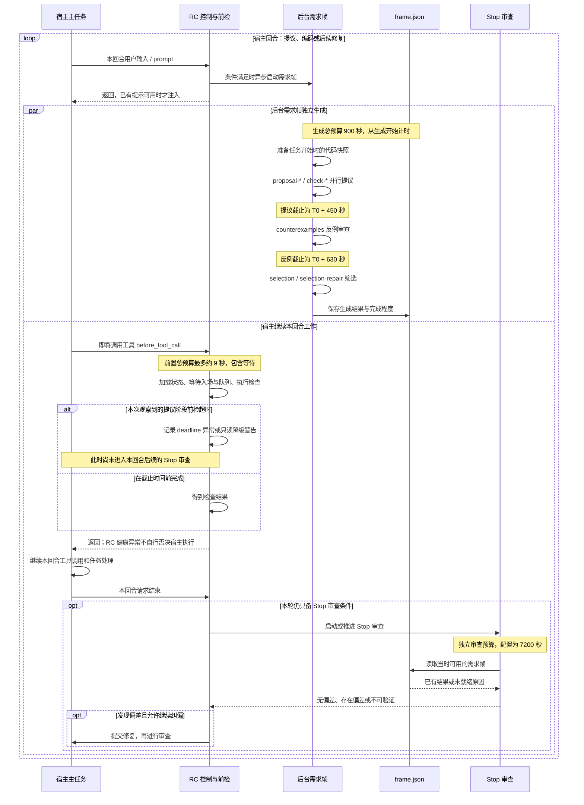
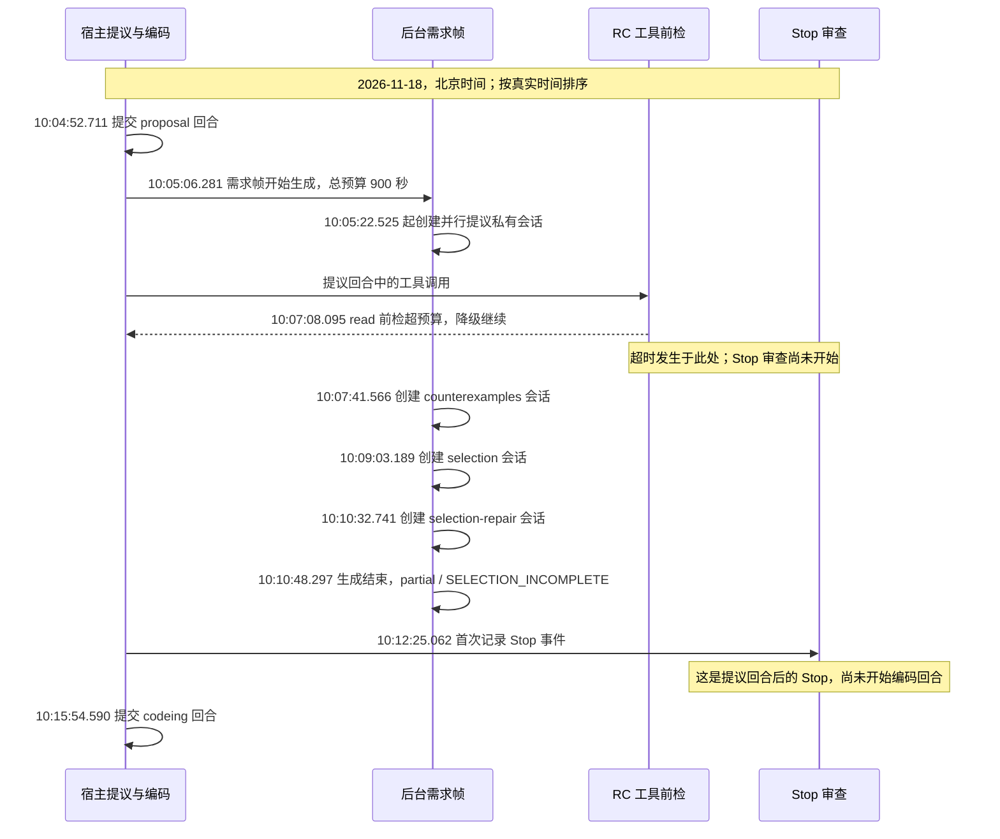
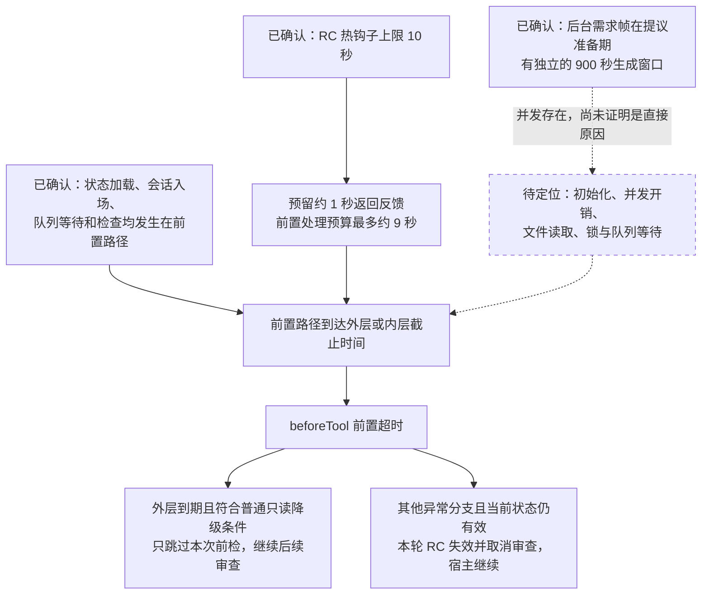

# dae36f7 镜像实验：前置超时发生率、阶段与根因分析

分析日期：2026-11-23。文中展示的时间均为北京时间（UTC+08:00），原始 JSON 中的 UTC 时间已换算。

## 结论

**dae36f7 镜像实验也出现过同类前置超时。这批记录中的历史发生率为 5/73，约 6.8%。**

进一步对齐宿主回合、后台需求帧和 Stop 审查后，确认这 5 条记录都发生在：

- 宿主的 `proposal`（提议）回合中，尚未提交随后的 `codeing`（编码）回合。
- 后台需求帧的提议准备期间，包括提议私有会话尚在启动的情况；反例和筛选私有会话尚未创建。
- 各自归档中首次记录的 Stop 审查之前，或该份归档根本未记录 Stop 事件。

因此，**这 5 条记录中的超时发生在提议阶段的工具前检，不能称为 Stop 终审超时。**

已确认的机制是：RC 的前置钩子采用短预算，状态加载、会话入场、队列等待和实际检查都消耗这份预算。前置路径到达截止时间后，部分调用会使本轮 RC 审查失效；符合条件的普通只读调用可以只跳过本次前检。

**尚未完全定位的是具体慢点。** 这些记录不足以把原因单独归到需求帧模型调用、插件初始化、文件读取或某一处锁与队列等待。时间上并发，不等于已经证明因果。

## 统计口径

检查对象为以下实验批次中的现存归档：

`C:\Users\user\workspace\program_workspace\Experiments\rc-formal13-20261117-dae36f7-v1`

检查了 `tasks/*/*/lab/artifacts/*/*trajectories.zip` 和 `repairs/**/*trajectories.zip`，共 74 份，均含 `harness/gateway/gateway.log`。

排除 1 份 `security_tool_10/image-repair-preflight-20261119` 镜像修复预检。其余归档按完整实验尝试编号识别，保留 `retry`、`parallel` 等后缀；无编号的 rolling 归档从内部 `manifest.json` 补取编号。最终得到 73 个不同尝试编号，覆盖 39 个预定实验轮次。

- 同类 deadline 报错：4/73，约 **5.5%**。
- 明确记录只读前检超时、降级后继续审查：1/73，约 **1.4%**。
- 合计出现同类前置超时：5/73，约 **6.8%**。
- 按预定轮次合并重试及并行尝试后：39 轮中有 5 轮至少一次出现，约 **12.8%**。

这些尝试的归档项目配置均开启 `requirementFrame`。统计包含重试和恢复，并非独立随机试验；它是这批归档中的历史观察率，不是未来稳定概率、单次工具调用超时概率，也不是整个实验失败率。

仅看最终保留的 39 份有效轮次归档，未找到这些同类前置报错。相关证据保存在失败、中断或被后续尝试替代的 `repairs` 归档中。此前只检查 `security_tool_1` 的三份归档，检查范围不足，遗漏了这些记录。

## 三条流程与三种预算

### 宿主主任务：提议回合、编码回合、后续修复回合

实验程序先提交 `proposal` 回合，再提交 `codeing` 回合；必要时还有后续回合。每个回合都可能调用工具，也都可能在回合结束时触发 Stop 审查。

**Stop 并非只在编码全部结束后出现。提议回合结束时也可能有 Stop 审查。** 因此，判断报错发生的阶段，必须同时对齐宿主回合和 RC 审查事件，不能只看实验最终处于什么状态。

### 后台需求帧：提议候选、反例、筛选

需求帧是 RC 自己的后台准备流程，与宿主的 `proposal` 回合不是同一条流程。

在这批配置中，`requirementFrame.timeoutMs = 900000`，即生成预算 900 秒。实际私有会话包含 `proposal-1/2/3`、`check-projectRules`、`check-verification`，随后是 `counterexamples`、`selection`，必要时还有 `selection-repair`。

这些步骤共享生成窗口，不是每个步骤各有 900 秒。以生成开始时间 T0 为基准，所核对代码中的阶段截止时间为：

- 提议阶段：T0 + 450 秒。
- 反例阶段：T0 + 630 秒。
- 整体生成与筛选：T0 + 900 秒。

需求帧异步启动，宿主主任务可以继续执行。提示注入读取已经可用的缓存或生成结果，不要求在首次前置钩子里等待整份需求帧完成。原生用户输入尚不可见时，也存在首次工具前检补启动需求帧的路径。

### 前置钩子与 Stop 审查

RC 将热钩子配置限制在最多 10 秒，并预留约 1 秒返回反馈，前置处理预算因而最多约 9 秒；宿主策略或内层操作可能采用更短预算。

这份短预算覆盖前置路径上的等待和检查。**900 秒后台生成预算不会自动延长约 9 秒的前置预算。** 同样，只把宿主配置中的超时调大，也不会移除 RC 自己的这层限制。

Stop 审查使用独立的长预算。这批配置中的 `stopCorrection.assessmentTimeoutMs = 7200000`，即 7200 秒；它仍受实际剩余窗口、角色预算、取消信号等条件约束。这个值不能解释成触发审查的每个宿主钩子都可同步阻塞 7200 秒。

Stop 会读取当时可用的需求帧；结果尚未就绪时，读取函数返回相应原因，并非固定先等待需求帧的 900 秒窗口耗尽。

## 完整时序：后台生成与宿主执行并行

下面按代码机制绘制，展示流程关系，不按图中垂直距离表达实际耗时。提议回合和编码回合都适用；本次 5 条前置超时记录全部位于提议回合。

图中的两条分支并发运行，不保证需求帧先于宿主开始编码完成，也不保证 Stop 开始时需求帧已经完整生成。若前检异常已使当前轮 RC 失效，本轮后续 Stop 路径可能不再执行。

## 真实样例时序：security_tool_9 / run2

这个样例记录的是只读降级，随后仍有 Stop 事件，可以直接区分“前置超时”和“终审超时”。

其中，需求帧生成耗时约 342 秒。这个耗时不代表工具前检也获得了 342 秒或 900 秒预算。前检入口时间未在该条日志中给出，不能把 `10:07:08.095` 反推为恰好等待了 9 秒。

## 五条记录的阶段与证据

共同阶段判断方法：

1. 读取归档内 `cli-runs/*/state.json` 的 `turns[].phase` 和 `turns[].at`，将报错定位到对应宿主回合。
2. 读取 `rc/requirement-frame/*/frame.json` 的生成开始与结束时间。
3. 读取 `raw-native-captures/*/*.jsonl` 首行的 `timestamp` 与 `cwd`，识别提议、反例、筛选私有会话的创建时间。创建时间不等于模型已经开始执行，也不单独证明哪一步阻塞。
4. 对照 `rc/tasks/*/journal/events.jsonl` 中 `hookEventName = Stop` 的首次记录时间。没有 Stop 记录时，只表述为“该份归档未记录”，不推断系统绝不可能发生未记录的事件。

以下日志位置均指 ZIP 内的 `harness/gateway/gateway.log`。归档链接使用本机绝对路径。

- **security_tool_6 / run0**：2026-11-18 14:28:24.314，第 792 行，记录相同的 `beforeTool` deadline 报错。宿主仍在 `proposal` 回合；需求帧于 14:27:11.749 开始，反例会话于 14:32:29.953 创建；归档 journal 未记录 Stop。见[归档](C:/Users/user/workspace/program_workspace/Experiments/rc-formal13-20261117-dae36f7-v1/repairs/security6-native-timeout-backfills-20261118/archives/dae36f7-formal13-20261117-v1-security_tool_6-run0/partial-trajectories.zip)。
- **security_tool_7 / run1**：2026-11-18 15:09:58.793，第 155 行，相同 deadline 报错。宿主仍在 `proposal` 回合；需求帧于 15:09:33.665 开始，最早的提议私有会话创建于 15:09:59.621，晚于该条报错；归档 journal 未记录 Stop。见[归档](C:/Users/user/workspace/program_workspace/Experiments/rc-formal13-20261117-dae36f7-v1/repairs/native-timeout-backfills-b2-20261118/archives/dae36f7-formal13-20261117-v1-security_tool_7-run1/partial-trajectories.zip)。
- **security_tool_9 / run0-retry2**：2026-11-18 10:54:43.421，第 95 行，相同 deadline 报错。宿主仍在 `proposal` 回合；最早的提议私有会话创建于 10:54:50.205；首次记录 Stop 为 11:12:37.260。见[归档](C:/Users/user/workspace/program_workspace/Experiments/rc-formal13-20261117-dae36f7-v1/repairs/security9-first-round-fourth-attempt-20261118/archives/dae36f7-formal13-20261117-v1-security_tool_9-run0-retry2/partial-trajectories.zip)。
- **security_tool_6 / run2-retry1**：2026-11-19 04:27:57.439，第 86 行，相同 deadline 报错。宿主仍在 `proposal` 回合；需求帧于 04:27:49.985 开始，最早的提议私有会话创建于 04:28:25.525；归档 journal 未记录 Stop。见[归档](C:/Users/user/workspace/program_workspace/Experiments/rc-formal13-20261117-dae36f7-v1/repairs/image-repair-restart-20261119/archives/dae36f7-formal13-20261117-v1-security_tool_6-run2-retry1/partial-trajectories.zip)。
- **security_tool_9 / run2**：2026-11-18 10:07:08.095，第 1265 行，明确记录 `read` 前检超过热钩子预算、跳过该次前检并继续审查。宿主仍在 `proposal` 回合；反例会话于 10:07:41.566 创建，首次记录 Stop 为 10:12:25.062。见[归档](C:/Users/user/workspace/program_workspace/Experiments/rc-formal13-20261117-dae36f7-v1/repairs/security9-third-round-rerun-20261118/archives/dae36f7-formal13-20261117-v1-security_tool_9-run2/partial-trajectories.zip)。

这些证据能确定报错时的外部流程阶段，但报错行没有充分记录工具调用身份、内层截止来源和各等待步骤耗时，不能据此认定报错一定来自某个需求帧提议私有会话。

## 根因图：已确认机制与待定位慢点

实线表示代码或归档可以支持的关系；虚线表示尚待验证的可能耗时来源。图中的截止时间既可能来自外层前检预算，也可能来自其内部更短的检查预算。

### 已确认的处理逻辑

- 进入热钩子的外层包装时计算绝对截止时间，然后调用实际处理函数；等待和执行共同消耗预算。
- 只有满足相应错误码、外层时间已到、调用被识别为普通观察性调用等条件，才走只跳过本次前检的降级分支。不能把所有 `Read` 或所有超时都直接视为可降级。
- 其他异常分支在当前状态仍有效时会设置 `nativeInvalidated`、释放当前 RC 流程为 `RC_HOOK_UNAVAILABLE`，并取消审查控制器。它不会因此自行关闭宿主 Session，也不代表整个实验已失败。
- `The shared Stop deadline was reached` 是共享 deadline 工具的通用错误文本；仅凭名字中的 Stop，不能判断发生在 Stop 终审。

### 尚未确认的根因

- 每条报错具体来自哪个工具调用、哪个私有或主会话。
- 时间主要消耗在初始化、会话入场、队列、锁还是文件检查。
- 四条通用 deadline 报错各自来自外层预算耗尽，还是某个更短的内层截止时间。
- 开启需求帧是否提高发生率、提高多少；当前统计中的配置均开启需求帧，没有条件一致的关闭组可作因果比较。

因此，目前应把“关闭需求帧”视为此前 Demo 验证过的绕过办法，不能据此认定根因已经解决。后续若定位，应首先补齐前置路径的阶段耗时和调用归属，而不是只扩大后台需求帧预算。

## 源码与配置定位

本次检查过镜像包与 Demo 包：两者并非完全相同的安装包，但热钩子限时逻辑一致，需求帧生成模块内容也一致。以下为本机可点击的对应源码位置；文中的阶段判断以归档记录为准。

- [热钩子上限与反馈预留](C:/Users/user/workspace/program_workspace/rc-wt/dae36f7-20261117/lib/openclaw/hook-timeout.mjs:3)。
- [前置预算、截止时间和超时分支](C:/Users/user/workspace/program_workspace/rc-wt/dae36f7-20261117/lib/openclaw/runtime.mjs:2296)。
- [后台需求帧生成与分阶段截止时间](C:/Users/user/workspace/program_workspace/rc-wt/dae36f7-20261117/lib/runtime-v2/requirement-frame.mjs:437)。
- [需求帧异步启动](C:/Users/user/workspace/program_workspace/rc-wt/dae36f7-20261117/lib/runtime-v2/requirement-frame.mjs:622)。
- [Stop 读取当时可用的需求帧](C:/Users/user/workspace/program_workspace/rc-wt/dae36f7-20261117/lib/runtime-v2/requirement-frame.mjs:733)。
- [共享 deadline 错误文本](C:/Users/user/workspace/program_workspace/rc-wt/dae36f7-20261117/lib/runtime-v2/stop-deadline.mjs:1)。
- [镜像输入配置](C:/Users/user/workspace/program_workspace/Experiments/rc-env-20261117-dae36f7/inputs/config.yaml)；实际项目配置还核对了各归档内的 `workspace/.runtime-corrector/config.yaml`。

本文记录的是现有归档的只读分析。本次没有重跑实验或修改 RC、MA、镜像和实验配置。
