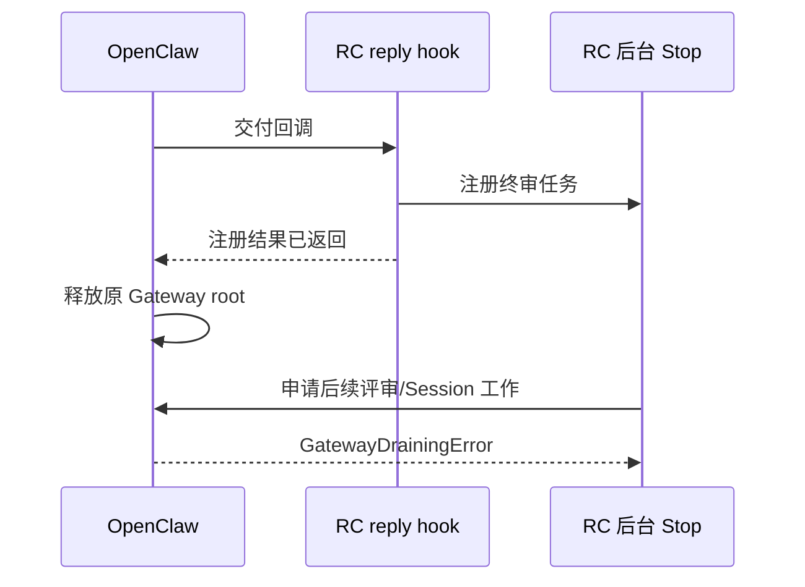

# Session 项目实测失败的原因分析

分析日期：2026-10-15，香港时区。被测源码仍为 `ef3054e`；分析基于 `98d7be8` 留存的 2026-10-14 真实隔离会话证据，另做了零网络、零模型的确定性对照。生产代码没有修改。

故障集中在 RC 与宿主的异步工作衔接，以及同一 Session 内连续 run 的结果传递。已经通过的项目目录、Worktree、显式启用、跨 Session 隔离与重启恢复证据仍成立；新版完整 Stop 闭环未通过。

## 1. 新版 Stop 继承已经释放的 Gateway 工作身份（P1）

入口为 `runtime.mjs:681`。`native-stop-review.mjs:34-58` 分别维护短暂的注册 promise 和长时间评审 promise；它在 `setImmediate` 后开始评审，但只把注册结果返回给 reply hook。宿主原调用因此可以结束，其 Gateway root 工作身份被释放。后续异步链仍继承这个旧 root。

OpenClaw 2026.10.3 的 `isGatewaySubordinateWorkAdmissionClosed` 在继承 root 已 released 时拒绝后续工作，即使 Gateway 整体仍处于 accepting。RC 在 `runtime.mjs:308` 持有的是 **Session 工作租约**，约束具体会话身份与取消；它没有保留 **Gateway root 工作租约**。两者解决不同问题。

真实 A 会话在 22:23:17.385 出现 chat.final；.411 建立 Stop checkpoint；后续 ground-truth-extractor 在 .461 登记、.470 结束，仅 9ms。没有该 Reviewer 的模型生命周期 start，也没有真正执行 Stop Reviewer。任务 journal 随后记录需求刷新失败和 UNVERIFIED。

无模型对照使用正式宿主包的实际 queue / Session admission 实现：活 root 的空任务成功；回调返回并释放 root 后，`globalAdmissionClosed=false`、`subordinateAdmissionClosed=true`，实际 queue 和 Session admission 都抛出相同文案。没有启动 Gateway、模型或改动 Session 数据库。

**证据边界**：真实首次 ground-truth-extractor 拒绝没有保存 stack。源码中最符合 9ms、无模型 start 的路径是 `compat-2026.10.3.mjs:54` → runEmbeddedAgent → command queue guard，但首次具体 guard 行不能称为现场已证实。后续调度通过 `runWithWorkAdmission` 被拒绝的路径确定，并已独立重现。

修复候选是公开的版本 2 plugin service 和宿主提供的 `ctx.scheduler`，让已有 RC Stop 工作在宿主服务的 detached context 中运行，保留插件生命周期和宿主准入保护。它不是业务执行器。其公开类型为 `OpenClawPluginServiceContextV2` / `PluginServiceSchedulerV1`；正式宿主 service scheduler 确实去掉旧 RPC 身份并保留插件 registry。

**候选尚未验证为完整修复**：服务上下文会去掉旧操作员权限，原生续作能否合法派发到业务 Session 仍需真实验证；还需覆盖取消、挂起、重启、原 deadline 和项目切换。不能使用要求宿主签发 scope 的 harness completion custody 充当通用续期，也不能关闭保护或简单扩大 timeout。公开 before_agent_finalize 在宿主检测到确定副作用后也可能拒绝 revision，不能未经验证替换整个闭环。

## 2. 包装器吞掉准入异常，调度器反复读取旧结果（P1）

准确链路：

1. 首轮进入 Stop 核心，Reviewer 刷新失败，写入 `state.nativeAssessment=UNVERIFIED/block`，基础设施失败计数为 1。
2. 下一轮 `runtime.mjs:308` 的宿主准入抛错，尚未进入 finalize callback。
3. `runtime.mjs:759-775` 的公共 Hook 包装记录 warning，返回 undefined，没有替换旧评估。
4. `runtime.mjs:364-376` 忽略本轮返回结果，重新读取旧 `state.nativeAssessment`，判为仍需重试。
5. 核心没有再次执行，基础设施计数保持 1；循环持续到取消或原 deadline。

**此前外层缓存键解释错误，已更正原报告。** finalize 事件没有 toolName，`runtime.mjs:271-274` 直接调用 callback，绕过工具 Hook 的外层 withTaskDecision。内层 `stop:infra-N` 身份正常。

现场 A/B 共 59,214 条调度 retry，但各只有一条核心失败重试记录、一个 Stop assessment，业务纠偏预算均为 0。wire 记录四个模型 run 开始：A/B 的业务 run 和各自 onboarding；后续两个 ground-truth-extractor 私有记录没有模型 start。run 数不等于提供商 HTTP 请求次数。

| 无模型对照 | 宿主准入请求 | 真正进入核心 | 结果 |
| --- | ---: | ---: | --- |
| 首轮失败，后续准入拒绝 | 30 | 1 | 29 条调度 retry、计数恒 1；观察者取消 |
| 每轮准入允许，Reviewer 永久失败 | 3 | 3 | assessment 依次 stop / infra-1 / infra-2；STOPPED_UNVERIFIED；业务预算 0 |

核心原规则是首次尝试加最多两次基础设施重试，第 3 次失败结束并明确保持未验证；它与业务 k=2 分开。需要修复适配层的结果协议：scheduler 只消费本轮、对应 attempt 的新结果；准入失败必须结构化传回并有限结束或进入既有合法故障计数路径。加 sleep 只能降低写入速度，不能修复旧结果误用；无需修改核心缓存或扩大任何预算。

## 3. 新 run 清空共享状态，旧 run 再读取它生成回执（P2）

同 Session 新 run 进入 `runtime.mjs:111-115` 会取消旧 controller、清空旧 nativeAssessment，这是必要的轮次隔离。问题在 `runtime.mjs:379-384`：旧 Stop 先 await 续作派发，之后才从共享 state 读取其评估。

宿主可以在 `native-followup.mjs:72` 的派发 await 返回前启动新 run。旧 Stop 随后读到 null，把已经正式提交的 DEVIATION 记为 UNVERIFIED，丢失 evaluationId。

真实旧版时间线（22:34:43）：正式 DEVIATION 提交 .546；续作 ADMITTED 记录 .807；新 run 的结束事件回溯 startedAt .814；旧 checkpoint 在 .941 写为 UNVERIFIED/null。对外 lifecycle start 包在 .961 才发出，不能用外发顺序替代内部执行顺序。现场未记录内存 reset 的精确时刻。

直接摘取未修改的生产 stateFor / submitNativeFollowup / scheduleNativeStop 函数，使用实际 checkpoint writer，只控制派发时序，已确定性复现：无新 run 时回执为 DEVIATION；在 await 内进入新 run 时，正式结果仍为 DEVIATION，旧回执变为 UNVERIFIED/null。

本例业务修复和最终 task / 续作复验均 PASS，当前用户状态查询读取 task verification。问题损害首轮审计真实性，并令严格闭环试验失败；SETTLED checkpoint 后续会被持久复用，不会自行变正确。

最小修复是派发前固定原 run 已完成的不可变 `{reviewStatus,evaluationId}`，派发后单独处理接收/续作回执；保留新 run 的正常状态重置。必须测试宿主在 run API 返回前触发新 prompt 的情形，同时核对旧 checkpoint、最终 PASS、预算和 epoch。

## 修复范围与验收顺序

先阻止准入异常造成高频旧结果重试，再接入经核验的新版工作生命周期，再固定旧 run 回执。改动应集中在 OpenClaw 适配模块和其调度/反馈状态，不修改需求提取、Reviewer 语义、业务工具路径或基础预算。

修复后重跑两版 E1/E2，补齐真正新版 Stop 中切换，以及原生续作、取消/恢复和非零预算恢复。现有单元测试把 Session admission 模拟成始终成功，也没有模拟派发返回前新 prompt 进入，因此其通过不能覆盖这三个真实边界。

## 分析证据

- 宿主 root 对照：`/tmp/rc-native-root-analysis-20261015/result.json`。
- 重试现场重新计数：`/tmp/rc-stop-retry-analysis-20261015.json`。
- 生产 runtime 的两个无模型诊断：`/tmp/rc-stop-retry-analysis-20261015.test.mjs`；根代理复跑日志 `/tmp/rc-stop-retry-analysis-20261015.log`，2 项通过。
- 原函数竞态重现：`/tmp/rc-checkpoint-race-minimal-20261015.mjs` 和 results JSON；根代理已复跑对照。
- 真实会话来源仍是 [2026-10-14 实测报告](session-projects-extended-results.md) 中原目录和原事务记录。

此次分析没有调用提供商或新增模型调用，也没有修改生产实现。公开 scheduler 仍是待真实验证的修复候选。

可提交的对照结果与原因更正见 [分析证据 JSON](session-projects-diagnosis-20261015.json)。原实验事实保留，先前的缓存键根因推断已明确撤回。

## 原分支对照：哪些方向正确，哪些修复没有完成

本节对照 `codex/openclaw-2026.7.1-2` 的实际 tip `75f5dba`，它是 Session 项目实现 `ef3054e` 的直接父提交。该 tip 已包含原生输出、原生续作和独立 Stop 预算的实验修订；不是早期 f19 的业务控制器实现。

| 问题 | 归属 | 原分支与当前实现证据 |
| --- | --- | --- |
| 新宿主后台 Stop 被拒绝 | 本次宿主迁移缺少生命周期适配 | 新适配处理了项目目录与 SQLite Reviewer 身份，但沿用了旧版本的后台调度执行契约。 |
| 准入异常后继续使用旧结果 | 原分支已有潜在缺陷 | 公共包装与调度循环相同；`0116513` 引入独立调度时，其有限重试依赖“每轮都进入核心”这一未保证的前提。 |
| 初轮 checkpoint 被记为 UNVERIFIED | 原分支已有潜在缺陷，而且能定位到具体修复 | `c29ca4c` 在新 run 时清空共享评估；`f6a1c84` 为防止继承旧验收，在派发后又读取这个可变字段。防串线的目的合理，判断依据应该改为原 run 已提交结果。 |

`native-stop-review.mjs` 和核心 orchestrator/task-store 无 diff；公共包装、新 run reset 代码逐字节相同；scheduler 除项目目录和显式 taskId 外等价。用 git archive 导出原分支，在独立临时目录运行三项无模型反例，根代理复跑 **3/3**：原分支同样会出现 30 次准入请求仅一次核心执行、正常准入下三次失败结束，以及 DEVIATION 正式评估对应 UNVERIFIED/null checkpoint。因此回退分支不能消除两个已有边界缺陷。

应保留原设计：

- `522a6ea`：业务、工具、审批和流式输出由宿主管理；不重建业务 harness。
- `c29ca4c`：原 Session 原生续作，固定幂等 runId；业务 k 与基础设施故障分开；确认拒绝才退款；不确定派发不重放。
- `0116513`：Hook 快速登记，完整终审使用独立 RC 总期限和每角色预算；不把等待业务回复变成等待整个终审。
- 本次 Session 作用域：原生项目权威、旧版兼容绑定、显式启用、scope fingerprint、独立 taskId、切换失效检查。

## 成熟做法在本项目中的具体措施

### 1. 后台工作应转交有生命周期的宿主服务

异步任务需要明确的所有者、取消和结果收集。Python 的 TaskGroup 是这种结构化生命周期的一个官方例子；这里应用的是这一原则，不移植 Python 运行时。[Python TaskGroup](https://docs.python.org/3.13/library/asyncio-task.html#task-groups)

Node 的 AsyncLocalStorage 会把 store 传播到在作用域内创建的异步操作，换成 setImmediate 不会自动获得新的宿主工作身份。因此“移出 Hook 时间窗口”还必须完成工作所有权转交。[Node 异步上下文](https://nodejs.org/api/async_context.html#asynclocalstoragerunstore-callback-args)

最低适配方案：

1. v2026.10.3 入口注册公开 `api.registerService({apiVersion:2,...})`，取得宿主提供的 service scheduler；其所有者是 RC 插件服务。
2. reply/agent_end Hook 只保存现有 PENDING checkpoint，并通过该 scheduler 安排 **现有 RC 评审**。不要另建业务模型 executor。
3. 执行前重新核对 Session incarnation、项目 fingerprint、taskId、原需求和证据；执行时持有公开 Session admission，并组合服务停止、Session 取消、作用域切换与既有 deadline 信号。
4. Reviewer 原提示、角色预算、核心有限重试和 Stop 复验算法照旧。业务续作仍只传原 sessionKey、message、固定 idempotencyKey、deliver:false，模型、cwd、工具和审批继续由宿主选择。
5. 若公开后台能力不可用，应记录当前终审未验证和明确原因；原生模式不能回退旧 RC 手动绑定或 Agent 默认目录。

正式 v2026.10.3 源码已经核对：service scheduler 使用宿主 detached context，保留插件 owner/registry，移除旧 RPC operator authority；`runtime.subagent.run` 调用原 `agent` 方法到传入 Session，没有强制另开业务 child。无 RPC client 时，宿主自己选择 system actor 并保留 plugin attribution，RC 不应伪造操作员角色。目录参数省略时仍由宿主解析 Session 实际目录。

这比笼统宣称“service 无人类权限，所以一定不能续作”更准确，但源码契约不是完整实测。必须验证真实 service → Reviewer → 原 Session 续作 → 宿主工具/审批 → 完整复验。`scheduleSessionTurn` 对此本地插件并非可靠替代：该版本部分工作流能力限 bundled origin；`enqueueNextTurnInjection` 也不自动启动下一轮。

### 2. 内部评审返回本轮结果；公开 Hook 才做降级反馈

将当前 finalize 的核心调用提取成适配层内部函数，例如 `assessOnce(reviewContext, attempt)`，返回带 `runId/assessmentId/scopeFingerprint` 的本轮结构化结果，或者返回本轮取消/准入失败。内部 scheduler 不能再调用吞异常的公开 Hook wrapper，也不能从 Session 的 latest 字段取回结果。

公开 Hook 对 RC 故障的建议式降级仍保留，避免把 RC 健康问题变成宿主工具 veto。内部异常传播与外部产品行为必须分别处理。

重试措施：原核心继续管理 Reviewer/检查故障的首次尝试加两次重试；被释放的 root、权限拒绝、取消、过期 scope 不能对原上下文循环重试。未进入核心的准入失败先有限结束为 UNVERIFIED/CANCELLED，并保留原因，不额外扩大任何 budget。若以后确需重试瞬态准入，应明确归入现有预算且不能在适配层另叠一套无限重试。退避只缓解瞬态负载，不能替代错误分类和本轮结果协议。[AWS 重试经验](https://aws.amazon.com/builders-library/timeouts-retries-and-backoff-with-jitter/)

### 3. 原 run 的结果不可变，Session latest 只用于定位当前活动

评审上下文只需现有信息：`agentId/sessionId/sessionKey/scopeTaskId/scopeFingerprint/originRunId/controller/deadlineAt`。以原 run/assessment 为键保存结果；新 run 仍正常清空自己的 latest 状态。

在续作派发前，从原 assessment 固定并持久化 `{reviewStatus,evaluationId}`，再等待宿主接收。后续派发状态单独更新。不能先 await 原生续作，再读取已可能属于新 run 的 `state.nativeAssessment`。原评估、派发接受、模型读取、业务结束和复验通过是不同事实，不能用任一事件替代全部完成。

已有 native-followup 的 RESERVED、ADMITTED、OBSERVED、FINISHED 是证据阶段：OBSERVED/FINISHED 通过 sourceRecordId/modelObservedAt/finishedAt/reviewStatus 表达，status 可能仍为 ADMITTED。本 MVP 不必迁移出一套新的同义状态枚举。

### 4. 使用已有回执做恢复对账，保持副作用边界

保留 intent-before-send、短锁、固定 runId、payload hash、真实宿主转录来源和不确定派发不重放。成熟幂等 API 用请求身份表示意图；仅看相同文本或接口接受一个 idempotencyKey，不能推断永久 exactly-once。[AWS 幂等 API 设计](https://aws.amazon.com/builders-library/making-retries-safe-with-idempotent-APIs/)

本地任务状态与外部派发是双写；当前 task transaction 和 followup receipt 是两个写入，不能称作完整事务 outbox。借鉴 outbox 的本地 intent 与幂等对账即可，不需要引入 SQS、数据库或通用任务队列；在现有文件事务能覆盖的范围内保存不可变关联，网络调用放在短事务之外。[AWS outbox 指南](https://docs.aws.amazon.com/prescriptive-guidance/latest/cloud-design-patterns/transactional-outbox.html)

新增发现一个恢复覆盖点：native-followup:108 先保存 OBSERVED receipt，随后 :109 更新 task delivered。如果回调失败并重载，sourceRecordId 已有使该更新跳过。真实模块的无模型 callback 失败/重载反例已确认：派发只一次、读取回执已持久、恢复回调零次、OBSERVED journal 零条；这不是实际进程 kill/crash 的通过结论。解决措施是对可信已观察 receipt 幂等补齐 task delivered 及其派生审计；不重新派发、不改变 k。既有 markStopFeedbackDelivered 已按 evaluationId 排除已交付 observation，可复用。

项目切换、取消与在途派发仍分开：尚未提交派发时可禁止；宿主已接受的业务运行由宿主管理。晚到 ACK/结束只归原 scope 历史，不恢复旧纠偏、不改变新项目状态；不能承诺撤回已经接受的业务动作。已在仓库恢复设计中规定的这些边界应落实到测试，而不是删除取消信号或扩大原始用户权限。

## 最小实施与验收清单

| 步骤 | 具体修改 | 验收要求 |
| --- | --- | --- |
| 1 | runtime 内部本轮结果协议，停止 stale outcome 循环 | 首次准入拒绝；首轮核心失败后拒绝；既有三次永久故障结束；业务 k 不变；原 deadline 不重开 |
| 2 | 派发前固定原 run checkpoint | 宿主 run API 返回前启动新 prompt；旧结果仍 DEVIATION/原评估 ID，新 run 独立；不继承旧 PASS |
| 3 | 新版公开 service 生命周期适配 | Hook 已返回后真正启动 Reviewer；原 Session/真实 Worktree 续作修改文件；角色预算超过短 Hook 窗口仍有效；正常文字流与审批保留 |
| 4 | receipt 幂等恢复对账 | RESERVED 后故障、宿主接受但 ACK 丢失、OBSERVED 后回调失败、重复 Hook/模块重载；已派发至多一次，未知不退款/不重放 |
| 5 | 两版真实交叉验收 | A/B 并发，评审中及派发在途时换项目，晚到结果，取消/挂起/重启，非零预算恢复；目录、来源、实际产物、回执和复验相互对应 |

步骤 1/2 可先用确定性反例修补，并同时覆盖两版；步骤 3 必须验证真实公开 SDK 服务执行链，不能只把 SDK 版本声明改为兼容。权限/生命周期能力、项目解析与 Reviewer transport 都应由 OpenClaw 兼容模块提供窄接口，纠偏核心继续使用原算法。

原分支函数与历史审计：`/tmp/rc-original-branch-comparison-20261015.json`；原分支反例根代理日志 `/tmp/rc-original-branch-rerun-20261015.log`。恢复窗口反例：`/tmp/rc-observed-recovery-gap-results-20261015.json`。本轮未新增真实模型调用，以上都是分析与待实施措施。
