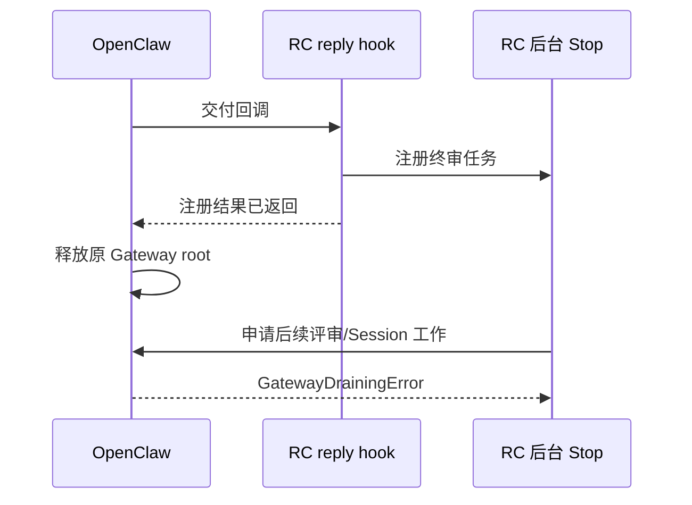

# Session 项目实测失败的原因分析

分析日期：2026-10-15，香港时区。被测源码仍为 `ef3054e`；分析基于 `98d7be8` 留存的 2026-10-14 真实隔离会话证据，另做了零网络、零模型的确定性对照。生产代码没有修改。

故障集中在 RC 与宿主的异步工作衔接，以及同一 Session 内连续 run 的结果传递。已经通过的项目目录、Worktree、显式启用、跨 Session 隔离与重启恢复证据仍成立；新版完整 Stop 闭环未通过。

## 1. 新版 Stop 继承已经释放的 Gateway 工作身份（P1）

入口为 `runtime.mjs:681`。`native-stop-review.mjs:34-58` 分别维护短暂的注册 promise 和长时间评审 promise；它在 `setImmediate` 后开始评审，但只把注册结果返回给 reply hook。宿主原调用因此可以结束，其 Gateway root 工作身份被释放。后续异步链仍继承这个旧 root。

OpenClaw 2026.10.3 的 `isGatewaySubordinateWorkAdmissionClosed` 在继承 root 已 released 时拒绝后续工作，即使 Gateway 整体仍处于 accepting。RC 在 `runtime.mjs:308` 持有的是 **Session 工作租约**，约束具体会话身份与取消；它没有保留 **Gateway root 工作租约**。两者解决不同问题。

真实 A 会话在 22:23:17.385 出现 chat.final；.411 建立 Stop checkpoint；后续 ground-truth-extractor 在 .461 登记、.470 结束，仅 9ms。没有该 Reviewer 的模型生命周期 start，也没有真正执行 Stop Reviewer。任务 journal 随后记录需求刷新失败和 UNVERIFIED。

无模型对照使用正式宿主包的实际 queue / Session admission 实现：活 root 的空任务成功；回调返回并释放 root 后，`globalAdmissionClosed=false`、`subordinateAdmissionClosed=true`，实际 queue 和 Session admission 都抛出相同文案。没有启动 Gateway、模型或改动 Session 数据库。

**证据边界**：真实首次 ground-truth-extractor 拒绝没有保存 stack。源码中最符合 9ms、无模型 start 的路径是 `compat-2026.10.3.mjs:54` → runEmbeddedAgent → command queue guard，但首次具体 guard 行不能称为现场已证实。后续调度通过 `runWithWorkAdmission` 被拒绝的路径确定，并已独立重现。

修复候选是公开的版本 2 plugin service 和宿主提供的 `ctx.scheduler`，让已有 RC Stop 工作在宿主服务的 detached context 中运行，保留插件生命周期和宿主准入保护。它不是业务执行器。其公开类型为 `OpenClawPluginServiceContextV2` / `PluginServiceSchedulerV1`；正式宿主 service scheduler 确实去掉旧 RPC 身份并保留插件 registry。

**候选尚未验证为完整修复**：服务上下文会去掉旧操作员权限，原生续作能否合法派发到业务 Session 仍需真实验证；还需覆盖取消、挂起、重启、原 deadline 和项目切换。不能使用要求宿主签发 scope 的 harness completion custody 充当通用续期，也不能关闭保护或简单扩大 timeout。公开 before_agent_finalize 在宿主检测到确定副作用后也可能拒绝 revision，不能未经验证替换整个闭环。

## 2. 包装器吞掉准入异常，调度器反复读取旧结果（P1）

准确链路：

1. 首轮进入 Stop 核心，Reviewer 刷新失败，写入 `state.nativeAssessment=UNVERIFIED/block`，基础设施失败计数为 1。
2. 下一轮 `runtime.mjs:308` 的宿主准入抛错，尚未进入 finalize callback。
3. `runtime.mjs:759-775` 的公共 Hook 包装记录 warning，返回 undefined，没有替换旧评估。
4. `runtime.mjs:364-376` 忽略本轮返回结果，重新读取旧 `state.nativeAssessment`，判为仍需重试。
5. 核心没有再次执行，基础设施计数保持 1；循环持续到取消或原 deadline。

**此前外层缓存键解释错误，已更正原报告。** finalize 事件没有 toolName，`runtime.mjs:271-274` 直接调用 callback，绕过工具 Hook 的外层 withTaskDecision。内层 `stop:infra-N` 身份正常。

现场 A/B 共 59,214 条调度 retry，但各只有一条核心失败重试记录、一个 Stop assessment，业务纠偏预算均为 0。wire 记录四个模型 run 开始：A/B 的业务 run 和各自 onboarding；后续两个 ground-truth-extractor 私有记录没有模型 start。run 数不等于提供商 HTTP 请求次数。

| 无模型对照 | 宿主准入请求 | 真正进入核心 | 结果 |
| --- | ---: | ---: | --- |
| 首轮失败，后续准入拒绝 | 30 | 1 | 29 条调度 retry、计数恒 1；观察者取消 |
| 每轮准入允许，Reviewer 永久失败 | 3 | 3 | assessment 依次 stop / infra-1 / infra-2；STOPPED_UNVERIFIED；业务预算 0 |

核心原规则是首次尝试加最多两次基础设施重试，第 3 次失败结束并明确保持未验证；它与业务 k=2 分开。需要修复适配层的结果协议：scheduler 只消费本轮、对应 attempt 的新结果；准入失败必须结构化传回并有限结束或进入既有合法故障计数路径。加 sleep 只能降低写入速度，不能修复旧结果误用；无需修改核心缓存或扩大任何预算。

## 3. 新 run 清空共享状态，旧 run 再读取它生成回执（P2）

同 Session 新 run 进入 `runtime.mjs:111-115` 会取消旧 controller、清空旧 nativeAssessment，这是必要的轮次隔离。问题在 `runtime.mjs:379-384`：旧 Stop 先 await 续作派发，之后才从共享 state 读取其评估。

宿主可以在 `native-followup.mjs:72` 的派发 await 返回前启动新 run。旧 Stop 随后读到 null，把已经正式提交的 DEVIATION 记为 UNVERIFIED，丢失 evaluationId。

真实旧版时间线（22:34:43）：正式 DEVIATION 提交 .546；续作 ADMITTED 记录 .807；新 run 的结束事件回溯 startedAt .814；旧 checkpoint 在 .941 写为 UNVERIFIED/null。对外 lifecycle start 包在 .961 才发出，不能用外发顺序替代内部执行顺序。现场未记录内存 reset 的精确时刻。

直接摘取未修改的生产 stateFor / submitNativeFollowup / scheduleNativeStop 函数，使用实际 checkpoint writer，只控制派发时序，已确定性复现：无新 run 时回执为 DEVIATION；在 await 内进入新 run 时，正式结果仍为 DEVIATION，旧回执变为 UNVERIFIED/null。

本例业务修复和最终 task / 续作复验均 PASS，当前用户状态查询读取 task verification。问题损害首轮审计真实性，并令严格闭环试验失败；SETTLED checkpoint 后续会被持久复用，不会自行变正确。

最小修复是派发前固定原 run 已完成的不可变 `{reviewStatus,evaluationId}`，派发后单独处理接收/续作回执；保留新 run 的正常状态重置。必须测试宿主在 run API 返回前触发新 prompt 的情形，同时核对旧 checkpoint、最终 PASS、预算和 epoch。

## 修复范围与验收顺序

先阻止准入异常造成高频旧结果重试，再接入经核验的新版工作生命周期，再固定旧 run 回执。改动应集中在 OpenClaw 适配模块和其调度/反馈状态，不修改需求提取、Reviewer 语义、业务工具路径或基础预算。

修复后重跑两版 E1/E2，补齐真正新版 Stop 中切换，以及原生续作、取消/恢复和非零预算恢复。现有单元测试把 Session admission 模拟成始终成功，也没有模拟派发返回前新 prompt 进入，因此其通过不能覆盖这三个真实边界。

## 分析证据

- 宿主 root 对照：`/tmp/rc-native-root-analysis-20261015/result.json`。
- 重试现场重新计数：`/tmp/rc-stop-retry-analysis-20261015.json`。
- 生产 runtime 的两个无模型诊断：`/tmp/rc-stop-retry-analysis-20261015.test.mjs`；根代理复跑日志 `/tmp/rc-stop-retry-analysis-20261015.log`，2 项通过。
- 原函数竞态重现：`/tmp/rc-checkpoint-race-minimal-20261015.mjs` 和 results JSON；根代理已复跑对照。
- 真实会话来源仍是 [2026-10-14 实测报告](session-projects-extended-results.md) 中原目录和原事务记录。

此次分析没有调用提供商或新增模型调用，也没有修改生产实现。公开 scheduler 仍是待真实验证的修复候选。

可提交的对照结果与原因更正见 [分析证据 JSON](session-projects-diagnosis-20261015.json)。原实验事实保留，先前的缓存键根因推断已明确撤回。
