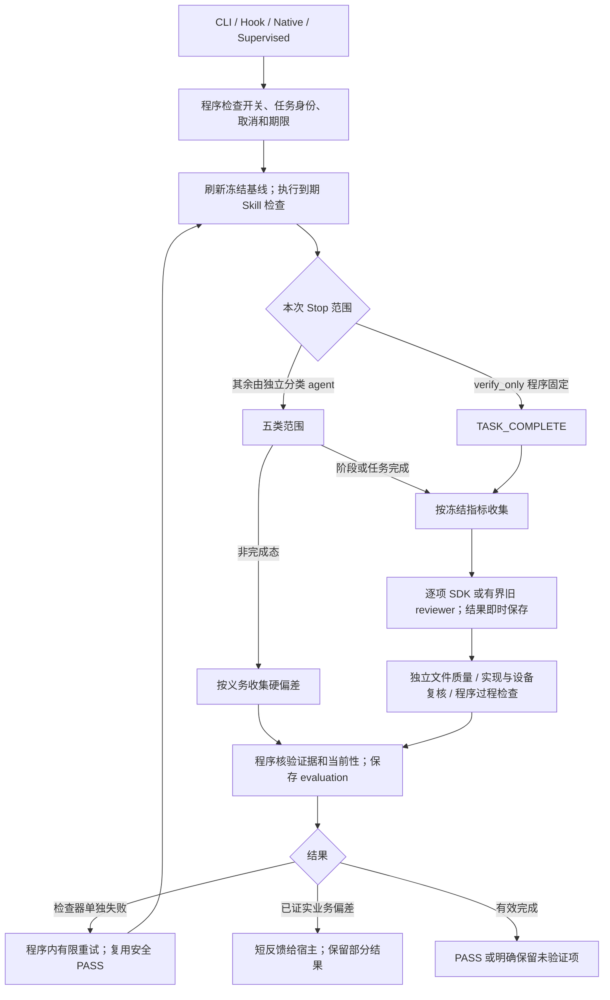

# Stop 全路径审查与分层修复（2026-10-24）

本文件保留 `183c20f` 前后的历史审查；后续完整调用链确认的断点与修复记录见 [Stop 调用链修复](stop-call-chain-fixes-20261024.md)。不能将此前的模块通过当成这些新断点已被覆盖。

状态：完整 Stop / 厨房端到端长跑暂停。审查基准为 `b763eaf` 加工作区候选改动；不改原项目、原 session、原 Gateway。本文是修复清单和验证记录，不是完整 Stop 通过证明。

## Stop 的职责与成功定义

Stop 决定当前停止是否需要验收、按冻结义务收集可核查的判断、保存已完成结果、给宿主有限且可行动的反馈。它不负责开发业务，不重新定义需求，不以另一轮大模型总评代替程序汇总。

冻结对象集合为 O；程序分配的短任务为 T。要求 `union(owned(t)) = O`，每个对象在一次收集中只有一个所有者。文件质量任务独立，不伪造指标对象。任务数随对象数和已声明文件数线性增长，不生成指标 × 文件 × 场景的组合。

PASS 需要完整且有效的收集、所有适用对象通过、没有阻断问题或检查器错误。合法 UNVERIFIED 可以按现有策略结束，但必须保留未验证状态；失败、取消、预算耗尽、宿主丢失都不能被实验标成全部通过。

## 执行路径清单

1. **CLI Hook**：`scripts/runtime-event.mjs` → core orchestrator → 协议输出。启用的 Stop 外层异常先阻断，连续失败有限次后显式未验证放行；禁用、shadow、不适用事件不强行阻断。CLI 没有 OpenClaw native 收据/调度器。
2. **OpenClaw Hook / finalize**：`lib/openclaw/runtime.mjs` → 同一个 core。任务内启用状态被锁定，非用户修改不能自行关闭终审。父级 deadline/abort 传入 reviewer。
3. **Native 终审**：业务输出后注册独立 review owner，写 PENDING/RUNNING；评审提交先落盘，再允许纠偏子运行。`assessment` 等一次判断，默认 `until_pass` 等整个已关联纠偏链；链有固定总 deadline，子记录有各自 deadline，不能把后者误当链总期限。2026.10.3 调度器和当前实测 2026.7.1-2 回退必须分开声明。
4. **Supervised 执行**：控制器完成业务轮次后调用 `assessSupervised`；检查器失败在控制器内重试，真正业务偏差才进入下一业务轮次。用户输入、证据变化、取消使旧判断失效。
5. **共同前置**：跳过内部评审运行、禁用/无任务事件；检查 correction barrier / completion claim / verify_only / Skill watcher。先刷新 Ground Truth，再执行到期 Skill 检查；这些独立于指标收集器，也可能失败或阻断。
6. **确定范围**：verify_only 由程序固定 TASK_COMPLETE；其余调用独立 native 分类器，至多 60 秒，不能输出指标判断。INTERMEDIATE / WAITING_FOR_USER / BLOCKED_EXTERNAL 只收集相关硬约束偏差；STAGE_COMPLETE 和 TASK_COMPLETE 才计算指标。
7. **短任务收集**：`review-collector.mjs` 按 sourceId / evidence owner 分组，支持的指标独立一项，旧组合最多四项；每项独立会话、单项最长 120 秒并受父 deadline 约束。每项保存后再 close；某项超时/无效输出记未验证，继续其他项。保留完整分母及未启动清单。
8. **SDK 路径**：单对象 TASK_COMPLETE、明确 CURRENT_TASK，以及候选支持的 typed CONDITIONAL；绑定文件的 TASK_COMPLETE 质量任务；实现复核中的 CURRENT_TASK 源码对象。冻结小范围原始资料；Pi 负责循环/压缩，轨迹索引和 cite 注册由程序维护；请求前健康检查拒绝危险请求。模型返回 citeId，程序取原文，不让模型复写引文。
9. **Native 回退路径**：分类器、STAGE_COMPLETE、findings-only、FUTURE/UNKNOWN/自由文字旧适用范围、无绑定质量任务、无 collection 能力的 factory。已有分页/读取额度/时间限制，但没有与 SDK 相同的压缩和检索保障。不能宣称“所有路径都走鲁棒 SDK”。
10. **源码 / 设备复核**：实现纠偏开启时再检查 source-owned M09/M12，先做确定性 Kit 检查和可用的设备/构建梯级，后做模型源码判断。源码 PASS 不等于运行验证 PASS；未知环境保留 assurance 降级说明。
11. **确定性检查与汇总**：程序的过程检查对其拥有的对象有最终证据权；校验对象覆盖、证据和当前性，持久化 evaluation 后才更新 task。真正偏差消耗业务纠偏次数，检查器错误使用独立次数。
12. **反馈 / 重试 / 退出**：短诊断 + 证据位置，超长详情落文件，最终包有硬上限。native 纠偏收据必须匹配当前输入并证明模型已观察；ADMITTED 不等于已观察/已完成。取消、reset、替代运行、deadline、owner 丢失必须与正常验收区分。进程被硬终止时磁盘 RUNNING 可以成为孤儿；同一身份重启能标记 OWNER_LOST，不能宣称任意孤儿自动恢复。

CLI 的真实 `startRoleReviewer` 已支持同一逐组 collector，但使用宿主 CLI 的 JSON reviewer，不进入 OpenClaw 专属 SDK。没有 `reviewCacheIdentity` 的 factory 不复用 PASS。CLI 子进程和 OpenClaw native/SDK 的取消与压缩能力不能混称：本轮双级信号修复针对 OpenClaw factory；CLI 保留原有子进程生命周期与 deadline 机制。

## 失败证据合并

- **大公共索引 / 重复读取**：复杂案例早期 0/4；拆任务没有去掉每项重复的大公共材料。后续 SDK 改为冻结小范围原文、可检索过程记录、原文分块和 cite；不能据此声称旧 native 路径也已解决。
- **错误候选对象**：03 将首个配置文件当交付物，出现假通过/假偏差；`b763eaf` 改为程序声明绑定。无绑定是 UNVERIFIED，零模型调用，不删分母。当前04的64项无绑定即此状态，不是64项通过。
- **GT 格式错误**：04 首次48个 operation 中47个 `applicability:null`，修复后成功；不是 JSON 被截断。候选仅澄清可选字段须省略，不能保证任意大 JSON 都正确。
- **单项时间用尽**：04 `M12:gt-005` 约120秒，15轮/24工具，最高约45k上下文，未见 overflow。运行证据定位 prompt 改善了单项重放，但工具读取字节反而增加，不能声称全面省 token。
- **条件项 native 读取额度**：04 `M11:gt-031` 为133255/131072字节、49/64次；第二次仍失败。候选 typed CONDITIONAL 接 SDK，保留真实触发条件和 NA 证据要求，不新增条件组合。
- **整体文件质量超时**：04单个 native 质量任务反复120秒失败。候选改为已声明文件逐个 SDK；无绑定 / 阶段范围仍有旧回退，必须在门禁覆盖。
- **M15 证据角色混淆**：04静态风险和 SOFT openQuestion 被升为 HARD 执行闭环缺陷。新 prompt 对照只支持有限结论：4个有固定 oracle 的案例正确，原始争议案例按普通 CLI 范围解释；不能称所有 M15 问题解决。
- **源码覆盖运行结论（代码可复现）**：实现复核无条件覆盖同 objectId 的旧判断。源码 PASS 可以掩盖运行 DEVIATION；源码 U 也会替代先前 P。前者必须修；后者先保持保守，不凭空升级通过。
- **仅检查器失败仍唤醒宿主（代码 + 实际证据）**：04第二个 evaluation `stop-20261024T094121137Z-b9444c2b` 无 blocking objects、无 findings，仍以部分反馈发起第三轮。只要 retained>0 就启用 continuation 会重复业务和整组评审。应仅在有已证实可修复偏差时唤醒；否则程序内检查重试。
- **重复的实现复核**：PASS 缓存只支持普通 Stop，源码复核在相同冻结输入的检查器重试也重复18项。应复用同一保守缓存机制，独立角色命名空间，仍验证输入身份和所有读取依赖；不做新的细粒度依赖调度器。
- **宿主丢失 / 错误观察标准**：04进程消失，无正式取消/自然超时，无完整 report；不能称63分钟一直评审。旧观察器只认全部 PASS，也会把合法未验证结束误当超时。观察器应分别记录 ALL_METRICS_PASS、SETTLED_WITH_UNVERIFIED、NOT_ACCEPTED，并在已知 owner 退出时立即判未完成。
- **准确度未关闭项**：花店 F08 语义假 PASS 仍在；已知全回归有一个 SessionEnd 时序波动，单独通过不等于全回归通过。不通过扩预算/放宽断言/改原始验收消除这些记录。

## 本轮集中修复边界

保留并审核工作区的 conditional / 单文件质量 / 证据语义校验 / 运行闭环 prompt 候选；不再扩展 workflow。补三个共同机制：实现结论不能抹掉已证实失败；checker-only 不启动业务续作；相同源码输入复用已校验 PASS。观察器接入真实终止判定和 owner 存活检查，原状态只读。

补充代码复现：native factory 原本只监听工厂的取消，忽略传入单项的取消；SDK 则采用二选一，会在提供单项信号时漏掉不同的父取消。两个用例修复前失败。现用 `AbortSignal.any` 合并不同信号，并在两条执行路径、恢复结果的有效性检查和监听清理中一致使用；没有新增调度器或重试。

不做：大一统调度器、额外汇总 agent、指标笛卡尔积、自动改需求、无限重试、放大预算、跨输入盲用旧 PASS。暂不重写旧 native 全路径；先准确呈现其有界失败能力。

## 验证门禁（按顺序）

1. **无模型复现与模块测试**：结论覆盖、checker-only 与真偏差分流、角色隔离缓存及变更失效、单文件/条件项校验、deadline/取消/迟到提交/owner丢失/反馈硬上限。
2. **组合离线测试**：CLI、native assessment/until_pass、supervised、三类非终态、阶段/任务完成、verify_only、禁用/shadow、实现开启/关闭、失败兄弟结果保留。使用已有 fake transport，不启动 Gateway。
3. **有界真实单项复核**：只运行已冻结的条件项和单文件质量正反例，不开发 app、不整轮终审；原条件/原文件/原预算不变。任一失败先回看轨迹，不追加长跑。
4. **回归与交付检查**：相关回归之后再全回归；失败单列，不改预算或断言掩盖。仅验证新版本的包，不交付旧 dist。
5. **完整 Stop 与端到端**：保持暂停。本轮不自动重启04、不启动05、不从头开发厨房；待上述证据汇总后再安排。

## 当前结果

全路径审查完成，修复和验证结果如下：

- 三个共同问题的5个新用例修复前全部失败，修复后全部通过；额外 core 接线验证确保运行 DEVIATION 经源码 PASS 后仍阻断且保留正确 reviewer 来源。
- 第一层模块/组合测试345/345通过，日志 `.runtime-correction/stop-audit-layer1-final-20261024.log`。第一次344/345，旧测试仍断言新运行提示为空；更新为验证真实调用/结果绑定及缺证据不能通过后重测通过，没有放宽业务验收。
- 第二层路径测试131/131通过，日志 `.runtime-correction/stop-audit-layer2-20261024.log`，包含 native assessment/until_pass、supervised、取消、重试、反馈、owner和兼容路径。两级取消补充用例修复后2/2通过；最终全回归覆盖该后续变动。
- 四个真实单项通过实际 factory/collector/SDK 完成，未调用 native 回退、未启动 Gateway、未执行业务；保护输入未变。历史条件项31.078秒 NOT_YET_APPLICABLE，历史文件质量项66.971秒 DEVIATION，文件质量正反例5.262秒 PASS / 6.573秒 DEVIATION。每项仍120秒，完整原合同及原条件保留，无扩预算、无追求特定结果的重复调用。
- 引用逐项按冻结源 SHA 和行范围核验；明确 oracle 的两个质量对照2/2符合。历史条件项与冻结轨迹中尚未收到纠偏反馈一致；历史质量 D 仍采用“负库存包含外部改写状态”的解释，gt-048 SOFT openQuestion 对该范围有歧义，不能将此项计为准确度已通过，更不能当作实际运行失败。审计记录 `.runtime-correction/all-metrics-lab-20261024/quality-conditional-factory-controls/live-audit-01/semantic-audit.json`。
- 上述真实单项的源码冻结为 `code-freeze-audit.json`；之后仅补了已由离线用例验证的双级取消传递。四个真实调用本身不能认证这个后续差异。
- 完整 Stop、厨房端到端开发仍暂停；未安装到原 Gateway，旧 dist 不作为本轮可交付包。

全回归：1416项，1404通过、3失败、9跳过，165.057秒，日志 `.runtime-correction/stop-audit-full-regression-20261024.log`。其中一个旧运行提示空值断言导致子用例和父用例各记一次失败，另一个为已有 SessionEnd watchdog 实际1227.097毫秒超过1200毫秒。修正提示断言后，最终适配器/双级取消/CLI协议/shadow等相关测试143/143通过，日志 `.runtime-correction/stop-audit-final-transport-20261024.log`；SessionEnd原模块单独7/7通过，日志 `.runtime-correction/stop-audit-session-end-isolated-20261024.log`。没有改 SessionEnd 代码、原断言或预算；未再整轮重复全回归，因此不能宣称全回归全绿。

最终观察器27/27通过（`.runtime-correction/stop-audit-observer-final-20261024.log`），补充确认拒绝续作属于结束失败，不能像未完成收据一样一直等待；历史拒绝记录也不能阻塞之后的正式通过。本轮未再新增模型调用。

完整 Stop 的历史失败、质量项的输入域歧义、F08语义漏检和未覆盖的旧 native 范围均继续保留，不计通过。本检查点可以复盘和继续隔离验证，不是部署或完整长跑的放行证明。
