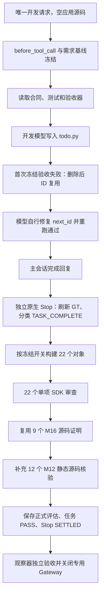

# TodoList 端到端实验：默认指标开关与实际执行链路

2026-10-25，北京时间 **08:52:50–09:16:38，23 分 48.464 秒**。

**本次插件正常完成了启用范围内的验收闭环：核心任务为 `COMPLETED / PASS`，22 个指标对象全部通过，独立冻结验收为 10/10 PASS。** 开发模型在进入 Stop 前自行修复一次 ID 复用缺陷；插件 Stop 纠偏次数为 0。不能据此声称两次纠偏、异常中断或预算耗尽分支已经实测通过。

本次也暴露了两个范围/表达问题：M15 已开启但没有独立计量对象；开发回复在独立 Stop 完成前就声称纠偏诊断通过。最终后台验收确实通过，这两点仍应保留在分析中。

## 冻结配置与被测版本

- 仅一次从空源码开始的业务开发请求；观察程序没有编写、复制或修复业务应用。
- 文档纠偏和 Skill 纠偏关闭；Stop 和实现核验开启；`maxCorrectionsPerEpoch: 2`，`waitMode: until_pass`。没有在投入后增加等待预算或改变开关。
- 实验项目 YAML 未逐项覆盖指标开关，实际使用当前插件默认值：M08、M09、M12、M13、M15、M16 开启，其余十项关闭；`fileQualityReviewEnabled: false`。
- 有效配置与任务内冻结的 `stop.reviewPolicy` 完全一致。十个关闭指标的人口均为 0、报告为 `DISABLED`、值为 null，收集器和 SDK 均未派发它们。
- 宿主 OpenClaw `2026.7.1-2`，模型 `custom/deepseek-v4-flash`，Python `3.13.13`。使用独立 Gateway、配置、会话、Git 仓和宿主 worktree；未替换原运行宿主。
- 分支 `codex/m16-production-implementation-coverage`，HEAD `4f1b36f684790d8d3ad331cfb1d97456f2681510`。被测内容还包括当前未提交的指标开关改动，因此 HEAD 不能单独代表完整被测版本；精确字节以 `source-admission.json` 为准。
- 154 个保留的插件源码/配置文件与投入快照一致；宿主构建生成的 5 个文件单独排除。合同、测试、验收器、RC 配置及 `.gitignore` 五项保护输入的 worktree 投入字节均未改变；原宿主两份配置/模型缓存文件的哈希未改变。

证据：[投入快照](../../experiments/live-todolist-switches-20261025-01/source-admission.json)、[有效配置](../../experiments/live-todolist-switches-20261025-01/effective-config.json)、[配置与链路审计](../../experiments/live-todolist-switches-20261025-01/execution-chain.json)、[保护输入检查](../../experiments/live-todolist-switches-20261025-01/postcheck.json)。

## 实际时间线

1. **08:53:29**：投入唯一业务开发请求，宿主 worktree 中不存在 `todo.py`。首次工具调用触发 onboarding；**08:53:38–08:56:53**，独立 `onboarding-extractor` 用 195.406 秒冻结第 1 版 GT，共 30 条 claim，其中 9 条 requirements、1 条 testContracts、1 条 acceptanceCriteria、7 条 capabilityChecklist。
2. 开发模型读取合同、测试和验收器，**08:57:32** 写入首次实现。写入后还有一次 20.716 秒的 GT 刷新；最终 GT 版本仍为 1。
3. **08:58:00**：第一次验收返回失败，`test_delete_does_not_reuse_ids` 得到 `1 != 2`；其余八项单元测试通过，连接旅程尚未执行。**08:58:07**：模型一次 edit 中修改四处逻辑，新增并持久化 `next_id`，不再从现有项目的最大 ID 重新计算。**08:58:20**：第二次冻结验收退出 0，九项单元测试和连接旅程通过。
4. **08:58:24**：开发模型发送完成回复，独立原生 Stop 开始。Stop 先刷新 GT，耗时 68.665 秒，再由一个原生 `stop-reviewer` 用 35.937 秒确定 `TASK_COMPLETE` 范围。这里的原生角色是完成范围分类，后面的单项 SDK 审查另外计数。
5. **09:00:10–09:13:47**：普通 Stop 串行审查 22 个对象，耗时 **13 分 37.863 秒**。其中 M12 12 项为 `RUNTIME_ACCEPTANCE`，M13 1 项为 `EXECUTION_CLOSURE`，M16 9 项为 `SOURCE_IMPLEMENTATION`。22/22 全部完成，无收集器失败。
6. **09:13:47–09:16:30**：独立实现核验只派发 12 个 M12 源码对象，耗时 **2 分 42.494 秒**，全部通过。九个已有读取证明和结构化生产链路证明的 M16 结果记录在 `reusedStopSourceObjectIds`，没有再派发 M16。当前实现路径是静态核验，设备保证为 `NO_DEVICE_CHECK_DECLARED`，build/smoke 为 skipped；不能声称运行了设备构建或真机验证。
7. **09:16:30**：正式评估保存，任务成为 `COMPLETED / PASS`，原生 Stop 为 `SETTLED / PASS`，无纠偏续跑回执。观察器再独立执行原样冻结验收，仍为 10/10 PASS，随后关闭自己的 Gateway；**09:16:38** 收尾完成。关闭后再次读取核心任务，仍为 `COMPLETED / PASS`。

第一条递归目录查看命令还遇到了 RC 内部目录的路径读取错误；模型随后改用非递归列表成功。主任务共四次 exec，失败两次：目录查看一次、首次业务验收一次。Gateway 错误为 0 不代表所有业务工具调用都一次成功。

证据：[主会话分析](../../experiments/live-todolist-switches-20261025-01/analysis.json)、[开发自修复记录](../../experiments/live-todolist-switches-20261025-01/business-self-repair.json)、[结束报告](../../experiments/live-todolist-switches-20261025-01/report.json)、[关闭后任务状态](../../experiments/live-todolist-switches-20261025-01/post-close-state.json)。

## 实际调用链与证据职责

代码入口与现场记录对应如下：

- `lib/openclaw/entry.mjs:54–55` 注册 `before_tool_call` 和 `reply_payload_sending`。主回复经过 `runtime.reply()`，在 `lib/openclaw/runtime.mjs:865` 起调度 `scheduleNativeStop()`；后台 Stop 的工作由 `native-stop-review.mjs` 持久化并收尾。
- `scheduleNativeStop()` 调用 `handlers.finalize()`，后者进入 `handleRuntimeV2Event(... Stop ...)`。`orchestrator.mjs:1274` 的 `freezeStopReviewPolicy()` 保存任务策略；`assessStop()` 根据它生成当前人口、证据和候选范围，然后调用收集器。开关在对象派发前生效，报告层也保留禁用状态。
- `review-collector.mjs` 按对象建立独立任务；OpenClaw reviewer factory 在符合范围时选择 `runOpenClawStopTask()`，经 `runStopTaskReview()` 进入只读单项 SDK。它与前述原生 Stop 分类会话是不同执行层。本次实际存在 **4 个原生内部角色运行 + 34 个单项 SDK 运行**，不是 38 次业务开发或 38 个独立验收单元。
- `orchestrator.mjs:1587–1612` 调用实现审查并保存 M16 复用归属。Stop 的 M12 使用实际履约/运行证据，实现审查的同名 M12 使用源码证据；这解释了 M12 共 24 个单项会话、最终只有 12 个指标对象。34 个单项运行均为 PASS，不应把它们算成 34 个唯一需求。
- 最终状态来自当前正式评估 `stop-20261025T011630413Z-2fc7990b` 与匹配的 assessment、人口和原生 Stop 记录，不来自开发模型的完成自述。没有需要派发的纠偏反馈，`submitNativeFollowup()` 没有产生续跑回执。

### 应用的真实数据流

最终 `todo.py` 为 238 行，SHA256 为 `0e9d4984eefa4275db79f0ed16f6b2971f23b588870915d762c0da5a314e1ade`。

`main()`（181 行）读取 `--store`、`--operation-id` 和命令参数，进入对应操作。`Store._load()`（39 行）读取同一 JSON 存储，内容同时包含 `items`、`receipts` 和 `next_id`。普通变更经具体 handler 修改状态；`_finalize()`（172 行）先序列化操作结果，保存不可变回执，再调用 `Store.persist()`（70 行），执行临时文件写入、flush、fsync 和 os.replace，最终把真实结果输出给 CLI 调用方。

幂等回放经 `handle_idempotent()`（105 行）比较原始命令参数，消费已持久化的原始回执，不重复变更；冲突输入提前报错。标题或不存在 ID 的拒绝路径在持久化前退出。list 从 `Store.items` 读出并序列化，空存储不会被写入。最终 ID 由持久化计数器生成，删除不会回退计数器。这些是可定位的生产逻辑，原样测试也实际跨进程调用了这些路径。

九个 M16 PASS 均保存 `productionTrace`，用于审计入口、输入、状态写入及消费关系。协议完整与引用可追溯不等于任意代码语义的自动正确性证明；本次结论仍受冻结需求、模型审阅和实际测试范围约束。

## 开关结果及需要继续改进的地方

本次真实计量的只有三项：**M12 12/12、M13 1/1、M16 9/9**。M08、M09、M15 已开启，但均为 `NOT_COMPUTABLE`、分母 0、值 null。其余十项为 `DISABLED`。没有独立文件质量任务、文档/Skill reviewer 或 Skill watcher。

1. **M15 的基线归属缺口。** 合同明确含有同一存储上的 Unicode 添加、列出、改名、完成、重新打开、删除和空列表旅程；提取器将它保留在 `testContracts-6241851e79934062`，没有另外生成 `criticalJourneys` claim。M15 的来源是 `criticalJourneys`，因此没有人口。这是开启与分母生成之间的区别，不是开关失效；但也说明本次未证明 M15 的独立审阅路径正常。应检查提取器对明确旅程的归属和覆盖，避免只因承载于测试合同就失去 M15 计量。冻结验收中的旅程实际通过，原结果不应被改写为 M15 已计量通过。
2. **完成措辞早于后台验收。** 08:58:24 的开发回复写了“纠偏诊断全程 passed”，而原生 Stop 到 09:16:30 才正式通过，相差约 18 分 6 秒。该说法在发出时缺少独立 Stop 依据；最终通过不能倒推早先已经验证。可以明确区分“业务测试已通过”和“RC 后台验收仍在运行”，并使宿主显示最终状态。本次没有发送下一条业务请求，不能将 `until_pass` 配置存在当成后续请求等待门已被实测验证。
3. **关闭 M11 后保留的过程边界。** 最初两次目录查看都没有显式传入 `workdir`，与投入请求要求不符；工具返回显示实际 cwd 仍是正确 worktree。M11 在本次关闭，没有把该历史过程问题重新包装成 M12/M16 偏差并阻断，这是开关语义的实际结果。整体 PASS 只能解释为所选人口通过，不能解读为每条操作纪律均被审查或遵守。
4. **M12 的双证据成本仍明显。** 普通 Stop 22 项与补充实现审查 12 项合计约 16 分 20 秒，占整个观察时段约 68.6%。M16 重复核验已消除；M12 的运行证据与源码证据仍各审一次，职责不同，仍有共享当前文件读取和减少重复基线开销的优化空间。两个额外 GT 刷新累计约 89.4 秒且最终版本未变，也可进一步分析失效触发是否必要。
5. **本次没有覆盖异常及纠偏分支。** Stop 纠偏 0、基础设施失败 0、续跑回执 0；两次上限、预算耗尽、手动 check 的纠偏子运行身份、自身等待及中断收尾均未触发。本次证明正常验收闭环，不证明这些分支已经完成新的真实 E2E 复验。

## 补充实测、健康与完整性

正式运行结束后，观察器只在项目内自己的临时应用数据目录做三组补充检查，存储名分别为 `todo.meta.json`、`nested/todos.json` 和 `数据/待办.json`。每组检查空存储不落盘、Unicode 添加/读取、改名后原回执回放、冲突 operation-id 和空标题拒绝且字节不变、删除后回执回放、ID 不复用和无临时文件残留。**三组全部通过，源码前后哈希一致。** 这些检查没有启动新模型任务，没有被反馈给原审阅者，也没有扩充或改写原冻结验收及指标分母。

34 个 SDK 单项运行均完成并保存 PASS；累计 161 轮、336 次工具调用。记录的累计输入为 1,931,573 token，输出为 81,827 token；输入含跨请求及缓存使用，不是同时上下文、HTTP 请求数或账单金额，也不是包括主会话及原生内部会话的全部用量。最大单请求预估为 68,213 token，模型窗口为 204,800；压缩、压缩失败和 unsafe-request 拦截均为 0。Gateway 错误匹配为 0，无 stuck-session、业务运行取消或基础设施重试。

审阅工具并非零次失败：SDK 会话有 **6 次可恢复的工具拒绝**，其中 3 次 `source_ls` 试图访问快照范围外目录、1 次提交未知引用、1 次 M16 提交缺少状态目标的 citeIds、1 次 M16 缺少完整的目标成对身份/消费效果分析。程序均拒绝，模型修正后才保存最终 PASS。这证明了本轮访问围栏、引用和 M16 证明协议的部分拒绝路径实际生效；不能把这些记录描述为无工具错误，也不应把它们记成 6 次基础设施失败或 6 次业务纠偏。提供商在保存前的错误为 0；另有 34 次已确认保存后的 SDK abort 尾部记录，来自保存后结束会话，不是未完成的取消。结束后重新执行 M16 证明校验，9/9 通过，9 处被引生产源码的 SHA256 均与当前文件一致。

本地预检曾因受限默认临时目录的读写限制失败；将预检临时目录置于工作区后，参考实现原样验收通过。正式 E2E 使用独立临时目录，没有因此更改测试、合同或业务源码。

关闭后任务为终态，无未关闭续跑回执；专用 Gateway 进程已退出。20 项配置、派发、证明、终态及完整性检查全部通过。过程中没有修改生产插件以改变本次结果。

## 证据入口

- [完整实验目录](../../experiments/live-todolist-switches-20261025-01/)
- [总报告](../../experiments/live-todolist-switches-20261025-01/report.json)、[Stop 终态认证](../../experiments/live-todolist-switches-20261025-01/stop-terminal.json)
- [运行分析](../../experiments/live-todolist-switches-20261025-01/analysis.json)、[执行链路与 20 项审计](../../experiments/live-todolist-switches-20261025-01/execution-chain.json)
- [开发首版与自修复](../../experiments/live-todolist-switches-20261025-01/business-self-repair.json)、[独立冻结验收](../../experiments/live-todolist-switches-20261025-01/independent-business-acceptance.json)
- [存储路径补充检查](../../experiments/live-todolist-switches-20261025-01/supplementary-store-boundary.json)、[关闭后核心状态](../../experiments/live-todolist-switches-20261025-01/post-close-state.json)
- [SDK 健康与证明复核](../../experiments/live-todolist-switches-20261025-01/sdk-health-audit.json)、[六次可恢复工具拒绝](../../experiments/live-todolist-switches-20261025-01/sdk-recoverable-tool-errors.json)
- 主会话 ID：`592b15cd-699b-477d-8e67-78c4906a6e68`；任务 ID：`oc-scope-52082aaf-2dd4-4a29-a200-3cb2adcbf49a`。实际文件路径保存在 `analysis.json.paths` 和 `execution-chain.json` 中。
