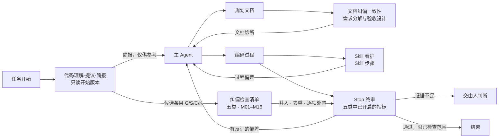

# Runtime Corrector 总体方案（第二版，汇报用）

范围：分支 `codex/rc-general-efficiency-bench`。本文按"缓解纠偏"和"纠偏"两条主线组织，并以纠偏检查体系作为贯穿全程的骨架。初版和本版各经过一轮辩护与挑战的对抗审查。方案描述可以领先于实现，凡是尚未实现或尚未实测的部分，都已标注状态。

状态标注：● 已实现，且有真实宿主实测；◐ 已实现，仅离线或单元验证；○ 规划，尚未实现。

## 一、一句话

RC 让编码 Agent 少走偏，走偏了能被拉回来。整套方案可以概括为**一份清单、四个时点、两种作用**：

- **一份清单**：纠偏检查体系规定"查什么"，包括五类检查、十六项指标（M01–M16）和四条准入规则。
- **四个时点**：开工、写文档、执行中、交付，各有一个组件负责。
- **两种作用**：开工时只找、不下结论，把找到的约束作为简报交给主 Agent，这是缓解纠偏；之后的三个时点对已形成的产物下结论，只对有证据的偏差发起修复，这是纠偏。

判断不了的事项明确交给人，不冒充通过。RC 不修改业务文件，也不向用户提问，修复始终由主 Agent 完成。"需求分解与验收设计"只是五类检查中的一类，RC 不是需求澄清工具。

## 二、要解决的问题

开发集的失败分析显示，编码 Agent 的失分主要来自四类问题，而不是"没听懂需求"：

1. **隐性契约。** 原文没写，但旧代码和旧测试已经决定了的约定。例如：新功能该接在哪个已有服务上；缺省值和空输入怎么回退；同一操作在不同状态下的效果；异常路径的副作用；配置是否在所有入口都真正生效。
2. **规划偏离。** 方案或任务文档与原文不一致，下游代码跟着偏。
3. **过程违规。** 项目规则或已加载 Skill 规定的步骤没做，或者顺序错了。
4. **完成声明不等于完成。** Agent 说"做完了"，但实现、测试或原有行为并不支持这个结论。

这四类问题分别落在纠偏检查体系的五类检查上：隐性契约属于"需求实现"，规划偏离属于"需求分解与验收设计"，过程违规属于"项目规则"和"Skill 步骤"，完成声明不等于完成属于"验证闭环"和"需求实现"（见第四节）。

**为什么不能只靠写更好的提示词。** 在审查提示词里加指导已经试过，st7 和 st6 的回放结果都没有变化（`docs/stop-contract-pass.md`）。问题出在结构上，有两点（`docs/requirement-frame-spec.md` §1）：

- 审查清单如果由已经看到候选代码的同一个会话生成，判断就会被候选的选择带偏。
- "无法证明就省略"的规则，会让漏检默认通过。

RC 与模型无关，换更强的模型同样可以叠加 RC。

## 三、四条设计原则（所有组件共用）

1. **依据分层，原文优先。**
   - 用户原文决定"要改什么"。
   - 既有代码、测试、项目规则和已加载的 Skill，决定"不能破坏什么、必须怎么做"。
   - 两者冲突时，以原文为准。
   - RC 自己生成的简报、检查项、反例和笔记只负责定位"该看哪里"，不构成新的义务。义务只能来自上面两层原文。
2. **提示与判定分离。** 缓解纠偏只提供信息：不下结论，不阻塞主任务，不占纠偏次数。纠偏只针对已经形成的产物下结论，而且必须有可归属的反证。在检查体系内部，这条原则表现为"开工找、交付判"（见 4.4）。
3. **三种结论，放行不等于通过。**
   - 偏差：有反证。进入"反馈→修复→复审"闭环。
   - 通过：有证据支持，且只覆盖已检查的范围。
   - 未验证：证据不足。在结果中逐项保留，交由人判断。
   - 额度耗尽、超时或 RC 自身故障时可以放行，但不会产生"通过"。
4. **成本有上限，故障不拖累主任务。** 每条纠偏通道都有次数或回合上限。终审在每个会话、每条流程中最多实际纠偏 3 次，只在主 Agent 真正开始修复时计数。各阶段都有时限。RC 出故障时主任务照常进行，同时留下未验证记录。

第 1 条也回答了"原文是唯一权威，RC 却去抓原文没写的东西"这一质疑：隐性契约属于"不能破坏什么"这一层，依据是旧代码和旧测试本身，而不是 RC 的推断。

## 四、纠偏检查体系：查什么

### 4.1 五个问题，五套分类

方案里出现的几套分类各自回答一个问题，不是相互竞争的口径：

| 问题 | 回答它的分类 | 本文位置 |
|---|---|---|
| 查什么 | 纠偏检查体系：五类检查、M01–M16、四条准入规则 | 第四节 |
| 什么时候、由谁查 | 四个组件，分别对应开工、写文档、执行中、交付四个时点 | 第五至七节 |
| 是提示还是判定 | 两条线：缓解纠偏、纠偏 | 原则 2、第五节 |
| 结论是什么 | 偏差、通过、未验证；放行不等于通过 | 原则 3 |
| 外部怎么评 | 独立评测：F2P/P2P、Checklist G0–G3 | 4.6、第十节 |

对外只需记住一句：一份清单、四个时点、两种作用。

### 4.2 准入规则：什么能进入清单

任何条目，无论来自提议者、终审审查者还是 Skill 规则图，都要同时满足四条（`docs/correction-checklist.md`）：

| 准入规则 | 含义 | 程序如何落实 |
|---|---|---|
| 原文权威 | 只收原文明确提出或明确采用的要求 | 检查项文字必须是引用行的短原文摘录，不得补充细节；引用少于 80 行；依据冻结为任务开始时的文档副本及其 sha256 |
| 当前触发 | 前提条件对本任务成立 | 原文的前提条件必须原样保留，不能把有条件的义务改成无条件 |
| 可以判定 | 能明确核对，且只有一个检查目标 | 每个条目只能检查实现、产物或过程动作中的一种；判不了就是"未验证" |
| 时机正确 | 到该检查的阶段才检查 | 指标目录记录每项最早适用的阶段；尚未到达的步骤不算偏差 |

不满足准入规则的内容不进入清单。开启某项指标不会新增交付义务：没有对应原文时报告"不适用"，不会为了得分要求 Agent 补写文档或调用 Skill（`docs/stop-metric-switches.md`）。

### 4.3 五类检查

| 检查类别（配置名） | 指标 | 查什么 | 依据 | 开工：谁来找 | 过程：谁来判 | 交付：终审 |
|---|---|---|---|---|---|---|
| 需求实现（fulfillment） | M12 需求执行率、M16 生产实现覆盖 | 用户要求的功能和测试是否真的做到；生产路径是否覆盖；原有行为是否保持 | 用户原文；开始版本的代码和测试 | 代码提议者：实现提示 G、行为场景 S、反例场景 C | — | 判定 M12、M16；先跑原测试回归；对 G/S/C 逐项给处置 |
| 项目规则（projectRules） | M09 开发规范、M10 强制经验规则、M11 固定流程 | 代码、文档、编码的规范属性；文档明确写出的历史教训；必须执行的命令、顺序和改后回读 | AGENTS.md、CLAUDE.md 等项目文档 | 检查项提议者：检查项 K | ○ 暂无 | 审查者自建条目，加上并入的 K |
| Skill 步骤（skills） | M08 | 已加载 Skill 的必做步骤、顺序和前置条件 | 本任务实际加载的 SKILL.md | 不在开工时找：Skill 加载后才知道要查哪些步骤 | Skill 看护 | M08 只做残余检查；历史顺序偏差只通知 |
| 验证闭环（verification） | M13 验收闭环、M14 里程碑、M15 关键旅程 | 项目要求的验收、完成定义、里程碑和端到端旅程是否真的跑过并通过 | 项目文档；项目验收命令 | 检查项提议者：检查项 K | — | 由程序执行项目验收命令，审查者按真实结果判定 |
| 需求分解与验收设计（clarification） | M01–M07 | Agent 写出的需求分解、验收标准和测试契约是否覆盖原文、是否合格、能否追溯 | Agent 产出的规划工件，对照用户原文 | 不在开工时找：规划工件此时还不存在 | 文档纠偏一致性 | 从工作流工件的原文判定 M01–M07 |

说明：

- "需求分解与验收设计"在配置中名为 clarification。它检查的是 Agent 自己写出的规划工件，不是向用户澄清需求。
- 代码理解·提议·简报服务三类检查：需求实现、项目规则、验证闭环。它的输入是开始版本的代码和项目文档，不是一个需求澄清环节。
- 文档纠偏在写入时审查规划文档与原文、上游文档是否一致，与 M01–M07 属于同一类问题，但不按 M 编号计分；M01–M07 的判定在交付时由终审完成。
- "修改某类代码时必须使用某 Skill"属于项目规则（M11），由检查项提议者提出。Skill 看护只能看到已加载的 Skill，看不到"本该加载却没加载"的情况，所以这条规则不归 Skill 看护。

**为什么开工时只找三类。** 这是"时机正确"规则的直接结果：开工时规划工件还不存在，Skill 也还没加载，没有可定位的原文。真正的覆盖缺口只有一处：项目规则在执行过程中没有专门的看护（○）。

### 4.4 开工找，交付判

- **找。** 开工时，提议者在开始版本上定位候选条目：实现提示 G、行为场景 S、反例场景 C、检查项 K。它们只决定"该看哪里"。
- **判。** 是否构成义务、是否违反，由对应时点下结论的组件判定。
- **同一条目，两种身份。** 在简报里它是提示：不下结论，不扣纠偏次数。到了终审，它是必须给出处置的候选必查项。
- **检查项不创造义务。** 义务来自项目文档原文本身，属于原则 1 中"必须怎么做"那一层。检查项只是指向原文行的定位。引用行没有陈述约束，或者本需求没有触发它时，检查项不构成偏差。检查项与用户原文冲突时，以用户原文为准。
- **终审怎么合并。**
  1. 审查者读完必读原文（用户消息、项目说明、用户点名的文件、已加载的 Skill），用 `set_original_checklist` 建立自己的清单。
  2. 程序按原文位置并入检查项 K，在 `review_checklist` 中标记为 `proposedCheck`。与 K 完全相同的条目共用一个编号，只审一次。
  3. 实现提示、行为场景和反例场景都要在 `frameDispositions` 中逐项给出处置。
  4. 任何框架项单独都不构成偏差，偏差必须有反证。
- **如实说明。** 终审能看到检查项和框架项。独立性的结构保证只有一条：它们是在候选代码出现之前生成的，而不是说终审对它们一无所知。

### 4.5 偏差能在哪个时点被拉回来

偏差的形态决定了它能在哪个时点被拉回来。这张表回答"为什么不只做终审"：

| 偏差形态 | 例子 | 哪个时点还能拉回 | 由谁负责 |
|---|---|---|---|
| 交付类：代码或产物的性质 | 生产路径没覆盖；违反编码规范；验收不通过 | 交付时仍可修复 | 终审 |
| 动作类：必须执行某个动作 | 构建后要跑 lint；修改后要回读 | 修复轮可以补做 | 终审，配合简报中的检查项 |
| 顺序类：先后关系 | 先设计后编码；Skill 步骤的顺序；编码前完成需求分解 | 只能事前预防，到 Stop 时已成历史 | 简报中的检查项、Skill 看护、文档纠偏 |

顺序类偏差到了终审只能通知一次（终态记为"带历史偏差结束"），不派发修复，所以必须靠前面的时点预防。

### 4.6 与独立评测的关系：分类同源，内容独立

- **分类同源。** RC 的 M 编号与 Checklist Benchmark 来自同一套指标规范。评测侧的定义是：G0 = M12；G1 = 正式分解遗漏率（即 M01 的失败比例）；G2 = M16；G3 = M08–M11 合并通过率。M02–M07 和 M13–M15 不进入 G0–G3，其中验证闭环需要单独报告。
- **内容独立。** RC 的条目在运行时从本任务的材料生成；评测清单由独立评测方结合标准补丁和测试补丁事先冻结。RC 读不到评测清单、隐藏测试和标准答案。
- **对外成绩只用独立评测。** RC 内部的比率只用于控制台观察，不作为对外成绩。对外只报独立评分的 F2P/P2P 和冻结的 G0–G3。
- **相关，不是责任划分。** 不说"某个组件对某个 G 负责"。一个 G 维度通常由多个时点共同影响，单个组件的贡献目前没有拆分。
- **必须保证的独立性。** 评测清单在运行前冻结，构建者不参考 RC 的运行轨迹。

## 五、总体架构：两条线、四个组件

| 组件 | 时点 | 主线 | 负责的检查类别 | 在清单中的角色 | 是否下结论 | 上限 | 状态 |
|---|---|---|---|---|---|---|---|
| 代码理解·提议·简报 | 开工，后台运行 | 缓解 | 需求实现、项目规则、验证闭环 | 找 | 否 | 每个用户回合最多送达一次 | 主体 ●；部分简报 ◐；检查项 ◐ |
| 文档纠偏一致性 | 写规划文档时 | 衔接：对文档是纠偏，对代码是缓解 | 需求分解与验收设计 | 判（文档） | 对文档下结论 | 反馈次数有上限 | ◐（单独效果尚无 ArkTS 实测） |
| Skill 看护 | 执行过程中 | 纠偏（过程） | Skill 步骤 | 判（过程） | 是 | 回合间隔与反馈上限 | 效率 ◐，效果尚无实测 |
| 终审 | Stop 时 | 纠偏（交付） | 五类中已开启的指标 | 判（交付） | 是 | 每会话、每流程 3 次 | ● |

**两条线的分界只有一条标准：是否针对已经形成的产物下结论。**

- 简报不对任何产物下结论，所以属于缓解。
- 文档纠偏、Skill 看护和终审都对已有产物下结论，所以属于纠偏。
- 文档纠偏的特殊之处在于：规划文档是代码的上游。文档对齐了原文，代码就少一个偏离来源。所以它对文档是纠偏，对代码是缓解。

## 六、缓解纠偏：让偏差少发生

### 6.1 代码理解、提议与简报

**做什么。**

1. **冻结开始版本。** 任务开始时，把开始版本的代码导出到临时目录。提议者只能读这份快照，看不到主 Agent 之后的修改。这是"预防判断不被候选代码带偏"的结构保证。
2. **代码理解。** 用语义图（符号、调用、写入、测试引用、状态依赖）加 code-understanding skill，引导模型从公共入口出发，追到调用者、测试替身和第一个可观察的副作用。
3. **代码提议（服务"需求实现"）。** 三个视角各自独立提议：实现落点与公共签名；数据与控制流；边界与兼容。
4. **反例复核。** 对每条有效提议，在源码中寻找反例。核对原入口、原测试替身的成功和失败返回，以及原输入范围。
5. **检查项提议（服务"项目规则"和"验证闭环"）。** ◐ 两类检查各运行一个提议者，只为已开启的指标提议。具体规则：
   - 扫描项目中的 Markdown 文档，AGENTS.md、CLAUDE.md 排在最前；
   - 每条检查项绑定具体行，文字必须是短原文摘录，原前提原样保留；
   - 冻结任务开始时的文档副本及其 sha256，任务中途改文档不会改变检查依据。
6. **选择。** 选择器对每个候选逐项给出"选中、拒绝、已被覆盖、延期"之一，并说明理由。
   - 程序校验证据行确实存在、引用确实出自原文。
   - 没有置信度门槛，置信度只用于排序。
   - 发布配额：实现提示最多 10 条，行为场景最多 6 条，检查项最多 10 条且每类最多 5 条。有依据但超出配额的条目标为延期并留档，不会被静默丢弃。

**怎么送达。**

- 简报第一行标明是 RC 反馈，不会被当成新的用户需求。
- 正文写明：仅供参考；与原文或实际代码不符时，以原文和代码为准；不要因此增加用户没要求的功能。
- 检查项以"项目规则"的形式附在同一条简报中，注明终审会按文档原文检查。
- 走 OpenSpec 流程时，在编码回合开头送达；不走 OpenSpec 时，生成完成后附加在下一次工具结果上。
- 每个用户回合最多送达一次。
- 准备不完整时，只发送已经通过复核的部分，并附一句"可能仍有遗漏，请结合原文和代码自主判断"，不再把整份丢掉。

**为什么终审替代不了它。**

- 到终审时候选代码已经存在，判断容易被候选带偏。
- 顺序类偏差只能事前预防（见 4.5）。
- 预防比修复便宜。一次终审约 5 分钟、170–210 万 token（st2 两轮实测），每次修复还要再跑一轮业务。
- 隐性契约在开始版本的代码上就能发现。在 st6 中，反例复核在写代码之前就给出了与标准修复关键边界一致的场景：缺少设备数字身份时，不得派发、不得落库。

**主动说明的局限。**

- 不能保证在写代码之前送达。st9 的简报在进入编码 3 分 18 秒后才到。
- 内容可能选错前提。st9 有三条场景放过了"调用者自己保证无副作用"这一原有契约。
- 检查项只读 Markdown 文档。写在 lint 配置或 CI 脚本里的规则看不到，应通过项目验收命令接入。
- 只支持 OpenClaw 宿主和 git 项目，只读取开始时已提交的内容；每个会话只生成一次。

**对策。**

- 部分送达，并给各阶段划分时间预算：提议最多用前 50% 的时间，反例复核在 70% 前结束，剩余时间留给筛选。◐
- 分别记录场景前提的来源：旧源码事实、旧测试设置、用户授权改变的断言、有依据的保留行为。○
- 终审对每个框架项重新追到当前代码。●

### 6.2 文档纠偏一致性

**做什么。** 主 Agent 写入规划文档（例如 OpenSpec 的 proposal、design、tasks）后，RC 自动审查三点：

- 与用户原文是否一致；
- 与上游文档是否一致；
- 复制类内容是否逐字符保真。模型给出通过，也不能覆盖字符差异。

诊断附在本次写入的结果上，由主 Agent 自己修改，修改后自动复审。RC 不代写文档。

**在检查体系中的位置。** 它在写入时处理"需求分解与验收设计"这一类问题，是这类问题唯一能在顺序类偏差发生前介入的时点。终审在交付时按 M01–M07 再判一次。

**边界。**

- 文档阶段的 Stop 不审查代码义务，代码义务留给编码阶段的终审。
- 每个产物只有一个审查归属方，避免重复审查和误扣次数。st7 曾出现文档阶段 Stop 越权审查、误扣一次额度的问题，已修复。

**为什么默认关闭。** 对没有规划文档的任务，开启它只会增加耗时。因此在有规划文档的项目中按项目启用。启用 M01–M07 的项目应同时启用文档纠偏，否则规划工件要等到交付时才被检查。

**证据。** SWE-ArkTS 39 轮对照所在的版本开启了规划文档审查，但它的单独贡献没有拆分；文档纠偏在 ArkTS 样本上的效果尚无单独的实测数据。

**对策。** ○ 在文档阶段结束时做一次规格审计：比较规划文档与原文和框架，把缺口并入编码回合的简报。审计不改变该阶段的结论，也不扣次数。

## 七、纠偏：偏差发生后拉回来

### 7.1 Skill 看护

**做什么。**

- 只看本任务实际成功加载的 SKILL.md。
- 按回合间隔检查调用和步骤。
- 带条件的步骤保留其条件；尚未到达的步骤不算偏差。
- Agent 声称完成时，核对前置条件。
- 有效偏差在预算内交回主 Agent。

**为什么放在过程中。** Skill 步骤大多是顺序类义务。到了 Stop，顺序类违规已经成为历史事实，只能通知，无法修复：终态记为"带历史偏差结束"，不派发修复，也不扣次数。过程看护则能在还来得及改的时候介入。终审中的 M08 只做残余检查。

**与项目规则的分工。** "修改某类代码时必须使用某 Skill"属于项目规则，由检查项提议者提出，按 M11 判定。Skill 自身的步骤由 Skill 看护和 M08 负责。两边不重复提出检查项。

**证据。**

- 效率 ◐：首次请求只披露文件清单，原文按需检索。在四种合成情形下，真实模型的输入 token 减少 83%，两组判断都是 4/4（`docs/skill-care-efficiency.md`）。
- 效果：尚无实测证据。

因此默认关闭，在含过程型 Skill 的项目中按项目启用。

### 7.2 终审

**做什么。** Stop 时启动一个私有审查会话：

1. 读完必读原文（用户消息、项目说明、用户点名的文件、已加载的 Skill），用 `set_original_checklist` 建立本次的原文清单，覆盖五类中已开启的指标。
2. 程序并入开工时找到的检查项 K，与审查者自建的相同条目合并。实现提示 G、行为场景 S、仅供终审使用的反例场景 C 逐项给出处置。
3. 如果修改了既有源码，先跑原测试，再做语义审查（原测试回归前移）。
4. 如果项目配置了验收命令，由程序执行，并把真实结果交给审查者。命令只能来自项目配置，并绑定来源文件的摘要，模型不能选择或改写。
5. 每个条目都给出结论和证据。源码只能证明实现，执行记录才能证明执行，两者不能互相冒充。

**结论与修复。** 偏差附带原文、证据位置和修复方向。反馈末尾要求主 Agent：先用最小检查复现问题；修复后重跑同一检查，并补跑一个相邻的既有行为检查；无法复现时不要改无关代码。这条要求用来抑制误报引发的乱改。

**额度与等待。**

- 每会话、每流程最多 3 次，只在修复实际开始时扣减。
- MA 的 until_pass 模式下，每轮业务正常结束后才审查，修复另起一轮，用户待办独立保留。

**定位。** 终审是"有证据的偏差发现器"加"完成前闸门"，不是测试神谕。它最强的信号来自可执行证据（原测试、项目验收命令），只读代码会漏检。

**主动说明的漏检与负面案例。**

- 数独：看到配置调用存在，就认为它会执行，漏看了外层的条件分支。
- st2 的一次全新运行：第一次修复删除了一个公共方法，导致原测试无法编译，终审仍判"未发现偏差"。
- SWE-ArkTS 的一次运行：一个 M09 判了"通过"，理由却是把审查者自己的读取当成了业务修改后的回读（`docs/arkts-serial-optimization.md`）。

这些案例推动了三项改进："原测试回归前移"、"追到第一个副作用"，以及"缺少可归属的过程证明时记为未验证"。改进后的效果还需要用新任务验证。

## 八、两条线如何互相兜底

1. **缓解失败时降级为检测，不会静默消失。** 简报晚到、没有生成或只生成了一部分时，已产出的框架项、检查项和反例仍然是终审的必查项。准备不完整只记录在覆盖统计中，不算作业务代码的问题。
2. **防止同源错误。**
   - 框架项和检查项在候选代码出现之前生成；终审先从原文自建清单，再并入它们。
   - 框架项要判"已检查"，必须追到当前代码。
   - 框架项和检查项单独都不能构成偏差，所以简报出错不会直接变成误判。
   - 但简报可能"选错检查角度"，让终审一起漏检（st9）。对应的改进是记录场景前提的来源依据（见 6.1，○）。
3. **纠偏不会无限循环。** 次数和时限都有上限。证据不足的条目交给人，不靠反复纠偏去凑出"通过"。

## 九、默认配置：两层缺省，按证据调整

默认值分两层：

- **插件内置缺省：** 偏保守，只开有实测的指标。
- **新项目模板：** 项目方指定的配置（`README.md` 第 32 行），开启了更多检查类别。

两层都会按实测证据调整。

| 能力 | 插件内置缺省 | 新项目模板 | 说明 |
|---|---|---|---|
| 代码理解·提议·简报 | 关 | 开，含检查项提议 | 仅 OpenClaw、git 项目 |
| 终审 | 开 | 开，完整逐项审查 | 闭环已实测 |
| 需求实现 M12 / M16 | 开 / 开 | **关** / 开 | 模板关闭 M12 后，用户明确要求的"写测试、跑测试"没有指标可以归属；而评测的 G0 就是 M12 |
| 项目规则 M09 / M10 / M11 | 开 / 关 / 关 | 开 / 开 / 开 | M10、M11 缺少单独的实测证据 |
| Skill 步骤 M08 与 Skill 看护 | M08 开，看护关 | **都关** | 花店评测 G3 的 78 个冻结对象中有 56 个属于 M08 |
| 验证闭环 M13 / M14 / M15 | 开 / 关 / 开 | 开 / 开 / 开 | 需要项目验收命令才有执行证据，否则多数只能记为未验证 |
| 需求分解与验收设计 M01–M07 | 关 | 开 | 只在有规划工件时适用 |
| 文档纠偏一致性 | 关 | 关 | 只在有规划文档时有价值 |
| 原测试回归、项目验收命令 | 关 | 关 | 需要项目提供命令和来源；有可执行验收时强烈建议开启 |
| 新会话启用 RC | — | 关 | 由用户在控制台或用 `/rc-session on` 开启 |

**待决策事项：**

1. 评测时必须开启被计分的类别（M08、M12），否则 G0、G3 的主体不在 RC 的检查范围内，评测结果没有意义。
2. 开启 M01–M07 的项目同时开启文档纠偏，否则规划工件只在交付时被检查，顺序类问题拉不回来。

## 十、当前证据（如实分级）

| 结论 | 证据 | 强度 |
|---|---|---|
| "发现→反馈→修复→复审"闭环能在真实宿主跑通，并修复真实缺陷 | st2 修复前新需求 1/2、原回归 739/746，修复后 2/2、746/746。最近四题实验中，st2 终审发现"已加载的 3D 策略被覆盖"，自动修复一次后独立评分全部通过 | 中（开发集，单次） |
| 检查体系所在版本相对不开 RC 的基线有正向观察，增益集中在项目规则，不在需求理解 | SWE-ArkTS 开发集 39 轮： • G3 项目规则遵从 39/90 → 58/90，增幅最大（+21.1 个百分点） • G1 正式分解遗漏 8/84 → 6/84 • G0 69/84 → 76/84 • G2 65/84 → 69/84 • 整题独立通过 27/39 → 33/39 • F2P 114/135 → 123/135 （`runtime-corrector-evaluate-arkts/.../dae36f7-v2.2.0-complete`） | 中偏弱：开发集；基线复用 11 月初批次的判定，不是同批运行 |
| 终审单独的贡献 | 同 39 轮关闭终审：整题 33/39 → 31/39，G3 偏差多 9 个；但双侧 p = 0.50，只看首次尝试的 20 对时方向反转（18/20 对 19/20）；两批的替补数量和镜像配置也不同，报告自身结论是"无法单独识别终审开关的贡献" | 弱 |
| 检查项机制符合设计 | 单测覆盖：按类别提议、逐字引用与条件保留、跨文档去重、终审并入与逐项处置（`test/requirement-frame.test.mjs`、`test/stop-workspace-review.test.mjs`） | ◐ 离线 |
| 检查项的单独贡献与精确率 | **未证明。** 仓库中没有"检查项检出偏差并被修复"的真实记录 | — |
| 只加提示词解决不了问题 | st7、st6 回放只加指导，结果不变 | 中（单例回放） |
| 原文直读可行，基线抽取不可行 | security_tool_1 与 security_tool_2 兼容变体合并对照，在预算内完成的比例：原文直读 6/6，两种对照方案 0/6（`docs/simplify-experiment-results.md`） | 中（小样本） |
| 正确实现上没有出现误报纠偏 | security_tool_1 正确首稿两次均无误报；合并对照中正确对象误报为 0（同上） | 中（样本少） |
| Skill 看护节省上下文 | 四种合成情形下输入 token 减少 83%，准确度持平 | 弱（合成情形，只证明效率） |
| 相对不开 RC 的泛化净收益 | **未证明。** 开发集有正向观察（见上），没有留出集数据 | — |
| 简报的预防作用 | **未证明。** 四题中只有两题收到简报，其中一题晚到，且含错误前提 | — |
| 花店 Checklist B0/RC0 对照 | 〔待补：如已有"MA+Verikit"与"MA+Verikit+RC"的对照汇总，放在这里；需注明 M08 是否开启〕 | — |

**必须同时说明的口径。**

- ArkTS 各题都是开发集，结论是在对照标准答案分析之后得出的。原先预定的留出集已经被使用，因此这些结果不能当作泛化证据。
- SWE-ArkTS 的增益属于"检查体系所在的整个版本"，不能归到某个组件，更不能单独归到检查项。
- 产品代码不包含题号、答案或针对题目的专用规则。
- 历史上 st6、st7、st9、数独的满分运行带有按题编写的公开验收探针。应表述为"配置了验收检查时的闭环演示"，而不是通用配置下的成绩。

## 十一、成本与风险

| 风险 | 已观察到的表现 | 控制手段 |
|---|---|---|
| 成本 | 一次终审约 5 分钟、170–210 万 token；简报准备 7–10 分钟（后台）；检查项提议的成本尚未单独计量 | 次数封顶；简报在后台运行，不阻塞主任务；可切换到"只报偏差"或关闭简报的低成本档 |
| 简报误导 | st9 的错误前提 | "仅供参考"声明、反例复核、终审复核；监测采纳后出错率 |
| 检查项拔高要求 | 尚未观察到 | 逐字引用、条件原样保留；单独不构成偏差；与用户原文冲突时以原文为准；监测检查项精确率 |
| 误报引发乱改 | 正确实现上暂未观察到 | 偏差必须有反证；反馈要求先复现；未验证不触发修复 |
| 漏检 | 数独、st2 删除公共方法、M09 错判通过 | 原测试回归前移、项目验收命令；公开漏检案例 |
| "用自己的尺子给自己打分" | RC 与评测共用 M 编号 | 内容独立生成；评测清单事先冻结、不参考 RC 轨迹；对外只报独立评测 |
| 过拟合 | 规则来自开发集分析 | 冻结审查规则的增长；新规则必须先在开发集之外看到收益，才能进入产品 |
| 复杂度 | 分支领先 main 约 590 个提交，核心文件有两千多行；分类较多 | 大部分代码用于身份、取消、截止时间和证据校验，目的是防止伪造"通过"；对外只讲"一份清单、四个时点、两种作用" |
| 适用范围 | 宿主只支持 OpenClaw 2026.7.1-2 和 2026.10.3；代码理解简报仅 OpenClaw；需要 git；检查项只读 Markdown | 汇报口径定为"MatrixAssistant/OpenClaw 首发" |

## 十二、汇报口径

| 不要说 | 改为 |
|---|---|
| "RC 提升了 F2P/P2P" | "闭环已在真实宿主跑通，并修复过真实缺陷；开发集上相对基线有正向观察，增益集中在项目规则；泛化收益尚未证明" |
| "RC 做需求澄清" / "需求澄清族" | "RC 按五类检查核对 Agent 的工作；需求分解与验收设计只是其中一类，检查的是 Agent 写的规划工件，RC 不向用户提问" |
| "RC 覆盖五大检查族" | "检查体系定义了五类检查；开工时找其中三类，过程中判两类，交付时判所有已开启的类别；默认开哪些类别按实测证据调整" |
| "提议者负责找，终审负责判"（不加解释） | "开工时定位原文行；是否构成义务、是否违反，由终审按原文和证据判定" |
| "检查项置信度不低于 0.75" | "检查项必须逐字引用原文行，经选择器逐条审查；按配额取舍（每类最多 5 条，共 10 条），没有置信度门槛" |
| "终审独立于框架，不受影响" | "框架项和检查项在候选代码出现前生成；终审能看到它们，但它们单独不能构成偏差" |
| "四个组件分别负责 G0–G3" | "评测维度与检查类别相关；单个组件的贡献目前没有拆分" |
| "RC 提升了项目规则遵从（G3）" | "开发集上 G3 由独立评测按冻结清单判定为提升；因为与 RC 共用指标编号，我们同时报告 F2P/P2P 和清单的独立性安排" |
| "简报能预防偏差" | "简报在编码前或编码中提供开始版本代码里的约束，是否减少偏差尚未证明；它同时为终审提供一份不受候选代码影响的必查清单" |
| "终审通过" | "终审在已检查范围内未发现有证据的偏差" |
| "原文是唯一权威" | "原文决定要改什么，既有代码和规则决定不能破坏什么，冲突时原文优先" |
| "四个组件默认全开、协同工作" / "默认值由证据决定" | "插件内置缺省偏保守，新项目模板按项目方指定开启了更多类别；默认值按实测证据调整" |
| "通用规则，不针对题目" | "产品代码不含题号和答案；规则来自开发集分析，泛化性尚未证明" |
| "失败开放，所以安全" | "RC 故障不阻塞主任务，代价是结果标为未验证" |
| "六题中四题满分" | "配置了验收检查时，闭环在开发集上的演示结果" |

## 附录 A：高频质疑与回答

1. **开 RC 和不开相比，多拿了什么？**
   - 闭环在真实宿主上跑通了，并修复过真实缺陷（st2）。
   - 开发集上有正向观察：SWE-ArkTS 39 轮中整题通过 27 → 33，G3 项目规则遵从提升约 21 个百分点。但这是开发集，基线也不是同批运行。
   - 泛化净收益还没有证明，增益也不能归到某个组件。
2. **说到底，RC 是不是在做需求澄清？**
   - 不是。检查体系有五类：需求实现、项目规则、Skill 步骤、验证闭环、需求分解与验收设计。最后一类检查的是 Agent 写出的规划工件，RC 全程不向用户提问。
   - 开工时的代码理解与提议服务需求实现、项目规则、验证闭环三类，输入是开始版本的代码和项目文档。
   - 数据也说明这一点：SWE-ArkTS 上增益最大的是项目规则（G3 +21 个百分点），需求理解（G1）只少了 2 处遗漏。
3. **RC 的指标和评测是同一套编号，是不是对着考卷做题？**
   - 分类同源是有意的，就像代码检查工具和代码评审共用一套规范。
   - 内容是独立的：RC 的条目在运行时从本任务材料生成，评测清单由独立评测方事先冻结，RC 读不到评测清单、隐藏测试和答案。
   - 主指标仍是与分类无关的 F2P/P2P。评测清单在运行前冻结，构建者不参考 RC 轨迹。
4. **五类检查里，开工时为什么只找三类？是不是空壳？**
   - 这是"时机正确"规则的结果：开工时规划工件还不存在，Skill 也还没加载。这两类分别由文档纠偏在写入时、Skill 看护在执行中处理，终审在交付时再判一次。
   - 真正的缺口只有一处：项目规则在执行过程中没有专门的看护（○）。
   - 至于默认开哪些类别，目前两层缺省并不一致（见第九节），这一点已列为待决策事项。
5. **检查项是模型从文档里挑的，会不会拔高要求，引起乱改？**
   - 检查项文字必须是引用行的原文摘录，原前提原样保留。
   - 检查项单独不构成偏差，判偏差需要反证；与用户原文冲突时以原文为准。
   - 反馈要求主 Agent 先复现再修改，改后补跑相邻检查。
6. **"提议者找、终审判"，终审不是也能看到检查项吗？**
   - 能看到。独立性的结构保证只有一条：检查项和框架项在候选代码出现之前生成。
   - 终审先从原文自建清单，再由程序并入检查项；判"通过"必须追到当前代码，判"偏差"必须有反证。
   - 剩余风险是两边一起选错检查角度（st9），对应改进是记录前提来源。
7. **顺序类违规到 Stop 才发现已经晚了，终审还有什么用？**
   - 顺序类问题只能预防，靠简报中的检查项、Skill 看护和文档纠偏，这正是要有四个时点的原因。
   - "必须执行某个动作"这类问题可以在修复轮补做；代码和产物性质的问题终审都能拉回。
8. **为什么不直接换更强的模型？**
   - RC 与模型无关，可以叠加在任何模型上。
   - 只改提示词的做法已经试过，无效。问题在结构：看到候选代码后再生成清单会被带偏，而隐性契约藏在旧代码里。
9. **成本多大？**
   - 一次终审约 5 分钟、约 200 万 token。
   - 简报准备 7–10 分钟，在后台进行，不阻塞主任务。检查项提议的成本还没有单独计量。
   - 纠偏最多 3 次。
   - 我们不主张 RC 能省钱，并提供"只报偏差"或关闭简报的低成本档。
10. **会不会越纠越错？**
    - 偏差必须有反证；未验证不触发修复；反馈要求先复现再修改。
    - 确实出现过负面案例：st2 的一次修复删掉了公共方法，终审没有发现。这已推动了原测试回归前移。
11. **默认配置是怎么定的？为什么模板关掉了评测要考的 M12 和 M08？**
    - 默认值有两层：插件内置缺省偏保守，新项目模板是项目方指定的配置。
    - 模板关闭 M12、M08，与评测计分维度错位，这一点我们主动列为待决策事项。评测时必须开启被计分的类别，模板取值按实测证据调整。
12. **终审的"通过"可信吗？**
    - "通过"只覆盖已检查的范围。证据不足记为"未验证"，不会被当作通过。放行和通过是两回事。
    - 终审不是测试神谕：数独、st2 都有漏检，还出现过一次 M09 错判通过，所以我们优先接入可执行证据。
13. **未验证的条目怎么处理？**
    - 在审查结果中逐项保留，交由人判断。RC 不会为了得到"通过"而反复纠偏。
    - 在控制台集中呈现为"待人工确认清单"，属于规划 ○。
14. **代码量这么大，是不是在打补丁？**
    - 大部分代码用于身份、取消、截止时间和证据校验，目的是不伪造"通过"。用户可见的只有几个开关。
    - 规则增长确实需要治理：冻结新增规则；新规则必须先在开发集之外看到收益才能加入。
15. **能用在别的宿主上吗？**
    - 终审引擎由 Claude Code、CodeAgent、OpenClaw 三个宿主共用；代码理解简报和检查项目前只支持 OpenClaw。
    - 首发范围定为 MatrixAssistant/OpenClaw。

## 附录 B：汇报前需要先统一的口径问题

1. `docs/stop-task-review.md` 首段写新模板使用"仅偏差模式"，模板实际是完整逐项审查（`deviationOnly: false`）。
2. README 第 32 行写新项目模板关闭 M08、M12，第 150 行写插件内置缺省开启 M08、M12。两处说的是不同层面的缺省，需要补一句说明区别。
3. 简报时限有三个数：配置文档 10 分钟、实验 15 分钟、模板 20 分钟。需要说明各自的适用场景。
4. 需求框架规格写"默认关闭，模板不加此配置"，而现在模板默认开启（插件内置缺省仍是关闭）。需要记录这次变更及其依据。
5. 模板中的 `regressionCheck.command` 写死了 `C:\MABench\...` 评测机路径，应参数化，或移出产品模板。
6. "准备不完整是否计入终审未验证"，`docs/post-proposal-contract-review.md` 与 `docs/partial-brief-receipts.md` 说法不一致。按本文第八节统一为"只记入覆盖统计，不算作业务问题"。
7. reviewer 并发槽等改动尚未提交，不作为已交付能力讲。
8. `docs/correction-checklist.md` 写"保留置信度不低于 0.75 的项"，代码已明确没有置信度门槛（`lib/runtime-v2/requirement-frame.mjs` 选择器提示词："There is no confidence cutoff"）。
9. `docs/correction-checklist.md` 写"每个有开启指标的族各运行一个检查项提议者"，实际只有项目规则和验证闭环两类有提议者。
10. 简报中检查项的标题是"完成前要遵守的项目规则"，语气是指令式的，与"检查项只负责定位"的定位不完全一致。建议改为"可能适用的项目规则（以文档原文和用户消息为准）"。
11. 引用行不构成约束的检查项：完整审查模式下要求记为"未验证"，仅偏差模式下记为"已检查"。两种模式应统一为"原文证明不适用即为已检查"，避免抬高未验证占比。
12. 模板关闭 M12，而"用户明确要求的写测试、跑测试"在终审中归 M12，关闭后没有归属；同时评测的 G0 就是 M12。需要在待决策事项中决定开启，或写明理由。
13. 模板关闭 M08 和 Skill 看护，而花店评测 G3 的 78 个冻结对象中有 56 个属于 M08。跑花店评测前必须核对。
14. 花店指标规范一处写 M11"不属于结果指标"，另一处又把它的 8 个对象计入 G3 的 78 个对象，需要与评测方统一。
15. 检查项扫描的文档数超过 200 个时直接截断，不留标记（`requirement-frame.mjs` 文档清单）。这与"达到上限时明确返回扫描不完整"的口径不一致，应补记截断。
16. SWE-ArkTS 两份报告的 G3 数字口径不同（双组对照为偏差 51 → 32；三组复核为 54 → 35 → 44）。汇报时只选一个版本，并注明报告和复核范围。
