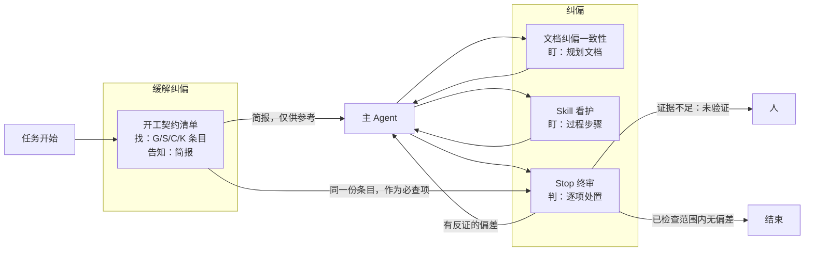
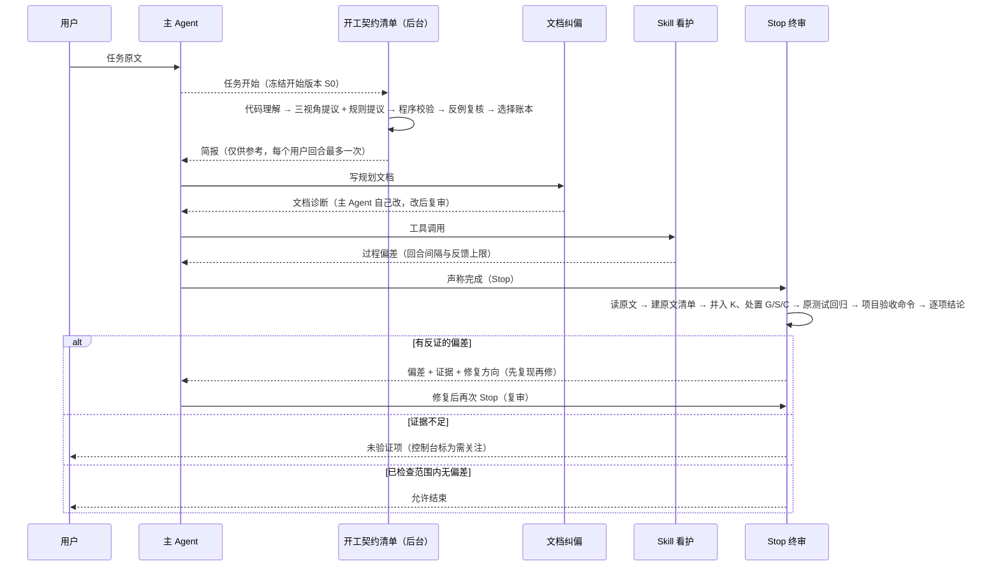

# Runtime Corrector 技术方案（初版，汇报用）

范围：分支 `codex/rc-general-efficiency-bench`。本稿先由辩护方和挑战方分别审查实现与已有草稿，再按"逻辑自洽、经得起追问"的标准整理。方案可以领先实现，凡是方案与当前实现不一致的地方，集中列在附录 B（内部，汇报前处理）。

状态标注：● 已实现，且有真实宿主实测；◐ 已实现，只做过离线或单元验证；○ 规划，尚未实现。

与已有材料的关系：`rc-overall-plan-draft.md` 和 `rc-technical-framework.html` 以四个组件为主线。本稿改为以"纠偏清单"为主线，四个组件是这份清单在不同时机的执行者，并据此修正了几处会被打穿的说法（见附录 C）。

---

## 一、一页纸

**一句话。** RC 是编码 Agent 的运行时纠偏系统。它把"这次任务该检查什么"整理成一份带原文出处的纠偏清单：开工前基于未被修改的代码找出约束并预告给 Agent，这是**缓解纠偏**；过程中和交付时逐项判定，有反证的偏差交回 Agent 自己修复，这是**纠偏**。证据不足的条目明确标为"未验证"，交给人判断。

**三个要点。**

1. **不是需求澄清。** RC 从不向用户提问，也不替用户决定需求。清单覆盖五类问题：需求实现、项目规则、验证闭环、Skill 遵循、规划工件质量。只有最后一类与需求文档有关，而它检查的也是 Agent 自己写的规划文档。
2. **有边界。** 偏差必须有可归属的反证；"允许结束"不等于"通过"；每个会话最多实际纠偏 3 次；RC 自身故障不阻塞主任务；RC 不改业务代码。
3. **证据现状。** 闭环已在真实宿主上发现并修复过真实缺陷（st2 两次全新运行）。首个单变量对照（同一版本、配置只差终审开关，13 题各 3 轮，开发集）中开 33/39、关 31/39，逐题没有下降；按事先约定的判定规则属于"无变化"，只能说明开启终审未见业务退化。净收益尚未证明，由留出集对照判定。

---

## 二、问题与目标

### 2.1 要解决的问题

编码 Agent 的失分主要不是"没听懂需求"，而是下面四类（来自开发集失败分析，`docs/requirement-frame-spec.md` §1、`docs/post-proposal-trajectory-analysis-20261115.md`）：

1. **破坏隐性契约。** 原文没写，但旧代码和旧测试已经决定的约定：新功能接在哪个已有服务上、缺省值和空输入怎么回退、异常路径有什么副作用、配置是否在所有入口都生效。
2. **规划偏离。** 方案或任务文档与原文不一致，下游代码跟着偏。
3. **过程违规。** 项目规则或已加载 Skill 规定的步骤没做，或顺序错了。
4. **无证据的完成声明。** Agent 说"做完了"，但实现、测试或原有行为并不支持。

### 2.2 为什么现有手段不够

这三点都是结构性原因，不是调参能解决的：

- **只改提示词，已经试过无效。** 在审查提示词里加指导后，st7、st6 的回放结论都没有变化（`docs/stop-contract-pass.md`："Guidance alone did not close the gap"）。
- **换更强的模型，解决不了结构偏差。** 检查清单如果由已经看过候选代码的会话生成，判断会被候选的选择带偏；"证明不了就省略"的规则会让漏检默认通过（`docs/requirement-frame-spec.md` §1）。RC 与模型无关，可以叠加在更强的模型上；"更强模型、不开 RC"已列入对照组。
- **只在最后做一次 code review，有三个缺口。**
  1. 顺序类违规到交付时已成历史，只能通知，无法修复。
  2. 只读代码会漏检，需要接入可执行证据（原测试、项目验收命令）。
  3. code review 只给意见，RC 还要把有证据的偏差交回 Agent 修复，并在修复后复审。

### 2.3 目标与非目标

| 目标 | 非目标 |
|---|---|
| 在偏差发生前提供开始版本代码中的约束 | 不向用户提问，不替用户定需求 |
| 对已形成的产物只报有反证的偏差，并驱动修复 | 不修改业务文件，修复始终由主 Agent 完成 |
| 每个结论都能追溯到原文和证据 | 不做测试神谕，"未发现偏差"不等于"正确" |
| 成本和次数有上限，故障不拖累主任务 | 不为了凑出"通过"反复纠偏 |

---

## 三、核心设计：一份纠偏清单贯穿全程

### 3.1 清单条目是什么

每个条目回答四个问题（准入规则，`docs/correction-checklist.md`）：

1. **依据哪段原文。** 必须绑定用户消息、项目文档或已加载 Skill 的具体行。
2. **本次是否触发。** 完成本次需求会触发它；只在更窄条件下生效的规则保留原条件。
3. **能否判定。** 终审能从源码、文档或执行记录判断是否满足。
4. **现在是否该查。** 只查已经交付的工作，尚未开始的后续输出不算偏差。

不满足任一条的内容不进清单，也不会为了得分要求 Agent 补写文档或调用 Skill。

### 3.2 三类来源，各回答一个问题

| 来源 | 回答的问题 | 形成的条目 | 何时形成 |
|---|---|---|---|
| 用户原文 | 要改什么 | 原文清单 | 终审时，由审查者独立建立 |
| 开始版本的代码与测试 | 不能破坏什么 | 实现提示 G、行为场景 S、反例场景 C；原测试回归 | G/S/C 在开工时从开始版本快照提出；原测试回归在终审时执行 |
| 项目文档、已加载 Skill | 必须怎么做 | 项目规则检查项 K；Skill 步骤（M08） | 开工时提出 K；Skill 加载后由规则图提出 |

### 3.3 权威链：谁说了算

这是整个方案最重要的一条约定，所有组件共用：

1. **义务只来自原始依据。** 用户原文是唯一的**需求**授权来源；项目文档、已加载 Skill 和开始版本的代码与测试是**约束**来源，它们不新增需求，只约束"怎么做"和"不能破坏什么"。两者冲突时以用户原文为准。
2. **原文清单是义务的登记表。** 终审审查者读完原文后自己建立。
3. **G/S/C/K 是检查假设。** 它们只决定"看什么"，不决定"是否违反"。K 项是指向文档原文的指针，被引用的那一行确实陈述了适用义务时才算数；G/S/C 单独不能构成偏差。
4. **M01–M16 是分类坐标。** 它规定每个义务的证据主体（源码、执行记录还是文档），不是另一份清单；五个族只是开关分组。
5. **评测清单独立于 RC。** Checklist Benchmark 的 G0–G3 由评测流程从任务需求、标准答案和测试独立构建、冻结后才评测。它沿用同一套分类坐标是为了口径一致，RC 的输出不进入评测清单。

### 3.4 五族十六指标

| 族（代码名） | 指标 | 检查什么 | 开工时谁提出条目 | 终审怎么判 |
|---|---|---|---|---|
| 需求实现（`fulfillment`） | M12 需求执行率、M16 生产实现覆盖 | 用户要求的行为是否落在真实生产路径上；原有行为是否被破坏 | 代码提议者从开始版本提出 G/S/C | 原文清单逐项判；M16 通过要追到真实入口、写入者和消费者；原测试失败必须逐条处置 |
| 项目规则（`projectRules`） | M09 开发规范、M10 经验规则、M11 固定流程 | AGENTS.md 等文档中适用于本次改动的规则 | 项目规则提议者提出 K 项 | 按引用行判，K 项并入原文清单 |
| 验证闭环（`verification`） | M13 验收闭环、M14 里程碑、M15 关键旅程 | 项目定义的验收是否真的执行并通过 | 验证要求提议者提出 K 项 | 只认可归属的执行记录；项目验收命令由程序执行 |
| Skill 遵循（`skills`） | M08 | 本任务实际加载的 Skill 的步骤 | Skill 规则图 | 过程中由 Skill 看护纠正；终审只做残余检查 |
| 规划工件质量（`clarification`） | M01–M07 | Agent 自己写的需求分解、测试契约、验收标准和追溯关系 | 无专门提议者 | 规划阶段的 Stop 从工作流工件建立条目 |

关闭的指标显示为"已关闭"，分母为 0，不转给其它指标，也不冒充通过。任务首次进入纠偏时冻结审查策略，任务中途改配置不能抹掉已发现的偏差（`docs/stop-metric-switches.md`）。

### 3.5 四个动作，两条线

清单在全程经历四个动作，四个组件分别承担：

| 动作 | 含义 | 组件 | 主线 |
|---|---|---|---|
| 找 | 在候选代码出现前，从开始版本代码和项目文档中找出条目，冻结依据 | 开工契约清单 | 缓解 |
| 告知 | 把条目作为参考提示送给主 Agent | 开工契约清单（简报） | 缓解 |
| 盯 | 对过程中形成的局部产物下结论 | 文档纠偏一致性、Skill 看护 | 纠偏 |
| 判 | 交付时逐项处置，驱动修复 | Stop 终审 | 纠偏 |

**两条线的分界只有一条标准：是否针对已经形成的产物下结论。** 简报不对任何产物下结论，属于缓解。文档纠偏、Skill 看护和终审都对已有产物下结论，属于纠偏。文档纠偏的特殊之处在于规划文档是代码的上游：它对文档是纠偏，对下游代码是缓解。

清单的两个入口在终审合并：开工时提出的 G/S/C/K，与终审审查者从原文独立建立的原文清单按原文位置合并，相同条目只审一次。这样"缓解"和"纠偏"用的是同一份清单的不同时机，而不是两套系统。

### 3.6 为什么不是"需求澄清"

- **不提问。** 整个流程不向用户提问，也不替用户做需求决定（`docs/correction-checklist.md` 准入规则）。
- **看的主要是代码契约和项目规则。** 开工契约清单的 G/S/C 条目按六类代码契约组织：实现落点与公共签名、缺省值与空/非法输入、承载的服务与入口、状态×操作的分支效果、错误与返回约定、不能改变的既有行为，来源是开始版本的代码和测试。K 条目来自项目文档中的规则。两者都不是在澄清需求。
- **五族中四族与需求文档无关。** 唯一相关的"规划工件质量"检查的是 Agent 写出的规划文档是否覆盖原文、可追溯，而不是向用户澄清。
- **会下结论、驱动修复。** RC 对已有产物判定偏差，并在修复后复审；澄清工具不做这件事。

---

## 四、总体架构

### 4.1 按任务时间轴

### 4.2 组件一览

| 组件 | 对清单的动作 | 主线 | 输入 | 是否下结论 | 是否阻塞主任务 | 上限 | 状态 |
|---|---|---|---|---|---|---|---|
| 开工契约清单（代码理解·提议·简报） | 找、告知 | 缓解 | 开始版本快照、原文、项目文档 | 否 | 否，后台运行 | 每个用户回合最多送达一次；阶段时限 | 主体 ●；K 项与部分送达 ◐ |
| 文档纠偏一致性 | 盯（规划文档） | 纠偏（对代码是缓解） | 规划文档、原文、上游文档 | 对文档下结论 | 附在写入结果上 | 反馈次数上限 | ●（受控样例） |
| Skill 看护 | 盯（过程） | 纠偏 | 已加载的 Skill、实时工具记录 | 是 | 否 | 回合间隔与反馈上限 | 效率 ●，效果未证明 |
| Stop 终审 | 判 | 纠偏 | 当前代码、原测试结果、执行记录、合并后的清单 | 是 | 在 Stop 时等待结论 | 每会话、每流程 3 次实际纠偏；总时间窗口 | ● |

### 4.3 分层与代码落点

| 层 | 职责 | 主要代码 |
|---|---|---|
| 宿主适配 | 生命周期事件、会话身份、续作协议、版本兼容 | `lib/openclaw/runtime.mjs`、`compat-2026.7.1-2.mjs`、`compat-2026.10.3.mjs`、`stop-start-protocol.mjs`、`post-run-dispatch.mjs`；`lib/hosts/` |
| 编排 | 任务状态、Stop 准入与结算、纠偏额度 | `lib/runtime-v2/orchestrator.mjs`、`production-stop.mjs`、`stop-correction-store.mjs` |
| 清单 | 指标与族、开工条目的提议/校验/选择、简报 | `metric-policy.mjs`、`metrics.mjs`、`requirement-frame.mjs`、`frame-selection.mjs`、`original-contract-context.mjs` |
| 审查 | 单会话终审、原文清单、条目合并与处置校验、审查范围 | `stop-workspace-review.mjs`、`review-routing.mjs`、`stop-review-round.mjs` |
| 证据与存储 | 读取覆盖证明、回归证据、事务日志、原子提交 | `review-read-proof.mjs`、`regression-evidence.mjs`、`transaction-journal.mjs`、`task-store.mjs` |
| 控制与观测 | 项目/会话开关、运行状态、控制台、审批模式 | `lib/openclaw/session-control.mjs`、`session-runtime-status.mjs`、`console-observations.mjs`、`ma-approval-bridge.mjs` |

终审引擎由 Claude Code、CodeAgent、OpenClaw 三个宿主共用；开工契约清单目前只在 OpenClaw 上提供。

---

## 五、缓解纠偏：让偏差少发生

### 5.1 开工契约清单（代码理解·提议·简报）

**流程。**

1. **冻结开始版本 S0。** 任务开始时用临时 Git 索引导出开始版本，不碰业务仓库的索引。提议者只能读这份快照和基于它的语义图，看不到主 Agent 之后的修改。"判断不被候选代码带偏"由结构保证，而不是靠提示词。●
2. **代码理解。** 语义图（符号、调用、写入、测试引用、状态依赖）加 code-understanding skill，从公共入口出发，追到调用者、测试替身和第一个可观察的副作用。●
3. **并行提议。** 三个代码视角各自独立提议：公共决策面与归属；输入域与第一个可观察副作用；状态、兼容性与反例。同时，每个已开启指标的规则族各运行一个检查项提议者，扫描项目文档提出 K 项。代码视角 ●，K 项 ◐。
4. **程序校验。** 证据行必须真实存在；引用必须是用户原文的原样片段；K 项必须是文档原句摘录（不超过 600 字），并原样保留前提条件。●
5. **反例复核。** 对每条提议，在开始版本中对照原入口、原测试替身的成功与失败返回和原输入范围寻找反例。●
6. **选择账本。** 选择器对每个候选逐项给出"选中、拒绝、已被覆盖、延期"之一并说明理由；不设置信度门槛，只设发布名额（G 10、S 6、K 10、每族 5）。被拒绝但有独立源码依据的反例，以 C 场景只送终审。◐

**时间预算与部分送达。** ◐ 提议最多用前 50% 的时间，反例复核在 70% 前结束，剩余时间用于选择。到时只发布已经通过复核的条目，并注明"可能仍有遗漏"，不再因为整份没做完就全部丢弃。这条改进来自 st6：一条与标准修复关键边界一致的反例已经算出来，却因"整份通过才发送"被丢掉。

**送达。**

- 简报第一行标明是 RC 反馈，正文写明仅供参考，与原文或实际代码不符时以原文和代码为准，不要因此增加用户没要求的功能。
- 走 OpenSpec 流程时在编码回合开头送达；不走时，生成完成后附在下一次工具结果上。
- 每个用户回合最多送达一次；RC 内部会话和纠偏后续运行不送达。

**为什么必须在候选出现之前，而且终审替代不了它。**

- 到终审时候选已经存在，判断容易被带偏；开工清单是终审手里唯一一份"没见过候选"的必查清单。
- 预防比修复便宜：一次终审约 4–5 分钟、170 万–210 万 token（st2 两次实测，仓库外实验记录），每次修复还要再跑一轮业务。

**失败时如何降级。** 简报晚到、没生成或只生成一部分时，已生成的条目仍作为终审必查项，缺失只记入覆盖统计，不算业务代码的问题。如果对照实验证明简报不能减少偏差，只需关闭注入（`requirementFrame.inject: false`），条目仍供终审使用，检测价值保留。这个开关已经实现。

**局限。**

- 不能保证在写代码之前送达：st9 的简报在进入编码 3 分 18 秒后才到。
- 条目可能选错前提：st9 有三条场景放过了"调用者自己保证无副作用"这一原有契约，终审也跟着全部判"已检查"。
- 只支持 OpenClaw 宿主和 git 项目，只读取开始时已提交的内容。

### 5.2 文档纠偏一致性

**做什么。** 主 Agent 写入已声明的规划文档（例如 OpenSpec 的 proposal、design、tasks）后，RC 自动审查三点：与用户原文是否一致；与上游文档是否一致；复制类内容是否逐字符保真，模型给出通过也不能覆盖字符差异。诊断附在本次写入结果上，由主 Agent 自己修改，改后自动复审。RC 不代写。

**边界。** 每个产物只有一个审查归属方。文档阶段的 Stop 不审查代码义务，代码义务留给编码阶段的终审（st7 曾出现文档阶段越权审查、误扣一次额度，已修复）。

**定位。** 它是规划工件质量（M01–M07）在过程中的执行者：写一份查一份，而不是等到 Stop。

**证据。** 受控注入 12 例、48 处偏差全部恢复（Terminal-Bench 6 例、SWE-bench 长文本 6 例），属于修复后同批复测。方案与需求的语义一致性只在一个样例上验证过：5 处预置偏差全部发现、无误报。

---

## 六、纠偏：偏差发生后拉回来

### 6.1 Skill 看护（过程纠偏）

- 只看本任务实际成功加载的 SKILL.md；按回合间隔检查调用和步骤；带条件的步骤保留条件，尚未到达的步骤不算偏差；Agent 声称完成时核对前置条件。
- **为什么放在过程中：** 到了 Stop，顺序类违规已无法修复，终态只能记为"带历史偏差结束"，不派发修复、不扣次数。过程看护能在还来得及改的时候介入。
- **与项目规则的分工：** "修改某类代码时必须使用某个 Skill"属于项目规则，由 K 项和 M11 负责；Skill 自身的步骤由 Skill 看护和 M08 负责，两边不重复提条目。
- **证据：** 首次请求只披露文件清单、原文按需检索，输入 token 从 19,150 降到 3,214（减少 83%），判断准确度持平（4/4），但耗时从 60 秒增至 75 秒。DeepSWE 5 题中没有触发纠偏，未显示效果收益（`docs/skill-real-benchmark.md`）。因此按项目启用，只用于含过程型 Skill 的项目。

### 6.2 Stop 终审（交付纠偏）

**流程。** Stop 时启动一个私有审查会话：

1. **分类。** 判断这次 Stop 是阶段完成、任务完成还是需要用户输入，据此确定审查范围。
2. **建原文清单。** 先完整读取原文，用 `set_original_checklist` 独立建立清单；程序强制"先建清单、才能选审查范围"的顺序。
3. **合并开工条目。** K 项按原文位置并入清单（依据文档的 sha256 必须与开工时冻结的副本一致，否则丢弃）；G/S/C 逐项给出"已检查、偏差、未验证"之一，"已检查"必须追到当前代码。
4. **原测试回归。** 修改了既有源码时，先跑原测试再做语义审查；每条失败必须处置为"回归""原文授权的改变"或"未验证"，不能忽略失败后判"无偏差"。●
5. **项目验收命令。** 项目配置了验收命令时由程序执行，把真实结果交给审查者。命令只能来自项目配置并绑定来源文件摘要，模型不能选择或改写；执行期间候选变化则作废。◐
6. **逐项结论。** 每个条目给出结论和证据。源码只能证明实现，执行记录才能证明执行，测试代码不能证明生产实现，三者不能互相冒充。

**反馈与修复。** 偏差附带原文、证据位置和修复方向。反馈末尾要求主 Agent：先用最小检查复现问题；修复后重跑同一检查，并补跑一个相邻的既有行为检查；无法复现时不要改无关代码。这条要求用来抑制误报引发的乱改。

**额度与等待。**

- 每会话、每流程最多 3 次，只在宿主确认修复**实际开始**时扣减；排队、审查、通知都不扣。会话额度跨项目累计，换项目不能补回。
- MA 的 until_pass 模式下，每轮业务正常结束后才审查，需要修复时另起一轮，用户待办独立保留。

**定位。** 终审是"有证据的偏差发现器"加"完成前闸门"，不是测试神谕。它最强的信号来自可执行证据；只读代码会漏检。

### 6.3 两档审查模式

终审有两种模式，差别在耗时和可审计性：

| 模式 | 做法 | 适用 | 实验依据 |
|---|---|---|---|
| 仅偏差（标准档） | 只对有反证的偏差提交结论，开工条目逐项给出处置 | 日常编码任务 | 简化对照第一轮（受控注入）四种配置检出均为 9/9、误报 0，仅偏差在预算内完成 21/21；第二轮自然缺陷上，仅偏差与 security_tool_1 合并后预算内完成 6/6，基线抽取方案为 0/6（`docs/simplify-experiment-results.md`） |
| 完整逐项（审计档） | 每个义务都给出结论和证据 | 长程任务、需要逐项留痕或配合 Checklist 评测的场景 | 受控注入上检出同为 9/9、误报 0，但同样预算内只完成 15/21，因此审计档把时间窗口放宽到 2 小时；自然缺陷上尚无同预算对照 |

这样讲，"仅偏差"和"完整逐项"就不是互相矛盾的默认值，而是两个有明确适用场景的档位（见第九节）。

---

## 七、判定语义与闭环控制

### 7.1 四种结论，放行不等于通过

| 结论 | 含义 | 后果 |
|---|---|---|
| 偏差（DEVIATION） | 有适用的、可归属的当前反证 | 进入"反馈→修复→复审"闭环，消耗额度 |
| 通过（PASS） | 指定范围的必要条件有当前有效证据支持 | 只覆盖已检查范围，不能扩张为整个任务通过 |
| 未验证（UNVERIFIED） | 证据缺失、过期、检查器故障或证据不足 | 不触发修复；保留在结果中，在控制台按指标标为"需关注" |
| 放行（ALLOW） | 流程允许停止 | 额度耗尽、超时、取消或 RC 故障时也可能放行，但不产生"通过" |

检查器故障不会归因为业务缺陷；依据变化后，旧结论保留为历史，不能进入当前反馈。

### 7.2 两条线如何互相兜底

1. **缓解失败时降级为检测。** 简报晚到或不完整时，Stop 前已生成的条目仍是终审必查项，缺失记入 RC 报告中的覆盖统计（不随反馈发给主 Agent）。已知缺口：Stop 时开工清单若尚未生成，本次终审目前不等待它；规划为限时等待，或在结果中显式标注"未等到"。○
2. **防止同源错误。**
   - 终审先从原文独立建清单，再并入开工条目。
   - 开工条目要判"已检查"，必须追到当前代码；单独不能构成偏差，所以简报出错不会直接变成误判。
   - 已知缺口：开工条目可能"选错检查角度"，让终审一起漏检（st9）。对策是分别记录每个场景前提的来源：旧源码事实、旧测试设置、用户授权的改变、有依据的保留行为。○
   - 已知缺口：原文清单与审查在同一会话中完成，目前靠程序强制顺序，尚未在工具层禁止建清单前读取候选代码。对策是把建原文清单改为不提供候选读取工具的独立步骤。○
3. **纠偏不会无限循环。** 次数和时间都有上限；证据不足的条目交给人，不靠反复纠偏凑出"通过"。

---

## 八、工程可信度

代码规模较大（lib 下约 4.7 万行），主体不是业务规则，而是保证"不伪造通过"的围栏：

- **身份与租约。** 真实任务、父会话、项目作用域和内部审查各有身份；内部会话持私有租约，防止递归审查、工具越权，以及自动反馈污染用户需求。独立审查者清除父会话凭据，日志与请求中不保存令牌。
- **截止与取消。** 绝对截止时间和取消信号贯穿读取、提交和反馈发布；反馈交付的预留时间包含在总窗口内；迟到的回调只影响它所属的那次 Stop。
- **持久化。** 事务日志增量提交、校验后原子替换；跨进程锁可回收已退出进程持有的锁；旧回执不能覆盖新代次。
- **故障语义（不是简单的"出错就放行"）。** 普通入口故障时放行，主任务照常进行；开工清单生成失败只标记为不可用，不重试、不阻塞、不扣次数；正在进行的 Stop 拿不到有效结算时保留"未验证"。任何情况下，取消、超时、依据变化和额度耗尽都不会产生"通过"。
- **防伪造。** 模型提交的路径、行号不算读取证明，读取证明绑定路径、字节摘要和调用归属；K 项必须与冻结副本一致；验收命令不由模型选择。
- **审批与并发。** MA 后台检查支持普通和无人值守两种审批模式，无人值守只授权本会话本次 RC 运行已登记的工具。私有 Agent 总并发和后台终审会话数的上限（`agentConcurrency`、`stopReviewConcurrency`）正在开发，尚未提交。○

---

## 九、配置档位：默认值按场景分档

默认值的原则是：**有实测且不阻塞主任务的默认开启；只在特定场景有价值、或效果尚未证明的按项目启用；审查强度按场景分档。**

| 能力 | 标准档（日常编码，方案推荐） | 审计档（MA 长程任务预设） | 低成本档 |
|---|---|---|---|
| 开工契约清单 | 开（OpenClaw + git），注入简报 | 开，含 K 项 | 关，或只供终审（不注入） |
| Stop 终审 | 开，原文清单 + 仅偏差 | 开，原文清单 + 完整逐项，窗口 2 小时 | 开，仅偏差，只报有可执行证据的偏差 |
| 开启的指标 | 需求实现 M12/M16、项目规则 M09、验证 M13/M15、Skill M08（与插件内置缺省一致） | 全部五族、M01–M16 | 同标准档 |
| 原测试回归、项目验收命令 | 项目提供命令时强烈建议开启 | 同左 | 开（这是最强的低成本信号） |
| 文档纠偏一致性 | 按项目启用（有规划文档时） | 走 OpenSpec 流程的项目开启 | 关 |
| Skill 看护 | 按项目启用（含过程型 Skill 时） | 含过程型 Skill 时开启 | 关 |
| 每会话 / 每流程纠偏次数 | 3 / 3 | 3 / 3 | 1 / 1 |

**为什么审计档可以全族开启。** 开启指标不会新增交付义务：没有对应的原文要求或工件时，该条目记为不适用，不会要求 Agent 为了得分补写文档或调用 Skill（`docs/stop-metric-switches.md`）。所以全开不会改变 Agent 该做什么，只扩大审查面；代价是耗时和未验证条目增加，因此只用于需要逐项留痕的场景。标准档只开有实测、与日常编码直接相关的指标。

**会话开关。** 项目默认允许使用 RC，新会话默认不开，由用户在控制台或用 `/rc-session on` 按会话开启。

---

## 十、证据现状（如实分级）

**讲法：能力已证明；开启终审未见业务退化；净收益尚未证明。**

| 结论 | 证据 | 强度 |
|---|---|---|
| 单变量对照：开启终审未见业务退化 | 同一插件版本（dae36f7），配置只差 `stopCorrection.enabled` 一行，其余为新项目模板加规划文档审查、开工清单时限 15 分钟（接近审计档）。13 题各 3 轮：开 33/39，关 31/39；逐轮通过数开 10/11/12、关 10/11/10；逐题无下降，security_tool_6 和数独各多一轮通过（仓库外实验记录） | 弱。按第十一节规则属于"无变化"；开发集，多一轮通过的两题恰是开发期重点分析过的题；开启组没有一次被确认的纠偏闭环；开启组 39 轮有效评分来自 72 次尝试（作废 33 次），关闭组 40 次只作废 1 次；两组运行时段不同 |
| "发现→反馈→修复→复审"闭环能在真实宿主上修复真实缺陷 | st2 两次全新运行：终审都发现"已加载的 3D 策略被覆盖"，各自动修复一次，最终独立评分 2/2、746/746（`docs/post-proposal-trajectory-analysis-20261115.md`）；st2 冻结候选的定向回放从 1/2、739/746 修到 2/2、746/746（`docs/stop-contract-pass.md`） | 中：开发集 |
| 关键设计选择有对照依据：原文直读优于基线抽取 | 预算内完成：仅偏差 + 原文清单 6/6，基线抽取方案 0/6；基线抽取占 RC 耗时约 97% | 中：小样本对照 |
| 正确实现上不乱纠偏 | 简化实验正确首稿误报 0；DeepSWE gql 大任务 17/17、811/811，0 次纠偏 | 中弱：样本少 |
| 文档保真纠偏有效 | 受控注入 12/12 例、48 处恢复 | 中：受控样例，同批复测 |
| Skill 看护节省上下文 | 输入 token 减少 83%，准确度持平 | 只证明效率 |
| 简报的预防作用 | 未证明。四题初版中只有两题收到简报，其中一题晚到且含错误前提 | — |

**必须同时说明的口径。**

- 上述 ArkTS 题目都是开发集，规则来自对照标准答案的失败分析，结果不能当作泛化证据。
- 产品代码不含题号、答案或针对题目的专用规则；按题编写的验收探针只在评测脚本中。历史上 st6、st7、st9、数独的满分回放依赖这些探针，应表述为"配置了验收检查时的闭环演示"。
- 唯一的旧版开/关对照（SWE-bench Lite 三例，10 月 31 日版本）为弱负信号：关闭组解决 3/3，开启组 2/3，开启组 token 至少多 86.6%。该版本依赖需求基线抽取，后来正是基于简化对照把这条路径换成了原文直读。
- 在这组对照的开启组中，终审只在 2/39 轮给出确认通过。34/39 轮的原因是"脚本写入的文档范围无法核实"：MA/OpenSpec 流程中规划文档多由脚本写入，RC 无法确认其范围，于是按"不伪造通过"的守卫把通过降为未验证（`orchestrator.mjs` 中的 `DOCUMENT_EXECUTION_UNVERIFIED`，`docs/ma-adaptation.md` D2）。这说明在目标场景里，终审目前主要承担"发现偏差"，还很少能给出"通过"。让脚本写入的文档可被核实，是第十三节的 P0。

---

## 十一、验证方案与决策门

这是下一步优先级最高的工作。分组与方案的两条线一一对应，每条决策规则都对应一个已经存在的开关，结果出来即可执行，不需要改写系统。

| 组 | 配置 | 回答的问题 | 对应开关 |
|---|---|---|---|
| B0 | 宿主原样，不开 RC | 基准 | — |
| B1 | 只开终审（标准档） | 纠偏线的净收益 | `stopCorrection.enabled` |
| B2 | B1 + 开工契约清单注入 | 缓解线的增量 | `requirementFrame.inject` |
| B3 | B2 + 文档纠偏 + Skill 看护（只在适用任务上） | 过程纠偏的增量 | 文档阶段、`skillCorrection.enabled` |
| 参照 | 更强模型、不开 RC | RC 与换模型的对比 | — |

- **样本：** 新登记一批从未看过答案的任务作为留出集。冻结 RC 版本和安装包哈希后，每组每题至少全新运行 3 轮；模型、宿主、时限一致。
- **"优于"的判定：** 组均值之差超过对照组重复运行的极差才记为变化（沿用简化对照的方法）；P2P 已在天花板时只要求不下降。
- **主指标：** 独立评分的 F2P/P2P；Checklist G0–G3（按"两组都能判断"的共同交集计分）。
- **纠偏质量：** 偏差精确率、修复成功率、负优化率（纠偏后原有行为变差的比例）、未验证占比。
- **缓解质量：** 编码前送达率、条目前提错误率、简报被采纳率。
- **成本：** 墙钟时间和 token，主会话与纠偏分开统计。

**决策规则（事先约定，结果出来后不改）：**

- B1 不优于 B0：终审默认改为低成本档，按项目启用，暂停新增审查规则。
- B2 不优于 B1：关闭简报注入，开工条目只作为终审的独立必查清单；不再宣称预防作用。
- B3 不优于 B2：文档纠偏和 Skill 看护保持按项目启用，只用于定向场景。

**治理：** 从冻结日起，新审查规则必须先在开发集之外看到收益才能进入产品；制定合并回 main 的收敛计划。

---

## 十二、成本与风险

| 风险 | 已观察到的表现 | 控制手段 |
|---|---|---|
| 成本 | 一次终审约 4–5 分钟、170 万–210 万 token（st2，仓库外实验记录）；开工清单后台准备 7–10 分钟；不同任务和版本波动大，早期完整逐项版本单题整轮（含业务）最高约 400 万 token | 次数封顶；开工清单在后台运行、不阻塞；提供低成本档；对照实验单独计量 |
| 简报误导 | st9 的错误前提 | "仅供参考"声明、反例复核、终审追到当前代码；监测条目前提错误率；可关闭注入 |
| 误报引发乱改 | 正确实现上暂未观察到 | 偏差必须有反证；反馈要求先复现；未验证不触发修复 |
| 漏检 | 数独配置调用被条件分支跳过；HTTPX 终审判通过但官方评分失败；st2 某次修复删除公共方法，终审未发现 | 原测试回归前移且失败必须逐条处置；项目验收命令；追到第一个副作用；公开漏检案例 |
| 未验证负担 | MA 长程对照的开启组中，34/39 轮因脚本写入的文档范围无法核实被降为未验证，确认通过只有 2/39 | 让脚本写入的文档可被核实（精确声明后重新核对）○；控制台集中呈现待人工确认清单 ○ |
| 过拟合 | 规则来自开发集失败分析 | 开发集与留出集分离；规则准入门槛；规则增长冻结 |
| 复杂度 | 分支领先 main 约 590 个提交，核心文件两千多行 | 围栏代码占主体；冻结规则增长；合并收敛计划；清理已被实验否定的基线抽取路径 |
| 适用范围 | 宿主只适配 OpenClaw 2026.7.1-2 和 2026.10.3（后者自动续作尚未验收）；开工清单仅 OpenClaw；需要 git | 首发范围定为 MatrixAssistant / OpenClaw |

---

## 十三、演进路线

| 优先级 | 事项 | 解决的问题 |
|---|---|---|
| P0 | 完成留出集对照（B0–B3），按决策规则调整默认档位 | 净收益 |
| P0 | 让 MA/OpenSpec 流程中脚本写入的规划文档可被核实 | 目标场景下终审很少能给出"通过" |
| P0 | 控制台"待人工确认清单"：逐条呈现未验证项，可确认或驳回 | 未验证项要有人看得到 |
| P0 | 提供"标准档"一键预设，与审计档并列 | 默认值与证据一致 |
| P1 | 场景前提来源标注；建原文清单前禁止读取候选代码 | 同源错误 |
| P1 | 终审对未就绪的开工清单做限时等待，或显式标注"未等到" | 缓解失败时的降级可见 |
| P1 | 过程类 K 项（如"修改后回读"）的过程看护 | 项目规则只在 Stop 判定 |
| P2 | 开工契约清单扩展到 Claude Code / CodeAgent | 适用范围 |
| P2 | 合并回 main，清理已否定路径 | 可维护性 |

---

## 十四、汇报口径

| 不要说 | 改为 |
|---|---|
| "RC 提升了 F2P/P2P" | "闭环已在真实宿主上修复过真实缺陷；同版本只开关终审的对照中未见业务退化；净收益由留出集对照判定" |
| "RC 做需求澄清" | "RC 维护一份带原文出处的纠偏清单，覆盖需求实现、项目规则、验证闭环、Skill 遵循和规划工件质量" |
| "简报能预防偏差" | "开工清单在候选出现前给出开始版本代码里的约束，同时为终审提供一份不受候选影响的必查清单；预防作用由 B2 对比 B1 验证" |
| "终审通过" | "终审在已检查范围内未发现有证据的偏差" |
| "原文是唯一权威" | "用户原文是唯一的需求来源；项目文档、Skill 和旧代码是约束来源；冲突时原文优先" |
| "清单全部检查过，所以没问题" | "清单保证每次放行都有逐项依据、漏检可以定位到条目，不保证正确" |
| "失败开放，所以安全" | "RC 故障不阻塞主任务，代价是结果标为未验证，不会伪造通过" |
| "四个组件默认全开" | "默认值按场景分档：标准档、审计档、低成本档，档位由证据和场景决定" |
| "六题中四题满分" | "配置了验收检查时，闭环在开发集上的演示结果" |

---

## 附录 A：高频质疑与回答

1. **这不就是需求澄清吗？**
   不是。RC 从不向用户提问。清单的五个族里，需求实现、项目规则、验证闭环、Skill 遵循都与澄清无关；规划工件质量检查的是 Agent 自己写的文档。开工清单的 G/S/C 条目是代码契约（来源是开始版本的代码和测试），K 条目是项目规则。RC 还会对产物判定偏差、驱动修复并复审。

2. **开 RC 比不开多拿了什么？**
   能证明的是：闭环在真实宿主上修复过真实缺陷（st2 两次全新运行）。同版本只开关终审的开发集对照中，开 33/39、关 31/39，逐题没有下降，但按我们事先约定的规则属于"无变化"，只能说明开启终审未见业务退化，不能说带来了提升。净收益由留出集对照判定，决策规则已事先约定。

3. **清单、提议、终审是不是三套东西、互相重复？**
   是同一份清单的不同时机。开工时"找"（从没见过候选的开始版本代码和项目文档中提出条目，冻结依据），终审时"判"（审查者从原文独立建清单，再并入开工条目，相同条目只审一次）。M01–M16 是条目的分类坐标，不是另一份清单。

4. **清单全部打勾，代码还是错了（st9），清单有什么用？**
   清单不保证正确，它保证每次放行都有逐项依据、漏检能定位。st9 能被诊断为"三条场景选错了前提"，正是靠这份账本；对应改进是记录每个前提的来源。

5. **会不会误报乱改？**
   偏差必须有可归属的反证；未验证不触发修复；开工条目单独不能构成偏差；反馈要求先复现再修改。负面案例确实有：st2 某次修复删掉了公共方法而终审没发现，这直接推动了"原测试失败必须逐条处置"。负优化率是对照实验的显式指标。

6. **成本多大？**
   st2 实测一次终审约 4–5 分钟、170 万–210 万 token，不同任务和版本差异较大；开工清单在后台准备 7–10 分钟，不阻塞主任务；每会话最多实际纠偏 3 次。我们不主张 RC 能省钱，成本在对照中与收益一起计量，主会话与纠偏分开统计，并提供低成本档。

7. **规则是不是对着答案调出来的？**
   规则确实来自开发集失败分析，并抽象成了通用模式（例如"可选参数有和没有两种情况都要追""下层拒绝不能代替调用入口自己的保证"）。产品代码不含题号和答案。泛化性由冻结版本后的留出集验证；新规则必须先在开发集之外看到收益才能进入产品。

8. **未验证的条目谁来管？终审在目标场景里到底能给出什么结论？**
   未验证不会被当成通过，也不会触发修复，目前在 RC 控制台按指标标为"需关注"。必须如实说：在 MA 长程对照里，终审只在 2/39 轮给出确认通过，34/39 轮因为脚本写入的规划文档无法核实而降为未验证。这是"不伪造通过"的代价，也说明目标场景下终审目前主要价值在发现偏差。两项 P0 针对它：让脚本写入的文档可被核实；逐条可确认的"待人工确认清单"。

9. **为什么有两个审查模式？**
   在受控注入的 9 例上两种模式检出相同（9/9、误报 0），差别在耗时和留痕；自然缺陷上还没有完整逐项模式的同预算对照。日常任务用仅偏差模式，长程或需要逐项留痕的任务用完整逐项模式并放宽时间窗口。

10. **为什么不直接换更强的模型？**
    RC 与模型无关，可以叠加。提示词层面的改进已经试过无效，问题在结构：看过候选再建清单会被带偏，隐性契约藏在旧代码里。对照中设有"更强模型、不开 RC"参照组。

11. **代码量这么大，是不是在打补丁？**
    主体是身份、取消、截止和证据校验，用户可见的只有几个开关和档位。规则增长确实需要治理：冻结新增规则、设准入门槛、清理已否定的路径、制定合并计划。

12. **能用在别的宿主上吗？**
    终审引擎由 Claude Code、CodeAgent、OpenClaw 共用；开工清单目前只支持 OpenClaw。首发范围是 MatrixAssistant / OpenClaw。

---

## 附录 B：方案与当前实现的差距（内部，汇报前处理，不放进汇报页）

以下差距不影响方案逻辑，但会在追问时被翻出来。建议汇报前先处理带 ★ 的项。

| # | 方案口径 | 当前实现 | 建议 |
|---|---|---|---|
| ★1 | 三个档位：标准档（仅偏差 + 插件内置指标缺省）、审计档（完整逐项 + 全族）、低成本档 | 只有两套配置：插件内置缺省（`config/stop-defaults.json`：M01–M07 关、M12 开）和新项目模板（`.runtime-corrector-default/config.yaml`，业务方指定：完整逐项、窗口 2 小时、M01–M07 开、M08 和 M12 关、文档审查和 Skill 看护关）。模板接近审计档，但关了 M08 和 M12；M12 关闭后，用户明确要求"编写或执行测试"的义务不在终审范围内 | 模板定位为"MA 长程任务预设"，确认 M12 关闭是否有意；另提供标准档和低成本档预设；README 第 32 行补一句两层缺省的区别 |
| ★2 | 用户原文是唯一的**需求**来源 | 简报文案写"用户原文是唯一依据"（`requirement-frame.mjs` 第 665、679 行），终审提示写 "only authority" | 文案改为"唯一的需求依据" |
| ★3 | K 项是指向原文的指针，以原文为准 | 简报写"完成前要遵守的项目规则" | 改为"可能适用的项目规则（以文档原文为准）" |
| ★4 | 规划工件质量（M01–M07） | 代码族名 `clarification`，文档称"需求澄清"；未提交的 `docs/openclaw.md` 写"需求澄清提议" | 汇报统一用"规划工件质量""开工契约清单"，代码名可不改 |
| 5 | 选择器不设置信度门槛 | `docs/correction-checklist.md` 仍写"置信度不低于 0.75" | 删除该句，改为发布名额 |
| 6 | "可能仍有遗漏"只在部分送达时附加 | `renderBrief` 总是附加 | 改代码或改文档，二选一 |
| 7 | 未验证在控制台标为需关注 | 发给宿主的反馈清空了 `unverifiedItems` 和 `frameCoverage`（`production-stop.mjs` 第 738–744 行），控制台按指标显示 | 汇报只说"控制台按指标标出"，逐条清单列为 P0 |
| 8 | 准备不完整只记入覆盖统计 | `post-proposal-contract-review.md` 说会作为未验证项进入 Stop，`partial-brief-receipts.md` 说不会 | 统一为后者 |
| 9 | K 项不适用时判"已检查" | 完整逐项模式要求不构成义务时判"未验证" | 统一为"已检查（不适用）" |
| 10 | 简报时限按档位 | 插件缺省 10 分钟、formal13 实验 15 分钟、模板 20 分钟 | 写明各自适用场景 |
| 11 | 模板不含评测机路径 | 模板的 `regressionCheck.command` 写死了 `C:\MABench\...` | 参数化或移出产品模板 |
| 12 | 宿主支持分级 | 2026.10.3 的自动续作尚未验收 | 汇报写"2026.7.1-2 完整支持，2026.10.3 项目与审查适配" |
| 13 | K 项 ◐ | 仓库内没有 K 项的真实宿主运行统计 | 不要把 K 项并入"主体已实测" |
| 14 | 并发上限 ○ | `review-concurrency.mjs` 等改动未提交 | 不作为已交付能力讲 |
| 15 | 开工清单未就绪时降级可见 | Stop 不等待开工清单（`orchestrator.mjs` 约第 2145 行，未落盘为 `FRAME_NOT_READY`）；`frameCoverage` 不随反馈发给宿主 | 已列为 P1，汇报不说"不会静默消失" |
| 16 | 单变量对照的配置应属于某个档位 | 对照用的是模板加规划文档审查（接近审计档，但 M08、M12 关），不是标准档 | 汇报时说明这组数据对应的配置；标准档的数据由留出集对照补齐 |

---

## 附录 C：对抗审查要点如何被吸收

| 挑战方提出的问题 | 本稿的处理 |
|---|---|
| 模板开了 7 个需求澄清指标、关了需求执行率，凭什么说不只是澄清 | 引入配置档位：模板定位为 MA 长程任务预设（接近审计档），标准档与插件内置缺省一致；M01–M07 改称规划工件质量，说明它检查的是 Agent 自己的文档，且开启指标不新增义务（第三、九节；模板与审计档的差异见附录 B 第 1 条） |
| 默认完整逐项正是自己实验里没入围的配置 | 两档审查模式：受控注入上检出相同、耗时不同；仅偏差为标准档，完整逐项为审计档并放宽窗口；注明自然缺陷上尚无同预算对照（6.3、第九节） |
| 清单全绿代码照样错，是在制造完整性幻觉 | 清单定位改为"逐项依据 + 漏检可定位"，不承诺正确；st9 作为账本价值的例子（附录 A 第 4 条） |
| 开 RC 到底多拿了什么 | 引用同版本单变量对照（33/39 对 31/39），但按自己的判定规则讲成"无变化、未见业务退化"，并写明尝试次数不对称、0 个确认纠偏闭环、提升题为开发期分析题；删除"无论结果如何结构都不需要推翻"，改为"每条决策规则对应已有开关"（第一、十、十一节） |
| 第二轮：34/39 未验证被误读为文档纠偏的副作用 | 改为终审自身"不伪造通过"守卫所致，承认目标场景下终审很少给出通过，新增 P0（第十、十二、十三节，附录 A 第 8 条） |
| 第二轮："不会静默消失"与现状不符 | 改为"已生成的条目仍必查"，并把"Stop 不等开工清单"列为已知缺口（7.2，附录 B 第 15 条） |
| G/S/C/K、M01–M16、五族、原文清单、G0–G3 谁是权威 | 一条权威链：原始依据 → 原文清单 → 检查假设 → 分类坐标 → 独立评测（3.3） |
| st6 被当成"写代码前就给出正确边界"的正面例子 | 改写为"反例已算出，却被整份通过门槛丢掉，由此推动部分送达"（5.1） |
| 未验证"交给人"，人在哪里看 | 如实写"控制台按指标标出"，逐条清单列 P0（7.1、第十三节） |
| 同源与"先建清单"只靠自觉 | 列为已知缺口并给出工具级隔离的规划（7.2） |
| 草稿把内部"待统一问题"放进汇报稿 | 移到附录 B，标为内部 |
