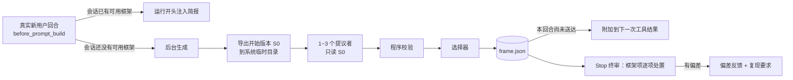

# 需求框架（Requirement Frame）实现需求 v1

- 基线：分支 `codex/stop-contract-pass-b1a6ad8`，提交 `b1a6ad8`。
- 请新建分支 `codex/requirement-frame` 实施。
- 本文是唯一需求来源；与本文冲突的个人判断以本文为准。

## 0. 先读：实现约束

本需求的价值在于小而准。以下约束优先于"更完整""更稳健"的判断。

1. **只做本文写明的东西。**
   - 没写的功能、选项、回执、哈希、围栏、重试、指标和日志字段，一律不加。
   - 遇到本文没覆盖的情况，选最简单、失败开放的做法，并在 PR 描述里列出，不要自行扩展设计。
2. **复用现有机制，不新建框架。**
   - 模型会话：沿用 Stop 审查创建私有审查会话的路径，即 `lib/runtime-v2/reviewer.mjs` 中调用 `runWorkspaceStopReview` 的地方。"自定义工具 + 提交工具"的写法参照 `lib/runtime-v2/baseline-coverage-audit.mjs`。不写新的模型客户端、调度器或会话引擎。
   - 只读代码工具：用 `lib/review-task/source-tools.mjs` 的 `createSourceTools(root, snapshot)`，根目录指向 S0 导出目录。不写新的读取围栏。
   - 中途送达：用与 `state.hotReviewFeedback` 相同的工具结果附加点。不拦截工具调用，也不走 Stop 反馈交付链（`lib/runtime-v2/feedback-delivery.mjs`）。
   - 用户消息：用 `lib/runtime-v2/original-requirements.mjs` 已记录的消息，取法与 Stop 审查的原文依据相同。
3. **失败开放。**
   - 任何一步失败（无 git、超时、模型出错、输出无效）时，只把框架标为不可用并记录原因。
   - 不重试，不阻塞主 Agent，不影响 Stop 结论，不消耗纠偏次数。
4. **默认关闭。**
   - `requirementFrame.enabled` 为 false 时，行为必须与 `b1a6ad8` 完全一致。
   - 现有测试必须原样通过，不修改现有测试的断言。
5. **代码量刹车**（不含测试和附录里的提示词文本）：阶段 1 不超过 350 行，阶段 2 不超过 100 行，阶段 3 不超过 150 行。超过就停下，在 PR 描述里说明原因，等确认后再继续。
6. **不重构。**
   - 不顺手改格式，不改名，不移动现有代码。
   - 新逻辑集中在新模块 `lib/runtime-v2/requirement-frame.mjs`，其他文件只加最少的接线。
   - 注释只写代码表达不了的约束。不为假想的并发或恶意输入加保护。
7. **不新增依赖。** 只用 Node.js 内置模块和 git 命令，新模块登记到 `packaging/runtime-modules.json`。
8. **文档只加一节。** 在 `docs/configuration.md` 加一节配置说明，不超过 40 行。不写进度日志、设计说明或实验报告。
9. **不碰宿主，不跑评测。** 不安装、不修改 MatrixAssistant 及随附的 OpenClaw，不 push，不跑真实模型评测（评测由人工执行，见第 9 节）。
10. **不泄露评测数据。** 不得向业务模型或审查模型提供隐藏测试、金标数据或参考实现。S0 只来自业务仓库自己的 git 提交。
11. **每个阶段一个提交**，提交前跑完该阶段列出的测试。

## 1. 背景与目标

目标是提高独立评测分数（F2P/P2P），并且对使用和不使用 OpenSpec 的 MA 任务都有效。

现有证据见 `docs/stop-contract-pass.md` 和 `docs/simplify-experiment-results.md`：

- **当前终审倾向判"无偏差"。** 当前 Stop 终审采用 B12 模式（原文依据加只报偏差），容易给出 NO_DEVIATION_FOUND；st7 只拿到 4/5，Stop 仍判无偏差。原因有两个：
  - 检查清单由能看到候选代码的同一个会话生成；
  - 规则是"无法证明的项省略"，漏检会默认通过。
- **失分集中在隐性契约上**，即需求原文没写、但现有代码决定了的约定：
  - st2：服务接入点；
  - st6：缺省值和空载荷的回退；
  - st7：挂起状态 × 操作的组合，以及异常路径的效果；
  - Sudoku-X：公开判定必须使用当前拓扑。
- **两条已试过的路都不通。** 只加审查提示词无效，v10 回放仍判无偏差；完整逐项审查会超时，A 和 B2 模式在时限内完成 0/6。

借鉴 long-horizon-controller 的两点：

- **需求澄清发生在看到候选代码之前，只基于开始版本的代码。** 由多个视角提议、一个选择器筛选，只保留有代码证据的高置信要点，用户原文始终是唯一权威。
- **终审不能把"没看"当"通过"。** 对少量关键项，审查方要给出明确的处置。

本需求只做一件事：在任务开始时，基于开始版本的代码生成一份小的**需求框架**，用在三个地方：

1. 开工简报，起预防作用；
2. Stop 终审逐项处置，起检测作用；
3. 偏差反馈中的复现要求，帮助修复。

是否使用 OpenSpec，只影响送达时机：

| | 不用 OpenSpec | 用 OpenSpec |
|---|---|---|
| 生成 | 第一个真实用户回合开始时 | 提案回合开始时 |
| 首次送达 | 生成完成后，附加到下一次工具结果（编码中途） | 生成完成后，附加到下一次工具结果（写规划文档中途） |
| 再次送达 | 之后每个真实用户回合的开头 | 编码回合开头，在写代码之前 |
| 终审 | 编码 Stop 使用 | 编码 Stop 使用；文档阶段 Stop 不变（`STOP_DOCUMENT_ONLY_CHANGES`） |

## 2. 范围

本轮实现三个阶段：第 5 节生成、第 6 节送达、第 7 节终审与反馈。

明确不做：

- long-horizon-controller 的控制器、PACT、Harbor、外部代码图实现、确定性验收台账、早期覆盖审计、传输冲突否决和进度守卫。
- 可执行探针和 OpenSpec 规格审计。第 8 节只记录方向，本轮不实现。
- 非 git 项目，以及开始时未提交的修改（S0 只取 HEAD 提交的内容）。
- 用户中途改需求后自动重新生成框架（见第 11 节）。
- 用程序过滤工作流阶段提示（v1 靠提示词让模型忽略流程指令）。
- 在 Claude Code、CodeAgent 宿主上生成和送达。这两个宿主上没有框架，终审行为不变。
- 修改纠偏预算、Stop 结论语义、文档/Skill/Ground Truth 纠偏以及评测脚本。

## 3. 总体流程



接线点速查：

| 文件 | 改动 |
|---|---|
| `lib/runtime-v2/requirement-frame.mjs`（新） | S0 导出、生成、校验、读写 `frame.json`、渲染简报、记录送达 |
| `lib/runtime-v2/config.mjs` | 归一化 `requirementFrame`；在 `REVIEWER_ROLES` 中加 `requirementFrame` |
| `lib/policy/config-loader.mjs` | 顶层键白名单加 `requirementFrame` |
| `config/schemas/project-config.schema.json` | 新配置块的 schema |
| `lib/openclaw/runtime.mjs` | `prompt()` 两处触发并在运行开头注入；`toolResult()` 中途附加 |
| 构建 Stop 审查输入、生成原文依据的地方 | 读取框架，传给审查 |
| `lib/runtime-v2/stop-workspace-review.mjs` | 依据部分、追加说明、`frameDispositions` 校验、`frameCoverage` |
| Stop 偏差反馈的渲染处（从 `lib/runtime-v2/stop-feedback.mjs` 开始找） | 追加附录 C |
| `packaging/runtime-modules.json` | 登记新模块 |
| `config/stop-behavior-frame.json`（新） | 评测配置 |
| `docs/configuration.md` | 一节配置说明 |

## 4. 配置

```yaml
requirementFrame:
  enabled: false      # 总开关
  proposers: 3        # 1..3，按附录 A.1 的视角顺序取前 N 个
  inject: true        # 第 6 节：向主 Agent 送达简报
  review: true        # 第 7 节：Stop 终审使用框架，偏差反馈加复现要求
  timeoutMs: 600000   # 整个生成过程的总时限
```

- **生效前提**：`enabled` 为 true，且现有配置已开启用户消息记录，即 `archivesUserMessages(plan.runtimeV2)` 为 true。不满足时视为关闭。非法值回落到默认值。
- **模型**：
  - 新增审查角色 `requirementFrame`，加入 `config.mjs` 的 `REVIEWER_ROLES`；未单独配置时沿用 `reviewers.defaults`。
  - 不修改 `CRITICAL_GATE_REVIEWER_ROLES`。
- **默认模板**：`.runtime-corrector-default/config.yaml` 不加这个配置块。
- **评测配置**：新建 `config/stop-behavior-frame.json`，内容等于 `config/stop-behavior-only.json` 加上 `"requirementFrame": { "enabled": true }`。

## 5. 阶段 1：生成需求框架

### 5.1 触发

- **触发位置**：`lib/openclaw/runtime.mjs` 的 `prompt()`，在识别出真实新用户回合之后。
  - 原生路径：`state.preparedNativeUsers = observed.externalUsersDigest` 之后。
  - 非原生路径：`realUser` 为 true 之后。

  两处调用同一个函数（例如 `startRequirementFrame(state, plan)`）。不 await，不改变 `prompt()` 的返回值和耗时。
- **不触发的情况**：RC 内部会话和审查会话、RC 自己发起的纠偏后续运行（followup）、会话或项目已关闭 RC、`shadowMode`。
- **每个会话只生成一次。** 如果该会话已有可用框架，就不再生成。可用框架的条件：
  - `status` 为 `ready`；
  - 至少有一项内容；
  - `startHead` 等于 5.2 确定的开始版本。

  以下情况在本回合生成：没有框架、上次失败、上次为空、开始版本变了。
- **并发与中止。**
  - 同一会话同时只有一个生成任务；新的生成开始前，中止旧的。
  - 会话关闭或 RC 被关闭时中止，时机沿用现有后台审查的中止时机。
  - 生成任务登记到 `hotReviewTasks` 所在的后台任务集合里，确保宿主关闭时能等待或中止它。

原因：在 OpenSpec 流程里，阶段提示和需求原文在同一条用户消息中，编码阶段又是一条新的用户消息（见 `scripts/bench/original-basis-workflow.mjs` 的 `workflowMessages`）。如果每条新消息都重新生成，就会浪费模型调用，也错过编码回合开头的注入。

### 5.2 开始版本 S0

- **确定开始版本。**
  - 如果该会话的任务已存在，且其 `task-start.json` 中有 `head`，就用这个 `head`。
  - 否则用当前的 `git rev-parse HEAD`。
  - 拿不到时（非 git 项目或没有提交），记为 `unavailable`，原因 `NO_GIT_HEAD`，不调用模型。

  补充：RC 的任务是在第一次调用纠偏入口工具时才懒创建的（`runtime.mjs` 中的 `CORRECTION_ENTRY_TOOLS`），所以第一个回合开头通常还没有任务。此时的 HEAD 就是稍后任务记录的 `startHead`。
- **导出。** 用临时 index 导出提交内容，不碰业务仓库的 index、工作区和 refs：

  ```
  GIT_OPTIONAL_LOCKS=0 GIT_INDEX_FILE=<tmp>/index git -C <projectRoot> read-tree <head>
  GIT_OPTIONAL_LOCKS=0 GIT_INDEX_FILE=<tmp>/index git -C <projectRoot> checkout-index -a -f --prefix=<tmp>/tree/
  ```

  - `<tmp>` 放在 `os.tmpdir()` 下。
  - `--prefix` 使用正斜杠，并以 `/` 结尾。
  - 生成结束后（无论成功或失败）删除 `<tmp>`。
- **大小上限。** 导出前用 `git ls-tree -r -l <head>` 统计。文件数超过 20000，或总字节超过 200 MB 时，记为 `unavailable`，原因 `SNAPSHOT_TOO_LARGE`。
- **只读 S0。** 提议者只拿到以下工具：
  - `createSourceTools(<tmp>/tree, snapshot)` 提供的只读工具（read、grep、find、ls）；
  - `semantic_graph`。在启动提议者前从同一份 S0 导出和文件清单建立一次索引，各提议会话共用。查询结果只用于导航，源码依据仍由 `source_read` 确认。图不可用时继续使用原有只读工具；
  - 一个提交工具。

  不提供任何能读取当前工作区的工具。这是"看不到候选代码"的唯一保证，不另加检查。

### 5.3 模型调用

- **提议者。**
  - 共 `proposers` 个独立的私有会话，每个使用附录 A.1 中的一个视角，提示词见附录 A.2。
  - 每个会话通过 `submit_frame_proposal` 提交一次。
  - 可以并行；如果现有会话路径只能串行，就串行。
- **选择器。**
  - 所有提议都结束后调用一次（只用成功的那部分），提示词见附录 A.3。
  - 不给代码工具，只给 `submit_frame_selection`。
  - `proposers` 为 1 时也要运行选择器。
- **用户消息。**
  - 按原顺序编号为 `U1..Un` 放进提示词。
  - 含 `[runtime-corrector:feedback]` 的消息，在行首标注 `(contains Runtime Corrector text that is not a user requirement)`。
- **时限。** 整个过程受 `timeoutMs` 限制，每个调用使用剩余时间。

### 5.4 程序校验

校验放在选择器之前做，不合格项直接丢弃，不报错。

- **证据。**
  - 每条 evidence 的 `path` 必须在 S0 中存在。
  - `startLine..endLine` 必须在该文件的行数范围内，跨度不超过 80 行。
  - 去掉无效的证据；某条 guidance 如果没有剩下有效证据，整条丢弃。
- **原文引用。** scenario 的 `quote` 必须是某条用户消息的子串（比较前把连续空白压成一个空格），否则丢弃。
- **字段。**
  - `contractCell` 必须是附录 A.1 列出的六个值之一。
  - `kind` 必须是 `requirement` 或 `preservation`。
  - `guidance.statement` 沿用 long-horizon-controller 的 4000 字符上限，超出时整条丢弃。
- **选择之后。**
  - 只保留选择器标为 `select` 且 `confidence ≥ 0.75` 的项。选择器没有评审到的候选按 `reject` 处理。
  - 按 `confidence` 降序排列，同分时保持原顺序。
  - guidance 最多 5 条，scenario 最多 6 条。
  - 重新编号为 `G1..G5` 和 `S1..S6`。

### 5.5 产物

- **路径**：`<stateRoot>/requirement-frame/<sha256(sessionId) 的前 24 位>/frame.json`。
- **原始提交**：同目录下的 `raw/` 保存每次模型提交的原始 JSON，只用于排查，不被任何逻辑读取。
- **写入方式**：用现有的 `atomicWriteJson` 原子写入。

```json
{
  "schemaVersion": 1,
  "status": "ready",
  "reason": null,
  "sessionId": "…",
  "startHead": "…",
  "userMessageCount": 1,
  "startedAt": "…",
  "finishedAt": "…",
  "counts": { "proposed": 14, "valid": 11, "selected": 7 },
  "guidance": [
    { "id": "G1", "statement": "…", "contractCell": "transport_integration",
      "evidence": [{ "path": "entry/src/main/ets/…", "startLine": 10, "endLine": 32 }], "confidence": 0.86 }
  ],
  "scenarios": [
    { "id": "S1", "kind": "requirement", "quote": "…", "given": "…", "when": "…", "then": "…", "confidence": 0.8 }
  ]
}
```

- **`status`** 取以下三个值之一：
  - `ready`：至少有一项内容；
  - `empty`：流程跑完，但没有入选项，`reason` 为 `NO_VALID_ITEM`；
  - `unavailable`：中途失败，`reason` 为 `NO_GIT_HEAD`、`SNAPSHOT_TOO_LARGE`、`TIMEOUT` 或 `MODEL_FAILED` 之一。
- **生成中**：生成过程中不写 `frame.json`。

### 5.6 验收

验收用脚本化模型，不调用真实模型，测试放在新文件 `test/requirement-frame.test.mjs`。

1. 有效提议得到 `ready`，条数上限和编号都符合 5.4。
2. 证据路径不存在或行号越界的 guidance 被丢弃；`quote` 不在用户消息里的 scenario 被丢弃。
3. 选择器标为 `reject`、或 `confidence < 0.75` 的项，不进入框架。
4. 非 git 目录得到 `unavailable` / `NO_GIT_HEAD`，模型调用次数为 0。
5. 导出前后，业务仓库的 `git status --porcelain` 输出和 `.git/index` 的哈希不变；临时目录被删除。
6. 在工作区新增一个未提交文件后，模型通过 ls/read 看不到它。
7. 模型超时或抛错时得到 `unavailable`，`prompt()` 的返回值与关闭本功能时相同。
8. 同一会话已有可用框架时，新的用户回合不再调用模型。
9. `enabled: false` 时，不创建任何 `requirement-frame` 目录。

## 6. 阶段 2：送达开工简报

### 6.1 渲染

- 使用附录 B 的模板。
- 渲染全部入选条目，不设简报总字符上限。
- 第一行必须是 `[runtime-corrector:feedback]`。这样即使宿主把简报并入用户消息，`original-requirements.mjs` 也会把那条消息标为含 RC 反馈，不会当作新需求。

### 6.2 通道

- **运行开头。**
  - 在真实新用户回合中，用 `joined` 把简报与 `prompt()` 原本要返回的 `prependContext` 合并，简报放在最后。
  - 条件：`inject` 为 true，且该会话有可用框架（同 5.1 的条件）。
- **运行中途。**
  - 如果框架在某个回合进行中变为 `ready`，而本回合还没有送达过，就把简报放进会话状态里的一个单独字段（例如 `state.frameBrief`，不要复用 `hotReviewFeedback`）。
  - 在 `toolResult()` 里，于合并 `hotReviewFeedback` 的同一处，把它附加到下一次工具结果。
  - 只有实际附加之后才算送达。
- **频率。** 每个真实用户回合最多送达一次，两个通道合计。
- **不送达的情况**：RC 内部会话和审查会话、RC 纠偏后续运行、RC 已关闭、`shadowMode`。
- **与纠偏状态无关。** 简报不计入纠偏次数，不改变任务的验证状态，不写入 Stop 反馈记录。

### 6.3 记录

每次送达，向 `frame.json` 同目录的 `deliveries.jsonl` 追加一行：

```json
{ "at": "…", "channel": "run_start", "runId": "…", "startHead": "…", "productionChangesBefore": 0, "text": "…" }
```

- `channel` 为 `run_start` 或 `tool_result`。
- `productionChangesBefore` 是送达时用 `task-changes.mjs` 现有函数算出的非文档改动条数；任务或开始快照不存在时为 `null`。它用来评估"简报是否在开写代码之前送达"。
- `text` 是本次送达的简报正文，供 RC 控制台读取。

### 6.4 验收

可以参照 `test/openclaw.test.mjs` 和 `test/original-basis-authority.test.mjs` 里现有的 prompt 与工具结果测试写法。

1. 框架就绪后的下一个真实用户回合：`prependContext` 末尾包含一次简报，同一回合的工具结果不再附加。
2. 回合进行中框架变为就绪：下一次工具结果末尾附加一次简报，之后的工具结果不再附加。
3. 以下情况都不送达：RC 内部会话、纠偏后续运行、`inject: false`、`shadowMode`。
4. 简报第一行是 `[runtime-corrector:feedback]`，长条目完整送达。
5. `deliveries.jsonl` 正确记录 `channel` 和 `productionChangesBefore`。

## 7. 阶段 3：终审使用框架

### 7.1 输入

- **读取位置**：在构建 Stop 审查输入、生成原文依据的同一处，读取该会话的框架。
- **可用条件**（全部满足才使用）：
  - `review` 为 true；
  - `status` 为 `ready`；
  - `frame.startHead === taskChanges.startHead`。

  任一条件不满足时不提供框架，审查行为与现在完全一致。
- **注入方式**：框架可用时，在 `stop-workspace-review.mjs` 的原文依据里增加一个必读部分 `requirement-frame`，内容只包含 `guidance` 和 `scenarios` 两个数组的 JSON，并在审查说明末尾追加附录 A.4 的文字。
- **不等待生成**：Stop 不等框架生成完成；届时没有可用框架，就按不可用处理。

### 7.2 逐项处置

- **新增参数。** `finish_stop_review` 增加参数：

  ```
  frameDispositions: [{ id, disposition, citeIds?, objectId?, reason? }]
  ```

  `disposition` 取 `CHECKED`、`DEVIATION` 或 `UNVERIFIED` 之一。
- **校验规则。**
  - 每个框架项的 id 恰好出现一次。
  - `CHECKED`：给出逐项核对的文字理由；不要求引用。以原始要求、实际调用入口和副作用为准，不将框架建议本身当作符合要求的证明。
  - `DEVIATION`：`objectId` 必须指向本次审查中已保存为 DEVIATION 的清单对象，或 `submit_finding` 的结果。
  - `UNVERIFIED`：`reason` 非空。
- **校验失败。** 按现有的 `taskError` 模式返回 `REVIEW_FRAME_DISPOSITION_REQUIRED`，让审查模型在会话内补齐。
- **框架项不改变结论。** 框架项本身不产生偏差，也不产生反馈；Stop 结论仍只由现有的偏差决定。`UNVERIFIED` 不改变 NO_DEVIATION_FOUND。
- **记录覆盖情况。** 在审查结果中记录：

  ```
  frameCoverage: { status: "used" | "absent", reason, total, checked, deviation, unverified }
  ```

  `status` 为 `absent` 时，只填 `status` 和 `reason`。

### 7.3 偏差反馈的复现要求

当 `review` 为 true 且存在偏差时，在 Stop 发给主 Agent 的偏差反馈末尾追加附录 C 的固定文字。反馈的其他内容和排序都不改。

### 7.4 验收

测试加在 `test/stop-workspace-review.test.mjs`，使用 `test/helpers/scripted-workspace-review.mjs`。

1. 框架可用时：原文依据包含 `requirement-frame` 部分，审查说明包含附录 A.4 的文字。
2. 以下情况下 finish 被拒绝，错误码为 `REVIEW_FRAME_DISPOSITION_REQUIRED`：
   - 缺少某项的处置；
   - id 重复或未知；
   - `CHECKED` 没有 citeId；
   - `DEVIATION` 的 `objectId` 不是已保存的偏差；
   - `UNVERIFIED` 没有 `reason`。
3. 处置全部合法时：结论与不带框架时相同，`frameCoverage` 的计数正确。
4. 框架不可用时（没有框架、`startHead` 不一致或 `review: false`）：原文依据、提示词和 finish 参数校验都与 `b1a6ad8` 一致，`frameCoverage.status` 为 `"absent"`。
5. 有偏差时，反馈末尾包含附录 C 的文字；`review: false` 时不包含。

## 8. 后续方向（本轮不实现）

是否实施这些方向，取决于第 9 节的评测结果。

- **OpenSpec 规格审计。**
  - 时机：文档阶段的 Stop 得出 `STOP_DOCUMENT_ONLY_CHANGES` 时（见 `production-stop.mjs`），在后台调用一次模型。
  - 内容：比较规划文档与用户原文和框架，把最多 5 条缺口追加到框架，在编码回合开头随简报一起送达。
  - 约束：不改变该 Stop 的结论，不消耗纠偏次数。
- **可执行探针。** 通过类似 `regressionCheck` 的配置命令运行；先在 S0 副本上校准，再用于检查候选代码。
- **重新生成。** 用户中途改需求时，重新生成框架。

## 9. 评测口径（人工执行，实现者不做）

- **分组**：

  | 组 | 配置 |
  |---|---|
  | A0 | `config/stop-behavior-only.json` |
  | A1 | 开启框架，`inject: true`，`review: false` |
  | A2 | 开启框架，`inject: false`，`review: true` |
  | A3 | 开启框架，两者都开 |

- **样本**：同一批 case，包括 six-once 的六个和 Sudoku-X。每组至少跑 2 轮，每次都是全新运行。
- **观察指标**：
  - F2P 和 P2P；
  - 纠偏次数、总时长、token 用量；
  - `deliveries.jsonl` 中首次送达时的 `productionChangesBefore`；
  - `frameCoverage` 的计数；
  - 抽查主 Agent 是否采纳了与原文冲突的提示。
- **决策规则**：以 A0 为基准。如果 A3 的 F2P 没有提升，或 P2P 下降，就不进入第 8 节。

## 10. 交付清单（PR 描述必须包含）

- 每个阶段的提交、改动的文件，以及新增行数（不含测试）。
- 运行过的测试命令和结果，包括：
  - `node --test test/requirement-frame.test.mjs test/stop-workspace-review.test.mjs`
  - 改动涉及的 openclaw 测试文件
  - `npm test`
  - `npm run build:plugins`
  - `npm run test:artifacts`
- 逐条列出：与本文不一致的地方，以及本文未覆盖、由你自行决定的地方。

## 11. 已知限制

- **框架可能过时。** 每个会话只生成一次；用户后来改了需求，框架不会更新，后续回合的简报可能过时。简报文字已声明以新消息为准。
- **看不到未提交的修改。** S0 只包含 HEAD 的提交内容，任务开始前未提交的修改看不到。
- **首次简报可能晚到。** 第一个回合的简报要等生成完成才送达，可能晚于第一次写代码。可以用 `productionChangesBefore` 观察。
- **流程指令只靠提示词过滤。** 工作流阶段提示与需求原文在同一条用户消息里时，只靠提示词让模型忽略流程指令。

---

## 附录 A：模型提示词（英文，原样使用）

### A.1 视角与契约类型

视角，按 `proposers` 的数量依次取用：

1. `ownership`：Ownership and extension points. Find where the requested behavior must live: the existing owner module, service, entry point or helper that must be extended or reused, and the public signatures that callers or tests depend on.
2. `flow`：Data and control flow. Trace from the trigger to every observable effect: each caller and consumer that must see the new behavior, each state × operation combination, and the success, returned-failure and thrown-exception branches.
3. `boundaries`：Boundaries and compatibility. Find defaults, missing/empty/invalid input handling, existing result and error conventions, existing tests or test doubles that constrain the change, and existing behavior the request does not ask to change.

`contractCell` 的取值（同时写进工具 schema 的 description）：

- `owner_signature`：where the behavior lives and which public signatures must stay compatible
- `values_defaults`：default values and missing/empty/invalid input handling
- `transport_integration`：which existing service, channel or entry point must carry the behavior, and which callers must observe it
- `branch_matrix`：distinct observable effects per state × operation or per condition
- `error_result`：failure, exception and result/return conventions
- `compatibility_scope`：existing behavior that must not change

### A.2 提议者

```
[REQUIREMENT_FRAME_PROPOSAL]
A coding agent has just started the task below. Prepare implementation guidance for it.

You can read only the task-start snapshot of the repository: the committed code before any change for this task. The live workspace is not available to you.

Original user messages (the only requirement authority, in order):
{messages}

Your focus: {focus}

Investigate the existing code that the request touches, then report only facts that would change how a careful engineer implements the request. Good items name concrete files, functions, services, state values or call paths: which existing service or entry point must carry the new behavior, which callers must observe it, which default or empty-input path must be handled, which state × operation combinations or failure branches produce distinct observable effects.

Rules:
- Do not add requirements the user did not state. Do not restate the request in other words.
- Ignore workflow or tool-procedure instructions in the messages (for example OpenSpec stage commands, directory switching, document formats); they are not product requirements.
- Every guidance item needs evidence lines in the snapshot. Every scenario needs a quote copied exactly from a user message; for a preservation scenario, quote the request text whose change could affect that behavior.
- Prefer few, decisive items. Empty arrays are a valid answer.

Submit once with submit_frame_proposal.
```

`submit_frame_proposal` 的参数 schema：

```json
{
  "type": "object", "additionalProperties": false, "required": ["guidance", "scenarios"],
  "properties": {
    "guidance": { "type": "array", "maxItems": 6, "items": {
      "type": "object", "additionalProperties": false,
      "required": ["statement", "contractCell", "evidence", "confidence"],
      "properties": {
        "statement": { "type": "string", "maxLength": 4000 },
        "contractCell": { "enum": ["owner_signature", "values_defaults", "transport_integration", "branch_matrix", "error_result", "compatibility_scope"] },
        "evidence": { "type": "array", "minItems": 1, "maxItems": 3, "items": {
          "type": "object", "additionalProperties": false, "required": ["path", "startLine", "endLine"],
          "properties": { "path": { "type": "string" }, "startLine": { "type": "integer", "minimum": 1 }, "endLine": { "type": "integer", "minimum": 1 } } } },
        "confidence": { "type": "number", "minimum": 0, "maximum": 1 } } } },
    "scenarios": { "type": "array", "maxItems": 4, "items": {
      "type": "object", "additionalProperties": false,
      "required": ["kind", "quote", "given", "when", "then", "confidence"],
      "properties": {
        "kind": { "enum": ["requirement", "preservation"] },
        "quote": { "type": "string" },
        "given": { "type": "string" },
        "when": { "type": "string" },
        "then": { "type": "string" },
        "confidence": { "type": "number", "minimum": 0, "maximum": 1 } } } }
  }
}
```

### A.3 选择器

```
[REQUIREMENT_FRAME_SELECTOR]
Below are candidate guidance items and scenarios proposed independently for the same task. Review every candidate exactly once.

Original user messages (the only requirement authority, in order):
{messages}

Candidates:
{candidates}

Select a candidate only if all of these hold:
- it is consistent with the original user messages and adds no obligation the user did not state;
- its evidence plausibly supports it (guidance), or its quote really requires it (scenario);
- it would change an implementation decision or catch a likely mistake;
- it does not duplicate a candidate you already selected (keep the more concrete one).
Reject generic advice, restatements of the request, process or document requirements, and speculation.

Submit once with submit_frame_selection.
```

- `{candidates}` 是校验后的候选数组 JSON。每项带有 `id`（形如 `P1-G2`、`P3-S1`）和 `type`（`guidance` 或 `scenario`），不带 `confidence`。
- `submit_frame_selection` 的参数是 `{ "reviews": [{ "id": string, "decision": "select" | "reject", "reason": string }] }`。

### A.4 Stop 审查追加说明

```
Requirement frame (basis part requirement-frame): guidance items G* and behavior scenarios S* that the program prepared from the task-start code before this candidate existed, after checking that their evidence exists and their quotes come from the user messages. They are advisory: the original user messages remain the only authority, and the frame never adds obligations.
Before finishing, give every frame item exactly one entry in finish_stop_review.frameDispositions:
- CHECKED: you traced it in the current production code and it holds. Cite at least one issued citeId where the effect is produced (for a scenario: where its "then" happens).
- DEVIATION: it does not hold, and you saved a proved deviation for the corresponding original requirement (checklist object or submit_finding). Give that objectId.
- UNVERIFIED: you could not establish it within budget, or it does not follow from the original messages. Give a short reason.
A frame item alone is never a deviation; a DEVIATION disposition needs a proved deviation saved through the normal tools. Check scenarios of kind requirement first, then guidance whose contractCell is transport_integration, branch_matrix, error_result or values_defaults.
```

## 附录 B：简报模板

文本按现有 locale 机制选择语言；只有中英两种，原样使用。

- 没有 guidance 或没有 scenario 时，省略对应小节。
- 每条 guidance 只写第一条 evidence。

中文：

```
[runtime-corrector:feedback]
【RC 实现提示｜仅供参考】
以下内容由 RC 根据本任务开始时的代码和用户消息整理，生成时没有看过你的修改。用户原文是唯一依据：某条提示若与原文或你核实到的代码不符，以原文和代码为准；不要因为这些提示增加用户没要求的功能。若之后的用户消息提出了不同要求，以新消息为准。

实现落点：
1. {statement}（依据：{path}:{startLine}-{endLine}）

需要满足的行为：
- [新需求] 前提：{given}；操作：{when}；预期：{then}。（原文：“{quote}”）
- [保持不变] 前提：{given}；操作：{when}；预期：{then}。（原文：“{quote}”）
```

English：

```
[runtime-corrector:feedback]
[RC implementation hints | advisory]
Runtime Corrector prepared these hints from the code at task start and the user messages, without seeing your changes. The user's original messages are the only authority: if a hint disagrees with them or with code you have verified, follow the messages and the code, and do not add features the user did not ask for. If a later user message asks for something different, follow the later message.

Where to implement:
1. {statement} (evidence: {path}:{startLine}-{endLine})

Behavior to satisfy:
- [new] Given {given}; when {when}; then {then}. (quote: "{quote}")
- [keep] Given {given}; when {when}; then {then}. (quote: "{quote}")
```

## 附录 C：偏差反馈追加文字

中文：

```
处理上面每个偏差时：
1. 先用一个最小的公开检查复现它（现有测试、命令，或放在系统临时目录、用完即删的临时脚本），确认它确实失败。
2. 修改后再运行同一个检查，确认通过；再运行一个相邻的已有行为检查，确认原有行为没有被破坏。
3. 如果无法复现，说明原因，不要为了通过评审而改动无关代码。
```

English：

```
For each deviation above:
1. First reproduce it with a minimal public check (an existing test, a command, or a throwaway script in the system temp directory that you delete afterwards) and confirm that it fails.
2. After the fix, rerun the same check and confirm that it passes; also run one nearby existing-behavior check to confirm that nothing else broke.
3. If you cannot reproduce it, explain why and do not change unrelated code just to pass the review.
```
