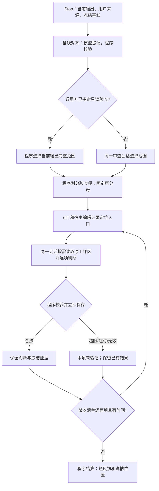

# Stop：有边界的验收

## 职责和不变量

Stop 只回答两件事：本次停止应检查什么；这些检查目前有何可靠结论。它不承担业务实现，不重写冻结要求，也不把宿主主会话搬进另一个大终审。

令冻结指标集合为 O，逐项结论必须分别对应原始对象，不允许删改分母。默认 Stop 的一个审查会话负责整个选定集合；中间输出只查有依据的偏差，不输出指标通过结论。分类只选择范围，不是 PASS。基线、已读证据、检索清单或取消状态变化后不能发布旧判断。

同一冻结基线下，已验证并持久化的结果集合 V 单调增加。某一项超限、超时、格式失败不删除兄弟项；缺项仍在原分母内，整体不能 PASS。基础设施失败不消耗业务纠偏次数 k。

## 六个独立子问题

1. **对齐基线**：输入真实用户来源、已有账本与材料目录；模型提出增量，程序校验来源及账本操作。Stop 的私有输入分页；不跳过新用户要求，不改变其他入口的提取逻辑。
2. **选择范围**：调用方已明确要求 verify_only 时，程序固定当前输出的完整验收范围，不让旧会话的中间状态缩小验收范围；范围确定仍不代表 PASS。普通 Stop 的同一审查会话以原始用户要求和最后的助手回复确定停止类型，通过 `review_checklist(stopClassification)` 或 `review_scope` 选定范围，不另起分类 Agent。
3. **组织材料**：程序建立本项、公共约束和显式依赖的披露视图。过大的正文保存为原文字节页和索引，小请求携带必读入口。导航不是证据；例外和条件不得截掉。
4. **逐项判断**：同一私有会话按需读取原文并给出短诊断、位置和状态；程序控制请求大小、单次披露边界和截止时间，不以累计字节数中止。不能在边界内读完必要依据时，明确未验证。单项不再按剩余项数均分出几秒钟，而是在共同截止内取得可完成检查的时间；同一会话续跑只补未完成项。
5. **保存及校验**：程序核对归属、对象覆盖、分类、证据位置、内容摘要和版本；合法结果逐项立即落盘，完整清单完成后关闭会话。`submit_review` 保存指标和文件质量结果，`submit_finding` 保存额外有据偏差；最后一项的 `finish: true` 或单独的 `finish_stop_review` 结算全部原始条目。
6. **结算及反馈**：程序合并已有判断，保留检查失败原因；每项短反馈和整包反馈有字节上限，完整详情带索引。沿用已有重试和纠偏预算，不增加总评 Agent。

Claude、CodeAgent 和 OpenClaw / MatrixAssistant 默认使用共享引擎；CLI 和原生宿主分别提供传输与真实结果回执。未声明 `supportsWorkspaceStopReview` 的自定义收集器仍保留原有兼容协议。

反馈沿用每项 768 字节、整包 8KiB 的硬上限。通过项统计计数；偏离项给原因及后果、少量来源位置；检查失败说明未验证原因。过长说明保存到项文件，整包放不下的项通过分页索引访问。宿主不接收整堆引文，也不再由一个模型读完所有结果重写总评。

## 上下文边界

默认 Stop 使用统一 task 执行底座。必要的基线更新保留来源提取协议；分类、阶段/任务审查、findings 与文件质量合并到一个审查会话，不消费最终文本作为完成结果。OpenClaw 旧配置 `native` 归一到 task。非 Stop 角色的既有入口保留。

项目文件直接按需读取，不复制代码仓，也不要求文件位于项目目录或源码清单内。绝对路径、父目录和链接文件都可读；只读权限与证据归属是独立规则。程序仅保存原始基线、过程记录、引文元数据和结果。计划、笔记、历史摘要及其他 RC 自产文件不能充当业务原文。

Stop task 的累计助手响应上限为 200 轮，单次模型输出上限为 32768 token。普通审查首次运行加最多一次续跑；分组、提交修正与续跑不重置计数、原绝对截止或已保存身份。基线领域修复沿用自己的额度。

上下文窗口、压缩和宿主工具结果处理由宿主管理；RC 不再按累计读取量、工具调用次数或旧 32KiB 单次结果大小中止检查。原文分页仍保留：`source_read` 每页最多 400 个完整行、51200 个 UTF-8 字节，返回文本块最多 6000 字节。超长单行可能仍无法交付，但这不构成整个 task 的累计阅读额度。

只有最终、非合成且与原文页完整匹配的工具结果能建立读取凭据：OpenClaw 使用 `tool_result_persist`，CLI 使用所属会话真实 `stream-json` 的工具调用与结果。单独执行 MCP 调用、早期诊断 observer、grep、摘要和历史检索不授予原文覆盖。宿主截断后须补读；无法补齐则未验证。程序继续校验版本、哈希、适用条件、任务归属、取消、截止和提交回执。

必读 Ground Truth 基础材料使用无损紧凑 JSON，保留所有正文、字段、适用条件和依赖。同一会话完整读取一次，跨验收项复用凭据。大材料按字节拆分，按文件名顺序拼接回原文；不是语义摘要。

## 避免重复和组合爆炸

划分的复杂度按冻结对象数量线性增长，不展开“指标 × 文件 × 历史事件”的笛卡尔积。仅查违规的中间 Stop 按来源义务去重，不因同一义务映射多个指标再查一次。分母保持冻结，不靠减少统计对象节省时间。

同一义务的多个指标常带着相同的长 description。只有正文与当前 Ground Truth claim 完全相同、修订一致时，程序将这些重复正文替换为精确来源引用；一次读取原 claim 即可。对象的 applicability、例外等其余字段全部原样保留，完整 population 另存审计副本。文本或修订不一致时禁止此消重，仍使用完整必读原文，避免用近似总结掩盖条件。

默认单会话链路在每个 Stop 重新检查原始清单，不把上次的部分结果或“没有发现”缓存为长期通过。同一会话的续跑保留已保存项和读取凭据。原有分组收集器的保守缓存仍仅适用于其兼容入口。

共享链路记录实际读取和搜索的文件、遍历过的目录及链接解析目标。每次提交检查这些依赖，结算前重算原文字节哈希；证据或检索目录变化使本次判断失效。未读文件不会因为复制整个仓库而成为隐式依赖。RC 自有可变日志和审查产物作为可读上下文，不充当业务证据或变更依赖；原始基线、过程记录和 Skill 仍受完整读取与变更校验。总截止及轮次边界限制本轮成本，未完成项保留为未验证。

单会话减少公共材料的重复披露和模型会话启动。大需求能否在指定时间内完成、模型准确率和实际 token 节省仍需真实记录，不能由离线协议回归推断。

材料交付及最终请求再分页也遵守同一截止和取消信号；不允许模型启动前的来源复制或请求重封装绕过预算。已到期的任务不再读取来源，也不写后续页面。

Stop 分类、基线对齐、逐项验收使用显式 boundedBasis 标记。其他插件功能和独立 implementation-reviewer 保留既有行为；因此独立实现审查的超大义务仍可能未验证，不能宣称所有审查均已解决。

## 验证边界

OpenClaw 提交当前 Stop 判断时，在宿主的 `reviewSummary.reviewCoverageReceipt` 保存完整 `reviewCoverage` 的内容摘要及所属项目、会话、回合、任务、判断、评估、范围和启用修订。生成回执还须持有本次任务事务完成发布后产生的内存凭据，核对相同正文对象和摘要；初次缓存命中、并发重复提交、过期或失败的发布均不产生该凭据。详细源码范围、来源处置及原因仍保留在工作区评估中，宿主只新增摘要。读取者须从可信宿主边界取得完整的原生 Stop 记录，再用 `verifyStopReviewCoverageReceipt` 对照详情。校验器要求相同身份的已提交、已结算记录，拒绝恢复的旧记录；放在可编辑工作区的同名回执不能建立可信性，只有摘要的调度汇总也不足以替代提交记录。匹配只证明详情与宿主提交时相同，不证明来源发现穷尽、语义判断正确或代码通过验收，原有待验证状态继续保留。缺少正文、过期的提交，以及从工作区旧记录直接复用的判断均不生成有效摘要，旧试验不会据此补获认证。

宿主调度记录还在 `reviewCoverageCarrier` 保存真实原生提交的身份、状态、提交时间及摘要，排除反馈、源码正文和私有推理。`reviewSummary.assessmentId` 明确保留实际判断身份，无须从回合名称推测。校验器也接受这一完整宿主记录，逐项核对外层范围、摘要及提交记录；字段缺失、身份不一致或原生旧记录被恢复时继续保留不可验证状态。

生产来源检查 `requireProductionOriginCoverage` 默认关闭。启用后，模板插值及正则／除法等未解析文本只提供潜在来源导航：程序按当前条目的完整文件选择值、符号及已有解析器能识别的导入别名查询；命中时保留文件范围和内容摘要，结论为未验证，不虚构调用者、调用次数、路由或执行事实。无关模板文本不会使整个索引失效。检查受源码、词汇、插值、查询工作量和返回大小上限约束；超限、无法解析的嵌套或转义标识符继续保留未验证。动态别名、间接路由及不支持的语法仍有边界，已记录的潜在来源不证明所有语义调用者已穷尽；审查人仍须读取原文并判断相关性和数据传递。

来源索引按可见操作数及词法上下文区分普通除法与正则表达式，保留数值、分组、属性、函数调用及连续除法中的实际引用。控制语句头、前缀操作符和跳转标签之后的正则文本不能生成调用关系。闭合花括号、转义标识符、未配对定界符及其他不能确定的上下文继续采用保守查询；命中相关潜在来源或超限时保持未验证。此调整只影响来源索引，独立的同级分支执行解析仍可能因除法返回不支持语法；索引 READY 不证明语义正确或执行通过。

来源入口按共享的词法可调用框架选择唯一的内层作用域。支持的匿名回调使用文件位置确定身份，赋值标签仅供导航，不生成属性接收者绑定、调用或事件执行关系；具备明确绑定的顶层常量箭头函数保留实际名称、导出及调用者。参数声明与类型注解分别处理，嵌套回调不借用外层注册函数的调用者，箭头函数仍保留已有类方法的词法 this 引用。引用部分跨过回调边界、同一行出现多个无法区分的函数，以及不支持的内部框架时，不能退回外层函数取得覆盖。框架超过 512 项或遍历工作超限时，入口解析保持未验证；框架定位也不能证明代码语义、回调执行或参数传递正确。

简单可选参数、默认值及末尾剩余参数分别保留绑定和初始化表达式；类型中的箭头不是运行时回调，参数默认值中的实际引用则属于该函数的参数作用域。复杂解构、无法确定的类型或默认值不靠猜测补齐。有限的表达式箭头和参数语法检查只调用 Node 的编译接口，不运行源码、函数或构造器；表达式正文最多 16KiB，词法工作量、框架数量和嵌套另有上限。解析不完整时保持未验证。

类型注解的范围不能越过所属类的闭合位置、后续成员或静态初始化块；类型别名省略分号时也不能把后面的实际回调吞入类型。局部类型别名及接口不作为运行时值的遮蔽声明。类型别名边界无法在有界规则内确定时，继续枚举后续框架，但明确记录索引不完整，不能据此选择外层函数取得覆盖。转义标识符末尾的字母、数字等相邻片段最多回看 128 项；超限保留不确定性，不解码标识符，也不把随后正则文本生成调用关系。

来源回执查找的诊断区分缺失或未在本次私有登记表签发的编号、对象及入口绑定不一致、发现结果不支持，以及索引过期。未知编号不能据此被认定来自另一会话。诊断只保存有界的编号、相对位置和内容摘要，不授予读取或覆盖凭据。失败上下文在后续未重提覆盖的结算中继续保留；新的有效覆盖才会清除旧失败，已接受覆盖过期时则先保存最新原因再撤销。最终待验证条目保留这些诊断，已有宿主内容摘要可核对其提交后的完整性，但不能据此认定诊断语义正确或补批旧试验。

分页披露、超过旧累计字节阈值后继续读取、单次返回与调用边界、部分保存、截止与取消通过离线行为测试验证。受控 reviewer 不证明真实模型准确性，也不能证明完整业务修复和最终验收闭环。完整需求能否在预算内完成检查仍取决于输入规模、宿主与模型，不承诺未经真实验收的性能收益。
