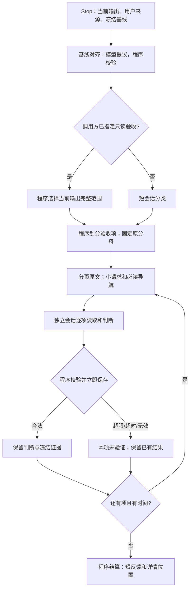

# Stop：有边界的验收

## 职责和不变量

Stop 只回答两件事：本次停止应检查什么；这些检查目前有何可靠结论。它不承担业务实现，不重写冻结要求，也不把宿主主会话搬进另一个大终审。

令冻结指标集合为 O，逐项划分为 O₁…Oₙ：并集必须等于 O，两两不相交。指标验收每项最多四个同来源、同验证目标的对象；仅查违规则按来源和目标一次去重，不输出指标判断。分类只选择范围，不是 PASS。基线、源码或取消状态变化后不能发布旧判断。

同一冻结基线下，已验证并持久化的结果集合 V 单调增加。某一项超限、超时、格式失败不删除兄弟项；缺项仍在原分母内，整体不能 PASS。基础设施失败不消耗业务纠偏次数 k。

## 六个独立子问题

1. **对齐基线**：输入真实用户来源、已有账本与材料目录；模型提出增量，程序校验来源及账本操作。Stop 的私有输入分页；不跳过新用户要求，不改变其他入口的提取逻辑。
2. **选择范围**：调用方已明确要求 verify_only 时，程序直接选择当前输出的完整验收范围，不消耗分类模型调用，也不让旧会话的中间状态缩小验收范围；范围确定仍不代表 PASS。普通 Stop 以用户要求和最后的助手回复进入分类 task，通过 submit_classification 提交；程序补齐空发现/指标数组。
3. **组织材料**：程序建立本项、公共约束和显式依赖的披露视图。过大的正文保存为原文字节页和索引，小请求携带必读入口。导航不是证据；例外和条件不得截掉。
4. **逐项判断**：独立私有会话按需读取原文并给出短诊断、位置和状态；程序控制请求大小、单次披露边界和截止时间，不以累计字节数中止。不能在边界内读完必要依据时，明确未验证。单项不再按剩余项数均分出几秒钟，而是在共同截止内取得可完成检查的时间；后续同输入重试只补未完成项。
5. **保存及校验**：程序核对归属、对象覆盖、分类、证据位置、内容摘要和版本；合法结果立即落盘，随后关闭会话。OpenClaw Stop 使用逐项提交和持久化回执保全结果，findings 批次使用 submit_findings / finish_findings。
6. **结算及反馈**：程序合并已有判断，保留检查失败原因；每项短反馈和整包反馈有字节上限，完整详情带索引。沿用已有重试和纠偏预算，不增加总评 Agent。

程序固定只读验收范围的优化适用于声明 supportsReviewCollection 的收集器入口；非 OpenClaw Stop 的其他宿主兼容入口保留其原有行为。

反馈沿用每项 768 字节、整包 8KiB 的硬上限。通过项统计计数；偏离项给原因及后果、少量来源位置；检查失败说明未验证原因。过长说明保存到项文件，整包放不下的项通过分页索引访问。宿主不接收整堆引文，也不再由一个模型读完所有结果重写总评。

## 上下文边界

OpenClaw Stop 只使用统一 task 执行底座。基线、分类、阶段/任务审查、findings-only 和文件质量各自提交工具结果；不消费模型最终文本 JSON 作为完成结果，也不保留旧引擎回退。旧配置 `native` 归一到 task。非 Stop 角色及其他宿主的既有入口保留。

Stop task 的累计助手响应上限为 200 轮，单次模型输出上限为 32768 token。普通审查首次运行加最多一次续跑；分组、提交修正与续跑不重置计数、原绝对截止或已保存身份。基线领域修复沿用自己的额度。

上下文窗口、压缩和宿主工具结果处理由宿主管理；RC 不再按累计读取量、工具调用次数或旧 32KiB 单次结果大小中止检查。原文分页仍保留：`source_read` 每页最多 400 个完整行、51200 个 UTF-8 字节，返回文本块最多 6000 字节。超长单行可能仍无法交付，但这不构成整个 task 的累计阅读额度。

只有最终、非合成且与原文页完整匹配的工具持久化消息能建立读取凭据；早期诊断 observer、grep、摘要和历史检索不授予原文覆盖。宿主截断后须补读；无法补齐则未验证。程序继续校验版本、哈希、适用条件、任务归属、取消、截止和提交回执。

必读 Ground Truth 基础材料使用无损紧凑 JSON，去掉格式缩进，保留所有字符串内空白、正文、字段、适用条件和依赖。完整 canonical 审计副本继续独立保留。大项目的 79 条公共材料由 54,820 降至 44,731 字节；这节省格式成本，不是语义摘要，也没有证明公共约束可以从各项验收中省略。

## 避免重复和组合爆炸

划分的复杂度按冻结对象数量线性增长，不展开“指标 × 文件 × 历史事件”的笛卡尔积。仅查违规的中间 Stop 按来源义务去重，不因同一义务映射多个指标再查一次。分母保持冻结，不靠减少统计对象节省时间。

同一义务的多个指标常带着相同的长 description。只有正文与当前 Ground Truth claim 完全相同、修订一致时，程序将这些重复正文替换为精确来源引用；一次读取原 claim 即可。对象的 applicability、例外等其余字段全部原样保留，完整 population 另存审计副本。文本或修订不一致时禁止此消重，仍使用完整必读原文，避免用近似总结掩盖条件。

Stop 复用同一冻结输入下已经完整通过程序校验的 PASS 项；不复用偏离、部分结果或未验证，也不把“没有发现”缓存为长期通过。固定 task-local 索引保留上一组输入下的条目，不遍历历史报告。输入身份包括基线、对象、分类、指令、schema、模型身份和完整证据快照；复用前仍校验原引用字节和程序完整记录的读取证据，并在新收集记录中标明来源。读取记录缺失、不稳定，或使用链接、目录及其他未能完整追踪的路径时正常重审。

基线、证据、指令、分类或模型变化则重新审查。保守复用的收益主要在未改变证据的基础设施重试，不宣称业务修改后的任意旧 PASS 仍可沿用；尚无完整依赖图时不凭少量引用推断无关文件变化不影响结论。总截止及各执行路径的调用、轮次边界限制本轮成本，到期交回已完成判断与未完成清单。

线性划分不等于总 token 线性：N 项若都需要 G 字节公共约束，最坏仍需重复读取 N×G。通过短分类、去重、保守复用和总截止限制成本，不以未经验证的摘要删掉公共条件。完整大需求的所有项目能否在指定时间内完成，需要真实记录判断，不能由预检成功推断。

材料交付及最终请求再分页也遵守同一截止和取消信号；不允许模型启动前的来源复制或请求重封装绕过预算。已到期的任务不再读取来源，也不写后续页面。

Stop 分类、基线对齐、逐项验收使用显式 boundedBasis 标记。其他插件功能和独立 implementation-reviewer 保留既有行为；因此独立实现审查的超大义务仍可能未验证，不能宣称所有审查均已解决。

## 验证边界

分页披露、超过旧累计字节阈值后继续读取、单次返回与调用边界、部分保存、截止与取消通过离线行为测试验证。受控 reviewer 不证明真实模型准确性，也不能证明完整业务修复和最终验收闭环。完整需求能否在预算内完成检查仍取决于输入规模、宿主与模型，不承诺未经真实验收的性能收益。
