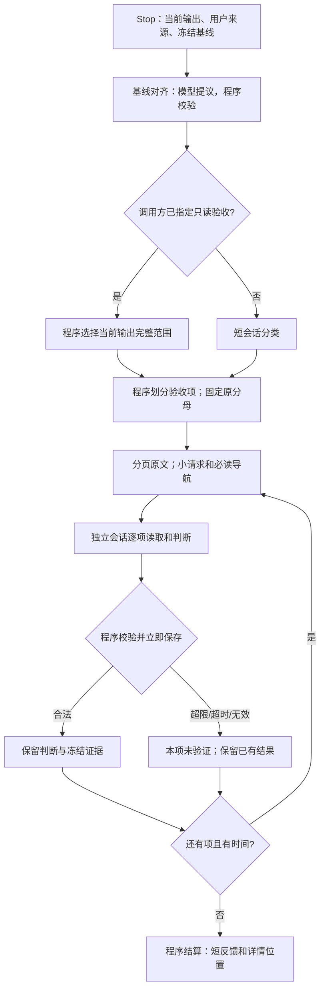

# Stop：有边界的验收

## 职责和不变量

Stop 只回答两件事：本次停止应检查什么；这些检查目前有何可靠结论。它不承担业务实现，不重写冻结要求，也不把宿主主会话搬进另一个大终审。

令冻结指标集合为 O，逐项划分为 O₁…Oₙ：并集必须等于 O，两两不相交。每项最多四个同来源、同验证目标的对象，保留既有分组方式。分类只选择范围，不是 PASS。基线、源码或取消状态变化后不能发布旧判断。

同一冻结基线下，已验证并持久化的结果集合 V 单调增加。某一项超限、超时、格式失败不删除兄弟项；缺项仍在原分母内，整体不能 PASS。基础设施失败不消耗业务纠偏次数 k。

## 六个独立子问题

1. **对齐基线**：输入真实用户来源、已有账本与材料目录；模型提出增量，程序校验来源及账本操作。Stop 的私有输入分页；不跳过新用户要求，不改变其他入口的提取逻辑。
2. **选择范围**：调用方已明确要求 verify_only 时，程序直接选择当前输出的完整验收范围，不消耗分类模型调用，也不让旧会话的中间状态缩小验收范围；范围确定仍不代表 PASS。普通 Stop 才以用户要求和最后的助手回复进入短分类会话，其空发现/指标数组 schema 不携带无用的大枚举。
3. **组织材料**：程序建立本项、公共约束和显式依赖的披露视图。过大的正文保存为原文字节页和索引，小请求携带必读入口。导航不是证据；例外和条件不得截掉。
4. **逐项判断**：独立私有会话按需读取原文并给出短诊断、位置和状态；程序控制请求大小、单次及累计读取预算、截止时间。不能在预算内读完必要依据时，明确未验证。单项不再按剩余项数均分出几秒钟，而是在共同截止内取得可完成检查的时间；后续同输入重试只补未完成项。
5. **保存及校验**：程序核对归属、对象覆盖、分类、证据位置、内容摘要和版本；合法结果立即落盘，随后关闭会话。沿用已有 rc_progress 保全机制。
6. **结算及反馈**：程序合并已有判断，保留检查失败原因；每项短反馈和整包反馈有字节上限，完整详情带索引。沿用已有重试和纠偏预算，不增加总评 Agent。

## 上下文边界

上下文包括系统说明、输出 schema、初始请求、工具参数和返回、修复轮次；每个文件小，不代表累计上下文小。本次复用 UTF-8 原文分页（16KiB）、请求限制（24KiB）、逐项会话与已有截止机制，补充原生 OpenClaw 私有 Stop 会话的累计读取保护。字节运行额度不是精确 token 计量，未知宿主注入和模型自身输出仍需原生上下文窗口及压缩兜底。

原生 Stop 每个私有会话累计已知系统说明、请求读取、工具参数和工具返回最多 128KiB；单次工具返回最多 32KiB，最多 64 次调用。已知模型窗口及输出预留只会收紧额度，重复读取和格式修复不重置累计值。宿主原生注入和输出仍有自己的上下文边界，不能将上述字节数当作精确 token 保证。

额度用厨房真实读取校准：79 条公共约束的五页原文经工具包装后占 81,719 字节，必要请求、导航和源码共约 99KB，尚需系统说明与格式修复余量。96KiB 会在完整必要读取前耗尽；128KiB 保持有界并留出该样例的必要余量。另明确禁止无必要地再读一遍完整 canonical，避免重复消耗。

预算超限属于检查器失败。压缩可由宿主原生机制执行，但压缩摘要不能取代原文条件及证据。此次不增加摘要 Agent、跨项共享材料缓存、自定义压缩器或新的工作流；CLI 的读取累计边界需要另外的宿主接口，不能从原生 OpenClaw 的验证外推。

Stop 的源码导航只省略每文件 SHA-256，路径、大小和其他元数据保留；完整 manifest 另存审计原文。哈希仍由程序校验，无须让模型重复读取这些校验字串。

## 避免重复和组合爆炸

划分的复杂度按冻结对象数量线性增长，不展开“指标 × 文件 × 历史事件”的笛卡尔积。仅查违规的中间 Stop 按来源义务去重，不因同一义务映射多个指标再查一次。分母保持冻结，不靠减少统计对象节省时间。

同一义务的多个指标常带着相同的长 description。只有正文与当前 Ground Truth claim 完全相同、修订一致时，程序将这些重复正文替换为精确来源引用；一次读取原 claim 即可。对象的 applicability、例外等其余字段全部原样保留，完整 population 另存审计副本。文本或修订不一致时禁止此消重，仍使用完整必读原文，避免用近似总结掩盖条件。

Stop 复用同一冻结输入下已经完整通过程序校验的 PASS 项；不复用偏离、部分结果或未验证，也不把“没有发现”缓存为长期通过。固定 task-local 索引保留上一组输入下的条目，不遍历历史报告。输入身份包括基线、对象、分类、指令、schema、模型身份和完整证据快照；复用前仍校验原引用字节和程序完整记录的读取证据，并在新收集记录中标明来源。读取记录缺失、不稳定，或使用链接、目录及其他未能完整追踪的路径时正常重审。

基线、证据、指令、分类或模型变化则重新审查。此轮保守复用的收益主要在未改变证据的基础设施重试，不宣称业务修改后的任意旧 PASS 仍可沿用；尚无完整依赖图时不凭少量引用推断无关文件变化不影响结论。总截止和单项读取额度限制本轮成本，到期交回已完成判断与未完成清单。

线性划分不等于总 token 线性：N 项若都需要 G 字节公共约束，最坏仍需重复读取 N×G。此次通过短分类、去重、保守复用和总截止限制成本，不以未经验证的摘要删掉公共条件。完整大需求的所有项目能否在指定时间内完成，需要真实记录判断，不能由预检成功推断。

材料交付及最终请求再分页也遵守同一截止和取消信号；不允许模型启动前的来源复制或请求重封装绕过预算。已到期的任务不再读取来源，也不写后续页面。

Stop 分类、基线对齐、逐项验收使用显式 boundedBasis 标记。其他插件功能和独立 implementation-reviewer 保留既有行为；因此独立实现审查的超大义务仍可能未验证，不能宣称所有审查均已解决。

## 从历史复用及验证要求

复用 `4d8ead6` 的逐项收集、进度恢复、分页和短反馈，不整体合并历史分支。旧厨房真实闭环见 `docs/experiments/process-semantics-fix-20261015.md`；其模型真实修复经验与新的材料边界应分别验收。融合实验见 `docs/rc-stop-fusion-isolation.md`，其中自然 save 未发生、花店改善未稳定复现，不能据此宣传可靠性提升比例。

验证分三层：原文字节和预算的独立回归；Stop 集成故障隔离及离线厨房真实业务测试（语义 Reviewer 替身）；隔离厨房样例的真实模型读取与判断。只有真实宿主观察反馈、业务修复和最终结算都被观察到，才能称为真实纠偏闭环。

厨房离线最终诊断覆盖 6 个隔离项目、7 轮：原样业务 21/21、Stop 28/28、实现审查 5/5；中间/末项溢出保留其他判断；超大单项 Stop 已完整分页验收，独立实现审查沿用原失败边界，整体保持未验证。最长反馈 4,898 字节，单项最长 720 字节。

真实厨房经过三次小迭代：首次正确诊断但引用格式不合约，结果未验证；第二次通过但用了四次模型调用修复格式；第三次改为一次提交所有引用问题、明确 schema 格式后，仅一次调用便保存正确偏离，耗时 55.6 秒、11 次读取、预算回放 106,917/131,072 字节。独立 Python 验证在第 14 项确认同一个未扣库存故障。该真实实验没有 Gateway、没有模型业务修复，只验证单项 Stop 的真实读取和判断；原生预算回调的中止及进度保全由独立集成回归验证。

大项目 `ma-vk-rc-r0` 使用隔离快照，仅验证 Stop；文档、Skill 及实现纠偏关闭，不重跑业务流程，不改原项目或活动 session。全量输入预检和限时真实判断分别记录，预检通过不等于完整业务 PASS。原始结果及最终检查计数见同目录实验记录。
