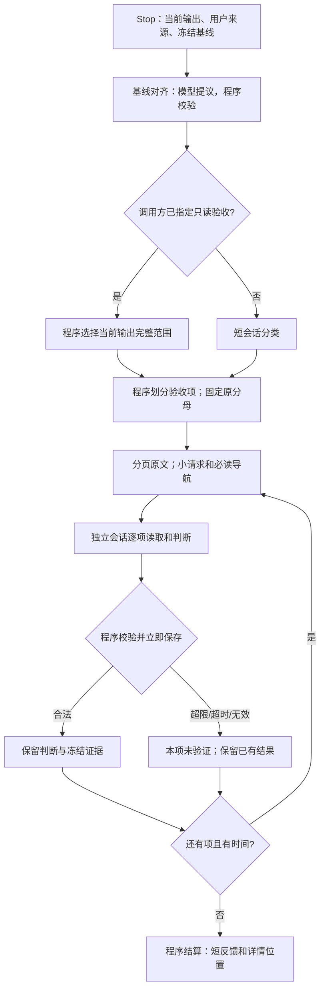

# Stop：有边界的验收

## 职责和不变量

Stop 只回答两件事：本次停止应检查什么；这些检查目前有何可靠结论。它不承担业务实现，不重写冻结要求，也不把宿主主会话搬进另一个大终审。

令冻结指标集合为 O，逐项划分为 O₁…Oₙ：并集必须等于 O，两两不相交。指标验收每项最多四个同来源、同验证目标的对象；仅查违规则按来源和目标一次去重，不输出指标判断。分类只选择范围，不是 PASS。基线、源码或取消状态变化后不能发布旧判断。

同一冻结基线下，已验证并持久化的结果集合 V 单调增加。某一项超限、超时、格式失败不删除兄弟项；缺项仍在原分母内，整体不能 PASS。基础设施失败不消耗业务纠偏次数 k。

## 六个独立子问题

1. **对齐基线**：输入真实用户来源、已有账本与材料目录；模型提出增量，程序校验来源及账本操作。Stop 的私有输入分页；不跳过新用户要求，不改变其他入口的提取逻辑。
2. **选择范围**：调用方已明确要求 verify_only 时，程序直接选择当前输出的完整验收范围，不消耗分类模型调用，也不让旧会话的中间状态缩小验收范围；范围确定仍不代表 PASS。普通 Stop 才以用户要求和最后的助手回复进入短分类会话，其空发现/指标数组 schema 不携带无用的大枚举。
3. **组织材料**：程序建立本项、公共约束和显式依赖的披露视图。过大的正文保存为原文字节页和索引，小请求携带必读入口。导航不是证据；例外和条件不得截掉。
4. **逐项判断**：独立私有会话按需读取原文并给出短诊断、位置和状态；程序控制请求大小、单次披露边界和截止时间，不以累计字节数中止。不能在边界内读完必要依据时，明确未验证。单项不再按剩余项数均分出几秒钟，而是在共同截止内取得可完成检查的时间；后续同输入重试只补未完成项。
5. **保存及校验**：程序核对归属、对象覆盖、分类、证据位置、内容摘要和版本；合法结果立即落盘，随后关闭会话。沿用已有 rc_progress 保全机制。
6. **结算及反馈**：程序合并已有判断，保留检查失败原因；每项短反馈和整包反馈有字节上限，完整详情带索引。沿用已有重试和纠偏预算，不增加总评 Agent。

程序固定只读验收范围的优化适用于声明 supportsReviewCollection 的收集器入口；不支持收集的旧 handoff 兼容路径保留分类行为。

反馈沿用每项 768 字节、整包 8KiB 的硬上限。通过项统计计数；偏离项给原因及后果、少量来源位置；检查失败说明未验证原因。过长说明保存到项文件，整包放不下的项通过分页索引访问。宿主不接收整堆引文，也不再由一个模型读完所有结果重写总评。

## 上下文边界

OpenClaw 默认使用 `stopReviewEngine: task` 执行受支持的逐项/分组审查；Stop 前置基线刷新使用独立抽取 task，范围与提交/恢复协议见 [基线 task](stop-baseline-task.md)。停止分类及保留的 `native` 兼容审查使用原生短会话。上述路径均不再以累计字节数中止；上下文窗口与压缩由宿主管理。

上下文包括系统说明、输出 schema、初始请求、工具参数和返回、修复轮次；每个文件小，不代表累计上下文小。材料封装保留 UTF-8 原文分页（16KiB）、请求限制（24KiB）、逐项会话与已有截止机制。task 保留诊断用字节统计；原生短会话不再累计字节，也不再与模型 token 数作一比一换算来收紧额度。宿主注入和模型输出仍受原生上下文窗口、输出 token 及压缩机制约束。

停止分类及 `native` 兼容短会话保留单次工具返回最多 32KiB 的保护，不再设置累计工具调用次数上限；重复读取、格式修复及后续交互仍记录调用次数，但不会因次数中止。审查继续受总截止、取消信号和宿主上下文管理约束。读取超过旧的 128KiB 不再触发检查失败。默认 task 的 `source_read` 每页最多 400 个完整行、51200 个 UTF-8 字节，并按最多 6000 字节拆分返回文本块；超长单行仍不能取得读取证明。这些单次披露边界用于分页及宿主传输兼容，不是累计阅读额度。

单次披露、调用或时间边界超限仍属于检查器失败。压缩可由宿主原生机制执行，但压缩摘要不能取代原文条件及证据。原文字节范围、哈希、最终读取回执、取消和截止校验继续保留；取消累计字节中止条件不放宽证据要求，也不增加摘要 Agent、自定义压缩器或新的工作流。

Stop 的源码导航只省略每文件 SHA-256，路径、大小和其他元数据保留；完整 manifest 另存审计原文。哈希仍由程序校验，无须让模型重复读取这些校验字串。

`native` 兼容短会话的业务源码读取未写 limit 时，原生工具参数由程序补为 80 行，保留 offset；显式区间保留。当前私有请求目录中的生成页不改。模型说明明确这只是一页，不能当作已读完整文件；读取账本和后续钩子记录实际参数。仍保留单次返回大小边界，超长单行也不能绕过上限；累计调用次数不设上限。

必读 Ground Truth 基础材料使用无损紧凑 JSON，去掉格式缩进，保留所有字符串内空白、正文、字段、适用条件和依赖。完整 canonical 审计副本继续独立保留。大项目的 79 条公共材料由 54,820 降至 44,731 字节；这节省格式成本，不是语义摘要，也没有证明公共约束可以从各项验收中省略。

## 避免重复和组合爆炸

划分的复杂度按冻结对象数量线性增长，不展开“指标 × 文件 × 历史事件”的笛卡尔积。仅查违规的中间 Stop 按来源义务去重，不因同一义务映射多个指标再查一次。分母保持冻结，不靠减少统计对象节省时间。

同一义务的多个指标常带着相同的长 description。只有正文与当前 Ground Truth claim 完全相同、修订一致时，程序将这些重复正文替换为精确来源引用；一次读取原 claim 即可。对象的 applicability、例外等其余字段全部原样保留，完整 population 另存审计副本。文本或修订不一致时禁止此消重，仍使用完整必读原文，避免用近似总结掩盖条件。

Stop 复用同一冻结输入下已经完整通过程序校验的 PASS 项；不复用偏离、部分结果或未验证，也不把“没有发现”缓存为长期通过。固定 task-local 索引保留上一组输入下的条目，不遍历历史报告。输入身份包括基线、对象、分类、指令、schema、模型身份和完整证据快照；复用前仍校验原引用字节和程序完整记录的读取证据，并在新收集记录中标明来源。读取记录缺失、不稳定，或使用链接、目录及其他未能完整追踪的路径时正常重审。

基线、证据、指令、分类或模型变化则重新审查。保守复用的收益主要在未改变证据的基础设施重试，不宣称业务修改后的任意旧 PASS 仍可沿用；尚无完整依赖图时不凭少量引用推断无关文件变化不影响结论。总截止及各执行路径的调用、轮次边界限制本轮成本，到期交回已完成判断与未完成清单。

线性划分不等于总 token 线性：N 项若都需要 G 字节公共约束，最坏仍需重复读取 N×G。通过短分类、去重、保守复用和总截止限制成本，不以未经验证的摘要删掉公共条件。完整大需求的所有项目能否在指定时间内完成，需要真实记录判断，不能由预检成功推断。

材料交付及最终请求再分页也遵守同一截止和取消信号；不允许模型启动前的来源复制或请求重封装绕过预算。已到期的任务不再读取来源，也不写后续页面。

Stop 分类、基线对齐、逐项验收使用显式 boundedBasis 标记。其他插件功能和独立 implementation-reviewer 保留既有行为；因此独立实现审查的超大义务仍可能未验证，不能宣称所有审查均已解决。

## 验证边界

分页披露、超过旧累计字节阈值后继续读取、单次返回与调用边界、部分保存、截止与取消通过离线行为测试验证。受控 reviewer 不证明真实模型准确性，也不能证明完整业务修复和最终验收闭环。完整需求能否在预算内完成检查仍取决于输入规模、宿主与模型，不承诺未经真实验收的性能收益。
