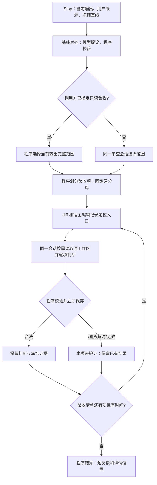

# Stop：有边界的验收

## 职责和不变量

Stop 只回答两件事：本次停止应检查什么；这些检查目前有何可靠结论。它不承担业务实现，不重写冻结要求，也不把宿主主会话搬进另一个大终审。

令冻结指标集合为 O，逐项结论必须分别对应原始对象，不允许删改分母。默认 Stop 的一个审查会话负责整个选定集合；中间输出只查有依据的偏差，不输出指标通过结论。分类只选择范围，不是 PASS。基线、已读证据、检索清单或取消状态变化后不能发布旧判断。

同一冻结基线下，已验证并持久化的结果集合 V 单调增加。某一项超限、超时、格式失败不删除兄弟项；缺项仍在原分母内，整体不能 PASS。基础设施失败不消耗业务纠偏次数 k。

## 六个独立子问题

1. **对齐基线**：输入真实用户来源、已有账本与材料目录；模型提出增量，程序校验来源及账本操作。Stop 的私有输入分页；不跳过新用户要求，不改变其他入口的提取逻辑。
2. **选择范围**：调用方已明确要求 verify_only 时，程序固定当前输出的完整验收范围，不让旧会话的中间状态缩小验收范围；范围确定仍不代表 PASS。普通 Stop 的同一审查会话以原始用户要求和最后的助手回复确定停止类型，通过 `review_checklist(stopClassification)` 或 `review_scope` 选定范围，不另起分类 Agent。
3. **组织材料**：程序建立本项、公共约束和显式依赖的披露视图。过大的正文保存为原文字节页和索引，小请求携带必读入口。导航不是证据；例外和条件不得截掉。
4. **逐项判断**：同一私有会话按需读取原文并给出短诊断、位置和状态；程序控制请求大小、单次披露边界和截止时间，不以累计字节数中止。不能在边界内读完必要依据时，明确未验证。单项不再按剩余项数均分出几秒钟，而是在共同截止内取得可完成检查的时间；同一会话续跑只补未完成项。
5. **保存及校验**：程序核对归属、对象覆盖、分类、证据位置、内容摘要和版本；合法结果逐项立即落盘，完整清单完成后关闭会话。`submit_review` 保存指标和文件质量结果，`submit_finding` 保存额外有据偏差；最后一项的 `finish: true` 或单独的 `finish_stop_review` 结算全部原始条目。
6. **结算及反馈**：程序合并已有判断，保留检查失败原因；每项短反馈和整包反馈有字节上限，完整详情带索引。沿用已有重试和纠偏预算，不增加总评 Agent。

Claude、CodeAgent 和 OpenClaw / MatrixAssistant 默认使用共享引擎；CLI 和原生宿主分别提供传输与真实结果回执。未声明 `supportsWorkspaceStopReview` 的自定义收集器仍保留原有兼容协议。

反馈沿用每项 768 字节、整包 8KiB 的硬上限。通过项统计计数；偏离项给原因及后果、少量来源位置；检查失败说明未验证原因。过长说明保存到项文件，整包放不下的项通过分页索引访问。宿主不接收整堆引文，也不再由一个模型读完所有结果重写总评。

## 上下文边界

默认 Stop 使用统一 task 执行底座。必要的基线更新保留来源提取协议；分类、阶段/任务审查、findings 与文件质量合并到一个审查会话，不消费最终文本作为完成结果。OpenClaw 旧配置 `native` 归一到 task。非 Stop 角色的既有入口保留。

项目文件直接按需读取，不复制代码仓，也不要求文件位于项目目录或源码清单内。绝对路径、父目录和链接文件都可读；只读权限与证据归属是独立规则。程序仅保存原始基线、过程记录、引文元数据和结果。计划、笔记、历史摘要及其他 RC 自产文件不能充当业务原文。

Stop task 的累计助手响应上限为 200 轮，单次模型输出上限为 32768 token。普通审查首次运行加最多一次续跑；分组、提交修正与续跑不重置计数、原绝对截止或已保存身份。基线领域修复沿用自己的额度。

上下文窗口、压缩和宿主工具结果处理由宿主管理。RC 保留原文分页，`source_read` 每页最多 400 个完整行、51200 个 UTF-8 字节。OpenClaw 私有工具以一个连续文本块发送原文页，避免宿主在块之间插入换行。超长单行可能无法交付，RC 只在单页应用读取量上限。

只有最终、非合成且与原文页完整匹配的工具结果能建立读取凭据：OpenClaw 使用 `tool_result_persist`，CLI 使用所属会话真实 `stream-json` 的工具调用与结果。单独执行 MCP 调用、早期诊断 observer、grep、摘要和历史检索不授予原文覆盖。宿主截断后须补读；无法补齐则未验证。程序继续校验版本、哈希、适用条件、任务归属、取消、截止和提交回执。

必读 Ground Truth 基础材料使用无损紧凑 JSON，保留所有正文、字段、适用条件和依赖。同一会话完整读取一次，跨验收项复用凭据。大材料按字节拆分，按文件名顺序拼接回原文；不是语义摘要。

## 避免重复和组合爆炸

划分的复杂度按冻结对象数量线性增长，不展开“指标 × 文件 × 历史事件”的笛卡尔积。仅查违规的中间 Stop 按来源义务去重，不因同一义务映射多个指标再查一次。分母保持冻结，不靠减少统计对象节省时间。

同一义务的多个指标常带着相同的长 description。只有正文与当前 Ground Truth claim 完全相同、修订一致时，程序将这些重复正文替换为精确来源引用；一次读取原 claim 即可。对象的 applicability、例外等其余字段全部原样保留，完整 population 另存审计副本。文本或修订不一致时禁止此消重，仍使用完整必读原文，避免用近似总结掩盖条件。

默认单会话链路在每个 Stop 重新检查原始清单，不把上次的部分结果或“没有发现”缓存为长期通过。同一会话的续跑保留已保存项和读取凭据。原有分组收集器的保守缓存仍仅适用于其兼容入口。

工作区 Stop 在普通 `source_read` 成功且文件稳定时记录内容和链接解析目标。提交、结算及复核已保存结果时都校验证据。`source_ls`、`source_find` 和 `source_grep` 提供导航，浏览过的目录和扫描到的文件不会变成验收依赖。用 `source_read` 的 `contextOnly:true` 查看可变日志或临时上下文，该次读取不发引文或必读回执。必读原文、过程记录、Skill、普通证据读取和已绑定的引用附件按各自规则校验。总截止及轮次边界限制本轮成本，未完成项保留为未验证。

单会话减少公共材料的重复披露和模型会话启动。大需求能否在指定时间内完成、模型准确率和实际 token 节省仍需真实记录，不能由离线协议回归推断。

材料交付及最终请求再分页也遵守同一截止和取消信号；不允许模型启动前的来源复制或请求重封装绕过预算。已到期的任务不再读取来源，也不写后续页面。

Stop 分类、基线对齐、逐项验收使用显式 boundedBasis 标记。其他插件功能和独立 implementation-reviewer 保留既有行为；因此独立实现审查的超大义务仍可能未验证，不能宣称所有审查均已解决。

## 验证边界

分页披露、超过旧累计字节阈值后继续读取、单次返回与调用边界、部分保存、截止与取消通过离线行为测试验证。受控 reviewer 不证明真实模型准确性，也不能证明完整业务修复和最终验收闭环。完整需求能否在预算内完成检查仍取决于输入规模、宿主与模型，不承诺未经真实验收的性能收益。
