# Stop task 统一方案：详细流程与逻辑审查

- 日期：2026-10-27。
- 依据：[实施方案](stop-task-unification-implementation-plan.md)，以及本仓库当前实现的只读核对。
- 性质：目标设计图解及实施前审查记录；代码落地与验收结果单独记录于实施方案。
- 图中“建议补充”和第 8 节保留实施前的审查意见；现已固化的契约及实现状态见实施方案第 5、8、16 节。
- 最新输出配置决策：目标 Stop task worker 的单次模型输出上限设为 `maxTokens: 32768`（32k）；已写入 Stop 专用执行配置，发布验证见实施方案。
- 最新轮次配置决策：目标 Stop task worker 的累计助手响应上限设为 `maxTurns: 200`；分组成员、提交修正与续跑共享计数，已写入 Stop 专用执行配置，发布验证见实施方案。
- 后续已按实施方案重构代码；本图解保留设计解释，当前验证进度见实施方案第 16 节。MatrixAssistant 与其内置 OpenClaw 保持只读。
- 最新设计复核：第 11—14 节重新核对当前完整 Stop 流程与材料访问边界，提出“Agent 自主探索、程序按需登记证据”的调整方向。这部分是设计建议，尚未改动运行时代码。
- 最新范围收敛：第 15 节按用户要求，仅简化 Stop 审查内部：不保存被审查业务文件副本，Agent 自主只读探索，上轮评审结果只传路径供按需回查，每个新 Stop 重新评审。旧图黄色为本路径可移除/替换部分，新图绿色为复用部分。

## 1. 判断

**统一 task 执行、工具提交与逐项回执的方向成立；材料访问层需要调整。当前完成审查把预扫描清单变成不可扩充的可读范围，会妨碍 Agent 追踪必要依赖。详见第 11—14 节。**

保留宿主原生会话、去掉 Stop 旧的最终文本 JSON 协议，两者没有冲突。不同 worker 通过自己的工具提交结果，程序负责校验、保存和结算，比依赖模型最后一句话更明确。分类不充当验收、分组不合并成员结论、上下文管理不替代证据校验，这几条边界也成立。

原方案已经规定取消、部分结果、证据校验和有限续跑。实施前审查要求先补齐第 8 节的六项约定；本次已在实施方案中明确协议完成、真实范围、外层重试、权威提交、部分结果与工具绑定契约，并完成 P0—P4。发布前验收进度以实施方案第 16 节为准。

下面所有 Stop 模型工作都使用统一 task 底座。只有自动 Stop 具备既有的纠偏准入语义；显式只读验证不会因为统一执行层而获得业务修复权限。

## 2. 先区分几种“任务”和“完成”

- **业务任务**：用户要完成的实际工作，由业务 `taskId` 标识。
- **一次 Stop**：一次停止检查与结算，由 `stopId` 等既有身份标识；它可能执行多个 worker。
- **一次 worker task**：一次分类、基线提取、审查组或偏离检查。各自拥有输入、协议、检查点与完成条件。
- **私有宿主会话**：承载某个 worker task 的运行与续跑。不同 worker 不要求共用同一个会话。
- **一次宿主运行**：同一私有会话可以有限续跑；每次使用新的 `runId`，且前一次运行不能仍在执行。
- **候选代次/绑定代次**：用于防止旧候选、旧工具句柄或迟到结果写入新状态，不能只靠业务 `taskId` 区分。

还要分别理解三个完成条件：

1. **worker 协议完成**：要求的提交已被程序接受。合法提交 `UNVERIFIED` 也可以让该 worker 结束。
2. **本轮范围验收完整**：当前应审对象都得到足够结论，且引用、版本、条件与必要依赖仍有效。不能仅按回执数量判断。
3. **业务任务完成并通过**：只有真实的任务完成范围经过所需审查，且既有指标及质量规则允许，才可能成立。

以下场景都合法，但彼此不能混淆：分类完成而业务未完成；偏离检查完成且 findings 为空；某成员提交了 `UNVERIFIED`；阶段验收通过但实现阶段尚未开始。

## 3. 图一：完整 Stop 编排与范围路由

此图展开了原方案主图省略的入口分流、基线发布、分类失败和补充审查。自动 Stop 的基线刷新受既有开关与刷新需求控制，不要求每次重新提取全部材料。

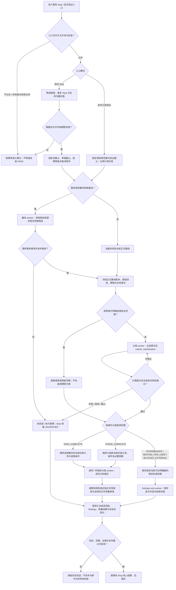

范围选择必须由程序固化后交给 worker。worker 不得在修正工具参数时自行从阶段审查升级到整任务终审，也不得降为 findings-only 来绕过终审。

独立实现审查、文件质量审查及设备/执行证据采集沿用原有开关和证明归属；图中的“组合”不规定它们必须串行，也不要求复用同一个会话。若某个审查对象缺乏必要证据，应明确未验证，不能通过省略该对象缩小分母。

## 4. 图二：基线候选与正式账本的边界

基线 worker 完成的是**提取候选**。正式 Ground Truth 必须经程序原有账本与事务链发布，之后分类及审查才能绑定该正式版本。

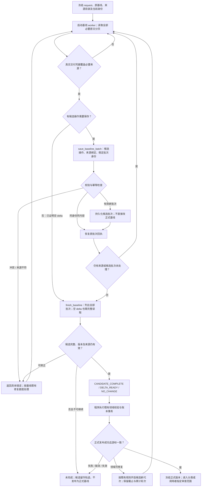

统一执行层不意味着把基线领域修复次数改成普通审查的 `maxAttempts: 2`。两者的计数对象不同，仍应各自保留原语义。

## 5. 图三：一个 worker task 的执行、修正与有限续跑

“工具提交错误后修正”和“宿主运行结束后续跑”是两条不同回路。前者留在本次宿主运行中；后者才增加运行次数。

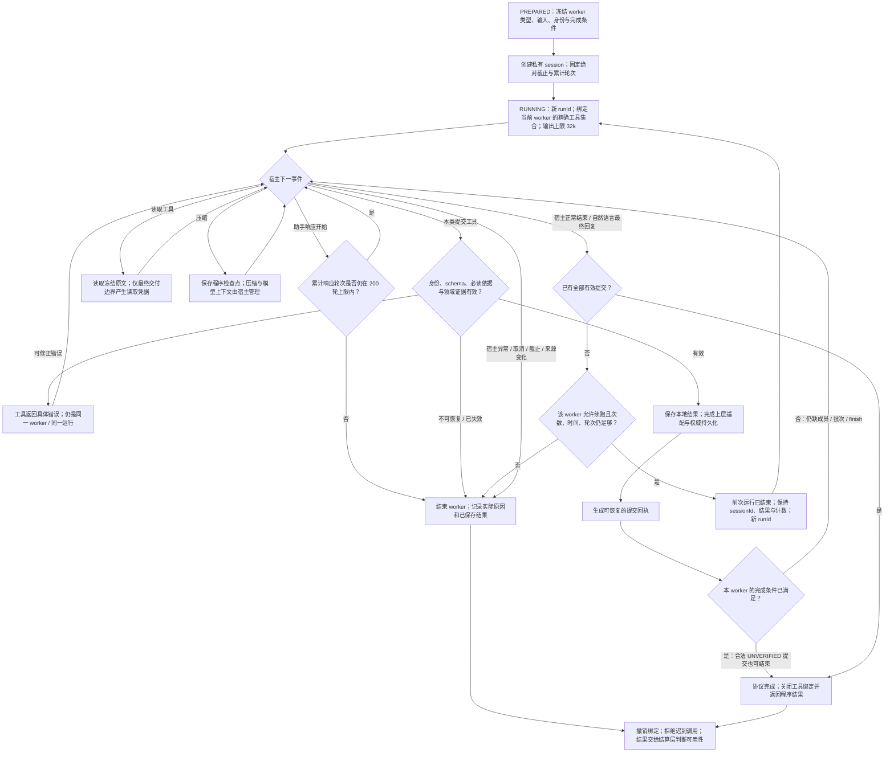

目标设计将本方案覆盖的 Stop worker 助手响应上限从当前代码的 100 轮调整为 `maxTurns: 200`。**200 轮属于这个 worker task，分组成员、提交修正与续跑共享计数，不是每次续跑重新获得 200 轮，也不是整次 Stop 所有 worker 合计 200 轮。** 普通审查首次宿主运行加最多一次续跑的规则保留；基线仍保留自己的领域修复机制。新分类和 findings worker 同样采用 200 轮上限，其完成与计数边界在 P0 固定。

目标设计将本方案覆盖的 Stop worker 单次输出参数统一为 `maxTokens: 32768`，替换当前的 `8192`。这是每次模型输出的上限，不是整个 task 的累计 token 预算或上下文窗口；不得因此重置截止、轮次或续跑次数。实施时须核对各调用层的显式覆盖及最终传入宿主的值，保持非 Stop 和其他宿主入口的原配置契约。

宿主异常不应伪装成格式错误重试。如果全部结果在异常前已完成权威提交，仍需按提交记录与当前性判断，而非仅凭宿主最后的错误覆盖有效结果。反过来，本地文件存在、最终文本声称成功，都不足以证明权威提交完成。

## 6. 图四：两类回执与结果提交的完整链条

这里有两种不同凭据：**读取凭据**证明某段冻结原文经过可信交付；**提交回执**证明某条本类结果经过程序校验并保存。二者不能互相替代。

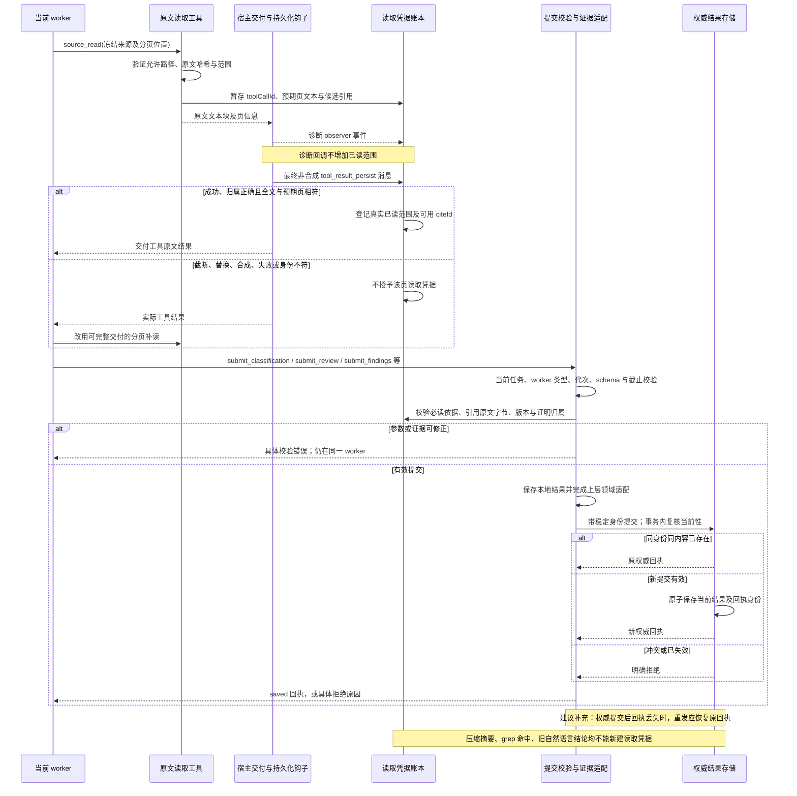

最终持久化钩子是本仓库当前采用的可信交付边界，不等于能够证明模型在认知上“理解了原文”。若某宿主版本无法提供这一边界，适配层必须明确未验证，不能用更早的诊断回调替代。这个要求可以在插件侧做能力检查，不要求修改只读集成宿主。

提交链中至少要考虑三个中断点：本地结果保存后、上层结果存储提交前；上层提交后、回执返回前；回执已生成、检查点尚未保存时。恢复依据必须一致，不能一个层说已经保存，另一个层重新生成相反结论。

## 7. 图五：部分结果、最终状态与纠偏额度

**验收状态与宿主控制是两个维度。** `ALLOW` 不表示 `PASS`；`UNVERIFIED` 也不意味着删除已经证实的偏离。部分有效偏离能否继续反馈与准入，应由既有 Stop 核心决定。

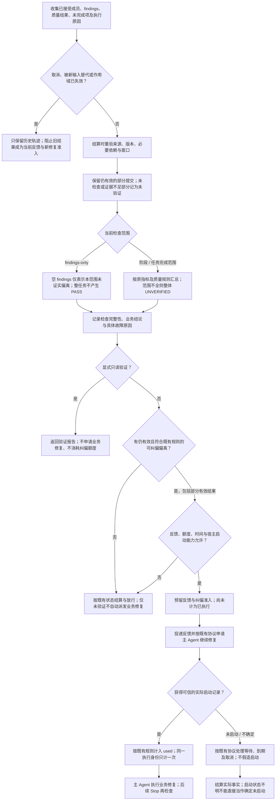

- **仅审查窗口到期**：停止新增读取与提交，利用总截止之前的结算预留重验和处理仍有效的部分结果。
- **总截止到期**：不能继续模型工作，也不能产生过期有效的准入或验收结果；按既有超时与历史保存规则收尾。
- **显式取消或输入代次变化**：与普通审查到期不同，不继续用旧结果发起新的修复。
- **真实业务反例与执行故障**：前者可以形成有效偏离；后者只说明检查未完成，不能伪造成业务失败。
- **实际启动晚于准入有效期**：仍需按现有真实启动记账与协议违规处理，不能为了保持图面简单而抹去这类执行事实。

阶段范围通过只说明该阶段；findings-only 即使完整执行且为空，也不证明任务完成。成员级已确认偏离、整体 `UNVERIFIED`、当前控制是否允许继续可以同时存在。

## 8. 实施前建议补齐的六项契约

本节是实施前审查留档，其中“当前”“建议”描述当时的状态，不代表重构后的实现仍未处理；当前行为以实施方案和代码为准。

### 8.1 明确完成字段，避免继续复用含义不同的 complete

原方案已经要求不同 worker 有不同完成条件，但没有统一描述这些条件怎样映射到上层已有字段。

当前 `runReviewTask` 可以接受一个合法的 `UNVERIFIED` 提交并结束；而 `stop-review-store` 的 `summary.complete` 要求所有成员都不是 `UNVERIFIED`。因此，直接把 worker 的 `completed` 复制到 Stop 的 `complete` 会制造错误的整体完成状态。

建议在 P0 明确三个概念的字段映射：worker 协议是否结束、范围是否获得充分验收、该范围业务结果是什么。可以保留已有字段名，但必须有明确映射及反例测试，不需要顺带全仓改名。

检查点：合法 `UNVERIFIED` 成员可以结束 worker，但不能让整组验收完整；空 findings 可以结束偏离检查，但不能把 Stop 或业务任务标成验收通过。

### 8.2 写清所有入口的 worker 路由与冻结范围

原方案方向正确，但只修改 `reviewer.mjs` 工厂还不够。生产编排仍有分类、findings-only、逐项收集、同指标分组、文件质量和独立实现审查等调用点。

建议 P0 列出每类调用的 worker 类型、输入身份、完成工具、输出映射与异常状态，P2/P3 同步改调用者。还要明确：当前阶段来自哪份冻结工作流；哪些原文是分类必读；阶段审查包含哪些必要依赖；显式验证沿用哪种调用者范围。

当前显式验证入口直接选择当前产物验证范围，不要求模型分类；这是调用者选择的审查范围，不是声称业务已经完成。不能为了画一条统一线而强制再经过分类。

分类模型仍承担语义判断，不应宣称 schema 校验能证明分类必然正确。建议覆盖“仅规划完成”“声称实现完成但无执行证明”“等待用户但已存在可证实偏离”等反例；缺执行证明应影响后续验收结论，不应被用来擅自降低停止分类。

### 8.3 明确 task 续跑与外层准备重试的关系

当前存在至少三层不同机制：普通 review task 默认最多两次宿主运行；基线有自己的修复额度及候选代次；`assessStopCorrection` 对部分准备阶段故障最多尝试三次。

准备阶段又包着基线刷新和分类。只写“task 最多续跑一次”不能自动约束外层重新创建 task 的次数。若不处理，可能发生同一冻结逻辑工作被多次创建、累计轮次重新开始，以及已经保存的发现或候选被重复计算。

建议规定：哪些故障允许外层重试；重入时如何识别并恢复同一逻辑 worker；已完成步骤如何复用；什么变化才允许创建新代次。始终共享原绝对截止，且不能借外层重入绕过同一 task 的轮次与续跑限制。

这不是要求删除既有准备重试，也不要求把不同计数统一成一个数，而是避免计数边界被迁移意外改变。

### 8.4 规定提交的权威边界与中断恢复

原方案已经要求“持久化并通过上层适配后才产生有效回执”，方向正确；还应明确权威结果究竟在哪一层。

当前提交链先写本地 `decision.json`，再调用上层 `onItemResult`，最后更新 worker 已接受集合。建议把上层结果存储的接受记录作为对应生产审查项的权威依据，并规定从该记录恢复回执的方式。其他 worker 使用各自领域的权威记录，不强行共用 `submit_review`。

需要覆盖：本地保存但上层失败；上层保存后响应丢失；取消刚好发生在提交过程中；同批次并发重复调用；相同身份不同内容提交。事务中的任务/代次检查必须阻止迟到写入，不能只在工具入口检查一次。

合法重复恢复原回执，冲突明确拒绝。尚未获得权威接受的本地文件只能作为诊断或候选，不能直接进入当前指标汇总。

### 8.5 固定部分结果、整体状态和反馈资格的映射

原方案明确允许保存有效部分结果，但“允许参与结算”还需要精确到三件事：单项结果是否有效、整体是否验收完整、是否符合当前纠偏准入。

当前生产层会把不完整整体的 `PASS` / `DEVIATION` 状态规范为 `UNVERIFIED`，同时保留有效偏离供既有核心判断。因此不能简单规定“有一条偏离，整体就永远是 DEVIATION”，也不能规定“整体 UNVERIFIED，所以丢掉所有偏离”。

建议在 P0 固定这组已有行为，特别区分审查到期、总截止、显式取消、输入变化和普通宿主失败。报告、纠偏反馈、额度与主 Agent 状态要使用一致的判定依据。

### 8.6 把工具契约、宿主能力和缓存身份列成具体检查点

原方案已要求更新注册与版本，但执行时应明确到这些位置：`config/openclaw-tool-contracts.json`、`task-tools.mjs` 注册名单、`tool-contracts.mjs` 的分组处理、插件包工具声明和包契约测试。当前工具分组只有 `public`、`task`、`baseline`；新增提交工具若没有进入完整注册与打包链，worker 会有协议却无法调用。

分类与 findings 工具可以加入现有 task 工具组，也可以扩展分组处理；这是实现选择，不必为统一而固定一种命名方式。

缓存身份除移除旧 `contextLimits` 并提升协议版本外，还要确认已有键确实区分 worker 类型、分类/阶段范围、正式基线及必要输入。新的阶段结果不能被错当作任务终审缓存。

同时验证宿主支持最终原文交付观察、精确工具绑定与所需取消行为；能力缺失应在插件侧明确失败或未验证，不能为了完成迁移而修改 MatrixAssistant 或放宽读取证明。

## 9. 图六：实施依赖与验收门槛

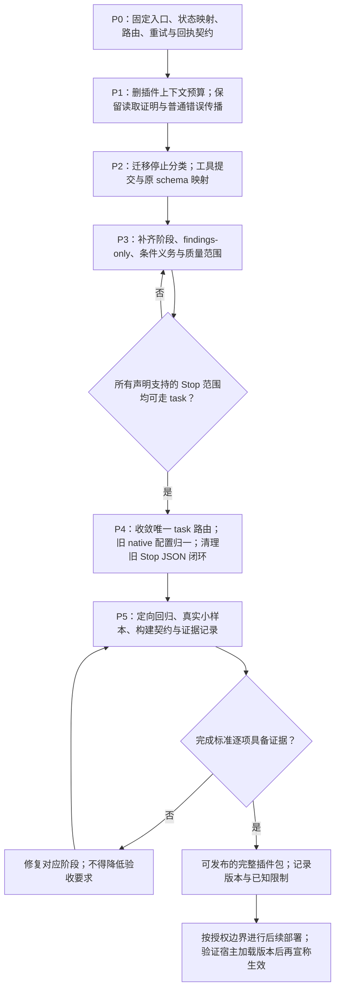

开发期临时共存是迁移手段；最终发布不保留 Stop 的运行失败回退旧审查分支。发布后回滚使用经过验证的旧完整包，不在新包中增加隐藏双引擎。

## 10. 实施前核对依据（历史留档）

下面保留最初设计审查时的代码状态，不代表完成重构后的当前行为。最新实施结果见实施方案第 16 节；本轮材料访问复核见第 11—14 节。

- `lib/runtime-v2/orchestrator.mjs`：生产准备先刷新/加载基线，再执行停止分类；显式验证可以跳过分类；存在过程偏离的窄范围复查。
- `lib/openclaw/reviewer.mjs`：当前 task 适配判断与旧最终文本链并存，基线有独立分支。
- `lib/runtime-v2/stop-task-review.mjs`：Stop 主审、条件义务及文件质量的适配条件仍主要限定 `TASK_COMPLETE`。
- `lib/runtime-v2/production-stop.mjs`：当前 findings-only 通过收集器进入；文件质量、独立实现审查、最终状态与纠偏分开组合。
- `lib/openclaw/task-session.mjs`：已有私有会话、同会话新运行身份、禁止并发运行、工具绑定与关闭机制。
- `lib/review-task/review-task.mjs`：已有工具提交、证据校验、成员保存、上层回调、累计轮次与有限续跑。
- `lib/openclaw/task-tools.mjs`、`lib/review-task/task-evidence.mjs`：读取证明依赖最终宿主持久化消息，诊断 observer 不授予原文读取证明。
- `lib/runtime-v2/stop-correction-assessment.mjs`：额度入口位于模型准备之前；存在最多三次的有限准备尝试；审查截止与结算截止分离。
- `lib/runtime-v2/stop-review-store.mjs`：逐项权威存储、当前性校验、部分结果与完整性语义。
- `lib/runtime-v2/stop-correction-store.mjs`：反馈预留与可信实际启动记账分离，同执行身份去重。
- `lib/review-task/baseline-task.mjs`、`lib/runtime-v2/baseline-task.mjs`：候选批次、完成回执、候选代次及正式基线发布边界。

本文最初用于方案理解与静态图解。后续已实施代码重构并执行回归；最新完成项、真实模型验收与部署边界见实施方案第 16 节。

## 11. 当前完整 Stop 流程

下图按当前仓库实现绘制，描述自动 Stop。显式只读验证可以由调用者指定范围、跳过模型分类，且不获得自动业务续修权限。加载/刷新基线仍走原有权威来源与事务发布链。

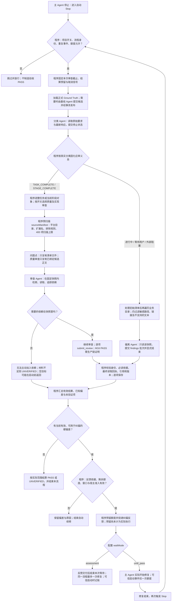

节点职责与不能混淆的边界：

- **G/W：程序门控**。是否评估、用哪个模式、还有多少额度和何时截止由程序决定，Agent 不能修改。每个 worker 的同会话续跑共用其累计 200 轮和绝对截止，单次输出为 32768 tokens。
- **B：正式基线**。Agent 提取候选；程序校验并发布正式基线。需求权威、修订和指标分母不能由审查 Agent 随意改变。
- **C/R：分类与范围**。分类 Agent 判断当前停止声明；程序选出应审义务。分类完成不是业务 PASS。阶段范围限制应回答哪些问题，不应阻止读取其他目录中的必要依赖。
- **M/F：当前主要瓶颈**。生产源码先被预扫描筛选，再被复制到快照；`source_*` 只能访问该快照。清单遗漏可直接变成 Agent 看不到的材料。
- **A/T：语义审查**。Agent 判断要求与实现是否一致，程序负责证据协议。M16 是生产实现覆盖率指标，implementation reviewer 是可承担 M09/M12/M16 源码职责的角色；已有合格 M09/M16 源码证据可以复用，未必额外调用一次实现 Agent。独立实现审查的静态 M12 PASS 不能替代执行证明，也不能擦除已独立观察到的运行偏差。
- **PF/AF：进行中检查**。它当前会遍历业务目录再冻结，采集方式比完成审查更宽，但仍不能在 worker 运行时加入快照外文件。完成状态不同导致可见材料不同，是另一处应统一的设计。
- **V/AG：校验与结算**。提交错误应在原 worker 中补读或修正；取消、截止或输入变更后的迟到数据不能进入新代次。整体未验证时，仍可能保留并使用已校验且仍有效的部分硬偏差。
- **H/Q/FB：纠偏准入**。只有确认的、当前有效的硬偏差可以进入反馈；模型错误、找不到材料或 `UNVERIFIED` 本身不等于业务偏差。
- **MD/AS/EX：模式与计账**。`assessment` 不是只读验证，它最多允许一次自动修复并在反馈交付后释放本次等待；`until_pass` 允许后续 Stop 继续评估，仍受额度、截止、取消与流程关闭约束。阶段 PASS 不提升为整任务 PASS。

任何 worker 的执行失败都不回退旧 Stop 最终 JSON 审查路径。失败与部分结果继续按现有证据和结算规则处理。

## 12. 当前读取路径为什么会变窄

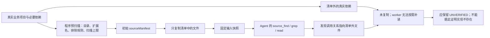

这里有两类不同的约束：

1. **授权与证据边界**：宿主权限、真实路径归属、任务身份、读取回执、字节与版本校验。它们用于保证访问和证据有效。
2. **预扫描策略**：固定源码根、扩展名列表、400 项扫描上限、测试/依赖目录排除及名称匹配。它们是材料准备策略，不是 M16 证明可信性的必要条件。

当前实现把第二类策略的结果变成了第一类工具可以访问的唯一内容。Agent 因而无法自行修复“发现依赖不在初始索引里”的材料问题。

具体例子：假设 `src/entry.ts` 调用了 `packages/storage/index.ts`，但当前配置只扫描 `src` 等预设目录，`packages` 没进入初始清单。即使 Agent 从入口源码看到了这个依赖，它也不能直接把该文件加入已冻结快照。平台配置不匹配导致清单为空时，部分源码审查还会在 Agent 启动前返回未验证。这是材料可达性问题，单纯增加模型思考强度、轮次或输出上限不能解决。

源码依据：

- `lib/runtime-v2/impl-review.mjs:136—168`：通用目录、扩展名、隐私/目录排除与 `MAX_MANIFEST_FILES = 400`；平台可以提供自己的扫描配置。
- `lib/runtime-v2/stop-task-review.mjs:269—312`：业务文件过滤、路径归属和链接校验；有清单时只复制清单文件。
- `lib/runtime-v2/stop-task-review.mjs:334—337`：没有可用目标时可能在模型启动前返回未验证。
- `lib/review-task/source-tools.mjs:82—99`：工具只访问快照根目录，读取还要求路径属于启动时捕获的快照。
- `lib/runtime-v2/stop-protocol-task.mjs:100—113`：findings 检查在处理初始清单后还遍历业务目录，与完成审查的采集方式不同。

## 13. 建议方向：Agent 自主探索，程序按需登记证据

以下是上一轮建议设计，尚未实现。用户随后进一步明确不保存业务文件副本、仅调整 Stop 审查、上轮结果传路径且本轮重新评审；以第 15 节为新的收敛方案。本节中“保存原文版本”不再是新方案的落盘要求。

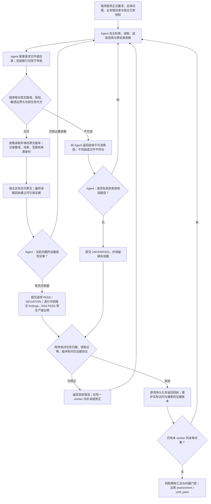

这套分工中，Agent 决定从哪里开始、搜索什么、追踪哪些依赖，以及证据是否足以支撑语义判断。程序保留访问授权、来源登记、版本/代次、提交校验和纠偏准入。

需要落实的契约：

- **阅读范围与结论范围分开**。每个 worker 仍回答已分配的义务，但可以在授权业务目录内读取其他模块、配置、测试及必要依赖作为理解上下文；这些材料不能自动替代该指标需要的证明。
- **初始索引可选且可扩充**。清单为空、没有匹配某种扩展名或初始扫描达到上限，都不应阻止 Agent 在授权范围内继续发现文件。400 项限制如保留，只限制初始索引，不限制后续按需探索。
- **按需冻结，不先复制整个项目**。文件第一次实际读取时建立可核验的版本和原文记录；提交前复核依赖及输入代次。并发改动、真实路径变化或版本不一致时，旧读取不能继续充当当前证据。
- **统一各类审查的读取入口**。完成、阶段、findings 和质量 worker 使用同一访问机制，职责仍由各自提交协议区分。文件质量的结论仍归属于指定交付物，但理解它时可以读取必要上下文。
- **敏感规则明确、可解释**。保留宿主已有权限及明确的敏感路径策略。普通业务模块不能仅因名称含某个宽泛关键词，就在无说明的情况下永久消失于可见材料。
- **发现范围也进入账本**。目录枚举、搜索范围、过滤和截断状态都要记录。依赖“未找到”作缺失结论时，需要相应范围的证据；没读过的文件不授予读取凭据，不完整搜索也不能证明全局缺失。
- **M16 保留生产证据语义**。允许读取测试、SDK 声明或文档理解行为；生产实现 PASS 仍需真实业务入口、处理、数据流及必要分支的生产证明，不能用测试成功或接口声明单独替代。
- **保留真实能力边界**。无法交付的材料、宿主禁止的路径和缺失的执行事实仍可以导致未验证；自主探索不能让静态源码自动证明实际运行成功。
- **保留独立的成本与生命周期控制**。200 个累计助手响应、32768 单次输出、业务截止、取消、部分回执、同 task 有限续跑和两个纠偏模式继续有效；不得用新增初始清单上限偷偷恢复累计阅读预算。

## 14. 设计复核结论

用户提出“应让 Agent 自己探索和审查”的方向有具体代码依据。应让 Agent 决定证据发现和依赖追踪路径，同时由程序记录实际读取、核对版本与归属，并控制结果提交和业务续修。

当前最值得调整的四点：

1. 预扫描遗漏会变成不可读依赖，空清单还可能让审查 Agent 无机会开始探索。
2. 完成审查与进行中检查使用不同的材料采集策略；停止状态影响了可见材料，而不只是检查问题。
3. 文件质量的候选正文绑定同时收窄了可读上下文；结论归属和上下文读取范围需要分开。
4. 固定路径、扩展名、扫描上限与宽泛名称排除会引入材料盲区；它们不应决定 Agent 能否发现实际生产调用链。

统一 task、真实读取回执、逐项持久化和程序纠偏门控仍应保留。它们解决执行与证据协议问题，不能替代 Agent 对真实材料的自主探索；程序校验回执与引用，也不能保证模型语义判断一定正确。

本轮只更新流程图与设计审查文档，未按上述建议修改运行时代码，也未修改或部署 MatrixAssistant 及其内置 OpenClaw。

## 15. Stop 审查的最小改动方案：无业务副本、自主探索、历史路径回查

本节仅为流程设计，尚未修改实现。适用于当前讨论的 OpenClaw/MatrixAssistant Stop 审查；不借此重构其他宿主或非 Stop 角色。

### 15.1 本次边界

保留原有 Stop 触发与进入判断、项目/会话开关、任务和流程身份、正式基线准备、停止分类及范围选择、项分组策略、指标规则、逐项结果回执、截止与取消、纠偏额度、两种模式，以及 MA 的反馈、排队、取消和可信启动协议。

调整的是这些模块之间的 Stop 审查调用与材料访问：

- 审查 Agent 在宿主已有授权内自主读取当前业务文件、搜索并追踪必要依赖。
- Stop 审查不再额外保存被审查业务文件全文、输入树副本、引用整文件备份或独立正文回放档案。结果、原因、引用元数据、进度与回执仍是插件自己的状态。
- 每次审查只传当前正式要求、应审对象、必要路径与上轮评审记录路径；不把全部上轮正文塞进提示词。
- 每个通过原有进入判断、实际开始审查的新 `stopId`，重新评审其本轮应审对象。上轮 PASS、DEVIATION 或 UNVERIFIED 都只作历史参考，不自动成为本轮结论。已关闭流程、额度不足等情况仍按原规则跳过，不能为“重评”绕过 Stop 准入。
- 同一次 Stop 的重复事件幂等、同一次 worker 的已保存项回执和有限续跑继续复用，避免把“每轮重评”误写为同一轮反复重派。

“模块复用”指保留职责、策略和外部契约；审查调用处仍可能需要新增历史路径字段、重评身份及引用元数据适配。基线/分类等模块内部若还有来源副本，不在本次删除范围；不能将本方案表述为整个插件或宿主零正文落盘。OpenClaw 正常会话转录仍遵循宿主策略。

### 15.2 旧流程：黄色为可从 Stop 审查路径移除或替换的部分

黄色不表示删除同名共享模块。非 Stop、基线抽取、分类或其他检查仍依赖的功能继续保留。

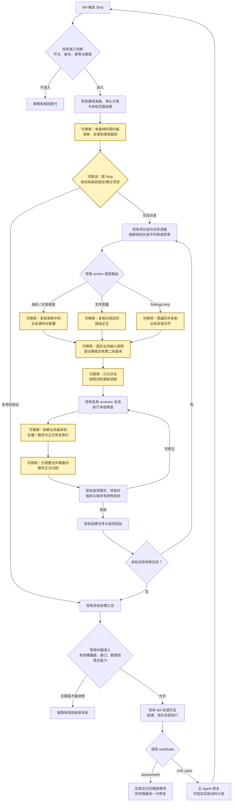

预扫描如果仍服务设备检查、Kit 检查或其他业务职责，其采集能力保留；黄色只表示 Stop 审查不再依赖该清单决定唯一可读范围。正式的交付物身份选择与指标范围选择也继续保留，移除的是正文预复制与读取围栏。

### 15.3 新流程：绿色为复用的模块或契约

未标绿的节点为本次新增或调整的审查内部流程。绿色节点中的输入数据格式可能需要适配，并不表示相关文件完全零改动。

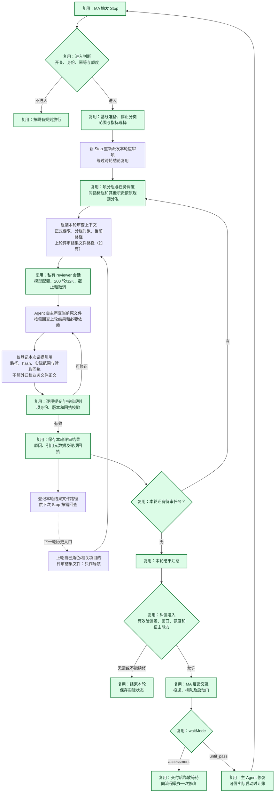

### 15.4 上轮路径怎样交给本轮 Agent

优先沿用现有 `review-components/<evaluationId>/<groupId>.json` 和 `evaluations/<evaluationId>.json` 结果文件，不新建第二套正文知识库。由程序定位同一业务任务的上一轮结果及相同角色/相关对象记录，分组改变时按对象身份匹配，不靠旧组序号猜测。

给 Agent 的历史上下文只需要包含：上轮 `stopId`、结果文件路径、相关对象身份、当时的需求修订，以及“历史记录仅供参考，本轮重新核验当前文件”的说明。没有上轮文件或文件不可读时，按首次审查继续，不为历史回查单独阻断本轮。

- Agent 可自行决定是否打开上轮记录；不强制读完所有旧报告。
- 上轮结论可以帮助定位上次问题、解释修复前后变化，但不能单独充当本轮源码证据。
- 当前所审对象无论上轮是 PASS、DEVIATION 还是 UNVERIFIED，本轮都需要给出新的判定。
- 同一 Stop 内已收到回执的成员不重复派发；重复收到同一个 Stop 事件也不重新启动整轮。
- 只授予程序提供的历史结果路径所需访问，不把整个 RC 私有账本开放给审查 Agent。
- 新结果继续落到现有结果文件中；只保存评审结果和引用元数据，业务原文件仍留在原位置。

### 15.5 最小接线变化与不可误标的复用点

1. **结果短路需要绕过两层**。`stop-review-store.mjs` 会跳过仍有效的旧结论，`review-collector.mjs` 还有独立 PASS 缓存。新 Stop 的审查调用应使用已有的 `recheckRequestId` 等机制要求重评，并绕过本路径的跨轮结果缓存；保留两模块的存储、分组、调度与回执职责。只增加历史文件路径不能实现“重新评审”。
2. **MA 交互不变，reviewer 工具绑定要适配**。继续使用当前私有会话、注册、取消与截止机制；Stop 审查的只读工具改为访问授权原始材料和明确提供的历史结果路径，不再依赖预复制业务树。不能把“协议复用”理解成工具参数和内部读取实现都不用改。
3. **引用与版本校验保留，但数据载体改变**。原路径、hash、范围和真实读取回执由程序观察记录；Agent 不自行捏造文件版本。读取和提交间发生变化时重读或未验证。无需通过正文副本才能完成这些检查。
4. **共享模块不做全局删改**。只在 Stop 审查适配处替换快照专用能力；基线、分类、非 Stop 角色和其他宿主继续遵守原有契约。实现 reviewer 只有被 Stop 调用时才进入本次简化范围。
5. **原指标含义继续有效**。M16 的生产实现要求、M12 的执行证明、质量审查的指定交付物归属等规则保留；自主阅读更宽的上下文，不等于把历史报告、测试替身或接口声明提升为生产实现证明。
6. **这不是“仅让 Agent 返回一句话”**。Agent 负责探索与语义判断，程序继续接收结构化逐项结果并执行原有结算和续修准入。新增流程不恢复旧 Stop 最终 JSON 格式修复链。

本方案的运行时改动集中在 Stop 审查适配、读取/引用记录和新旧轮次结果接线。外层模块的职责、MA 协议和项分组策略可以复用，少量调用参数和数据结构仍需要调整。此次仅绘图及更新设计文档，尚未实施上述代码变更。
