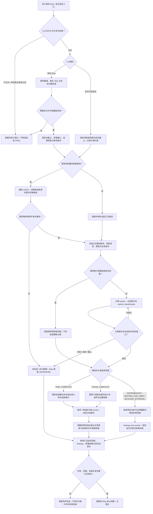
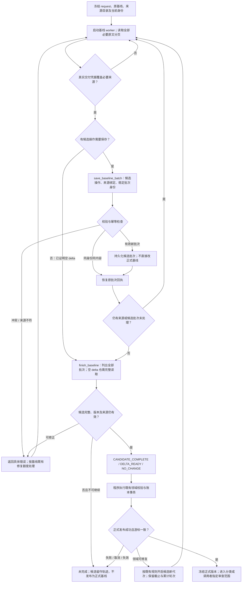
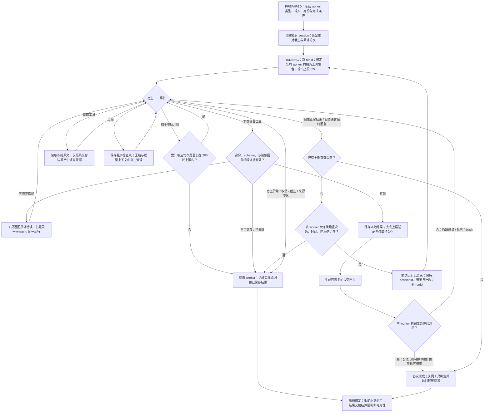
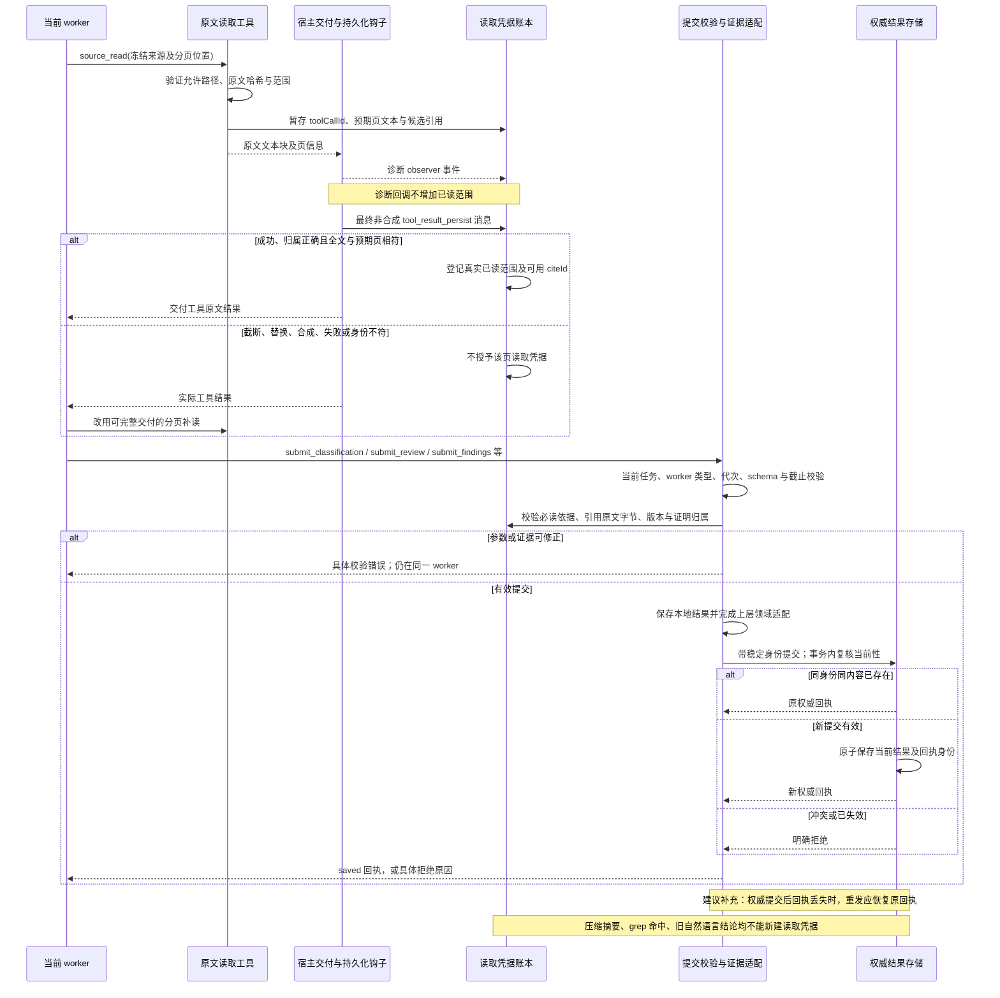
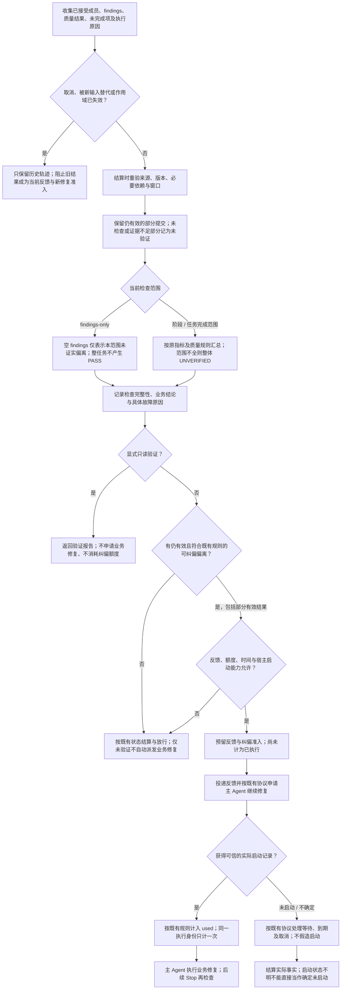
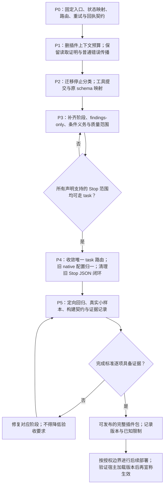

# Stop task 统一方案：详细流程与逻辑审查

- 日期：2026-10-27。
- 依据：[实施方案](stop-task-unification-implementation-plan.md)，以及本仓库当前实现的只读核对。
- 性质：目标设计图解及实施前审查记录；代码落地与验收结果单独记录于实施方案。
- 图中“建议补充”和第 8 节保留实施前的审查意见；现已固化的契约及实现状态见实施方案第 5、8、16 节。
- 最新输出配置决策：目标 Stop task worker 的单次模型输出上限设为 `maxTokens: 32768`（32k）；已写入 Stop 专用执行配置，发布验证见实施方案。
- 最新轮次配置决策：目标 Stop task worker 的累计助手响应上限设为 `maxTurns: 200`；分组成员、提交修正与续跑共享计数，已写入 Stop 专用执行配置，发布验证见实施方案。
- 后续已按实施方案重构代码；本图解保留设计解释，当前验证进度见实施方案第 16 节。MatrixAssistant 与其内置 OpenClaw 保持只读。

## 1. 判断

**整体设计合理，可以作为重构方向。它统一的是执行机制，而不是把所有业务职责揉成一个 Agent。**

保留宿主原生会话、去掉 Stop 旧的最终文本 JSON 协议，两者没有冲突。不同 worker 通过自己的工具提交结果，程序负责校验、保存和结算，比依赖模型最后一句话更明确。分类不充当验收、分组不合并成员结论、上下文管理不替代证据校验，这几条边界也成立。

原方案已经规定取消、部分结果、证据校验和有限续跑。实施前审查要求先补齐第 8 节的六项约定；本次已在实施方案中明确协议完成、真实范围、外层重试、权威提交、部分结果与工具绑定契约，并完成 P0—P4。发布前验收进度以实施方案第 16 节为准。

下面所有 Stop 模型工作都使用统一 task 底座。只有自动 Stop 具备既有的纠偏准入语义；显式只读验证不会因为统一执行层而获得业务修复权限。

## 2. 先区分几种“任务”和“完成”

- **业务任务**：用户要完成的实际工作，由业务 `taskId` 标识。
- **一次 Stop**：一次停止检查与结算，由 `stopId` 等既有身份标识；它可能执行多个 worker。
- **一次 worker task**：一次分类、基线提取、审查组或偏离检查。各自拥有输入、协议、检查点与完成条件。
- **私有宿主会话**：承载某个 worker task 的运行与续跑。不同 worker 不要求共用同一个会话。
- **一次宿主运行**：同一私有会话可以有限续跑；每次使用新的 `runId`，且前一次运行不能仍在执行。
- **候选代次/绑定代次**：用于防止旧候选、旧工具句柄或迟到结果写入新状态，不能只靠业务 `taskId` 区分。

还要分别理解三个完成条件：

1. **worker 协议完成**：要求的提交已被程序接受。合法提交 `UNVERIFIED` 也可以让该 worker 结束。
2. **本轮范围验收完整**：当前应审对象都得到足够结论，且引用、版本、条件与必要依赖仍有效。不能仅按回执数量判断。
3. **业务任务完成并通过**：只有真实的任务完成范围经过所需审查，且既有指标及质量规则允许，才可能成立。

以下场景都合法，但彼此不能混淆：分类完成而业务未完成；偏离检查完成且 findings 为空；某成员提交了 `UNVERIFIED`；阶段验收通过但实现阶段尚未开始。

## 3. 图一：完整 Stop 编排与范围路由

此图展开了原方案主图省略的入口分流、基线发布、分类失败和补充审查。自动 Stop 的基线刷新受既有开关与刷新需求控制，不要求每次重新提取全部材料。

范围选择必须由程序固化后交给 worker。worker 不得在修正工具参数时自行从阶段审查升级到整任务终审，也不得降为 findings-only 来绕过终审。

独立实现审查、文件质量审查及设备/执行证据采集沿用原有开关和证明归属；图中的“组合”不规定它们必须串行，也不要求复用同一个会话。若某个审查对象缺乏必要证据，应明确未验证，不能通过省略该对象缩小分母。

## 4. 图二：基线候选与正式账本的边界

基线 worker 完成的是**提取候选**。正式 Ground Truth 必须经程序原有账本与事务链发布，之后分类及审查才能绑定该正式版本。

统一执行层不意味着把基线领域修复次数改成普通审查的 `maxAttempts: 2`。两者的计数对象不同，仍应各自保留原语义。

## 5. 图三：一个 worker task 的执行、修正与有限续跑

“工具提交错误后修正”和“宿主运行结束后续跑”是两条不同回路。前者留在本次宿主运行中；后者才增加运行次数。

目标设计将本方案覆盖的 Stop worker 助手响应上限从当前代码的 100 轮调整为 `maxTurns: 200`。**200 轮属于这个 worker task，分组成员、提交修正与续跑共享计数，不是每次续跑重新获得 200 轮，也不是整次 Stop 所有 worker 合计 200 轮。** 普通审查首次宿主运行加最多一次续跑的规则保留；基线仍保留自己的领域修复机制。新分类和 findings worker 同样采用 200 轮上限，其完成与计数边界在 P0 固定。

目标设计将本方案覆盖的 Stop worker 单次输出参数统一为 `maxTokens: 32768`，替换当前的 `8192`。这是每次模型输出的上限，不是整个 task 的累计 token 预算或上下文窗口；不得因此重置截止、轮次或续跑次数。实施时须核对各调用层的显式覆盖及最终传入宿主的值，保持非 Stop 和其他宿主入口的原配置契约。

宿主异常不应伪装成格式错误重试。如果全部结果在异常前已完成权威提交，仍需按提交记录与当前性判断，而非仅凭宿主最后的错误覆盖有效结果。反过来，本地文件存在、最终文本声称成功，都不足以证明权威提交完成。

## 6. 图四：两类回执与结果提交的完整链条

这里有两种不同凭据：**读取凭据**证明某段冻结原文经过可信交付；**提交回执**证明某条本类结果经过程序校验并保存。二者不能互相替代。

最终持久化钩子是本仓库当前采用的可信交付边界，不等于能够证明模型在认知上“理解了原文”。若某宿主版本无法提供这一边界，适配层必须明确未验证，不能用更早的诊断回调替代。这个要求可以在插件侧做能力检查，不要求修改只读集成宿主。

提交链中至少要考虑三个中断点：本地结果保存后、上层结果存储提交前；上层提交后、回执返回前；回执已生成、检查点尚未保存时。恢复依据必须一致，不能一个层说已经保存，另一个层重新生成相反结论。

## 7. 图五：部分结果、最终状态与纠偏额度

**验收状态与宿主控制是两个维度。** `ALLOW` 不表示 `PASS`；`UNVERIFIED` 也不意味着删除已经证实的偏离。部分有效偏离能否继续反馈与准入，应由既有 Stop 核心决定。

- **仅审查窗口到期**：停止新增读取与提交，利用总截止之前的结算预留重验和处理仍有效的部分结果。
- **总截止到期**：不能继续模型工作，也不能产生过期有效的准入或验收结果；按既有超时与历史保存规则收尾。
- **显式取消或输入代次变化**：与普通审查到期不同，不继续用旧结果发起新的修复。
- **真实业务反例与执行故障**：前者可以形成有效偏离；后者只说明检查未完成，不能伪造成业务失败。
- **实际启动晚于准入有效期**：仍需按现有真实启动记账与协议违规处理，不能为了保持图面简单而抹去这类执行事实。

阶段范围通过只说明该阶段；findings-only 即使完整执行且为空，也不证明任务完成。成员级已确认偏离、整体 `UNVERIFIED`、当前控制是否允许继续可以同时存在。

## 8. 实施前建议补齐的六项契约

本节是实施前审查留档，其中“当前”“建议”描述当时的状态，不代表重构后的实现仍未处理；当前行为以实施方案和代码为准。

### 8.1 明确完成字段，避免继续复用含义不同的 complete

原方案已经要求不同 worker 有不同完成条件，但没有统一描述这些条件怎样映射到上层已有字段。

当前 `runReviewTask` 可以接受一个合法的 `UNVERIFIED` 提交并结束；而 `stop-review-store` 的 `summary.complete` 要求所有成员都不是 `UNVERIFIED`。因此，直接把 worker 的 `completed` 复制到 Stop 的 `complete` 会制造错误的整体完成状态。

建议在 P0 明确三个概念的字段映射：worker 协议是否结束、范围是否获得充分验收、该范围业务结果是什么。可以保留已有字段名，但必须有明确映射及反例测试，不需要顺带全仓改名。

检查点：合法 `UNVERIFIED` 成员可以结束 worker，但不能让整组验收完整；空 findings 可以结束偏离检查，但不能把 Stop 或业务任务标成验收通过。

### 8.2 写清所有入口的 worker 路由与冻结范围

原方案方向正确，但只修改 `reviewer.mjs` 工厂还不够。生产编排仍有分类、findings-only、逐项收集、同指标分组、文件质量和独立实现审查等调用点。

建议 P0 列出每类调用的 worker 类型、输入身份、完成工具、输出映射与异常状态，P2/P3 同步改调用者。还要明确：当前阶段来自哪份冻结工作流；哪些原文是分类必读；阶段审查包含哪些必要依赖；显式验证沿用哪种调用者范围。

当前显式验证入口直接选择当前产物验证范围，不要求模型分类；这是调用者选择的审查范围，不是声称业务已经完成。不能为了画一条统一线而强制再经过分类。

分类模型仍承担语义判断，不应宣称 schema 校验能证明分类必然正确。建议覆盖“仅规划完成”“声称实现完成但无执行证明”“等待用户但已存在可证实偏离”等反例；缺执行证明应影响后续验收结论，不应被用来擅自降低停止分类。

### 8.3 明确 task 续跑与外层准备重试的关系

当前存在至少三层不同机制：普通 review task 默认最多两次宿主运行；基线有自己的修复额度及候选代次；`assessStopCorrection` 对部分准备阶段故障最多尝试三次。

准备阶段又包着基线刷新和分类。只写“task 最多续跑一次”不能自动约束外层重新创建 task 的次数。若不处理，可能发生同一冻结逻辑工作被多次创建、累计轮次重新开始，以及已经保存的发现或候选被重复计算。

建议规定：哪些故障允许外层重试；重入时如何识别并恢复同一逻辑 worker；已完成步骤如何复用；什么变化才允许创建新代次。始终共享原绝对截止，且不能借外层重入绕过同一 task 的轮次与续跑限制。

这不是要求删除既有准备重试，也不要求把不同计数统一成一个数，而是避免计数边界被迁移意外改变。

### 8.4 规定提交的权威边界与中断恢复

原方案已经要求“持久化并通过上层适配后才产生有效回执”，方向正确；还应明确权威结果究竟在哪一层。

当前提交链先写本地 `decision.json`，再调用上层 `onItemResult`，最后更新 worker 已接受集合。建议把上层结果存储的接受记录作为对应生产审查项的权威依据，并规定从该记录恢复回执的方式。其他 worker 使用各自领域的权威记录，不强行共用 `submit_review`。

需要覆盖：本地保存但上层失败；上层保存后响应丢失；取消刚好发生在提交过程中；同批次并发重复调用；相同身份不同内容提交。事务中的任务/代次检查必须阻止迟到写入，不能只在工具入口检查一次。

合法重复恢复原回执，冲突明确拒绝。尚未获得权威接受的本地文件只能作为诊断或候选，不能直接进入当前指标汇总。

### 8.5 固定部分结果、整体状态和反馈资格的映射

原方案明确允许保存有效部分结果，但“允许参与结算”还需要精确到三件事：单项结果是否有效、整体是否验收完整、是否符合当前纠偏准入。

当前生产层会把不完整整体的 `PASS` / `DEVIATION` 状态规范为 `UNVERIFIED`，同时保留有效偏离供既有核心判断。因此不能简单规定“有一条偏离，整体就永远是 DEVIATION”，也不能规定“整体 UNVERIFIED，所以丢掉所有偏离”。

建议在 P0 固定这组已有行为，特别区分审查到期、总截止、显式取消、输入变化和普通宿主失败。报告、纠偏反馈、额度与主 Agent 状态要使用一致的判定依据。

### 8.6 把工具契约、宿主能力和缓存身份列成具体检查点

原方案已要求更新注册与版本，但执行时应明确到这些位置：`config/openclaw-tool-contracts.json`、`task-tools.mjs` 注册名单、`tool-contracts.mjs` 的分组处理、插件包工具声明和包契约测试。当前工具分组只有 `public`、`task`、`baseline`；新增提交工具若没有进入完整注册与打包链，worker 会有协议却无法调用。

分类与 findings 工具可以加入现有 task 工具组，也可以扩展分组处理；这是实现选择，不必为统一而固定一种命名方式。

缓存身份除移除旧 `contextLimits` 并提升协议版本外，还要确认已有键确实区分 worker 类型、分类/阶段范围、正式基线及必要输入。新的阶段结果不能被错当作任务终审缓存。

同时验证宿主支持最终原文交付观察、精确工具绑定与所需取消行为；能力缺失应在插件侧明确失败或未验证，不能为了完成迁移而修改 MatrixAssistant 或放宽读取证明。

## 9. 图六：实施依赖与验收门槛

开发期临时共存是迁移手段；最终发布不保留 Stop 的运行失败回退旧审查分支。发布后回滚使用经过验证的旧完整包，不在新包中增加隐藏双引擎。

## 10. 本轮核对到的实现依据

下面用于解释当前状态，不代表本轮运行过测试：

- `lib/runtime-v2/orchestrator.mjs`：生产准备先刷新/加载基线，再执行停止分类；显式验证可以跳过分类；存在过程偏离的窄范围复查。
- `lib/openclaw/reviewer.mjs`：当前 task 适配判断与旧最终文本链并存，基线有独立分支。
- `lib/runtime-v2/stop-task-review.mjs`：Stop 主审、条件义务及文件质量的适配条件仍主要限定 `TASK_COMPLETE`。
- `lib/runtime-v2/production-stop.mjs`：当前 findings-only 通过收集器进入；文件质量、独立实现审查、最终状态与纠偏分开组合。
- `lib/openclaw/task-session.mjs`：已有私有会话、同会话新运行身份、禁止并发运行、工具绑定与关闭机制。
- `lib/review-task/review-task.mjs`：已有工具提交、证据校验、成员保存、上层回调、累计轮次与有限续跑。
- `lib/openclaw/task-tools.mjs`、`lib/review-task/task-evidence.mjs`：读取证明依赖最终宿主持久化消息，诊断 observer 不授予原文读取证明。
- `lib/runtime-v2/stop-correction-assessment.mjs`：额度入口位于模型准备之前；存在最多三次的有限准备尝试；审查截止与结算截止分离。
- `lib/runtime-v2/stop-review-store.mjs`：逐项权威存储、当前性校验、部分结果与完整性语义。
- `lib/runtime-v2/stop-correction-store.mjs`：反馈预留与可信实际启动记账分离，同执行身份去重。
- `lib/review-task/baseline-task.mjs`、`lib/runtime-v2/baseline-task.mjs`：候选批次、完成回执、候选代次及正式基线发布边界。

本文最初用于方案理解与静态图解。后续已实施代码重构并执行回归；最新完成项、真实模型验收与部署边界见实施方案第 16 节。
