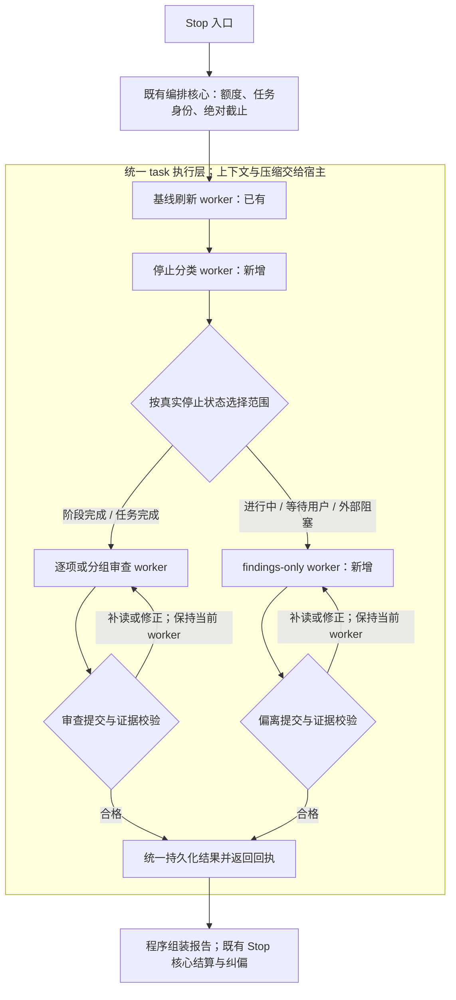

# Stop 审查统一到 task 的实施方案

- 日期：2026-10-27
- 状态：源码重构、自动化回归和安装包构建已完成；真实模型小样本和部署尚未执行，见第 16 节。
- 目标仓库：`C:\Users\user\workspace\program_workspace\runtime-corrector-toy`
- 本文中的代码路径均相对于目标仓库。
- 集成目标：MatrixAssistant / OpenClaw。两者的代码只读；实现、测试、文档及隔离实验放在 `runtime-corrector-toy`。

## 1. 目标与已确认的决策

将 Stop 链路统一为一套 task 执行框架。基线刷新、停止分类、阶段审查、进行中偏离检查、任务完成终审使用不同的 worker 协议，共用宿主会话创建与执行机制、工具绑定、证据读取、取消、截止时间和结果持久化机制。每个 worker task 拥有自己的私有会话，同一 task 的有限续跑复用该会话。

统一对象限定为 OpenClaw/MatrixAssistant 宿主的 Stop 执行路径。修改共享 `runtime-v2` 模块时，应保持其他宿主入口的既有契约，不能把跨宿主调用也强制改成 OpenClaw 私有会话。

本次采用以下决策：

1. Stop 审查只保留 task 执行路径，不保留 task 失败后切回旧 native 审查的回退路径。
2. 删除旧 Stop 的“模型最终回复整份 JSON → 程序解析 → 格式修复”闭环。
3. 完整删除 `REVIEWER_CONTEXT_BUDGET`，包括剩余的 32 KiB 单次结果阻断、上下文 guard 和专用错误处理。上下文窗口、原生压缩及宿主工具结果处理交给 OpenClaw。
4. 保留程序侧的参数、任务归属、必读依据、引用、原文字节、版本、适用条件和业务证据校验。
5. 保留逐项判断和持久化回执。分组只共享会话与公共材料，不共享结论，不改变指标分母。
6. 保留现有业务截止、取消、纠偏额度和 task 的有限续跑机制；将本方案覆盖的 Stop task 助手响应轮次上限从现有 100 轮调整为 `maxTurns: 200`。分组成员、提交修正及续跑共享计数；该上限不用于判断上下文大小。
7. 本方案覆盖的 Stop task worker 单次模型输出上限统一设为 `maxTokens: 32768`（32k），替换现有 Stop worker 的 `8192` 设置。这是单次输出参数，不是上下文窗口或整个 task 的累计 token 预算；模型选择和 effort 行为保持原契约。

“一条路径”指一套执行框架，不要求把不同职责合成一个 Agent，也不要求所有 worker 使用同一个提交工具。

## 2. 实施前状态与问题（留档）

本节记录重构前盘点；当前实现与验证结果以第 16 节为准。

### 2.1 已完成的前序改动

- `reviewer-context.mjs` 中的 64 次工具调用上限已经删除。
- 调用次数仍用于诊断。
- 源码和本机安装副本曾同步该改动，相关 48 项定向测试通过。
- 以上验证仅针对前序改动，不构成本方案的验收结果。

### 2.2 仍待处理

- `lib/openclaw/reviewer-context.mjs` 仍会因单次结果超过 32 KiB 抛出 `REVIEWER_CONTEXT_BUDGET`。
- `lib/openclaw/reviewer.mjs` 仍创建 guard，且缓存身份包含 `REVIEWER_CONTEXT_LIMITS`。
- `lib/openclaw/runtime.mjs` 仍专门捕获该错误并拦截工具调用或替换工具结果。
- 当前默认 `stopReviewEngine: task` 只覆盖适配器支持的范围。
- 停止分类仍使用旧 native 最终 JSON 协议。
- Stop 主审的阶段完成、进行中偏离检查等范围尚未全部进入 task。
- 当前 task 已有 `submit_review`、程序证据校验、逐项保存与续跑能力，可以作为统一基础。

### 2.3 不要误判的现状

- 新 task 与旧 native 都使用 OpenClaw 原生会话底座；不能删除宿主原生执行能力。
- 目前不支持的 task 分组会明确报错，不能把现有逻辑描述成“task 失败后静默重跑 native”。
- `reviewer.mjs` 仍服务其他非 Stop 角色，不能直接删除整个文件及其全部 JSON 处理函数。
- 文件名含 `native` 不表示它属于待删除的旧审查协议；Stop 等待、会话身份、启动回执和反馈投递等宿主适配仍可能需要。

## 3. 统一后的流程与职责



图中的修正回路只返回当前 worker；实际实现不得把审查任务在不同类型之间互相切换。分类提交同样通过专门的校验和回执结束，不依赖最终文本 JSON。

职责划分：

- **宿主**：模型调用、上下文窗口、原生压缩、宿主自身的工具结果处理及模型运行错误。
- **task 执行层**：私有会话身份、精确工具绑定、工具结果回执观察、worker 生命周期、任务检查点、取消和剩余执行时间。
- **worker**：本类任务的输入、工具、提交协议及完成条件。
- **证据适配层**：冻结来源、真实读取凭据、原文引用、指标约束和结果映射。
- **Stop 核心**：状态与指标汇总、纠偏额度、反馈交付、修复准入及最终结算。

## 4. 实施范围

### 4.1 必须覆盖

- 自动 Stop 的基线刷新和停止分类。
- `TASK_COMPLETE` 下的逐项、同指标分组、条件义务和启用时的文件质量审查。
- `STAGE_COMPLETE` 下限定当前阶段的审查及启用时的文件质量审查。
- `INTERMEDIATE`、`WAITING_FOR_USER`、`BLOCKED_EXTERNAL` 下的 findings-only 检查。
- 显式只读验证；保留其由调用者确定范围、可跳过分类的现有语义。
- 当前已接入 task 的 Stop 相关独立实现审查和证据适配。

### 4.2 本次不顺带改变

- 指标定义、分母、Ground Truth 权威等级与冻结规则。
- 纠偏额度的计数方式、主 Agent 的业务修复方式。
- 非 Stop 的 onboarding、Skill、普通产物审查协议。若这些角色仍需要通用旧工厂，其代码必须保留，Stop 不得再进入该分支。
- 当前模型选择、effort 及非目标调用的输出配置行为。本次只将目标 Stop task worker 的单次输出上限调整为 `maxTokens: 32768`，详见第 8.3 节。`maxTokens` 不等于 `REVIEWER_CONTEXT_BUDGET`，也不能据此宣称所有模型参数均已改为完全继承宿主。
- 源码采集的平台配置。当前 Python 任务配合 `platform: harmonyos` 导致的源码清单为空，是独立问题，不能通过执行层统一自动解决。

## 5. Worker 与提交协议

下列分类、findings 协议及其 Stop 适配已在本次重构中新增；公共实现还包括 `lib/review-task/protocol-task.mjs`、`stop-policy.mjs` 和 `lib/runtime-v2/stop-protocol-task.mjs`。

### 5.1 基线刷新 worker：复用已有实现

- 复用 `lib/review-task/baseline-task.mjs` 与 `lib/runtime-v2/baseline-task.mjs`。
- 保留 `save_baseline_batch`、`finish_baseline` 和原始来源绑定。
- 候选不得绕过原账本链直接写入正式 Ground Truth。
- 完整 delta 与来源游标仍按现有事务机制发布；部分候选不能冒充完整基线。

### 5.2 停止分类 worker：新增

本次新增：

- `lib/review-task/classification-task.mjs`：分类任务协议。
- `lib/runtime-v2/stop-classification-task.mjs`：Stop 输入冻结与现有 schema 映射。

输入由程序提供：冻结的原始用户要求、最新助手响应、必要的当前阶段依据、来源身份以及任务身份。材料按需选择，但被标记为分类必要依据的材料必须完整读取。

建议新增工具 `submit_classification`，提交字段沿用既有名称：

```json
{
  "stopClassification": "STAGE_COMPLETE",
  "stage": "design",
  "summary": "本次响应声称当前设计阶段完成，后续实现尚待执行。"
}
```

程序必须校验：

- 分类只允许既有五种枚举值，不新增隐式成功状态。
- `STAGE_COMPLETE` 的阶段与当前冻结的工作流范围相符。
- 工具调用属于当前分类会话，输入及必要读取凭据仍有效。
- 分类提交中不得包含指标 PASS、业务 findings 或文件质量结论。
- 程序映射回当前 Stop 分类结果，必要的空数组等结构由程序补齐。

分类只决定后续检查范围，不证明业务完成或验收通过。无法有效分类时返回明确的分类未完成状态，整次 Stop 保留 `UNVERIFIED`；不得默认降为 `INTERMEDIATE` 来绕过终审。

### 5.3 逐项与分组审查 worker：扩展已有实现

复用：

- `lib/review-task/review-task.mjs`
- `lib/runtime-v2/stop-task-review.mjs`
- `lib/runtime-v2/stop-task-group.mjs`

实施要求：

- 将当前只适配 `TASK_COMPLETE` 的约束改为显式支持阶段和任务完成两种范围。
- 不得通过把 `STAGE_COMPLETE` 改写成 `TASK_COMPLETE` 来复用现有分支。
- 阶段审查只接收程序选出的当前阶段义务、适用条件和必要依赖，不扩大成整任务验收。
- 分组保持同一指标、每个原始成员独立提交；组 ID 不能替代成员 ID。
- `BASIS_PENDING`、无效对象或缺少必要来源应明确未验证或报告适配错误，不切回旧引擎。
- 保留 M16 生产实现证明、M12 执行证明、过程义务和条件义务的现有证明归属，不能只保留 JSON 格式校验。
- 文件质量审查仍受原开关控制，同时补齐阶段范围下的适配。

### 5.4 findings-only worker：新增

本次新增：

- `lib/review-task/findings-task.mjs`
- `lib/runtime-v2/stop-findings-task.mjs`

职责是检查当前范围内已有证据能证明的偏离，不生成完成率或整任务 PASS。

建议以 `submit_findings` 提交经过校验的 findings 批次，并由显式完成工具结束本轮检查；具体工具数量可以按现有批次协议复用。

不要为了复用 `submit_review` 而构造虚拟指标对象或伪造一个 PASS verdict。这个 worker 使用独立的提交 schema 和完成条件，共享 task 执行接口即可。

必须满足：

- 每条 finding 绑定原始义务、当前任务与真实证据，引用使用读取工具产生的身份。
- 批次按稳定身份持久化，相同提交幂等，冲突提交明确拒绝。
- 空 findings 只表示“本次限定范围内未确认可证明偏离”，不表示任务完成或指标全部通过。
- 空结果不能替代必要依据读取；未完成检查时明确记录未验证。
- 发生取消或截止时，已保存的有效 findings 可参与现有结算，未完成部分不能冒充检查完毕。

## 6. 统一执行与路由

### 6.1 复用一个会话底座

继续使用 `lib/openclaw/task-session.mjs` 的私有会话和工具绑定能力。worker 提供工具、提示词、完成判断及检查点接口，执行层不根据 `submit_review` 的工具名推测任务已经结束。

各 worker 共用以下规则：

- `sessionId` 在同一 task 续跑期间保持不变，每次宿主运行使用新的 `runId`。
- 正在执行的一个 task 不能并发启动第二次宿主运行。
- 仅当前绑定会话可以调用任务工具；关闭或代次替换后拒绝迟到调用。
- 工具提交持久化并通过上层适配后才产生有效回执。
- 最终自然语言回复只用于展示，不是成功完成的权威信号。
- worker 协议完成与业务验收通过分别映射：合法 `UNVERIFIED` 提交可以结束 worker，但不令 Stop 范围验收完整。
- 分类及 findings 由 `protocol-task.mjs` 共用读取凭据、检查点、截止与有限续跑；原有逐项/分组与基线领域协议保留。
- OpenClaw Stop worker 的失败带 `stopTaskFailure` 标记，外层准备阶段不重新创建同一 worker 来重置轮次；其他宿主的原有准备重试契约保留。
- findings 批次先通过领域证据校验和持久化，再经上层批次回调保存为程序记录，之后返回回执；空结果必须显式调用 `finish_findings`。

### 6.2 Stop 工厂必须直接路由到 task

调整 `lib/openclaw/reviewer.mjs` 和 `lib/openclaw/stop-task-runtime.mjs`：

- Stop 请求由程序提供明确的 worker 类型，先校验输入，再派发到对应 task。
- `canUseStopTaskReview` 等能力判断可以保留为输入校验，但不得再充当“失败就选择旧 native”的路由开关。
- 所有声明支持的 Stop 范围都能到达对应 task；不支持的范围返回明确故障或未验证。
- 非 Stop 角色可以继续复用既有通用代码，但 Stop 请求不能落入最终文本 JSON 分支。

### 6.3 兼容旧配置，不保留第二条引擎

当前 `packaging/hosts/openclaw/openclaw.plugin.json` 接受 `stopReviewEngine: task | native`，`runtime.mjs` 会读取它。

本次采用一个兼容发布周期：

- 缺省或 `task` 均使用唯一 task 实现。
- 旧值 `native` 也归一到 task，并给出一次明确的弃用提示，不启动旧执行分支。
- 未知值仍按既有配置校验规则报错。
- 后续版本再删除这个无实际选择作用的配置键。

这样无需修改只读集成目标的代码，也不会因用户残留旧配置而在加载阶段中断。保留旧输入值不等于保留旧审查引擎。

## 7. 完整删除插件上下文预算保护

### 7.1 代码删除清单

- [ ] 删除 `lib/openclaw/reviewer-context.mjs`；确认构建清单中不再包含它。
- [ ] 删除 `reviewer.mjs` 对 `createReviewerContextGuard`、`REVIEWER_CONTEXT_LIMITS` 的导入、实例化及调用。
- [ ] 删除缓存身份中的 `contextLimits`，并提升审查协议或缓存身份版本，避免错误复用迁移前的结果。
- [ ] 删除 `runtime.mjs` 中 `isReviewerContextBudgetError` 的导入和两处专用捕获分支。
- [ ] 删除因 32 KiB 单次结果而中止审查、替换工具结果或建议未验证的提示词和逻辑。
- [ ] 清理活跃文档中“仍保留 32 KiB 上下文保护”的说明，替换为宿主管理上下文的责任边界。

删除专用捕获时，要保留普通工具观察、读取凭据和其他异常传播。不能为了删 guard 而一起删掉 `observeReviewReads`、`readProof` 或私有会话隔离。

### 7.2 宿主处理上下文后，RC 仍必须做什么

- 只根据宿主实际完成交付的原文消息建立读取凭据。
- 宿主截断、改写或未完整交付时，未收到的内容不能计入“已读”。
- 对缺失的必要原文继续分页读取；无法补齐则明确 `UNVERIFIED`。
- 保留哈希、版本、范围、任务身份与最终回执校验。
- 宿主上下文溢出、输出截断、压缩失败或运行失败，记录为实际宿主/执行故障；不能生成虚假的业务偏离或 PASS。

`source_read` 的行数/字节分页和传输文本分块属于正常材料交付，不是累计上下文预算。可以保留分页与 `nextOffset`，但不得重新包装成另一个“达到读取量就中止”的限制。

## 8. 时间、轮次与提交重试

### 8.1 保持现有业务时间预算

项目当前配置示例为：一次 Stop 总预算 60 分钟，结算与反馈预留 3 分钟，角色默认审查时限 30 分钟。实际审查会话取角色时限、Stop 剩余审查窗口和宿主更早截止中的最小值。

这些数值来自当前项目配置，不是实现中的新固定默认值。不得把“每个助手轮次”解释为重新拥有 20 或 30 分钟。

### 8.2 task 的执行边界与 200 轮上限

- 本方案覆盖的 Stop task worker 统一设为 `maxTurns: 200`，替换现有 100 轮设置。每个 worker task 内的分组成员、提交修正及续跑共享累计计数；不是每次运行各 200 轮，也不是整次 Stop 所有 worker 合计 200 轮。
- 在 Stop 专用配置或调用层统一提供该上限，核对普通审查、基线及新增 worker 的默认值和显式覆盖，避免残留 `maxTurns: 100` 使上限仍为 100 轮；保持非 Stop 及其他宿主入口的既有配置契约。
- 当前 `maxAttempts: 2` 表示首次宿主运行加最多一次续跑，不是首次之后再重试两次。
- 可修正的工具参数或证据校验错误在同次运行内反馈，Agent 可以修正后重新提交；不为每次错误重新建立 task。
- 首次宿主运行正常结束但没有全部有效提交时，才进入现有有限续跑机制。
- 宿主异常、取消、截止、来源变化等终止条件不能被当作“格式错误”无限重跑。
- 任何重试都不重置原绝对截止、200 轮累计计数或已保存成员的身份。

基线刷新已有领域修复与候选代次机制，应保留其语义；不为了统一执行层而强行把所有 worker 的领域修复次数都改成相同值。

### 8.3 单次模型输出上限设为 32k

- 本方案覆盖的基线刷新、停止分类、逐项/分组审查、findings-only、文件质量及 Stop 相关独立实现审查，均以 `maxTokens: 32768` 作为单次模型输出上限。
- 该值是允许的输出上限，不要求每次输出满 32k，也不限制一个 task 多轮累计使用的 token 数；上下文窗口和压缩仍由宿主管理。
- 在 Stop 专用配置或调用层统一提供该值，清理该调用链中显式写入的 `8192`，避免只改底层默认值却被上层重新覆盖。涉及 `review-task.mjs`、`baseline-task.mjs`、`stop-task-review.mjs`、`stop-task-group.mjs` 及新增 worker 的调用时，均须核对最终传入宿主的值。
- 共享模块仍需保持非 Stop 角色及其他宿主入口的既有配置契约，不因本次调整扩大修改范围。
- 宿主或模型不接受该输出参数时，返回明确的配置/执行故障，不能静默沿用 `8192` 并宣称 32k 已生效。实施验收以实际传入宿主模型配置的参数为准。
- 调整输出上限不改变绝对截止、第 8.2 节规定的 200 轮累计计数、有限续跑或提交证据校验。

## 9. 删除旧 Stop 闭环的边界

迁移完成后删除下列 Stop 专用旧实现；只有仍被非 Stop 角色或其他宿主实际使用的共享代码可以保留，且 OpenClaw Stop 不能进入这些分支：

- 旧审查的 request → 索引 → TXT 包装与读取链，只清理其 Stop 专用部分。
- 依赖模型最终文本的 `parseResult` 调用及旧 `canonicalAssessment` 映射，仅针对 Stop 调用链。
- 旧 Stop 的 `formatRepairAttempts` 最终 JSON 修复循环。
- 为旧 Stop 保存整份模型 JSON 的专用中间协议。
- task/native 双执行分支与旧 Stop 引擎相关的能力开关。

仍需保留：

- 程序组装后的汇总报告 schema 校验。
- 通用工具 schema 和领域证据校验。
- OpenClaw 原生 transport、版本适配、会话关闭与隔离。
- 非 Stop 角色仍在使用的解析或修复代码，直至这些角色另行迁移。
- 既有 Stop 等待、修复准入、反馈投递、事务及历史轨迹。

不得删除历史 `.runtime-correction` 记录，也不能修改旧轨迹来让历史错误看起来已经修复。

## 10. 分阶段实施任务

每个阶段应形成可独立评审的提交；迁移完成前的临时共存仅用于开发过程，不作为最终生产双路径。

### P0：固定契约与现状基线

- [x] 记录所有 Stop 入口与角色调用，确认自动 Stop、显式验证、阶段完成和 findings-only 的范围选择。
- [x] 为当前额度、基线事务、分类枚举、指标分母和反馈交付补充必要的行为断言。
- [x] 明确 worker 类型、输入身份、完成条件和回执结构。
- [x] 固定非 Stop 角色不进入本次重构范围的边界。

完成条件：后续开发有可执行的行为契约，不能用“删功能”来让统一路径测试通过。

### P1：删除 `REVIEWER_CONTEXT_BUDGET`

- [x] 完成第 7 节清理。
- [x] 将旧 guard 测试替换为“上下文由宿主管理、RC 不按大小或次数中止”的测试。
- [x] 验证较大工具结果、超过旧次数的读取和宿主压缩不会触发 RC 自建预算错误。
- [x] 验证宿主未完整交付时仍不能产生完整读取证明。

完成条件：生产 `lib/` 不再引用该错误码、guard 或限制常量；缺失证据仍无法通过校验。

### P2：迁移停止分类

- [x] 实现分类 worker、提交工具和现有分类 schema 映射。
- [x] 自动 Stop 分类统一通过 task-session 执行。
- [x] 覆盖五种停止状态、非法提交、无法分类、取消及截止。
- [x] 保留显式验证可以由调用者直接确定范围的现有入口。

完成条件：停止分类不再解析模型最终文本 JSON，且分类结果不能充当验收 PASS。

### P3：补齐阶段、findings-only 和质量审查范围

- [x] 扩展阶段审查适配，保持阶段过滤与依赖范围。
- [x] 实现 findings-only worker，空结果不产生任务 PASS。
- [x] 补齐条件义务、文件质量开关、独立实现审查的任务绑定。
- [x] 验证部分提交后截止时，只结算实际保存且仍有效的项。

完成条件：声明支持的 Stop 范围全部可以通过 task 执行，不依赖旧协议。

### P4：收敛路由与配置

- [x] Stop 工厂始终选择 task worker；不支持的输入明确失败或未验证。
- [x] 按第 6.3 节兼容旧 `stopReviewEngine` 输入，删除实际引擎选择分支。
- [x] 按第 9 节删除旧 Stop JSON 闭环，并检查非 Stop 调用者。
- [x] 按第 8.2 节将目标 Stop worker 的轮次上限统一为 `maxTurns: 200`，清理该调用链中的旧默认值及显式 100 轮覆盖。
- [x] 按第 8.3 节将目标 Stop worker 的单次输出上限统一为 `32768`，核对现有显式覆盖和新增 worker，避免残留 `8192` 覆盖。
- [x] 更新工具注册、缓存身份、协议版本、构建清单和包内工具契约。

完成条件：旧配置 `native` 也不能使 Stop 进入旧执行链；旧配置仍可按兼容策略加载。

### P5：回归、真实小样本和发布

- [x] 通过第 11 节自动化测试。
- [ ] 进行第 12 节真实小样本验收，保存完整轨迹和提交回执。
- [x] 构建新安装包，核对包内已无 guard、旧 Stop 路由与旧配置执行分支。
- [x] 更新文档并记录测试结果、已知限制和构建版本；本次未发布新版本。
- [ ] 验证完成后再部署安装副本；确认宿主重新加载了新包后，才宣称运行时已生效。

## 11. 测试清单与运行方式

### 11.1 现有测试的主要修改位置

- `test/openclaw-reviewer-context.test.mjs`：删除 32 KiB 阻断预期，保留读取凭据、缓存与宿主配置继承相关测试。
- `test/openclaw-task-runtime.test.mjs`：统一 worker 执行、同会话续跑、新运行身份、共享截止与迟到回执隔离。
- `test/review-task-engine.test.mjs`、`test/review-task-cancellation.test.mjs`：有效提交、错误反馈、部分结果、取消和轮次边界。
- `test/stop-task-review.test.mjs`、`test/stop-task-group.test.mjs`、`test/stop-task-all-metrics.test.mjs`：逐项、分组、阶段范围及指标证明语义。
- `test/stop-task-factory.test.mjs`、`test/stop-task-compat.test.mjs`：单路分发、旧配置归一、不得回退旧审查。
- `test/stop-production-entry.test.mjs`、`test/stop-preparation-scope.test.mjs`、`test/stop-checker-fail-closed.test.mjs`：完整入口、阶段过滤、故障状态。
- `test/stop-baseline-task.test.mjs`：基线来源绑定、候选代次与事务发布不退化。
- `test/stop-task-package.test.mjs`：安装包工具、配置和旧模块清理。

本次新增 `test/stop-classification-task.test.mjs`、`test/stop-findings-task.test.mjs` 验证两个协议，并新增 `test/stop-task-production-protocol.test.mjs` 验证真实生产入口通过工具回执完成阶段与任务审查。上述生产入口测试使用脚本化模型，不等于真实模型准确性验收。

### 11.2 必须覆盖的用例

- [x] 五种分类状态均通过分类工具提交，而不是模型最终文本。
- [x] 错把 schema 定义当提交结果时被拒绝，能在同一会话中修正。
- [x] 错误 task ID、额外字段、非法 verdict、未读依据和伪造引文均被拒绝。
- [x] 任务完成与阶段完成使用各自真实范围；不能用改写分类来获得支持。
- [x] 同组成员逐项保存、部分保存后故障、重复提交和冲突提交行为正确。
- [x] findings-only 空结果不产生任务完成、业务 PASS 或伪造指标分母。
- [x] 超过旧 64 次读取、旧 32 KiB 返回大小不触发 RC 自建预算中止。
- [x] 宿主截断或替换工具结果时，只有完整真实交付的内容可获得读取凭据。
- [x] 压缩后的检查点、已提交结果及读取身份保持有效；不能把压缩摘要升级为原文证据。
- [x] 所有目标 Stop worker 使用 `maxTurns: 200`，覆盖第 200/201 轮边界；分组成员与续跑共享累计计数，续跑不重置时间、冻结身份和已保存结果。
- [x] 所有目标 Stop worker 实际传入宿主模型配置的 `maxTokens` 均为 `32768`；非 Stop 及其他宿主的输出配置契约保持原样。
- [x] 取消、截止、输入变化或宿主失败后，迟到工具及回执不能写入新代次。
- [x] 旧 `stopReviewEngine: native` 按兼容策略仍只进入 task。
- [x] 非 Stop 角色、主 Agent 权限和既有纠偏额度不受本次迁移破坏。

### 11.3 Windows 定向验证命令

在目标仓库执行。使用当前测试进程独立的临时目录，避免系统临时目录权限影响文件锁与原子写入。

```powershell
New-Item -ItemType Directory -Force .runtime-correction/test-temp | Out-Null
$env:TEMP = (Resolve-Path .runtime-correction/test-temp).Path
$env:TMP = $env:TEMP

$targetTests = @(
  'test/openclaw-reviewer-context.test.mjs'
  'test/openclaw-task-runtime.test.mjs'
  'test/review-task-engine.test.mjs'
  'test/review-task-cancellation.test.mjs'
  'test/stop-baseline-task.test.mjs'
  'test/stop-classification-task.test.mjs'
  'test/stop-findings-task.test.mjs'
  'test/stop-task-review.test.mjs'
  'test/stop-task-group.test.mjs'
  'test/stop-task-all-metrics.test.mjs'
  'test/stop-task-factory.test.mjs'
  'test/stop-task-compat.test.mjs'
  'test/stop-production-entry.test.mjs'
  'test/stop-preparation-scope.test.mjs'
  'test/stop-checker-fail-closed.test.mjs'
  'test/stop-task-package.test.mjs'
  'test/stop-task-production-protocol.test.mjs'
)
node --test @targetTests
```

新增测试文件应在 P2/P3 实现后创建，不能在文件缺失时直接宣称这组命令已经验证。若测试涉及目录链接，须使用支持相应操作的本地执行权限；不能通过删除缓存一致性断言绕过。

需要无模型宿主契约测试时，按现有项目文档设置只读的 `RC_OPENCLAW_HOST_ROOT`，不得修改 MatrixAssistant 或其内置 OpenClaw。

## 12. 真实小样本验收

至少保留以下轨迹：

1. **阶段完成 → 实现完成**：先只完成规划文档，再完成代码与测试。前后两次均走 task，但前一次保持阶段语义，后一次执行任务终审。
2. **进行中 / 等待 / 外部阻塞**：通过 findings-only worker 检查当前可证明偏离，不能误记为整个任务完成。
3. **长材料与压缩**：使用超过旧大小/次数限制的原文。不得出现 `REVIEWER_CONTEXT_BUDGET`；宿主完整交付时可以建立证据，截断时必须补读或保留未验证。
4. **无效提交后修正**：让第一次工具提交缺字段或引用未读证据，确认收到具体错误，修正后保存回执；已保存成员不重审。
5. **取消与截止**：在有部分回执时取消或到期，确认只保留真实提交结果，迟到数据不能复活任务。

记录应包含入口分类、worker 类型、会话和运行身份、工具错误、单项回执、最终结算状态及实际耗时。不能仅凭最终消息或总 PASS 数证明迁移成功。

源码采集错误须单独记录；执行层统一不能使空源码清单自动变成有效实现证据。

## 13. 完成标准

以下区分源码统一与发布验收；完成真实模型验收及安装副本部署前，不宣称宿主已加载新版本：

- [x] 所有目标范围均使用统一 task 会话底座与类型明确的 worker。
- [x] Stop 不再消费模型最终文本 JSON 作为完成结果。
- [x] Stop 不再进入旧 native 审查及其格式修复循环。
- [x] 活跃生产代码不再包含 `REVIEWER_CONTEXT_BUDGET`、`createReviewerContextGuard` 或 `REVIEWER_CONTEXT_LIMITS`。
- [x] 不存在换名后的累计读取量或单次结果上下文预算中止。
- [x] 目标 Stop task worker 的轮次上限统一为 `maxTurns: 200`，具有边界及续跑累计计数验证；业务截止仍可能更早终止执行。
- [x] 目标 Stop task worker 的单次输出上限统一为 `maxTokens: 32768`，并有宿主参数传递验证；不能仅凭文档或底层默认值宣称生效。
- [x] 程序证据校验、逐项回执、业务截止、取消与纠偏额度全部保留。
- [x] 历史数据不被删除或重写，缓存与协议版本能区分迁移前后结果。
- [x] 定向回归和构建契约通过。
- [ ] 第 12 节真实模型小样本证据齐全。
- [x] MatrixAssistant 及其内置 OpenClaw 的代码未被修改。

## 14. 回滚原则

迁移开发期可以按阶段回退尚未发布的提交。发布后发生问题时，应恢复上一个经过验证的完整插件包，不在新版本中增加自动切回旧审查的隐藏分支。

不得通过清空历史、改写验证结果、降低证据要求或把所有停止状态标成 `TASK_COMPLETE` 来恢复表面可用性。

## 15. 后续重构执行提示

后续工作先核对第 16 节，继续尚未完成的验收；不重复执行已经完成的 P0—P4。只修改 `runtime-corrector-toy`；集成宿主只读。不要扩大到非 Stop 角色，不改变指标语义，不重新引入插件上下文预算。每阶段完成后记录修改文件、通过的检查、未覆盖场景及下一阶段依赖，最终以第 13 节逐项验收。

## 16. 本次实施记录

- 已实现：唯一 OpenClaw Stop task 路由、分类与 findings 提交协议、阶段范围及质量审查、200 轮/32k Stop 专用配置、最终原文读取证明、按运行代次绑定的工具与取消、部分 findings 批次保存。
- 已删除：`reviewer-context.mjs`、预算专用捕获、Stop 最终文本 JSON 分支中的专用处理和旧引擎选择；非 Stop 通用解析及其他宿主入口保留。
- 已同步：工具注册与包内声明、运行模块清单、缓存协议版本、活跃文档和回归用例。
- 额外修正：关闭会话时等待已启动的运行状态持久化，避免 Windows 清理与后台写入竞态；已结束运行的工具信号立即失效。
- 已验证：`node scripts/test.mjs` 全量回归 141 个文件全部通过，共 1652 项测试，1643 通过、9 跳过、0 失败、0 超时；日志为 `.runtime-correction/stop-unification-final-rerun.log`。设置只读 `RC_OPENCLAW_HOST_ROOT` 后执行，包含真实 MA Hook Runner 的无模型契约测试。另行复跑 Windows 文件收尾和子进程 watchdog 的 15 项测试全部通过。
- 已构建：`node scripts/build-plugin.mjs --all` 成功生成 `dist/runtime-corrector-claude`、`dist/runtime-corrector-codeagent`、`dist/runtime-corrector-openclaw`。构建沿用仓库版本 `1.9.1`，未发布新版本；构建产物核对不替代宿主加载验证。
- 已核对：源码及构建产物中旧 guard 模块和预算符号均无残留；Stop 使用新协议与工具回执，兼容配置 `native` 仍归一为 task；非 Stop 通用路径保留。`git diff --check` 通过。
- 尚未执行：带真实模型的第 12 节小样本，以及部署/重新加载安装副本。不能将脚本化模型或无模型宿主测试当作上述验收，也未修改 MatrixAssistant 或其内置 OpenClaw。
